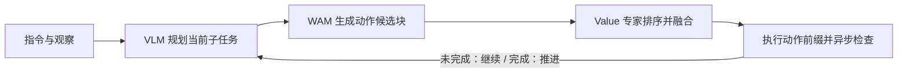
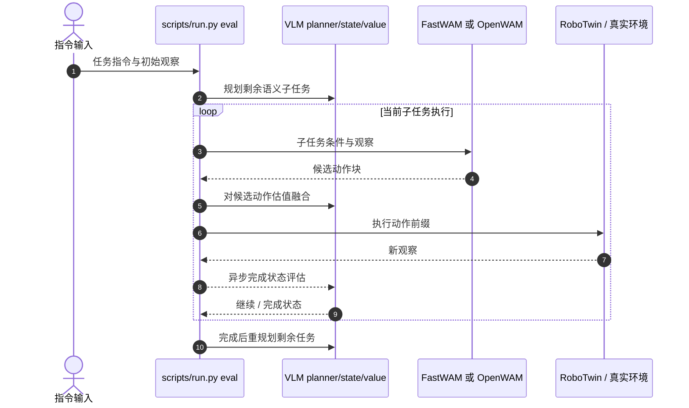

# LAW：以语义子任务进度统一语言、动作与世界建模

**LAW**（*Unifying Language, Action, and World Modeling for Agentic Physical Intelligence*，[arXiv:2610.23334](https://arxiv.org/abs/2610.23334)）由**北京大学与北京人形机器人创新中心（X-Humanoid）**提出，是面向长时程操作的闭环 VLM–WAM 系统：VLM 规划语义子任务并异步检查阶段完成，WAM 提出动作块，价值专家按当前子任务评估和融合动作候选。

## 一句话定义

LAW 用当前语义子任务把语言规划、世界-动作模型的候选生成、动作价值排序和执行状态检查串成反馈闭环。

## 英文缩写速查

| 缩写 | 英文全称 | 简要说明 |
|------|----------|----------|
| LAW | Language, Action, and World Modeling | 本文闭环智能体系统 |
| VLM | Vision-Language Model | 规划子任务并评估执行状态/动作价值的视觉语言模型 |
| WAM | World Action Model | 与视频世界表征联合建模并生成动作块的模型 |
| MoTE | Mixture-of-Transformer Experts | WAM 中为视频、动作流路由私有及共享专家的结构 |
| RoboTwin | — | 论文用于仿真操作评测的 50 任务基准 |

## 为什么重要

长时程任务的失败常来自阶段管理：抓取没成功却切换目标，或已经完成一个子目标仍持续执行旧动作。LAW 将**阶段进度**变成语言规划与低层动作之间的接口，令系统能在动作执行过程中并行检查结果，并在确认阶段完成后重新计划。它把“做什么、动作是否符合当前目标、何时推进任务”纳入同一个控制回路。

## 核心原理

### 系统分工

- **Planner 专家：** 根据指令、当前观察与 VLM 记忆，规划剩余语义子任务；当前子任务是动作生成的条件。
- **WAM：** 联合视频与动作表征生成多个动作块候选。LAW 报告的设计包含 FastWAM 与 OpenWAM 后端。
- **Value 专家：** 按当前子任务对候选动作估值，对 32 个候选排序并融合 top-8。
- **State 专家：** 对新观察异步判断当前子任务是否完成。推理与动作执行并行；过期或属于旧子任务实例的结果会被丢弃。
- **推进规则：** 未确认完成则继续当前目标；完成后保存阶段边界观察、更新计划并切换到下一个子任务。

WAM 的 MoTE 结构让视频与动作 token 先交换信息，再经模态专属路由进入私有专家或共享专家。系统为 VLM 与 WAM 保留各自的分层视觉记忆，较近观察和子任务边界观察保留较高空间细节，较旧历史压缩。价值学习以语义子任务为单位构造目标，因此长轨迹后半段失败时，先前已成功阶段仍可作为有效监督前缀。

### 流程总览

评估异步运行，因此阶段检查无需阻塞每个动作块。论文称并行状态评估提高推理吞吐；这一系统设计适合需要显式阶段边界的长时程任务。

## 源码运行时序图

官方仓库 scripts/run.py 提供检查点推理/评估入口；FastWAM 可直接运行评估，OpenWAM 支持独立 WAM server 与 RoboTwin client。下图概括部署时各模块的职责，不代表所有子进程的精确线程调度。

## 工程实践

官方代码、模型和训练数据均已公开（截至 2026-10-20），代码和资产许可需分别核对：

| 项 | 论文 / 仓库信息 | 复现读法 |
|----|----------------|----------|
| 后端 | FastWAM（16d profile）、OpenWAM（20d profile） | 按 profile 使用对应环境、模型和归一化统计 |
| 训练 | WAM 先预计算视频 latent；WAM 与 VLM 分阶段训练 | 脚本已覆盖准备、训练与校验；完整训练是多节点作业 |
| 评测 | RoboTwin 50 tasks，完整表覆盖 clean/randomized 场景 | 使用 README 固定入口与已发布检查点复测 |
| 资源 | 4 节点 × 8 GPU 用于完整训练/评测 | 不是单卡快速复现项目 |
| 许可 | 代码 MIT；作者权重 Apache-2.0；标注 CC-BY-4.0 | 上游代码、媒体、资产各有许可，依 NOTICE 核查 |

## 实验与评测

- **RoboTwin：** 50 项任务平均成功率报告为 **94.21%**；官方 README 拆分为 clean **94.22%**、randomized **94.20%**。LAW 使用 FastWAM 后端。
- **替换 WAM 后端：** LAW + OpenWAM 平均 **95.56%**（clean **95.60%**、randomized **95.52%**）。
- **真实机器人：** Puzzle、Domino、Organize 三个长时程任务的平均完整任务成功率 **65%**；论文对照 π₀.₅ 为 **28.33%**，Fast-WAM 为 **25%**。论文摘要列出该均值；实机样本规模与平台限定结论外推范围。
- **异步评估：** 论文报告并行状态评估令推理吞吐提升 **15%**；应与任务成功率分开理解，它是系统吞吐指标。

## 与其他工作对比

- [FastWAM](./paper-fast-wam.md) / [OpenWAM-α](./paper-openwam.md)：LAW 在 WAM 后端外增加语义子任务规划、候选动作价值融合与阶段完成检测；论文报告用 OpenWAM 后端进一步提高 RoboTwin 均值。
- [World Action Models（WAM）](../concepts/world-action-models.md)：WAM 说明动作与世界预测如何耦合，LAW 进一步处理长任务中的计划推进和执行状态核验。
- [VLA](../methods/vla.md)：LAW 将 VLM 推理和 WAM 动作生成拆成不同角色与调用节奏，并以阶段状态形成闭环；它不是单次文本到动作映射。

## 结论

**LAW 的主要系统贡献是用经观察核验的语义子任务进度协调长时程规划与动作执行；模拟器成功率的提升与真实机器人证据应分开读。**

1. **让阶段状态驱动切换：** 状态专家判定子任务完成后再更新计划，降低一次性计划与执行偏离造成的级联错误。
2. **分频执行：** planner 负责较长时间尺度，WAM/value 在动作块层面工作，state 评估与执行异步重叠。
3. **动作选择显式依赖当前目标：** value 专家对 32 个候选取 top-8 并融合，候选质量仍会限制最终执行。
4. **结果需按评测域拆开：** 50 项 RoboTwin 仿真结果很高；实机结论目前基于三个任务，不能直接等同于广泛开放环境泛化。
5. **复现成本较高：** 全量训练与 benchmark 需要 4×8 GPU；实践中优先检查已发布模型、数据和环境兼容性，再考虑重训。

## 局限与风险

- 实机评估只覆盖三个长时程任务，不能据此推断任意开放世界操作能力。
- 每个子任务完成与否依赖视觉状态判断；遮挡、误报或状态延迟可能导致提前推进或停滞。
- 候选动作估值与融合增加推理和系统协调复杂度，实测吞吐增益依赖具体异步实现。
- 完整训练和评测资源成本较高；许可须按代码、权重、标注、第三方资产分别核对。

## 关联页面

- [World Action Models（WAM）](../concepts/world-action-models.md) — WAM 的定义与研究实例
- [视觉-语言-动作模型（VLA）](../methods/vla.md) — 视觉语言条件策略
- [机器人操作](../tasks/manipulation.md) — 操作任务与评测
- [FastWAM](./paper-fast-wam.md) · [OpenWAM-α](./paper-openwam.md) — LAW 使用的 WAM 后端

## 参考来源

- [LAW 论文摘录与来源映射](../../sources/papers/law_arxiv_2610_23334.md)
- [LAW 项目页核查](../../sources/sites/law.md)
- [LAW 官方代码归档](../../sources/repos/law.md)
- [arXiv:2610.23334](https://arxiv.org/abs/2610.23334)
- [官方代码仓 README](https://github.com/hey-cjj/LAW)

## 推荐继续阅读

- [LAW 项目页](https://hey-cjj.github.io/LAW-project/)
- [LAW 官方代码仓](https://github.com/hey-cjj/LAW)
- [LAW 论文 HTML](https://arxiv.org/html/2610.23334v1)
