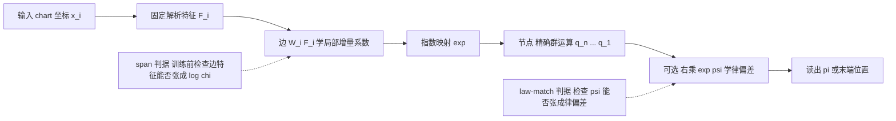

# LawKAN：群运算层（arXiv:2611.12567）

**LawKAN**（*LawKAN: Group-Law Layers for Composition — When Imposing a Known Law Pays Off*，Anna Mishchenko、Nikolai Gavrilin，独立研究者，[arXiv:2611.12567](https://arxiv.org/abs/2611.12567)，v1 于 2026-11-09 提交）。论文自述其价值是「架构层面且有条件的」，主要对象是一张「何时赢、何时平、何时输」的实测地图（第 8 节、表 6）。

## 一句话定义

**把已知的非交换群运算（旋转的 Hamilton 积、刚体运动的 SE(3) 积）精确地写在层的节点里，边只学局部增量的系数，再加一个零初始化的修正 ψ 去学「法则本身」的偏差；是用于组合子计算（姿态链、机械臂标定、IMU 积分）的小模型，不是端到端策略。**

## 英文缩写速查

| 缩写 | 英文全称 | 简要说明 |
|------|----------|----------|
| KAN | Kolmogorov–Arnold Network | 边上放可学习函数、节点做固定加法的网络；LawKAN 只沿用「边 / 节点」分工，节点改为群运算 |
| SU(2) | Special Unitary group of degree 2 | 单位四元数群，旋转的双覆盖；节点用 Hamilton 积 |
| SE(3) | Special Euclidean group in 3D | 刚体运动（旋转 + 平移）群，机械臂正运动学所在群 |
| GL+(2,R) | Positive-determinant general linear group | 行列式为正的 2×2 实矩阵群，非紧致、指数映射非全局 |
| ψ | zero-initialized law correction | 零初始化的律修正，右乘在物理复合上 |
| PoE | Product of Exponentials | 指数积运动学模型，经典标定参照 |
| GN | Gauss–Newton | 经典标定的高斯–牛顿拟合（论文中的强参照） |
| BCH | Baker–Campbell–Hausdorff | 群乘积的对数级数，不终止，故截断留下误差下限 |
| IMU | Inertial Measurement Unit | 惯性测量单元（论文用 BROAD 数据集上的消费级陀螺） |

## 为什么重要

- 机械臂标定、姿态积分这类任务的组合规则是已知的，通用网络要重新学一遍并让误差累积，经典估计器又把规则写死而无法表示硬件对规则的偏离（摘要、第 1 节）。LawKAN 在中间：规则精确写入，只学剩余部分。
- 论文给出可在训练前使用的判据（第 3.3、5.7 节）：边的特征是否张成链图 log χ 决定能否精确表示，不张成就有与训练无关的误差下限；这对「为什么加宽网络或延长训练不管用」提供了诊断思路。
- 论文明确列出输的情形（目标无群律时 23.87° 对 12.64°，第 4.2.3 节），对「已知结构先验是否值得嵌入」给出了边界而非一味宣传。

## 核心原理与流程总览

**两层已知结构（第 3 节）：** 律（节点执行）+ 增量形式（由边的固定特征承载）；系数与偏差是学习对象。

**SU(2) 层（第 3.2 节）：**
1. 固定特征 F_i = {1,cos α,sin α}⊗{1,cos β,sin β}（9 个标量 / 因子）；
2. 边 ξ_i = W_i F_i（W_i∈R^{3×9}，n=2 时 54 参数）；
3. 节点 q_i = exp(ξ_i)，Q = q_n…q_1（Hamilton 积，无参数）；
4. 读出 π(Q)：Q 作用于探针向量后的方向；
5. 可选修正 Q ← Q·exp ψ(f(A),f(B))，ψ 末层为零。

**其他关键机制：**
- 判据 1（span，第 3.3 节）与判据 2（law-match，第 3.3 节），证明在附录 C.1、G。
- ψ 默认「全局线性槽（186 参数）+ 局部 RBF 核槽（120 参数）」两槽共 306 参数（附录 G.4）；冻结精确边、单独训练 ψ（隔离），因为联合训练不可识别、边会吸收部分修正（第 3.4 节）。
- 三个群实例（第 3.5、4.1 节，表 1）：SU(2)；GL+(2,R)（边直接输出群元素）；SE(3)（边特征 {a, p, a×p, a(a·p)}）。
- 作者主张精确节点优于 BCH 截断：截断留下正的误差下限（附录 C.3）。

## 实验结果（均为作者自述数字）

数据：1 个合成基准、6 个真实机械臂标定数据集（FR3、MUKCa、ABB RobotCali 等）与 BROAD 消费级 IMU；指标为角度误差（°）或末端位置误差（mm），每平台 3–10 个 seed（第 4–6 节）。

| 设置 | 结果 | 出处 |
|------|------|------|
| 合成固定角 SU(2) 复合 | LawKAN 54 参数 2.78±0.02°；MLP+四元数头 h=32（1476 参数）3.36±0.06°；调参后 MLP-Quat h=64（4996 参数）3.25±0.02° | 第 4.2.1 节，表 2 |
| FR3 真实机械臂标定（114 位姿，5 seed） | 两槽 ψ（306 参数）N=20/40/60/80：1.51/1.24/1.14/1.12 mm；GN 1.56/1.39/1.29/1.33；精确节点 1.53/1.49/1.37/1.40；残差 MLP 2.39/2.03/1.35/1.33 | 第 5.1 节，表 3 |
| MUKCa 插座一致性（4 台设备） | KUKA iiwa14、Panda 上 ψ 优于缩减边与稠密螺旋；FR3 unit 与 Kinova 上不优于稠密螺旋 | 第 5.3 节，表 4 |
| ABB RobotCali 仅测距 | 全局 ψ 在 N=160/320 优于 GN（p=0.013/0.0004），N=80 差异不显著（p=0.74） | 第 5.4 节，表 5 |
| BROAD 真实 IMU 姿态积分 | 18 参数剪枝边与无训练的捷联积分基本持平（5.0 s：1.189 对 1.191°）；稠密边在 5 s 一个 seed 发散到 73° | 第 5.5.1 节，表 18 |

## 与其他工作对比

| 工作 | 关注点 | 与本文的区别 |
|------|--------|--------------|
| 经典 PoE + [Gauss–Newton](../methods/gauss-newton.md) 标定 | 把指数积运动学写死，拟合几何参数 | 律成立时 LawKAN 与之基本平手；律有偏差时 ψ 可学偏差，FR3 上 N=80 为 1.12 对 1.33 mm（表 3），但两者优化器与损失不同，差距不能全归于结构 |
| MLP + 四元数输出头（见 [SO(3) 旋转表示对比](../comparisons/so3-rotation-representations.md)） | 通用网络从数据学组合规则 | 合成 SU(2) 复合上 54 参数 2.78° 对 1476 参数 3.36°（表 2）；但目标无群律时 MLP 反而更好（12.64° 对 23.87°） |
| [指数积（PoE）与旋量表述](../formalizations/spatial-twist-wrench-poe.md) | SE(3) 上的正运动学与标定基础 | LawKAN 的 SE(3) 节点即精确群积；作者承认未与配置相关的学习式 PoE（Lu et al., 2025）正面比较（第 7 节） |

## 结论

**LawKAN 表明：当组合法则确实成立且偏差落在修正项 ψ 的张成内时，把精确群运算写进节点能以极少参数换来小样本优势；法则不成立时这一先验反而拖累结果。**

1. span 与 law-match 两个判据可在训练前判断能否精确表示，解释「加宽网络或延长训练无效」的误差下限（第 3.3 节）。
2. 真实机械臂标定上小样本时优于 GN（FR3、ABB 大 N），但在 FR3 unit 与 Kinova 上不优于稠密螺旋（表 3–5）。
3. 真实 IMU 积分只与捷联积分持平，稠密边存在 seed 发散（表 18）。
4. 局限：证据面窄、单作者团队预印本、链长超过 4 后不稳定，缺少与最接近学习式方法的正面对比（第 6、7 节）。

## 工程实践

- 论文提供「span 检查」五步法与脚本 `tools/span_check.py`（线性探针，第 5.7 节），用于训练前判断特征集是否张成目标对数，属于便宜的第一步检查。
- 使用建议（作者）：默认两槽 ψ；小而 seed 不稳的数据用局部核头；平滑形变用全局头（第 5.6 节、表 21）。训练尖峰可通过权重平均（Polyak / EMA）去除，需要跨越 π 的任务建议用「branch-safe」四元数特征变体（第 5.2 节）。
- 复现：代码与规范化 JSON 清单在 [lawkan 仓库](https://github.com/occamolab/lawkan)（AGPL-3.0-or-later，仓库 README 已静态核对，代码未运行）。数据集许可见论文末尾，ABB RobotCali 无明确许可、作者称经授权使用。
- 适用提示（我的判断，不是论文结论）：这是针对「组合子计算」的小模块，输入需先转成群 chart 坐标；是否能用在带视觉输入的端到端策略里，论文未测（第 7 节未来工作第 i 条）。

## 与文章说法的核对

对照来源：公众号《机器人动作块太长，什么时候该重新规划？》（2026-11-11）中对该论文的段落。

| 文章说法 | 核对结论 |
|----------|----------|
| 「把已知群运算法则直接嵌入组合层」 | 对。节点执行精确群律，且论文称把精确群律放入 KAN 节点据其所知是首次（第 1 节、第 2 节）。 |
| 「学习局部增量与修正」 | 对。边学局部增量系数，ψ 学律偏差（第 3.2、3.4 节）。 |
| 「减少模型重复学习结构的负担」 | 大体对。合成基准上 54 参数 vs 1476 参数的 MLP+四元数头，真机上 306 参数 vs 18k–69k 残差 MLP（表 2、表 3）；但数字只在作者选择的任务与基线下成立，这是作者自述。 |
| 「包含机械臂校准实验」 | 对，但需限定：是在公开的真实机械臂标定数据集上做离线拟合（FR3 114 个位姿、MUKCa、ABB RobotCali 等，第 5.1–5.4 节），论文没有在线闭环控制或策略实验；FR3 结果来自单台设备（第 6 节）。 |
| 「收益依赖法则成立」 | 对，且论文更细：律成立且有经典同类估计器时是平手（parity），律有偏差且在 ψ 张成内才赢，律不是任务的律就输（第 5.6 节、表 6）。 |
| 「错误的结构先验也会拖累结果」 | 对。无群律目标上 Hamilton 节点 23.87±0.41°，MLP h=4 为 12.64±3.00°（第 4.2.3 节、附录 E.3）。 |
| 文章未提及 | 作者是独立研究者，单篇预印本；效果在 FR3 上是 1.12 对 1.29–1.33 mm（相对 GN 约 0.2 mm 量级），N=20 时与精确节点差异不显著（p=0.84）；在 FR3 unit 和 Kinova 上 ψ 不占优（表 4）；论文自身统计的 130 条预注册预测中 29 条被推翻（表 31）。 |

## 局限

**论文自述（第 6 节、附录）：**
- 剪枝边假设固定已知角，链长扩展只到 n=4；n=6 起 seed 双峰，n=8 所有模型接近随机（附录 E.3）。
- 稠密组合器在真实 IMU 上不优于捷联积分，剪枝版也只是「适度」更好；稠密 IMU 边在 5 s 视野有 seed 双峰（一个 seed 73°）。
- 在 GL+(2,R) 上无结构稠密边不优于 MLP，要靠解析支撑边（0.0024 对 0.53）。
- 识别性：UR10 上联合训练的边会漂移（关闭修正后误差 0.40→11.7 mm）；Kinova 上全局槽 2/10 seed 塌缩；N=20 时修正会过拟合，需验证门限。
- 证据面窄：1 个合成基准、39 条消费级 MEMS 试验、6 个真实标定数据集、每平台 3–10 个 seed；战术级 IMU、其他机器人、大规模视觉 / 语言任务未测；FR3 结果来自单台设备；背隙只做了代理检验，结论为不确定（第 6 节、3.4.1 节）。
- 与最接近的学习式竞争者（配置相关的 PoE，Lu et al., 2025）的正面对比未做（第 7 节）。

**我看到的未验证之处（我的判断）：**
- 论文未独立复现；我只读了论文与仓库 README，未运行代码，数字未重算。
- 经典基线 GN 与 LawKAN 使用不同优化器与损失，作者也承认差距不能只归于结构（第 5.3 节、表 3 注）；ψ 的权重衰减剂量按大小规则在同一批划分上选定，对新协议是否迁移未测（第 6 节）。
- 论文称作者在内部实验日志中预注册预测，但日志仅「应编辑 / 审稿人请求提供」，读者无法独立验证预注册时间。
- 附录 L 说明正文起草与数字一致性检查借助了大语言模型（Kimi、DeepSeek），作者声明实验由其本人完成。
- 本页的属性是「几何先验层 + 标定」，不是动作块重规划相关工作；与文章同栏目其他论文无直接技术联系。

## 关联页面

- [SO(3) 旋转表示对比](../comparisons/so3-rotation-representations.md)
- [刚体运动的李群表述](../formalizations/lie-group-rigid-body-motions.md)
- [正运动学](../formalizations/forward-kinematics.md)
- [系统辨识](../concepts/system-identification.md)
- [状态估计](../concepts/state-estimation.md)
- [IMU 原理与算法](../concepts/imu-principles-algorithms-camera-sync.md)
- [手眼标定](../concepts/hand-eye-calibration.md)

## 参考来源

- [lawkan_arxiv_2611_12567.md](../../sources/papers/lawkan_arxiv_2611_12567.md)
- [arXiv:2611.12567](https://arxiv.org/abs/2611.12567)
- [occamolab/lawkan 仓库](https://github.com/occamolab/lawkan)

## 继续阅读

- [arXiv PDF](https://arxiv.org/pdf/2611.12567v1)
- [SO(3) 旋转表示对比](../comparisons/so3-rotation-representations.md)
- [刚体运动的李群表述](../formalizations/lie-group-rigid-body-motions.md)
