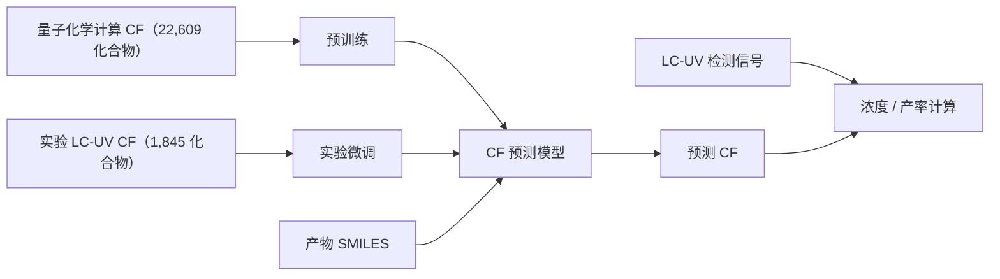
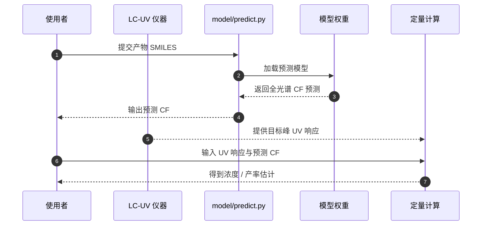

# AI 预测 UV 校正因子与无标准品反应定量

## 一句话定义

**lcms2yield** 将分子结构到全光谱 UV 校正因子（CF）的预测，与液相色谱-紫外（LC-UV）测量结合，用于没有目标物纯标准品时估计浓度和反应产率。

## 英文缩写速查

| 缩写 | 英文全称 | 简要说明 |
| --- | --- | --- |
| CF | Correction Factor | 把 UV 信号换算为目标物浓度的校正因子 |
| LC-UV | Liquid Chromatography–Ultraviolet | 液相色谱分离并以紫外吸收检测 |
| HTE | High-Throughput Experimentation | 并行执行大量合成与测量的实验方式 |
| QC | Quantum Chemistry | 论文预训练阶段使用的量子化学计算数据 |
| MAE | Mean Absolute Error | 预测值与参考值差异绝对值的平均 |

## 为什么重要

高通量合成在早期筛选时，目标产物往往没有可用的纯化标准品。若每个候选都先纯化并建立校准曲线，分析工作会增加周期与成本。该工作尝试从分子结构预测 UV 校正因子，再将其与 LC-UV 测量配合，减少标准品制备对产率定量的依赖。

这使化学实验的“测量链路”更适合自动化：模型负责结构条件下的 CF 推理，色谱仪提供实验信号，定量步骤将两者组合。它与实验机器人或自主实验平台可形成接口，但论文贡献本身是分析化学与分子机器学习方法，不是机器人策略。

## 方法栈与流程总览

论文定义全光谱 CF，并提出由“检测”和“预测”组成的无标准品定量框架。量化计算预训练覆盖更广化学空间，实验微调补偿计算与真实 LC-UV 仪器条件之间的差异；推理期以分子结构预测 CF，再与 UV 响应换算浓度和产率。

这里的关键不是单纯扩大训练集，而是把计算域的广覆盖与实验域的仪器真实性分阶段处理。**论文层面的 detect-predict 框架**将预测 CF 与 UV 色谱信号结合；公开仓库 README 展示的程序入口则聚焦于输入 SMILES、输出 CF。

## 实验与评测

| 测试 | 样本与参考 | 论文报告 |
| --- | --- | --- |
| 浓度定量 | 144 种 FDA 批准药物 | 与已知实验浓度独立比较 |
| 反应产率 | 178 个真实反应、71 种产物、25 种条件，涵盖酰胺偶联、Suzuki、SN2 与 Buchwald–Hartwig | 相对校准曲线产率 MAE 为 4.74% |
| 分离收率压力测试 | 34 个 Suzuki–Miyaura 与 26 个 Minisci 反应 | 与分离收率对照；粗反应定量与纯化后分离收率存在系统差别 |

浓度测试报告 MAE 为 0.167 μmol/mL。评测集说明方法适用于论文覆盖的化合物和反应条件；不能直接据此推断对所有反应类别、色谱方法或实验室仪器都有相同误差。

## 结论

该方法的工程价值在于把结构预测转化为可与实验色谱信号组合的校正量，降低反应筛选对分析物标准品的依赖；评估时应把定量目标、参考测量与实验范围一起看。

- **判断目标：** 4.74% MAE 衡量 178 个真实反应中相对校准曲线的产率误差，不等同于对所有合成任务的统一精度承诺。
- **区分产率口径：** 粗反应液的分析产率与纯化后的分离收率不同；二者差距可能来自纯化损失，不能简单视为模型误差。
- **复现优先级：** 先核对目标分子、LC-UV 条件和 CF 定义，再运行仓库的 SMILES→CF 预测入口；仓库的预测 API 不等于完整色谱采集与峰分析系统。

## 源码运行时序图

仓库 README 展示的可运行入口为 `predict_by_smiles_list`，输入 SMILES 列表并返回 CF。序列图中的色谱检测与浓度/产率组合对应论文框架；公开示例未展示仪器采集驱动、通用峰识别或机器人实验站控制。

## 工程实践

- **数据域：** 复现时分别记录预训练计算数据与实验微调数据，避免将两者当成同分布样本。
- **推理边界：** 仓库示例需要 SMILES，返回 CF；LC-UV 峰提取和实验方法学验证需由调用方完成。
- **部署条件：** 官方 README 建议 Python 3.11，列出 CPU 安装流程并将 NVIDIA GPU/CUDA 作为可选加速。
- **开源状态（2026-10-15）：** 已开源。官方仓库公开预测代码、模型目录及训练/评测数据，README 标注 Apache-2.0；未在公开示例中看到通用仪器采集与自动实验站集成。
- **与机器人研究的关系：** 适合作为自动化化学/HTE 中的分析定量组件线索；不应归类为运动控制或机器人学习算法。

## 局限与风险

- 测试覆盖了论文报告的有限药物与反应集；不同波长响应、溶剂、基质、共洗脱峰或仪器条件仍需本地验证。
- MAE 是特定测试协议与参考曲线下的指标，不代表每个样本的最大误差。
- 量化计算到实验 LC-UV 的域差异需要实验微调处理；新化学空间是否可靠，仍取决于训练覆盖和仪器适配。
- 模型预测因子不能独立确认色谱峰身份；错误的产物结构或峰归属会传递到后续定量。

## 与其他工作对比

相较于“先纯化目标物、再建立专属校准曲线”的流程，lcms2yield 将标准品准备成本转为结构模型和实验数据适配成本。它不同于自动实验论文中的实验动作规划：该研究解决的是**实验结果如何定量读取**，因此可作为自动化实验栈中的分析组件，而非替代实验规划器。

## 关联页面

- [AI 设计物理实验](./paper-designing-physics-experiments-with-ai.md) — 以 AI 建立实验工作流的相邻案例；任务域与指标不同。
- [AI 自动研究](../concepts/ai-auto-research.md) — 将数据、执行与分析接入研究闭环的上层背景。

## 参考来源

- [论文摘录与评测数据](../../sources/papers/lcms2yield_jacsau_2026.md)
- [XtalPi 官方介绍与开源核查](../../sources/sites/lcms2yield.md)
- [官方代码与数据仓库归档](../../sources/repos/lcms2yield.md)

## 推荐继续阅读

- [ACS 论文页](https://pubs.acs.org/doi/10.1021/jacsau.6c00812)
- [XtalPi 官方研究介绍](https://www.xtalpi.com/ai-predicted-full-spectrum-uv-correction-factors-an-analyte-standard-free-framework-for-reaction-yield-quantification/)
- [lcms2yield GitHub 仓库](https://github.com/xtalpi-inc/lcms2yield)
