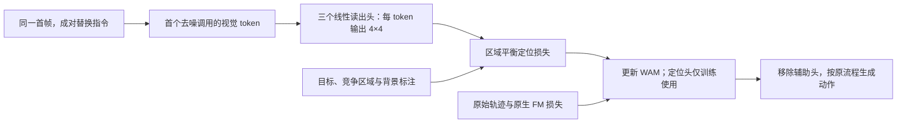
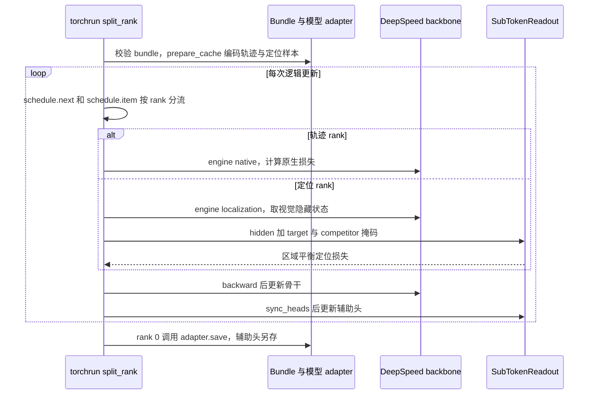
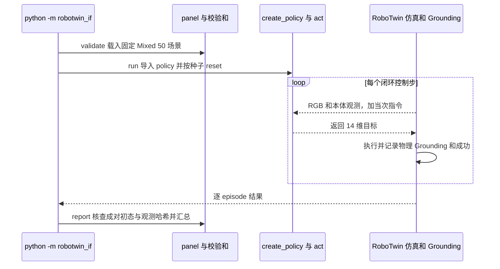

# Beyond Linear Decodability: Understanding and Improving Instruction Following in World Action Models｜超越线性可解码性：理解并改进世界动作模型的指令跟随

## 一句话定义

> LDS 在训练中让同一画面下、由不同指令指定的目标能从 WAM 的视觉 token 中线性读出，同时保留原来的轨迹训练；部署时不向策略提供掩码，也不保留辅助头。

## 英文缩写速查

| 缩写 | 英文全称 | 简要说明 |
|---|---|---|
| WAM | World Action Model | 利用世界演化表征生成动作 |
| LDS | Linear Decodability Supervision | 训练期线性读出辅助监督 |
| IF / NF | Instruction Following / Non-Following | 是否按当次指令行动 |
| FM | Flow Matching | 保留的原生轨迹训练目标 |
| DiT | Diffusion Transformer | 被读取中间视觉 token 的骨干 |

## 为什么重要

机器人反复选训练中常见的物体，不等于它没读懂目标。锁定初态、只替换指令可以消除不少视觉解释；同时测探针准确度、接触/到达和物理完成，可以定位问题是出在选目标，还是选对后没抓稳、没放好。对已有的离线示范，增加标注不要求把旧场景重建出来补录每条替代轨迹。

## 核心机制

1. **先诊断，再训练。** 对同一场景的替代指令，读取当前头部相机 token。OpenWAM 的探针固定骨干，只学习线性分类，指令跟随版本由反事实示范微调获得，跨层和计算位置的双向准确率由 51.5% 升至 77.5%。这只是行为和表征的关联，不是因果结论。
2. **两类信号竞争。** 作者将两候选的表征对比拆为随指令变化的项 I，以及在该配对中保持不变的 U。U 含外观差异，不能当作纯先验 P。OpenWAM 在 LIBERO-CF 抓取子集上，具有真值掩码的无训练干预 Enhance I / Transit P 将成功率从 3.8% 提高到 53.0% / 50.8%。这是限定场景的机制证据，不是部署接口。
3. **把诊断变成辅助监督。** 取**输入首帧**在**第一次去噪调用**的第 9、19、29 个零基 block 输出（两个「首」不在同一轴）。每层共享线性头把每个视觉 token 映成 4×4 个定位 logits。按照指令目标、竞争区域、背景分配 0.50 / 0.45 / 0.05 的归一化损失权重。替代指令只给定位掩码，不提供对应未来视频或动作标签；放置任务监督的是目的区域，并不是充当空间参照的物体掩码。
4. **保留原训练与策略 I/O。** 原轨迹继续提供原生 FM 监督；定位损失以预热后的 0.25 权重影响读出头和所连接的视觉/共享参数，不给只属于动作输出的参数提供定位梯度。部署只使用更新后的原策略。

## 实验与评测

论文表 1 的 LIBERO-CF 有 50 项任务、各 50 个初态。F. 是按反事实新指令得分，B. 是按原训练目标得分；Grounding 在此评估是否到达目标，未要求完整任务结束。

| 模型 | F. 成功率：Base → LDS | F. Grounding：Base → LDS | 原 LIBERO 成功率：Base → LDS |
|---|---:|---:|---:|
| InternW0-Δ | 23.5% → 74.6% | 37.3% → 89.2% | 96.0% → 96.8% |
| OpenWAM | 5.1% → 65.1% | 14.4% → 90.3% | 94.0% → 89.2% |
| LingBot-VA | 12.3% → 29.8% | 32.0% → 59.3% | 89.0% → 88.2% |

- **跨基准。** InternW0-Δ 的 LangGap 平均成功率为 37.5% → 71.4%；RoboTwin-IF 上 OpenWAM 平均成功率为 7.6% → 54.4%（25 个 Pick、25 个 Placement 场景，两指令 × 10 初态种子，共 1,000 回合/策略）。RoboTwin-IF 先用每场景一条所选指令的示范训 Base，LDS 时两个指令都给定位。
- **定位不等于完成。** RoboTwin-IF Placement 中，LingBot-VA 的目的区域 Grounding 由 16.0% 升至 20.0%，严格成功率反从 14.4% 降到 13.2%。另训的留出场景方案上，InternW0-Δ 成功率为 LIBERO-CF 67.7%、LangGap 45.8%；不能把主表全训练划分的权重当作留出权重。
- **真机。** AgileX Cobot Magic 双臂平台，每模型、每变体、每任务 10 次。训练轨迹只按红按钮；绿色/蓝色按钮有定位标签，无轨迹示范，三种 LDS 策略各 10/10。插槽任务中 OpenWAM 与 InternW0-Δ 各 10/10，LingBot-VA 6/10。仅涵盖这两项有设计偏差的任务。

## 结论

LDS 表明，在作者测试的 WAM 中，强化现有目标信号能改善实际指令跟随，无需改变部署接口。

- 诊断数据时，先构造同初态、同画面、不同目标的指令对。
- 单列目标定位、完整任务、误走训练目标、原任务保留率，不用单一成功率代替。
- 评估泛化时按物理场景拆分并报告 Pick/Placement 构成，不把新初态当作新场景。
- 复现时先核对掩码与 token 几何，并确认 checkpoint 对应基准和训练划分。

## 与其他工作对比

- [OpenWAM](paper-openwam.md) 研究如何把视频预训练与动作学习接起来，LDS 不改变其架构，而是在已训练模型上增加目标选择监督。
- [InternW0-Δ](paper-internw0-delta.md) 的 Causal Imprint 用未来视觉监督改善动作相关时间表征；LDS 监督当前视觉表征的语义指代，并不补未来标签。
- [LIBERO](libero-benchmark.md) 原任务衡量完成熟悉目标；LIBERO-CF 通过可执行的替代指令揭露场景到原任务的捷径，两个数字不可互换。

## 工程实践

- 官方 LDS 实现有三类 adapter。先确认 upstream 版本及归一化，再准备 `robotwin_if_release_v1` bundle；公开专家 episode 与冻结评测包不能直接替代带 queries 和 mask 的训练输入。
- RoboTwin-IF 的 `validate`、`run`、`report` 对应数据核验、闭环回合和统计；部署接口每次返回 14 维绝对关节/夹爪目标，允许 adapter 在内部缓存动作块。样例 `examples.hold_position` 只测试接口，不是 LDS 策略。
- 已核验公开仓、数据文件与 9 个基准专用 checkpoint 的公开文件清单。未跑八卡训练、权重推理、RoboTwin 仿真或真机。

## 源码运行时序图

LDS 训练按 [split_rank.py](https://github.com/RuFlect-Intelligence/Linear-Decodability-Supervision/blob/0cd3465abc0e0de84a21d32f30bd4b08dd86a50b/src/linear_decodability/train/split_rank.py) 与 [RoboTwin-IF CLI](https://github.com/RuFlect-Intelligence/RoboTwin-IF/blob/b7f860d4d5f325f43e30015fed82759ece8cd779/robotwin_if/__main__.py) 静态核对；两者是独立入口，不自动串联。

## 局限与风险

- 干预依赖真实区域掩码，且主要检验一个 OpenWAM 检查点和两候选子集；附录 Motus 的路径分析不是对 LDS 的第 9/19/29 层选择做消融，不应外推到全部架构。
- 基准主结果不等于未见场景或未见组合的能力。附录 E 显示组间 Pick/Placement 比例会扭曲汇总成功率；LIBERO-CF 的 held-out Place 只代表一个任务。
- 独立训练包的端到端 GPU 验证在 README 中仍为待完成；完整训练还需特定基座、缓存与定位数据。评测数据许可与各仿真资产条款分开。

## 参考来源

- [arXiv v1 论文归档](../../sources/papers/lds_arxiv_2611_27401.md)：§3–6、附录 A–G。
- [LDS 官方项目页归档](../../sources/sites/lds-homepage.md)：方法、结果、演示。
- [LDS 与 RoboTwin-IF 源码归档](../../sources/repos/linear-decodability-supervision.md)：提交、运行入口与发布边界。

## 关联页面

- [世界动作模型](../concepts/world-action-models.md)：定位损失是一种后训练方法，不是新的模型类别。
- [WAM 纵深路线 Stage 3](../../roadmap/depth-wam.md)：比较保留联合骨干、改变监督的设计。

## 推荐继续阅读

- 复核[论文附录 E](https://arxiv.org/html/2611.27401v1#A5)的留出和重加权口径，再用[官方评测源码](../../sources/repos/linear-decodability-supervision.md)核对 Grounding 与严格成功的独立判定。
