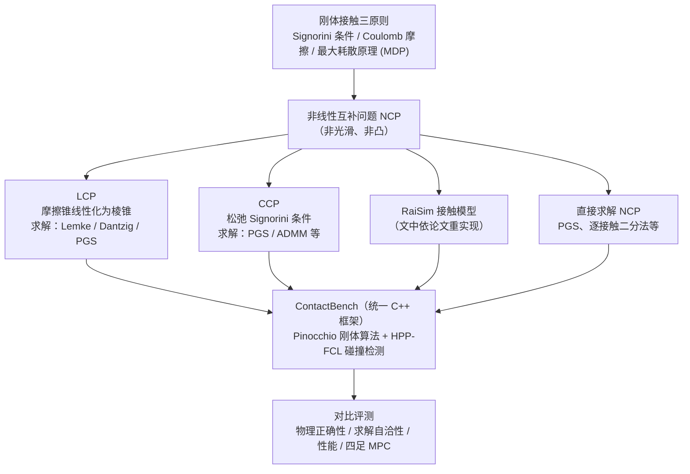

# Contact models in robotics: a comparative analysis

**Contact models in robotics: a comparative analysis**（[arXiv:2304.06372](https://arxiv.org/abs/2304.06372)）收录于 [自由度FreeDof · Sim2Real 四条路线梳理](../../sources/blogs/wechat_freedof_sim2real_four_routes_dr_to_residual_2026-08-23.md) 参考文献 **[22/44]**，归类 **域随机化**。

## 一句话定义

从 Signorini、库仑摩擦与最大耗散原理比较各引擎接触近似及其物理松弛。

## 英文缩写速查

| 缩写 | 英文全称 | 简要说明 |
|------|----------|----------|
| TRO | Transactions on Robotics | IEEE 机器人汇刊 |
| Sim2Real | Simulation to Real | 仿真到真机 |
| LCP | Linear Complementarity Problem | 线性互补接触公式 |

## 为什么重要

- PolySim 的理论骨架；解释 reality gap 的结构来源。
- 在 [44 篇技术地图](../overview/freedof-sim2real-44-papers-technology-map.md) 与 [四条路线对比](../comparisons/sim2real-four-routes-identifiability.md) 中作为 **域随机化** 节点。
- 开源结论：**待核实**（步骤 2.5，2026-09-20）。

## 流程总览

图依据：论文 §I–§IV（Tab.III 接触模型与求解器分类、§IV ContactBench 实验设定）；各求解器与模型的归属为依据章节标题归纳

## 核心机制

| 项 | 内容 |
|----|------|
| **出处** | IEEE TRO 2024 |
| **文内章节** | 域随机化 |
| **要点** | 统一数学框架对比软约束、互补约束等接触实现。 |
| **开源** | **待核实** |

## 源码运行时序图

**不适用（待核实）** — 截至 2026-09-20 以项目页/论文 Code availability 为准；入库未核验可运行入口。

## 实验与评测

- **本页为索引级节点**（FreeDof 44 篇梳理 [22/44]）：正文固化文内角色与机制要点，**未转存原文实验表**。
- **回原文须核对的证据**：本页要点是「统一数学框架对比软约束、互补约束等接触实现」，对应证据是统一框架与统一算例下各实现的解存在性 / 精度 / 耗时对照。
- **读法：** 先对齐平台、任务、指标定义与成功阈值，再读任何数字；勿从公众号摘录外推。

## 与其他工作对比

| 维度 | 读法 |
|------|------|
| **文内路线** | 归类 **域随机化**；同路线其他节点见 [44 篇技术地图](../overview/freedof-sim2real-44-papers-technology-map.md) 与 [四条路线对比](../comparisons/sim2real-four-routes-identifiability.md) |
| **横比口径** | 对比成立于该统一框架与统一算例；脱离该设置后各引擎的实现差异会重新主导结果，排名不可引用。 |
| **开源状态** | **待核实** — 部署 / 复现前以项目页或原文 Code availability 为准 |

## 结论

**引擎接触近似不是细节，而是 Sim2Real gap 的一级来源。**

1. 文内角色：域随机化 路线上的参考节点，非重复 arXiv 页面。
2. 机制要点：统一数学框架对比软约束、互补约束等接触实现。…
3. 部署/复现前请对照原文与项目页，勿直接外推公众号数字。

## 关联页面

- [Sim2Real 四条路线（可辨识性）](../comparisons/sim2real-four-routes-identifiability.md)
- [44 篇技术地图](../overview/freedof-sim2real-44-papers-technology-map.md)
- [Sim2Real](../concepts/sim2real.md)

## 参考来源

- [freedof_sim2real_22_le-lidec-contact-models-comparative-analysis.md](../../sources/papers/freedof_sim2real_22_le-lidec-contact-models-comparative-analysis.md)
- [wechat_freedof_sim2real_four_routes_dr_to_residual_2026-08-23.md](../../sources/blogs/wechat_freedof_sim2real_four_routes_dr_to_residual_2026-08-23.md)
- [freedof_sim2real_44_catalog.md](../../sources/papers/freedof_sim2real_44_catalog.md)
- [arXiv PDF](https://arxiv.org/pdf/2304.06372)：已通读方法部分（实验与附录以略读为准）：§I 引言、§II 刚体接触建模（略读）、§III 接触问题算法变体（A–E 标题与要点）、§IV 实验设定与小节标题

## 推荐继续阅读

- [arXiv PDF](https://arxiv.org/pdf/2304.06372)
- [44 篇 Sim2Real 技术地图](../overview/freedof-sim2real-44-papers-technology-map.md)
