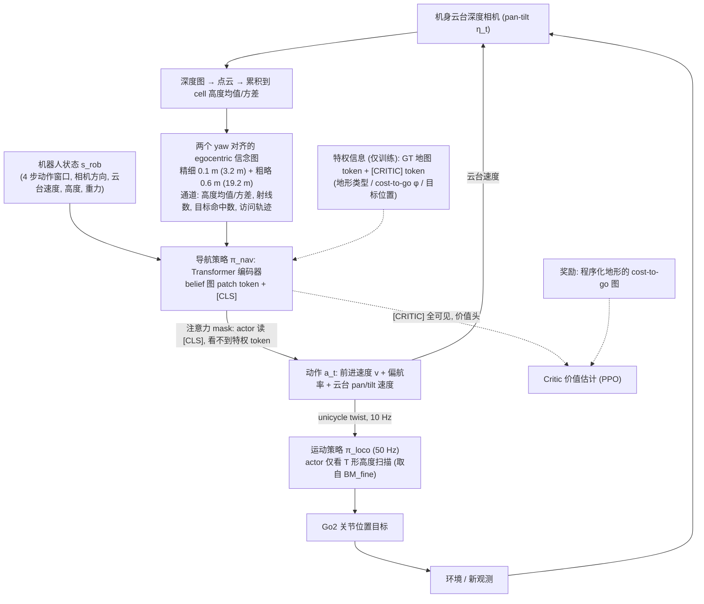

# LEAP（四足主动感知）（arXiv:2609.17628）

**LEAP（四足主动感知）**（*LEAP: Learning Emergent Active Perception for Quadruped Navigation*，[arXiv:2609.17628](https://arxiv.org/abs/2609.17628)）来自 [senlanke 具身运控lab 周更盘点](../../sources/blogs/wechat_senlanke_weekly_humanoid_quadruped_2026-09-14_18.md)（2026-09-14–18）。

## 一句话定义

**连续深度图融合为视线无关 egocentric 信念地图；仅通过任务难度递增使凝视控制涌现；成功率 92.7% 接近 Oracle。**

## 英文缩写速查

| 缩写 | 英文全称 | 简要说明 |
|------|----------|----------|
| LEAP | Learning Emergent Active Perception | 本文框架 |
| RL | Reinforcement Learning | 强化学习 |
| Oracle | Privileged Oracle | 特权上界策略 |

## 为什么重要

- 四足危险地形导航需主动视角；显式 gaze 模块不如 curriculum 涌现稳定。

## 流程总览

图依据：论文 §IV-A–F / Fig. 4（策略架构）

## 核心机制

| 项 | 内容 |
|----|------|
| **arXiv** | [2609.17628](https://arxiv.org/abs/2609.17628) |
| **开源** | **待发布**（步骤 2.5，2026-09-20） |
| **方法摘要** | Depth → view-invariant belief map; emergent gaze via progressive task difficulty. |

## 源码运行时序图

**不适用**（截至 2026-09-20 未发布可运行官方代码或待核实）。

## 实验与评测

- 92.7% success vs privileged Oracle（作者报告）。
- 读法：先对齐任务设定、传感器与成功定义，再解读 headline 数字。

## 与其他工作对比

| 维度 | 读法 |
|------|------|
| **同周对照** | 见对应 [周更盘点](../../sources/blogs/wechat_senlanke_weekly_humanoid_quadruped_2026-09-14_18.md) 映射表，勿跨任务直接比 SR |
| **开源状态** | **待发布** — 部署前以项目页/arXiv 为准 |

## 结论

**LEAP 表明四足主动感知可从导航课程中涌现，无需手工 gaze 奖励塑形。**

1. 开源：**待发布**；勿凭公众号摘要臆断可复现性。
2. 指标须连同实验条件解读（仿真/真机、平台、成功阈值）。
3. 关注 arXiv 版本更新与代码发布。

## 关联页面

- [locomotion](../tasks/locomotion.md)
- [reinforcement-learning](../methods/reinforcement-learning.md)
- [sim2real](../concepts/sim2real.md)
- [robot-perception-stack-selection-loop](../queries/robot-perception-stack-selection-loop.md) — 把连续深度图融合成视线无关信念地图，是该闭环第 ① 层「有深度图 ≠ 深度处处可信」的一条主动感知解法；凝视控制则落在第 ④ 层「感知帧率 ≠ 控制闭环带宽」

## 参考来源

- [leap-quadruped-active-perception_arxiv_2609_17628.md](../../sources/papers/leap-quadruped-active-perception_arxiv_2609_17628.md)
- [wechat_senlanke_weekly_humanoid_quadruped_2026-09-14_18.md](../../sources/blogs/wechat_senlanke_weekly_humanoid_quadruped_2026-09-14_18.md)
- [arXiv:2609.17628](https://arxiv.org/abs/2609.17628)
- [arXiv PDF](https://arxiv.org/pdf/2609.17628)：已通读方法部分（实验与附录以略读为准）：§IV 方法（地形与 cost-to-go、观测空间、动作、导航策略架构、运动策略、训练）；§III 问题定义与 §V 实验仅略读

## 推荐继续阅读

- [arXiv PDF](https://arxiv.org/pdf/2609.17628)
