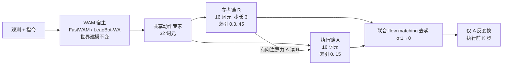

# LeapBot-JAC：世界-动作模型里的两条联合动作链

**LeapBot-JAC**（*Joint Action Chains*，[arXiv:2610.12886](https://arxiv.org/abs/2610.12886)，Leapmotor 与香港科技大学（广州）等作者）是一个挂在世界-动作模型（WAM）宿主上的动作词元编排方案：不增加词元和参数，把固定预算拆成「稀疏远期参考」与「稠密近期执行」两条链。

## 一句话定义

**在 WAM 动作专家固定的 32 个动作词元里，用 16 个步长为 3 的稀疏未来控制作参考链、16 个稠密控制作执行链，两链共享参数并按物理时间对齐位置，执行链单向读取参考链，推理时只执行执行链。**

## 英文缩写速查

| 缩写 | 英文全称 | 简要说明 |
|------|----------|----------|
| JAC | Joint Action Chains | 本文方法：参考链 + 执行链联合去噪 |
| WAM | World Action Model | 同时建模未来世界与动作的策略（宿主） |
| R / A | Reference chain / Execution (Action) chain | 16 个稀疏参考 / 16 个稠密执行词元 |
| RoPE | Rotary Position Embedding | 用物理时间索引作位置，使相对偏移为 3j−i |
| LIBERO | Lifelong robot learning benchmark | 四套任务的仿真操作基准 |

## 为什么重要

- 动作分块只执行块前部，后部预测通常白白浪费；JAC 给这部分预算一个明确角色（看得更远的参考）而不扩张模型。
- 零额外参数、零额外词元：延迟与显存与基线持平（见实验），便于嫁接到已有 WAM。
- 对分布外扰动（LIBERO-Plus）的增益大于分布内，值得作为鲁棒性线索，但机理论文自认未分离。

## 方法栈 / 流程总览

## 方法

- **词元布局：** 参考链覆盖 48 步窗口、执行链覆盖前 16 步；完整窗口内两链共享 6 个时间点，32 个词元覆盖 26 个不同控制时刻。
- **监督：** 两链都用演示控制作目标；越界索引取最后有效动作并标 padding（不进直接损失，但对注意力可见）。
- **共享生成：** 共享投影、时间嵌入、Transformer 层与输出头；线性 flow matching，共同噪声水平、各自独立高斯噪声。
- **物理时间对齐：** 位置取 [0,3,…,45; 0,1,…,15]，沿用宿主 RoPE 频率表，不加链身份嵌入。
- **有向注意力：** M_JAC = M_host ∧ M_role，执行链可读参考链，反向禁止。
- **损失：** E[ℓ_A + λ_R·ℓ_R] + 宿主世界损失，λ_R=0.2。
- **推理：** 两链一起积分，只执行 A；K=10（LIBERO、LIBERO-Plus）、K=16（RoboTwin）。参考槽位每次查询都生成，即使不返回。
- **宿主：** FastWAM（复现 11,701.62M 参数）与 [LeapBot-WA](./paper-rcl-2607-23969-leapbot-wa-world-anchor-action-models-via-predic.md)（8,428.11M）；世界建模流程与世界损失系数不变。

## 源码运行时序图

不适用：官方仓库 [LeapWM/leapbot-jac](https://github.com/LeapWM/leapbot-jac) 截至 2026-10-12 仅有一行标题的 README，无可运行入口，不能对齐真实目录与脚本（归档见 [leapbot-jac-github.md](../../sources/sites/leapbot-jac-github.md)）。

## 实验与评测

- **LIBERO 平均：** FastWAM 97.0 → 98.3（+1.3），LeapBot-WA 97.3 → 98.3（+1.0）。表中引用的 π0.5 96.9、Motus 97.7、LingBot-VA 98.5、ImageWAM 98.4 为文献数，训练配方不同。
- **LIBERO-Plus 零样本：** FastWAM 53.5 → 70.4（+16.9，相机视角 19.2 → 43.7、噪声 41.0 → 75.1）；LeapBot-WA 73.1 → 77.3（+4.2）。引用的 ImageWAM 83.1 是其自报平均，口径可能不同。
- **RoboTwin 2.0 平均：** FastWAM 91.02 → 91.24（+0.22，Clean 子集反而 91.44 → 91.32）；LeapBot-WA 91.49 → 92.00（+0.51）；ImageWAM 93.38 仍更高。
- **消融（FastWAM，LIBERO 平均）：** 链间可见性 R↔A 97.5、无跨链 97.7、A→R 98.2、R→A 98.3；λ_R（s=2）0.1/0.2/0.5/1.0 为 97.8/98.1/97.5/96.2；步长 s=2/3/4 为 98.1/98.3/98.0。
- **开销：** p50 延迟 337.0 → 337.7 ms（FastWAM）、438.6 → 435.1 ms（LeapBot-WA）；峰值显存 25.00 / 26.13 GB 不变。
- **真机（每模型每任务 200 次）：** 顺序分拣 FastWAM 82 → 93、LeapBot-WA 90 → 95；关抽屉 77 → 79、85 → 90。

## 工程实践

| 项 | 内容 |
|----|------|
| 嫁接方式 | 只改动作目标、位置、可见性掩码与参考损失，不动宿主世界模型 |
| 推荐默认 | 16R+16A、s=3、λ_R=0.2、R→A 有向 |
| 训练资源 | 8×H100；学习率/batch/步数沿用宿主配方，所读内容未给出 |
| 开源状态 | 仓库截至 2026-10-12 **待发布**（仅标题 README），无法复现 |
| 源码运行时序图 | 不适用（见上） |

## 结论

**JAC 是一个成本近乎为零的动作词元重排：把执行块之外的预算改成稀疏远期参考，在 LIBERO 与 LIBERO-Plus 上给两个 WAM 宿主带来正向增益，但证据是单种子且代码未发布。**

1. 在固定词元预算内，给参考与执行分配不同角色，比单一稠密链更好（LIBERO 97.0/97.3 → 98.3）。
2. 注意力方向重要：R→A 98.3 最优，双向 97.5 反而更差。
3. λ_R 不宜大：1.0 时降到 96.2，0.2 左右最稳。
4. 增益主要体现在零样本扰动鲁棒性（FastWAM +16.9），RoboTwin 仅 +0.22–0.51，别指望处处提升。
5. 推理开销可忽略（延迟 +0.7 / −3.5 ms，显存不变）。
6. 引用前先看单种子、无显著性检验的限制，等待官方代码后再复现。

## 局限与风险

- 单训练种子、无误差棒，论文自称描述性比较。
- 步长与 λ_R 联动，消融不能干净分离原因；LIBERO 消融不解释 LIBERO-Plus 增益。
- 参考动作的语义未被约束，不能当作抽象规划的证据；有向掩码可能经宿主世界状态或缓存泄漏。
- 与文献基线（ImageWAM 等）训练预算不同，排名不可直接比。
- 开源：仓库待发布。

## 与其他工作对比

| 对照 | 差异读法 |
|------|----------|
| [LeapBot-WA](./paper-rcl-2607-23969-leapbot-wa-world-anchor-action-models-via-predic.md) | 同团队宿主；WA 改世界表征，JAC 改动作词元布局，可叠加 |
| [动作分块](../methods/action-chunking.md) | 常规分块是单条稠密链；JAC 在同预算内引入稀疏远期链 |
| [世界-动作模型](../concepts/world-action-models.md) | 提供宿主范式背景；JAC 不改世界建模 |

## 关联页面

- [34 篇具身论文空间落地技术地图](../overview/embodied-station-34-papers-spatial-grounding-technology-map.md)
- [操作任务](../tasks/manipulation.md)
- [世界-动作模型](../concepts/world-action-models.md)
- [LIBERO 基准](./libero-benchmark.md)
- [RoboTwin](./robotwin.md)

## 参考来源

- [微信盘点来源](../../sources/blogs/wechat_embodied_station_34_papers_spatial_grounding_2026-10-12.md)
- [leapbot_jac_arxiv_2610_12886.md](../../sources/papers/leapbot_jac_arxiv_2610_12886.md)
- [leapbot-jac-github.md](../../sources/sites/leapbot-jac-github.md)
- [arXiv:2610.12886](https://arxiv.org/abs/2610.12886)

## 推荐继续阅读

- [arXiv HTML 全文](https://arxiv.org/html/2610.12886v1)
- [LeapWM/leapbot-jac（待发布）](https://github.com/LeapWM/leapbot-jac)
