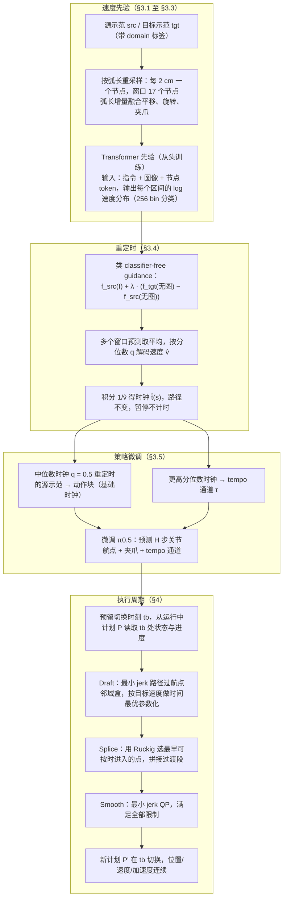

# Learned Speed Prior（arXiv:2610.32676）

**Learned Speed Prior**（*Retiming Robot Demonstrations with a Learned Speed Prior*，[arXiv:2610.32676](https://arxiv.org/abs/2610.32676)，[项目页](https://mllab.snu.ac.kr/projects/learned_speed_prior/)）来自 [具身智能小站 2026-10-29 盘点](../../sources/blogs/wechat_embodied_station_58_papers_diverse_demonstrations_2026-10-29.md)，属「示范数据与数据引擎」组。

## 一句话定义

**学习式速度先验为不同轨迹分配局部节奏，再以约束控制器执行动作块；仿真与真机支持效率收益，比较时需同时观察成功率和运动平滑度。**

## 英文缩写速查

| 缩写 | 英文全称 | 简要说明 |
|------|----------|----------|
| Learned Speed Prior | Retiming Robot Demonstrations with a Learned Speed Prior | 本文方法 / 基准的简称 |

## 为什么重要

- 给示范重新配速，而非整体加速播放。
- 开源结论：**项目页未列 GitHub**（步骤 2.5，2026-10-29）。项目页 HTTP 200，未列 GitHub，也无 coming soon 字样（脚本扫描）。
- 同期同组工作见 [多样成功示范、触觉工具链与预见式感知：具身智能小站 10-29 期 58 篇阅读坐标](../overview/embodied-station-2026-10-29-58-papers-technology-map.md)。

## 流程总览

图依据：论文 §3.1–§3.5 / §4.1–§4.2 / Fig.1、Fig.2。

## 核心机制

| 项 | 内容 |
|----|------|
| **arXiv** | [2610.32676](https://arxiv.org/abs/2610.32676) |
| **开源** | **项目页未列 GitHub** |
| **要点** | 学习式速度先验为不同轨迹分配局部节奏，再以约束控制器执行动作块；仿真与真机支持效率收益，比较时需同时观察成功率和运动平滑度。 |
| **文内指标** | 公众号未给具体数字，本页不引用。 |

## 源码运行时序图

**不适用（项目页未列 GitHub）** — 项目页 HTTP 200，未列 GitHub，也无 coming soon 字样（脚本扫描）。 不编造运行脚本；代码公开后再补。

## 实验与评测

- 公众号未给具体数字，本页不引用。
- **读法：** 本页为索引级摘要，依据公众号转述的官方摘要与仓库信息整理；逐项数字与 baseline 以原文 PDF 为准。

## 与其他工作对比

- 横向索引见 [多样成功示范、触觉工具链与预见式感知：具身智能小站 10-29 期 58 篇阅读坐标](../overview/embodied-station-2026-10-29-58-papers-technology-map.md)；同 arXiv 不重复造页。

## 结论

**给示范重新配速，而非整体加速播放：学习式速度先验为不同轨迹分配局部节奏，再以约束控制器执行动作块；仿真与真机支持效率收益，比较时需同时观察成功率和运动平滑度。**

1. 开源边界：**项目页未列 GitHub** — 项目页 HTTP 200，未列 GitHub，也无 coming soon 字样（脚本扫描）。
2. 核心机制：学习式速度先验为不同轨迹分配局部节奏，再以约束控制器执行动作块；仿真与真机支持效率收益，比较时需同时观察成功率和运动平滑度。
3. 复现与选型前核对任务协议、硬件与基准口径，勿直接横比公众号摘录数字。

## 关联页面

- [embodied-data-collection-four-layers-taxonomy](../concepts/embodied-data-collection-four-layers-taxonomy.md)
- [imitation-learning](../methods/imitation-learning.md)
- [teleoperation](../tasks/teleoperation.md)
- [embodied-station-2026-10-29-58-papers-technology-map](../overview/embodied-station-2026-10-29-58-papers-technology-map.md)

## 参考来源

- [learned_speed_prior_arxiv_2610_32676.md](../../sources/papers/learned_speed_prior_arxiv_2610_32676.md)
- [wechat_embodied_station_58_papers_diverse_demonstrations_2026-10-29.md](../../sources/blogs/wechat_embodied_station_58_papers_diverse_demonstrations_2026-10-29.md)
- [arXiv:2610.32676](https://arxiv.org/abs/2610.32676)
- [arXiv PDF](https://arxiv.org/pdf/2610.32676)：已通读方法部分（实验与附录以略读为准）：§3 Learning the Pace from Demonstrations（§3.1 至 §3.5）、§4 Executing the Predicted Pace（§4.1 执行周期、§4.2 求解器）、§1 至 §2 引言与相关工作（略读）

## 推荐继续阅读

- [arXiv PDF](https://arxiv.org/pdf/2610.32676)
- [项目页](https://mllab.snu.ac.kr/projects/learned_speed_prior/)
