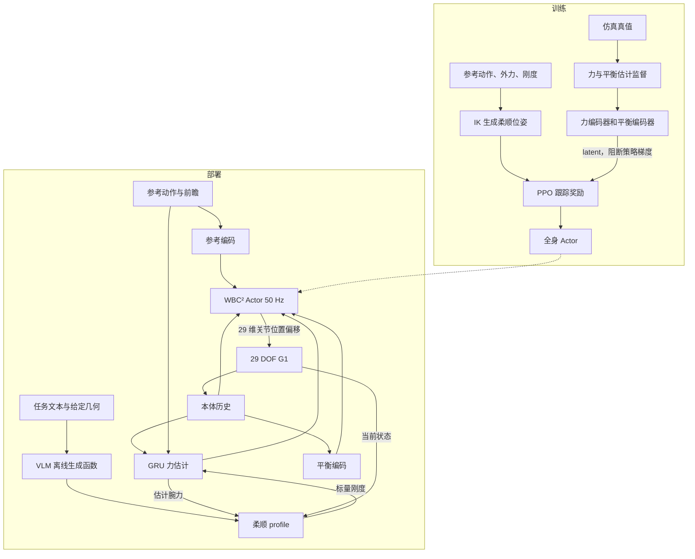

# Functionally Compliant Humanoid Whole-Body Manipulation｜功能性柔顺的人形机器人全身操作

## 一句话定义

WBC² 将任务相关的柔顺函数与学习式全身控制解耦：任务层根据估计力和给定几何调节标量刚度，同一控制器协调手臂、躯干和腿部完成运动与接触响应。

## 英文缩写速查

| 缩写 | 英文全称 | 简要说明 |
|---|---|---|
| WBC² | Whole-Body Compliant Control | 全身柔顺控制器 |
| VLM | Vision-Language Model | 视觉语言模型，离线生成柔顺函数 |
| IK | Inverse Kinematics | 逆运动学，生成柔顺训练目标 |
| GRU | Gated Recurrent Unit | 门控循环单元，用于力估计 |
| COM | Center of Mass | 质心 |
| PPO | Proximal Policy Optimization | 近端策略优化 |

## 为什么重要

钥匙插入需要对横向接触让位，同时维持推进能力；书本翻转需要随运动变化的切向控制。只靠手臂柔顺会限制位移空间，而全身协调能够利用躯干和下肢在受力时保持平衡。任务变化时可修改外置柔顺函数，而无需重新训练 WBC²。须区分随力方向变化的标量刚度和独立多轴刚度矩阵。

## 核心信息

| 项目 | 内容 |
|---|---|
| 论文 | Functionally Compliant Humanoid Whole-Body Manipulation（旧收录标题 Learning Functional Compliance in Whole-body Manipulation） |
| 作者 | Gio Huh, Yue Zhuo, Zehua Wang, Alan Yu, Yibo Cheng, Yanbing Han, Gabriel B. Margolis, Ge Yang |
| 机构 | FortyFive Labs、麻省理工学院（MIT）、斯坦福大学（Stanford）、加州理工学院（Caltech） |
| 会议 | CoRL 2026 |
| 平台 | Unitree G1，29 DOF；MuJoCo |
| 控制频率 | 50 Hz；训练仿真 200 Hz，decimation 4 |
| 原文核对 | 2026-11-25，20 页会议版 PDF，正文及附录 A–M |

## 核心机制

### 柔顺参考与 PPO 训练（§2–3.1，附录 L）

- 目标平衡位移：$d=x-x_{ref}=K^{-1}F$，其中 $K=k_{cmd}I$，$k_{cmd}>0$。这是持续受力下的平衡关系，动态过程还受惯性、阻尼及执行器限制影响。
- 在参考动作 $q_{ref}$ 上施加力 $F_i$ 和刚度命令，IK 将受力点目标设为 $p_i^*=p_{i,ref}+K^{-1}F_i$，同时优化关键点、关节、姿态、足部和质心目标，并约束关节限位。
- 策略观察原始参考，却以适配后的 $q_{aug}$ 为跟踪奖励目标。训练数据包括合成站姿、操作动捕、TWIST2 和 LAFAN1 子集，进行镜像及不同力/刚度增强。
- 使用 PPO 与独立的 wrench / COM-balance 辅助监督。附录 L 给出 30 s episode、24 步 rollout、5 epochs、4 mini-batches、折扣 0.99、GAE 0.95。

### 观测、估计与动作（§3.2，附录 L）

| 模块 | 输入与输出 |
|---|---|
| 力编码器 | 10 帧 × 132 维（93 维本体、38 维参考、log stiffness）；64 维投影、两层 128 宽 GRU、96 维 latent |
| 力预测头 | MLP [256, 128]，输出双腕力、力矩、log isotropic stiffness，共 14 维 |
| 平衡估计器 | 64 → 256 → 19 MLP；预测质心、根部速度与高度、足接触/离地高度、capture point |
| 参考编码器 | 时序卷积处理未来参考，输出参考 latent |
| Actor | 拼接三类 latent 与 10 帧本体历史；ELU MLP [512, 256, 128]，输出相对默认位姿的 29 维关节位置偏移，scale 0.5 |
| Critic | 非对称特权观测，包含仿真真值速度、接触力、wrench 和辅助监督目标 |

力和平衡编码器通过仿真标签训练，策略损失对它们 stop-gradient。部署时保留显式力估计反馈；平衡预测头可丢弃，保留 latent。

### 任务级可变柔顺（§3.3，附录 H–I）

Claude Opus 4.7 在执行前接收任务文本、给定几何、状态接口及 helper 示例，生成无状态 Python 函数。运行时约 50 Hz，根据估计腕力、机器人状态与任务轴求标量刚度。

对非零力与单位任务轴，$\alpha=\cos^2\theta=(\hat F\cdot \vec{x})^2/\|\hat F\|^2$；平滑函数 $k=k_{soft}+(k_{stiff}-k_{soft})\alpha$。钥匙与柜门使用有低力回退及过渡区间的 plateau；书本使用随腕位置更新的切向轴。

## 流程总览

据原文图 2、图 4 与附录 L，训练监督和运行时反馈分开表示。

实际反馈按控制周期更新；图中闭环不表示同一周期内无限递归。

## 源码运行时序图

**不适用（完整运行入口未确认）**：附录 H–I 提供接口、helper 和 key_insertion、flip_book、cabinet_pull_left 三个 Python profile 示例，但尚未确认完整官方训练/推理/部署源码或权重入口。因此不将论文示意图冒充源码调用时序。

## 工程实践

- 钥匙：pelvis +X 为插入轴；dominant_force 选择双腕主导力；plateau 示例阈值 0.3/0.7、硬刚度 400 N/m，低于 1 N 选软刚度。
- 书本：用给定铰链与腕位置求弧线切向；示例 50–400 N/m，切向受力更硬、径向受力更软。
- 开柜门：固定 pelvis X 拉力轴，参考运动仍沿门弧线执行。
- 部署前检查力和轴同为 pelvis frame、阈值有序及工作空间几何；校验失败的 profile 被禁用，控制器继续运行。
- 工程复现建议：单独验证估计力大小/方向误差、实测刚度、步响应和任务得分，再部署接触任务。论文附录 M 报告固定刚度步响应等效阻尼比 0.66 ± 0.03、峰值超调 5.3 ± 1.5%。

## 实验与评测

### 仿真与刚度（§4.1–4.2，表 1–2）

| 指标 | WBC² | 校准 CHIP | 原生 CHIP |
|---|---:|---:|---:|
| 实测刚度中位端点（N/m） | 约 50–740 | 约 90–370 | — |
| 命令跨度（±30% 误差容限，N/m） | 850 | 300 | 100 |
| 柔顺评分（1 − error） | 0.90 | 0.72 | 0.62 |
| 失衡前位移（m） | 0.50 | 0.41 | 0.41 |

10 个 50–900 N/m 命令、每个 20 次随机方向腕部推力；WBC² 十个命令均在误差带内，校准 CHIP 四个。实际刚度中位端点的跨度约为校准 CHIP 的 2.5 倍，与命令跨度不是同一指标。84 个 PICO/LAFAN1 动作片段的跟踪比较中，局部关键点误差 42.0 mm 对 CHIP 61.0 mm，但 CHIP 的全局关键点和根速度误差更小。消融刚度误差：完整 0.111、去 COM 0.374、去力编码器 0.453、去两者 0.377。

### 真机接触任务（§4.3，表 3，附录 K）

同一 WBC²、预录参考及 10 个匹配设置，每次按失败/部分完成/完成计 0/0.5/1 分，以下为得分和而非成功率。

| Profile | 钥匙 | 书本 | 柜门 | 总分 |
|---|---:|---:|---:|---:|
| Soft（50 N/m） | 2.0 | 5.5 | 3.0 | 10.5 |
| Stiff（700 N/m） | 1.5 | 2.5 | 7.0 | 11.0 |
| LLM-iso | 1.5 | 5.0 | 7.0 | 13.5 |
| Force-dependent | 5.5 | 7.0 | 6.0 | 18.5 |

对 LLM-iso 的单侧精确配对置换检验：钥匙 p=0.0156，书本 p=0.0625，柜门 p=0.875；未校正多重比较。书本观察得分更高，但证据弱于钥匙；柜门未见优势，不可宣称等效。

## 结论

WBC² 的核心价值是将可复用的全身柔顺策略与任务层力反馈刚度规则解耦，在保持竞争力的动作跟踪时扩展可实现刚度范围。

- 评估时区分命令跨度与实际刚度跨度，不混用 850 N/m 和 2.5 倍。
- 方向相关的 scalar stiffness 与多轴独立刚度是不同的控制接口。
- 钥匙插入具有最清晰的统计证据，书本与柜门不宜外推为普遍提升。
- 力估计与平衡表征是控制性能的重要组成部分，部署前应分别验证。
- 复用同一策略只改变 profile，不等于具备自动识别任务几何或生成参考动作的能力。

## 局限与风险

论文 §6：仅验证双腕柔顺；其他身体接触需要额外估计输出和训练目标。小力方向估计较不可靠，真机已知负载测试覆盖 20–40 N；精细或动态接触仍待标定验证。给定几何与固定参考动作由外部提供，未自动在线更新几何；目前输出标量刚度。尚无直接在线导纳控制对照。完整官方运行源码和权重公开状态未核实，不将附录示例当作完整开源实现。

## 关联页面

- [移动操作](../tasks/loco-manipulation.md)
- [分层强化学习](../methods/hierarchical-reinforcement-learning.md)（背景阅读，本文控制器使用 PPO）
- [CEER2：方向可调的人形末端与根部柔顺](./paper-ceer2-directional-compliance.md)
- [接触丰富操作纵深路线](../../roadmap/depth-contact-manipulation.md)

## 参考来源

- [论文来源归档](../../sources/papers/learning-functional-compliance-corl-2026.md)
- [OpenReview](https://openreview.net/forum?id=wALhOwQWnx)
- [论文 PDF](https://openreview.net/pdf?id=wALhOwQWnx)

## 推荐继续阅读

- [SoftMimic](https://arxiv.org/abs/2510.17792)：IK 柔顺参考训练。
- [CHIP](https://arxiv.org/abs/2512.14689)：柔顺动作跟踪对照。
