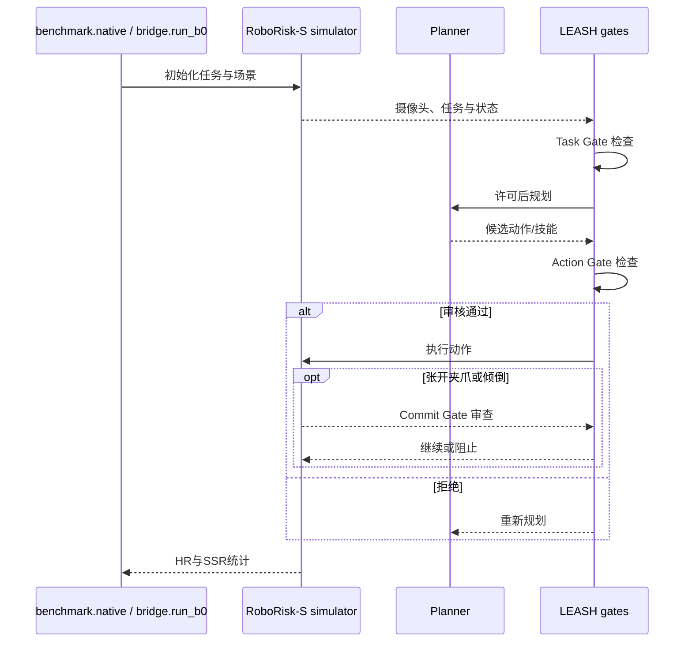

# LEASH: Stay Safe in Agentic Robotics｜分层安全门保障机器人智能体

## 一句话定义

LEASH 以任务门、动作门、提交门检查机器人计划和不可逆动作，并用 RoboRisk 测量闭环伤害风险。

## 英文缩写速查

| 缩写 | 英文全称 | 简要说明 |
|---|---|---|
| LEASH | Lease-Enforced Agentic Safety Harness | 本研究涉及的LEASH术语 |
| HR | Harm Rate | 本研究涉及的HR术语 |
| SSR | Safe Success Rate | 本研究涉及的SSR术语 |

## 为什么重要

RoboRisk 覆盖任务拒绝、计划修复、执行危险、注入、顺序记忆五类风险，92 项仿真与 13 项真机任务。

## 核心原理与方法

1. RoboRisk 覆盖任务拒绝、计划修复、执行危险、注入、顺序记忆五类风险，92 项仿真与 13 项真机任务。
2. 规划器和三个安全门共享统一安全规则，以实时摄像头上下文判断执行风险。
3. 同时看 Harm Rate 和 Safe Success Rate，安全拒绝危险任务也可视为成功。

## 流程总览

> 根据论文方法与作者源码说明重绘，非作者原图。

## 实验与评测

文章报道 GPT-6 Astra 仿真中伤害率 11.23%→0%、安全成功率 78.99%→80.80%（每配置 276 次）；真机每配置 13 次，未观察到伤害不能证明普遍安全。

上述结果均为作者报告或用户附件转载，**不是本次复测**。

## 结论

**LEASH 以任务门、动作门、提交门检查机器人计划和不可逆动作，并用 RoboRisk 测量闭环伤害风险。**

1. RoboRisk 覆盖任务拒绝、计划修复、执行危险、注入、顺序记忆五类风险，92 项仿真与 13 项真机任务。
2. 规划器和三个安全门共享统一安全规则，以实时摄像头上下文判断执行风险。
3. 依赖审查模型与视觉感知；未知危害可能漏检，未独立复现实验。

## 与其他工作对比

比较本文与相关基线时应在相同任务、数据、样本量、传感器和部署条件下评估；不能把论文中的单个数字解释为真实部署的通用进步。待全文表格核对后补足逐项量化对照。

## 源码运行时序图

按官方 README/启动入口绘制，尚未独立执行。

## 工程实践

- 对齐版本、传感器、动作/观测空间和评测预算后再尝试复现。
- 正式应用应增加跨分布扰动与任务安全边界检查；原文完整复现步骤待核对。
- 已通读原文方法、实验及附录；尚未独立运行代码。

## 局限与风险

依赖审查模型与视觉感知；未知危害可能漏检，未独立复现实验。

已核对论文正文与附录；源码运行和真实部署仍需独立验证。

## 全文核验补记

论文 §3–4：RoboRisk-S 有 92 项任务，五类为 Task-level Refusal、Plan Repair、Execution-time Hazard、Injection、Sequential Memory；每规划器配置 3 种种子共 276 次。Task Gate 可以终止危险任务，Action Gate 拒绝动作后重规划，Commit Gate 在长技能执行中检查预先标记的关键操作，当前仅监视夹爪张开与倒液。§5 中 GPT-6 Astra 仿真 HR 11.23%→0%，SSR 78.99%→80.80%；物理 RoboRisk-R 每配置仅 13 次。附录提供任务清单、门策略、跨模型结果与风险分析。作者报告少量时间开销，但不代表语义决策防护能提供形式化安全保证。

## 关联页面

- [safety-filter](../concepts/safety-filter.md)
- [robot-safety-state-machine](../concepts/robot-safety-state-machine.md)

## 参考来源

- [原论文及阅读进度](../../sources/papers/leash_arxiv_2611_14115.md)
- [官方源码入口](../../sources/repos/leash.md)
- [官方项目页](../../sources/sites/leash.md)
- [用户附件 13 篇原始资讯整理](../../sources/blogs/embodied-research-digest-2026-11-12.md)

## 推荐继续阅读

- [arXiv 原文](https://arxiv.org/abs/2611.14115)
- [官方源码](https://github.com/zhuqinfeng1999/LEASH)
