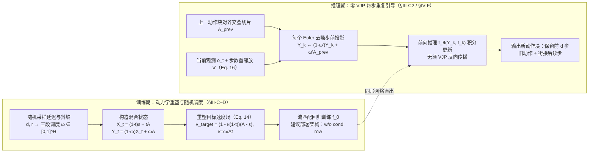
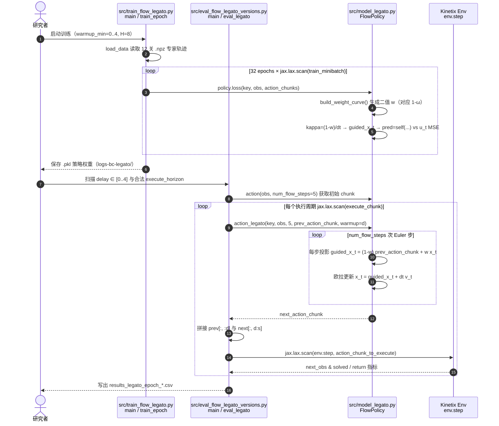

# Legato（Learning Native Continuation for Action Chunking Flow Policies）

**Legato**（*Learning Native Continuation for Action Chunking Flow Policies*，[arXiv:2602.12978v2](https://arxiv.org/abs/2602.12978)，[项目页](https://lyfeng001.github.io/Legato/)，[仿真源码](https://github.com/lyfeng001/Legato-kinetix)，已录用至 **RSS 2026**）由 **上海交通大学**、**千寻智能（Spirit.AI）**、**清华大学**、**同济大学** 与 **中国科学技术大学** 联合提出。针对 [Action Chunking](../methods/action-chunking.md) 流匹配 [VLA](../methods/vla.md) 策略在真实异步部署中因推理延迟导致的块边界跳变与**伪多模态切换（spurious multimodal switching）**，Legato 将平滑延续推进训练期流场动力学本身：在保持原有流模型架构与推理计算量不变的前提下，实现更低抖动、更快执行且无需推理期反向传播引导的实时动作块衔接。

## 一句话定义

> **在流匹配训练阶段用“动作–噪声混合路径 + 每步重复引导的等效重塑速度场目标 + 随机三段调度”教会策略沿上一动作块延续，从而在不改变推理结构、不计算 VJP 梯度的情况下消除跨块模态跳变。**

## 英文缩写速查

| 缩写 | 英文全称 | 简要说明 |
|------|----------|----------|
| RTC | Real-Time Chunking | 推理期基于 $\Pi\mathrm{GDM}$ pseudoinverse guidance 的动作块衔接方法 |
| T-RTC | Training-Time Real-Time Chunking | 在训练期条件化已提交前缀的 RTC 变体，仅锚定硬约束前缀 |
| VLA | Vision-Language-Action | 视觉–语言–动作多模态机器人策略模型 |
| VJP | Vector-Jacobian Product | 推理期引导算法每步去噪须执行的反向传播梯度计算开销 |
| ODE | Ordinary Differential Equation | 流匹配推理所积分的常微分方程动力学路径 |
| NSPARC | Normalized Spectral Arc Length | 衡量末端执行器加速度谱平滑度的无量纲指标，越低越平滑 |

## 核心信息

| 项 | 内容 |
|----|------|
| 论文 | [arXiv:2602.12978v2](https://arxiv.org/abs/2602.12978)（v1 2026-02-13，v2 2026-05-17，**RSS 2026**） |
| 作者 | Yufeng Liu、Hang Yu、Juntu Zhao、Bocheng Li 等（Project leader：Junliang Guo；通讯：Dequan Wang、Yang Gao） |
| 机构 | 上海交通大学、千寻智能（Spirit.AI）、清华大学、同济大学、中国科学技术大学 |
| 项目主页 | <https://lyfeng001.github.io/Legato/> |
| 官方源码 | <https://github.com/lyfeng001/Legato-kinetix>（**MIT License**，基于 `Physical-Intelligence/real-time-chunking-kinetix`） |
| 开源边界 | **部分开源**：仅 Kinetix 2D 仿真训练与评测脚本开源；真机 $\pi_{0.5}$、$\pi_0$ 与 GR00T N1.6 适配代码未开源 |

## 为什么重要

- **直击真机异步痛点：** 大型流匹配 VLA 单次前向常耗 100–200 ms（论文中 $\pi_{0.5}$ 在 RTX 4090 上约 170 ms），相邻 chunk 间独立采样容易产生左右路径来回摇摆、犹豫停顿或高频折返纠正。
- **去除推理期计算税：** 推理期 [Real-Time Chunking（RTC）](./paper-real-time-chunking.md) 虽不改训练权重，但每个去噪步需过网络计算 VJP 反向传播，且强制把未经延迟分布训练的向量场拉向旧块轨迹，容易破坏原有平滑流场。
- **补充硬前缀之外的软衔接动力学：** 相比 [Training-Time RTC](./paper-training-time-real-time-chunking.md) 只把固定前缀 `d` 设为干净条件、其余步数不作训练期引导，Legato 通过三段权重调度把延迟与过渡斜坡同时写进训练期速度场目标。
- **多底座通用性有实证：** 在 $\pi_{0.5}$ 之外还在 $\pi_0$ 与 NVIDIA GR00T N1.6 上完成真机对照，说明核心公式仅作用于连续动作采样路径而非特定模型结构。

## 流程总览

下图依据原文 §III-A–D 与 §IV-F 总结训练期目标重塑与推理期无梯度延续两条主链：

## 核心原理

### 1. 为何“只在初态引导”不够：Per-step Repeated Guiding 的必要性

Legato 首先通过消融验证：若只在去噪首步 $t=0$ 按旧块混合初始化 $Y_0 = (1-\omega)\epsilon + \omega A$、之后完全自由积分（One-shot guidance），后续多步积分依然会让交叠区域漂移偏离已知轨迹（原文 Table A.2 中 Pour 任务 Overlap RMSE 从 Legato 的 `5.14 ± 0.17` 升至 One-shot 的 `12.69 ± 1.55`）。因此延续约束必须在**每个 Euler 步前重复执行投影引导操作符** $\mathcal{G}_{\omega}(Y) = (1-\omega)\odot Y + \omega \odot A$。

### 2. 三段调度权重与重塑速度场 ODE

1. **三段调度权重 $\omega \in [0,1]^H$（§III-A2）：** 将长度 $H = d + r + s$ 的动作块划分为三段——推理延迟窗口内已无法改写的前 $d$ 步固定 $\omega_i = 1$；紧随其后长度为 $r$ 步的过渡区间从 $1$ 线性斜坡衰减到 $0$，鼓励交叠区平滑衔接；末端 $s$ 步开放区设 $\omega_i = 0$，允许策略充分响应当前视觉观测。训练期按均匀随机分布 $d \sim \mathrm{Uni}[0, 10],\, r \sim \mathrm{Uni}[0, 50]$ 采样，覆盖真机延迟波动。
2. **等效连续 ODE 与重塑训练目标（§III-C，Eq. 8–14）：** 令标准流插值为 $X_t = (1-t)\epsilon + tA$，引导中间态为 $Y_t = (1-\omega)\odot X_t + \omega \odot A$，其中等价噪声初态分布为 $\epsilon_{\mathrm{eff}} = (1-\omega)\odot \epsilon + \omega \odot A$。若离散采样步长为 $\Delta t = 1/N$ 且每步先施加 $\mathcal{G}_\omega$ 再前向求速度场 $f_\theta(Y_t, t)$，则其在连续时间极限对应带恢复项 $\kappa = \omega/\Delta t$ 的动力学：

$$
\dot{Y}(t) = (1-\omega)\odot f_\theta(Y(t), t) - \kappa \odot (Y(t) - A), \qquad
v_{\mathrm{target}}(\epsilon, A, t, \omega) = \bigl(1 - \kappa \odot (1 - t)\bigr)\odot (A - \epsilon)
$$

模型直接在该重塑速度目标下做流匹配均方误差回归，推理期只需执行标准欧拉步并套用投影 $\mathcal{G}_\omega$，无需计算高代价 VJP 梯度。

### 3. 去条件行与推理步数重缩放（§IV-D3、§IV-F）

原文早期架构把 $\omega$ 作为额外通道拼接进模型条件输入，但消融发现：当部署时更改去噪步数（$N_{\mathrm{infer}} \neq N_{\mathrm{train}}$，如追求低延迟而缩至 $1$ 步）时，带条件行的版本会失去调度泛化能力；为此 **§IV-F 部署指南建议直接去掉调度条件通道（`w/o cond. row`）**，并在不同 $N_{\mathrm{infer}}$ 下用公式 (16) 对推理引导权重重缩放：

$$
\omega'_i = \mathrm{clamp}\!\left(1 - (1 - \omega_i)\frac{N_{\mathrm{train}}}{N_{\mathrm{infer}}},\; 0,\; 1\right)
$$

### 4. 论文符号与 `Legato-kinetix` 源码记号的对应差异

阅读开源仓库 `src/model_legato.py` 时需注意正负互补约定：论文 $\omega$ 表示**旧块延续引导强度**（前段 $1$、后段 $0$），而 Kinetix 源码中的权重张量 `w` 表示**随机噪声保留比例**（`warmup` 之前为 `0.0`，之后为 `1.0`，即 $w \equiv 1 - \omega$）；针对 Kinetix 短视野 $H=8$，源码 `build_weight_curve` 也省略了中间线性斜坡，仅采用二值阶跃。

## 评测

以下结果均据 `arXiv:2602.12978v2` §IV 及附录 Tables I–VII、A.1–A.4（真机主平台为双臂 7-DoF 桌面机械臂，14 维动作空间，$H=60$、$30\,\mathrm{Hz}$、默认延迟 $d=8 \approx 266.7\,\mathrm{ms}$、$N=5$ 步积分）：

1. **真机对照 RTC（$\pi_{0.5}$ 底座，Table I）：** 在 5 项桌面与双臂任务中，Legato 全面降低完成时间与动作平滑度指标 `NSPARC` 且保持不低于或更高的任务得分。其中高难度多步骤 **Pour**（3 次重复 50 trials 级别评估口径）得分从 `9.34` 提升至 `9.72`，耗时 `95.07s → 75.73s`（约减 `20.3%`），`NSPARC` `2.85 → 1.65`，块交叠 RMSE `7.64 → 5.14`；**Bowls** 得分 `8.68 → 9.08`，耗时 `52.88s → 42.66s`（约减 `19.3%`）；**PickPlace / Drawer / Towel** 完成时间分别缩短 `14.5%`、`16.1%` 与 `22.9%`。
2. **对照 Training-Time RTC（§IV-C）：** 同在 Pour 任务上，Legato 取得 `9.72` 分、`75.73s`、`NSPARC 1.65`，全面优于 T-RTC 的 `9.46` 分、`81.73s`、`NSPARC 2.46`（后者的硬前缀锚定在多模态连续倒水中仍残留较强境界跳变）。
3. **对照 Temporal Ensembling（TE）与动态扰动（§IV-D5、Table A.3）：** TE 在长延迟下平均多模态模式会引起迟滞和轨迹偏移；在 **Skewer Fruit**、**Insert Pen** 与动态**主动拉球扰动实验**（$d=s=8,\, r=22$）中，Legato 维持 `0.7` 成功率的同时把 `NSPARC` 从 RTC 的 `1.97 ± 0.14` 压低至 `1.48 ± 0.18`。
4. **跨底座扩展（Table V）：** 将同一训练/引导机制迁移至 $\pi_0$ 与 **NVIDIA GR00T N1.6** 后均维持对推理期 RTC / TE 基线的速度与平滑优势。
5. **Kinetix 2D 仿真基准（§IV-E）：** 在 12 关卡不同推断延迟设置下，$d > 0$ 时 Legato 整体优于 `Inference-Time RTC`、`BID` 与 `Hard Masking`。

## 结论

**Legato 说明“动作块连续性”应当被写成流匹配策略本身的速度场动力学约束，而非推理时的补丁引导。**

- 若任务需在百毫秒级推理延迟下完成高频双臂操作且允许微量后训练预算，**重塑流场目标（`w/o cond. row` + 随机调度）优于推理期 VJP 引导与时间集成**。
- **切勿省略每步重复投影：** 仅在去噪首步混合已知后缀会在积分中漂移回单模态均值或错位，须每步循环施加 $\mathcal{G}_\omega$。
- **部署变更采样步数时选无条件行方案：** `w/o cond. row` 配合 Eq. (16) 步数缩放可避免测试步数改变引发的条件分布失效。
- **代码复现边界清晰：** `Legato-kinetix` 可直接用于理解算法和在 Kinetix 验证，但**无法直接用作 $\pi_{0.5}$ / GR00T 真机微调工程模板**，真机集成须自行修改目标 VLA 的流匹配损失与采样循环。

## 与其他工作对比

| 维度 | Legato（arXiv:2602.12978） | [Real-Time Chunking](./paper-real-time-chunking.md) | [Training-Time RTC](./paper-training-time-real-time-chunking.md) | [REMAC](./paper-remac.md) | [FutureRTC](./paper-futurertc.md) |
|------|-----------------------------|---------------------------------------------------|-----------------------------------------------------------------|---------------------------|-----------------------------------|
| 约束进入阶段 | 训练期重塑目标速度场 + 推理期零梯度每步投影 | 仅推理期 $\Pi\mathrm{GDM}$ inpainting | 训练期干净前缀条件化 + 推理直接前向 | 训练期 delay 掩码仅监督可执行后缀 | 冻结 VLA + 前挂时空预测 adapter |
| 是否需重训 VLA 权重 | 需要（微调 / 续训动作头速度场） | 不需要（即插即用） | 需要（微调前缀条件与 token-wise 时间步） | 需要 | 不改 VLA 主权重（仅训 adapter） |
| 交叠过渡区域处理 | 三段调度（固定 $d$ + 线性斜坡 $r$ + 开放 $s$） | 固定 $d$ + 指数衰减软掩码（覆盖重叠区） | 仅硬锚定已提交前缀 $d$ | 基于延迟掩码与自条件课程 | 用预测的执行时刻视觉/本体条件对齐未来 |
| 推理额外开销 | **极低**：每步一次张量混合，**无 VJP** | 每步需反向传播求 **VJP**（约增 1.3×–2.5× 步时） | 与标准流采样一致 | 与标准采样一致 | 增加轻量 adapter 前向计算 |

## 源码运行时序图

下列时序严格对应官方开源仓 `lyfeng001/Legato-kinetix` 中的 Kinetix 2D 仿真训练路径（[`src/train_flow_legato.py`](https://github.com/lyfeng001/Legato-kinetix/blob/main/src/train_flow_legato.py)）与延迟扫描评测路径（[`src/eval_flow_legato_versions.py`](https://github.com/lyfeng001/Legato-kinetix/blob/main/src/eval_flow_legato_versions.py)、[`src/model_legato.py`](https://github.com/lyfeng001/Legato-kinetix/blob/main/src/model_legato.py)）。**真机 $\pi_{0.5}$ / $\pi_0$ / GR00T N1.6 版本源码未开放，不在本图范围内。**

> 关键代码入口说明：Kinetix 实现将重塑流权重 `w` 拼接在特征维末位 `action_dim + 1 + obs_dim` 输入 `FlowPolicy.in_proj`（含 `w` 条件通道与阶跃调度），在迁移到真实高维 VLA（`H=50–60`）时应按原文 §IV-F 采用“三段线性斜坡 + `w/o cond. row` + Eq. (16) 缩放”。

## 工程实践

- **如何判断是否先用推理期 RTC 还是上 Legato：** 无权重或只想做零训练基线测试时，先按 [LeRobot RTC 文档](https://huggingface.co/docs/lerobot/rtc)跑通推理期 RTC；一旦在高速/接触切换任务遇到单步时间涨到近百毫秒或频繁块间犹豫，用约 1–2 万步尺度后训练微调换入 Legato 收益显著。
- **注意代码 `w` 与论文 $\omega$ 的反向约定：** 复现时核对公式系数前务必分清是“延续权重 $\omega$”还是“噪声保留权重 `w = 1 - ω`”，反用会把已知前缀完全置零或把自由后缀强行锁死在旧轨迹上。
- **避开超步数泛化陷阱：** 若目标边缘平台需要将去噪步数从训练时的 `N=5–10` 降到 `1–2` 步，务必采用原文 §IV-F 推荐的 `w/o cond. row` 变体并用 Eq. (16) 重算有效引导强度。

## 局限与风险

- **真机代码未开源：** 仓库 `lyfeng001/Legato-kinetix` 仅包含基于 `real-time-chunking-kinetix` 的 2D 仿真训练与评测脚本，论文中 $\pi_{0.5}$ / $\pi_0$ / GR00T N1.6 真机实现与硬件适配层未公开发布。
- **需改动模型训练阶段：** 相比完全免训练的推理期 RTC 或训练-free 的 [Action Upcycling](./paper-action-upcycling.md)，Legato 需要对已训 VLA 进行带随机调度重塑目标的微调。
- **极端突发障碍约束与超参敏感性：** 若在已进入执行窗口的最后 $d$ 步发生突发碰撞，硬锁定的前缀动作依然不能即时回撤；此外原文仅在一个特定延迟/斜坡采样区间下做主验证，过短或过长 $H$ 的分布适配仍需按硬件控制频率校准。

## 关联页面

- [千寻智能（Spirit.AI）](./spirit-ai.md) — 论文产研主导方之一；Legato 作为官方 `/news/41` 公开的四大研究瓶颈之四解决异步块切换
- [Spirit-v1.5](./cn-os-spirit-v1-5.md) — 千寻同系 60-step chunk 流匹配 VLA 开源项目
- [Action Chunking](../methods/action-chunking.md) — 动作块方法谱系总览，含 RTC / T-RTC / Legato 演进线
- [VLA（Vision-Language-Action）](../methods/vla.md) — 视觉–语言–动作策略方法页
- [操作（Manipulation）](../tasks/manipulation.md) — 双臂与桌面操作核心任务定义
- [Real-Time Chunking](./paper-real-time-chunking.md) — 推理期 $\Pi\mathrm{GDM}$ inpainting 原文页
- [Training-Time RTC](./paper-training-time-real-time-chunking.md) — 训练期前缀条件化方案
- [REMAC](./paper-remac.md) · [FutureRTC](./paper-futurertc.md) — 同谱系异步 chunk 训练期与冻结适配对照
- [VLA 纵深路线 · Stage 4 部署与系统整合](../../roadmap/depth-vla.md) — 对应本库 VLA 部署延时的学习节点

## 参考来源

- [Legato 原文与源码精读归档（arXiv:2602.12978v2，RSS 2026）](../../sources/papers/legato_arxiv_2602_12978.md)
- [arXiv:2602.12978v2 HTML 全文](https://arxiv.org/html/2602.12978v2)
- [官方 Kinetix 仿真仓库（lyfeng001/Legato-kinetix，MIT License）](https://github.com/lyfeng001/Legato-kinetix)

## 推荐继续阅读

- [Legato 官方项目主页（含真机多倍速对比视频）](https://lyfeng001.github.io/Legato/)
- [Physical Intelligence Real-Time Chunking 博客与技术脉络](https://www.pi.website/research/real_time_chunking)
