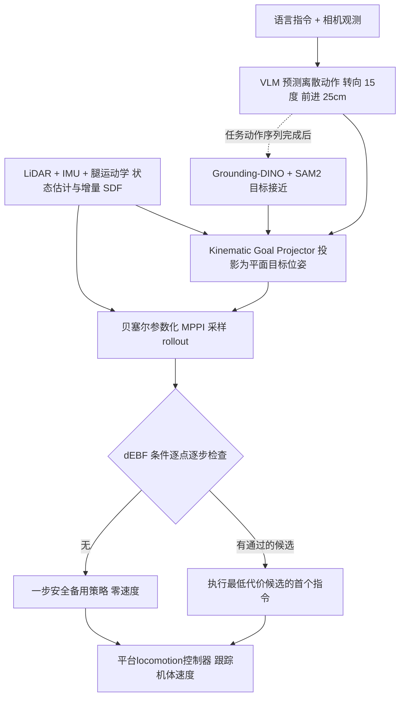

# Caging Vision-Language Navigation for Legged Robots via Barrier-Certified Safety Architecture（arXiv:2611.04972）

论文 [arXiv:2611.04972](https://arxiv.org/abs/2611.04972)，特拉华大学 RPNG（Kulkarni、Katragadda、Du、Huang）与丰田汽车公司 Frontier Research Center（Sha），首页标注 Accepted to IEEE-RAS Humanoids 2026。逐段核对记录见 [来源归档](../../sources/papers/legged-vln-barrier-caging_arxiv_2611_04972.md)。

## 一句话定义

**不改动预训练 VLM/VLA，只在它的导航提议与腿式机器人运动控制器之间插入一层几何安全「笼」：增量 SDF 感知 + 低维贝塞尔 MPPI + dEBF 硬认证与一步备用策略，在论文声明的假设下给出碰撞规避的前向不变性证明。**

## 英文缩写速查

| 缩写 | 英文全称 | 简要说明 |
|------|----------|----------|
| VLN | Vision-Language Navigation | 按自然语言指令导航 |
| VLA / VLM | Vision-Language-Action / Vision-Language Model | 本文前端实际输出离散转向 / 前进动作（IV） |
| SDF | Signed Distance Field | 到最近障碍表面的带符号距离，本文为 2D 栅格并增量更新（III-A、III-B） |
| MPPI | Model Predictive Path Integral | 采样式轨迹优化，按指数代价加权更新均值 |
| dEBF | Discrete Exponential Barrier Function | 离散指数屏障条件 h(x_{k+1}) ≥ γh(x_k)（式 10） |
| JPS | Jump Point Search | 可选全局栅格路径规划，减轻局部极小（III-B） |
| CR / SR / E2E SR | Collision Rate / Success Rate / End-to-End SR | 碰撞率 / 成功率 / 需同时完成任务且无碰撞（VI-A） |
| NE | Navigation Error | 终点到目标物体相对位置的距离误差 |

## 为什么重要

- 作者认为预训练模型的导航输出不含机器人轮廓、局部障碍和形式化安全条件（I），而语义前端可替换，安全责任不应转给学习模型（II）。本文给出一种把安全压到几何层的做法。
- 结果（作者报告）：G1 上 120 次执行，无笼 60/60 碰撞，有笼 0/60，四个前端一致（VI-E 表 IV）。
- 与强化学习的关系：本文是规划与屏障函数方法，没有训练策略；locomotion 控制器只被说成「平台相关、跟踪机体速度指令」（VI-A），具体类型论文未写。可作为 VLA 之上安全层的对照读物。

## 核心机制

要点（括号为论文章节 / 式号）：

1. **语义层（III-B、IV）：** VLM 输出离散动作，投影器要求目标点 SDF 值不小于 0.3 m，被占用时在局部半径内采样替代并按式 (2) 选优。
2. **贝塞尔 MPPI（V-A）：** 控制序列由度 d 贝塞尔曲线的 d+1 个控制点表示 (3)；代价 J = C_goal + C_ctl + C_safety (4)，其中 C_safety (11) 只用于引导采样，安全保证来自显式检查。
3. **dEBF 认证（V-C）：** 机器人用 M 个体固定球近似，h_i = ϕ(p_i) − r_i；只执行满足 (10) 的最低代价 rollout 的第一条指令，否则执行满足 (12) 的备用 κ。只需 SDF 取值，无需 SDF 梯度（V）。
4. **定理 1（V、附录 I）：** 在 (A1) 至 (A5) 下，h_i(x_k) ≥ γ^k h_i(x_0) ≥ 0，安全集前向不变；证明是对 k 的归纳。
5. **目标接近（IV、VI-F）：** 任务动作序列完成后用 Grounding-DINO 与 SAM2 检测分割，经 LiDAR、里程计、内参投影成 3D 位置，距离 0.5 至 3.0 m 内才接受，d_stop = 0.50 m。

## 实验结果速览

| 实验 | 设置 | 论文报告 | 出处 |
|------|------|----------|------|
| 无 JPS、静态障碍 | G1，4 m x 4 m，4 前端 x 5 次，每配置 20 次 | CR 80% -> 0%，Obj SR 35% -> 40%，E2E SR 15% -> 40% | VI-C 表 I |
| JPS + 突现障碍 | 同上 | CR 100% -> 0%，Obj SR 55% -> 70%，E2E SR 0% -> 70% | VI-C 表 II |
| 端到端 | G1，6 m x 6 m，25 条指令 x 3 次，每配置 75 次 | CR 简单 0.33 -> 0.00，复杂 0.50 -> 0.00，SR 均 0.75 | VI-D 表 III |
| 端到端 | Vision 60，室内外，类别级比率 | 简单 SR 0.47 -> 0.73、CR 0.67 -> 0.20；复杂 SR 0.46 -> 0.54、CR 0.91 -> 0.08 | VI-D 表 III |
| 系统级笼 | G1，12 m x 12 m，15 条指令 x 4 前端 x 开关 = 120 次 | 无笼 60/60 碰撞，有笼 0/60 | VI-E 表 IV |
| 目标接近 | Vision 60，终点 5（关）/ 3（开） | 平均 NE 1.50 m -> 0.29 m | VI-F 表 V |

## 结论

**这层「笼」在论文的实验范围内把碰撞率压到 0（G1），且不改语义前端；但它保证的是「不撞」，不是「做成」，任务完成率仍由前端和 SDF 覆盖决定。**

1. **真正要看的指标**是 E2E SR（完成任务且无碰撞）而不只是 CR：G1 端到端实验 CR 降到 0 而 SR 维持 0.75 不变（表 III），说明笼主要换来安全、不直接换来成功率。
2. **注意保守性代价**：表 I 中 Claude 前端开笼后无碰撞但接近任务 E2E SR 从 40% 掉到 0%；γ 越大越保守（V-C、图 3a），部署需按场景调 γ。
3. **证明的前提要逐条核对**：定理 1 依赖 (A1)–(A5) 与平面模型，不含估计误差、延迟、跟踪误差和运动障碍物（VI-G）；未建图的细杆、电线等无法认证，是 Vision 60 剩余碰撞的主因。
4. **传感器是安全上限**：同一规划层在 G1（高质量 LiDAR）上 CR 归零，在 Vision 60（VLP16）上复杂任务仍有 CR 0.08（表 III）。
5. **贡献未拆分**：系统级消融是 MPPI、JPS、dEBF 全开对全关（VI-E），也没有和其他屏障函数 MPPI 或 CBF-QP 做对比实验，选型时不能据此判断哪个组件起主要作用。

## 与其他工作对比

作者在相关工作（II）把本文放在三条线之间：学习式腿式 VLN 前端（如 NaVILA、QUAR-VLA）、操作侧的安全 VLA（SafeVLA、VLSA/AEGIS），以及 MPPI 加屏障函数的方法（Shield-MPPI、BR-MPPI、MPPI-DBaS）。

| 对照 | 差异读法 |
|------|----------|
| [NaVILA](./paper-notebook-navila-legged-robot-vision-language-action-model.md) | 学习式腿式 VLA 导航前端；本文不替代它，而是把它作为四个可替换前端之一放在笼内（VI-A、表 IV） |
| [LOVON](./paper-notebook-lovon-legged-open-vocabulary-object-navigator.md) | 同为腿式开放词表目标导航，偏重分层规划与执行鲁棒性；本文重点是对前端输出做几何硬认证 |
| Shield-MPPI / BR-MPPI 等（见 [MPPI](../methods/mppi.md)） | 作者在相关工作中列为同类屏障函数 MPPI；本文用贝塞尔低维参数化加 dEBF 显式逐点检查与一步备用策略，但未做实验对比 |
| [Barrier-state 安全导航](./paper-barrier-state-safe-navigation.md) | 同为屏障类安全导航，该页沿路径拼接安全区域成单一约束；本文以 SDF 取值和多球足迹做离散指数屏障检查 |

## 工程实践

- 平台与计算（VI-A）：Unitree G1（高质量 LiDAR，FastLIVO2 里程计）与 Ghost Robotics Vision 60（不变 EKF，较旧的 VLP16 激光雷达）；建图与规划跑在 NVIDIA A4500 上；语义前端本地或通过接口调用。
- 参数（VI-A）：γ = 0.95，200 样本，10 次迭代，步长 0.05 s，50 步（2.5 s 时域）。γ 越大越保守（V-C、VI-B 图 3a）。
- 模块化接口：语义层输出平面目标位姿，物理层只依赖 SDF 与平台专属的多球足迹（图 2），论文称同一规划层在两个平台上不改动地部署（II）。
- 不做 SDF 数值微分，避免增量地图上的梯度（V）。
- 与本 wiki 关系：安全滤波思路见 [Safety Filter](../concepts/safety-filter.md)，屏障函数基础见 [控制障碍函数](../concepts/control-barrier-function.md)，采样优化见 [MPPI](../methods/mppi.md)。

## 局限与未验证之处

论文自述（VI-G、VII）：

- 认证只针对当前 SDF，传感器盲区和未建图几何（细电线、桌沿、窄杆）无法被认证，是 Vision 60 剩余碰撞的主要原因。
- 平面体速度模型与多球模型不含状态估计误差、延迟、跟踪误差；运动障碍物未处理。
- 笼不能纠正错误或不可达的语义目标；任务完成仍取决于前端，表 I 中 Claude 前端在无 JPS 设置下加 dEBF 后无碰撞但未完成接近任务。

读者判断（非作者自述）：

- 定理 1 把 h 当作固定函数，而 SDF 在线更新；地图变化时前向不变性是否保持，论文未单独讨论（推测需要额外假设）。
- 样本量小：受控实验每前端 5 次；Vision 60 只有类别级比率，试验数未给出；表 V 的 NE 是 5 对 3 个终点，两组终点不同，不是同一批的配对比较。
- 无笼基线是 MPPI、JPS、dEBF 全关（VI-E），不能区分 JPS、SDF 取代价和 dEBF 各自的贡献；没有与 Shield-MPPI、BR-MPPI 等屏障函数 MPPI 方法或 CBF-QP 安全滤波的对比实验。
- 论文未给出代码或项目页链接，复现性未知。
- 前端模型名（ChatGPT 5.6 Luna、Gemini 3.5 Flash、Claude Fable 5）按论文原文照录，版本细节论文未展开。

## 关联页面

- [控制障碍函数 CBF](../concepts/control-barrier-function.md)
- [Safety Filter](../concepts/safety-filter.md)
- [MPPI](../methods/mppi.md)
- [VLA 方法页](../methods/vla.md)
- [视觉语言导航任务](../tasks/vision-language-navigation.md)
- [Unitree G1](./unitree-g1.md)
- [Barrier-state 安全导航论文](./paper-barrier-state-safe-navigation.md)
- [LOVON 腿式开放词表导航](./paper-notebook-lovon-legged-open-vocabulary-object-navigator.md)

## 参考来源

- [legged-vln-barrier-caging_arxiv_2611_04972.md](../../sources/papers/legged-vln-barrier-caging_arxiv_2611_04972.md)
- [arXiv:2611.04972](https://arxiv.org/abs/2611.04972)

## 推荐继续阅读

- [arXiv PDF](https://arxiv.org/pdf/2611.04972)
- [Safety Filter](../concepts/safety-filter.md)
- [视觉语言导航任务](../tasks/vision-language-navigation.md)
