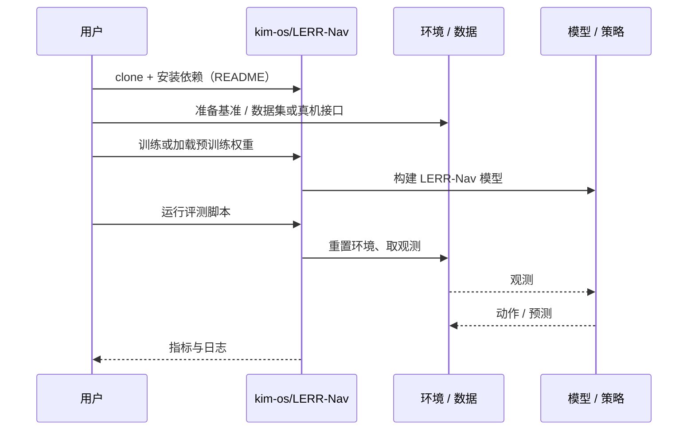

# LERR-Nav（arXiv:2610.15362）

**LERR-Nav**（*LERR-Nav: Learning to Coordinate Exploration, Recovery, and Reminiscing for Object Navigation*，[arXiv:2610.15362](https://arxiv.org/abs/2610.15362)，[代码](https://github.com/kim-os/LERR-Nav)）来自 [具身智能小站 2026-10-14 盘点](../../sources/blogs/wechat_embodied_station_41_papers_streamingwam_2026-10-14.md)，属「导航、足式与规划」组。

## 一句话定义

**高层视觉语言策略协调探索、停滞恢复与记忆回访，结合文字执行摘要与地图历史；HM3D / MP3D。**

## 英文缩写速查

| 缩写 | 英文全称 | 简要说明 |
|------|----------|----------|
| ObjNav | Object Navigation | 目标导航 |
| HM3D | Habitat-Matterport 3D | 导航数据集 |
| VLM | Vision-Language Model | 视觉语言模型 |

## 为什么重要

- 导航失去进展后如何脱困应纳入策略学习。
- 开源结论：**已开源**（步骤 2.5，2026-10-14）。仓库可达。
- 同期同组工作见 [流式动作块与世界模型记忆：具身智能小站 10-14 期 41 篇阅读坐标](../overview/embodied-station-2026-10-14-41-papers-technology-map.md)。

## 核心机制

| 项 | 内容 |
|----|------|
| **arXiv** | [2610.15362](https://arxiv.org/abs/2610.15362) |
| **开源** | **已开源** |
| **要点** | 仿真基准。 |
| **文内指标** | 以原文为准。 |

## 源码运行时序图

以下为按仓库入口（`kim-os/LERR-Nav`）推断的通用运行链路；入库日仅核实仓库可达，未逐文件阅读，具体脚本名以 README 为准。

## 实验与评测

- 以原文为准。
- **读法：** 本页为索引级摘要，依据公众号转述的官方摘要与仓库信息整理；逐项数字与 baseline 以原文 PDF 为准。

## 与其他工作对比

- 横向索引见 [流式动作块与世界模型记忆：具身智能小站 10-14 期 41 篇阅读坐标](../overview/embodied-station-2026-10-14-41-papers-technology-map.md)；同 arXiv 不重复造页。

## 结论

**脱困决策是导航策略的一等组件，而非兜底规则。**

1. 开源边界：**已开源** — 仓库可达。
2. 核心机制：仿真基准。
3. 复现与选型前核对任务协议、硬件与基准口径，勿直接横比公众号摘录数字。

## 关联页面

- [zero-shot-object-navigation](../tasks/zero-shot-object-navigation.md)
- [autonomous-exploration](../tasks/autonomous-exploration.md)
- [embodied-station-2026-10-14-41-papers-technology-map](../overview/embodied-station-2026-10-14-41-papers-technology-map.md)

## 参考来源

- [lerr_nav_exploration_recovery_reminiscing_arxiv_2610_15362.md](../../sources/papers/lerr_nav_exploration_recovery_reminiscing_arxiv_2610_15362.md)
- [wechat_embodied_station_41_papers_streamingwam_2026-10-14.md](../../sources/blogs/wechat_embodied_station_41_papers_streamingwam_2026-10-14.md)
- [arXiv:2610.15362](https://arxiv.org/abs/2610.15362)

## 推荐继续阅读

- [arXiv PDF](https://arxiv.org/pdf/2610.15362)
- [https://github.com/kim-os/LERR-Nav](https://github.com/kim-os/LERR-Nav)
