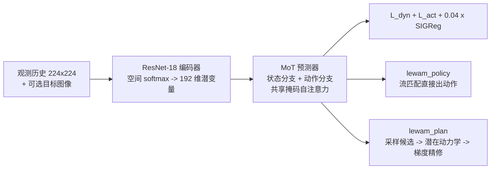
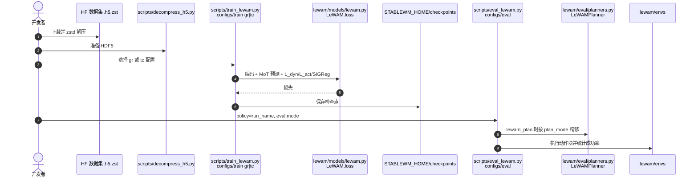

# LeWAM：用同一个潜在模型执行与规划

**LeWAM**（*End-to-End World and Action Modeling with JEPAs*，[arXiv:2610.12818](https://arxiv.org/abs/2610.12818)，[项目页](https://le-wam.github.io/)，[代码](https://github.com/MinghaoFu/lewam)）由 **UC San Diego / ETH Zurich / University of British Columbia / Brown University**（Minghao Fu、Tavis Siebert、Eryk Halicki、Randall Balestriero）提出：编码器与预测器端到端联合训练，同一个模型既预测下一潜状态，又以流匹配输出动作块。

## 一句话定义

**一个共享 ResNet-18 编码器与 Mixture-of-Transformers 预测器的 JEPA 世界-动作模型：直接采样动作即可执行，也可把采样结果送进潜在动力学做梯度精修后再执行。**

## 英文缩写速查

| 缩写 | 英文全称 | 简要说明 |
|------|----------|----------|
| WAM | World Action Model | 同时建模未来与动作的模型 |
| JEPA | Joint-Embedding Predictive Architecture | 在潜空间预测、无像素重建 |
| SIGReg | Sketched Isotropic Gaussian Regularization | 把潜变量推向各向同性高斯的正则 |
| MoT | Mixture-of-Transformers | 状态/动作两分支各有权重、共享自注意力 |
| CEM | Cross-Entropy Method | 对照的采样式规划器（LeWM 使用） |
| BC | Behavior Cloning | 无目标图像的任务完成评测 |

## 为什么重要

- **表示与控制不再割裂：** 先训 JEPA 表示再接策略时，特征可能漏掉控制相关信息；联合训练让动作损失直接塑造潜空间。
- **规划更省：** 以流策略采样作为先验、梯度精修代替宽先验 CEM，论文报 52.50 vs 1.62 plans/s（32.3×）。
- **一个模型两种用法：** 既可当反应式策略，也可在有目标图像时规划，便于按场景切换成本与精度。

## 方法栈 / 流程总览

## 方法

- **编码器：** ResNet-18（从零训练，GroupNorm）+ 32 关键点空间 softmax + 2 层 MLP；潜变量 192 维，与 [LeWM](./paper-lewm.md) 对齐。
- **预测器：** 状态分支预测 z_{t+K}，动作分支预测带噪动作块的流速度；两分支独立权重、共享一个带掩码的自注意力（掩码阻止干净动作泄漏），宽度 192、4 块、4 头，约 16.9M 参数；目标条件用 AdaLN-Zero。
- **损失：** L = L_dyn + L_act + 0.04·L_sig；帧跳 K=5，动作块 C=10。
- **规划：** 流策略采样 N 个候选（8 步 Euler）→ 潜在动力学前向 → 对冻结动力学做梯度下降（目标代价 MSE(ẑ_{t+L}, z_g) 加邻近惩罚；Adam lr 0.05）→ 选最低代价 → 执行前 K 个动作并重规划。
- **训练：** 视觉规划 batch 128、50 epoch；任务完成 batch 64、120 epoch；检查点按验证集动作流匹配损失选择。

## 源码运行时序图

官方仓库 [MinghaoFu/lewam](https://github.com/MinghaoFu/lewam)（归档 [sources/repos/lewam.md](../../sources/repos/lewam.md)）提供训练与评测入口：

- **最短复现路径：** `bash install.sh lewam cu128` → 下载 HF 数据/检查点 → `train_lewam.py --config-name gr` → `eval_lewam.py --config-name pusht eval.mode=lewam_plan eval.plan_mode=grad`；`plan_mode` 还可选 best_of_k / steer / cem。

## 工程实践

| 项 | 建议 |
|----|------|
| 起步 | 直接下载 HF 检查点（如 lewam-pusht）跑 `eval_lewam.py`，再决定是否重训 |
| 模式选择 | 有目标图像用 `lewam_plan`；仅有任务示范用 `lewam_policy`（`tc` 配置） |
| 本体与任务 | 论文为每任务、每本体单独训练，别指望开箱跨本体 |
| 开源状态 | **已开源**（MIT）：仓库含训练/评测/环境/配置；HF 组织页列出数十个数据集与检查点；论文真机部署代码未在仓库见到（推测未包含） |

## 实验与评测

- **十个仿真环境视觉规划：** LeWAM 均值 93.5%，LeWM(CEM) 50.9%；ToolHang 94.7% vs 35.4%，Transport 83.3% vs 2.8%。摘要另报接触丰富任务 28.6%→89.7%、长时域（100 步目标偏移）10.9%→46.2%，为不同任务子集口径。
- **规划速度：** 52.50 vs 1.62 plans/s，32.3×。
- **表征探针：** 含 SIGReg 的有效秩 42.90，去掉后 10.94；物体 R² 0.90 对 0.88。
- **消融：** 去 SIGReg 使 Push-T 规划降 25.3 点；端到端编码器直接成功率 86.7%，冻结 DINOv2 CLS 79.0%。
- **真机（每任务 30 次）：** Diffusion Policy 平均 38.9%（19/16/0）；LeWAM 端到端 33.3%（16/8/6），冻结 V-JEPA 2.1 版 35.6%；π0.5 28.9%。LeWAM 约 270 GFLOPs/chunk，π0.5 约 3604。
- 无目标任务详表在附录，本次未读到。

## 结论

**把动作流匹配与 JEPA 动力学放进同一端到端模型，既保留反应式执行，又让规划比宽先验 CEM 更省；真机上仅与 Diffusion Policy 相当偏低。**

1. **联合训练优于冻结特征** — 端到端编码器 86.7% 高于冻结 DINOv2 的 79.0%。
2. **SIGReg 对规划关键** — 去掉后 Push-T 规划降 25.3 点。
3. **用流策略当规划先验** — 比宽高斯 CEM 快 32.3 倍。
4. **真机别高估** — 平均低于 Diffusion Policy，只是“有竞争力”。
5. **先复现仿真检查点** — 仓库与检查点齐全，成本低。

## 局限与风险

- 数据规模与覆盖有限；对陌生物体、视角、接触状态的泛化未验证。
- 每任务、每本体单独训练；无多任务/语言条件，未接层次或子目标规划。
- 约 17M 参数；真机仅三项任务各 30 次。
- 项目页写 arXiv “coming soon”，与实际不一致；附录部分未读。

## 与其他工作对比

| 对照 | 差异读法 |
|------|----------|
| [LeWM](./paper-lewm.md) | 先训表示/动力学再规划（CEM）；LeWAM 联合学动作并用梯度精修 |
| [JEPA-WAM](./paper-jepa-wam.md) | 同属 JEPA 系世界-动作模型思路 |
| [Diffusion Policy](./paper-diffusion-policy.md) | 真机强基线，平均 38.9% 略高于 LeWAM |
| [世界-动作模型概念](../concepts/world-action-models.md) | 本页是其轻量潜空间实例 |

## 关联页面

- [34 篇空间落地技术地图（汇总页）](../overview/embodied-station-34-papers-spatial-grounding-technology-map.md)
- [世界-动作模型](../concepts/world-action-models.md)
- [生成式世界模型](../methods/generative-world-models.md)
- [LeWM](./paper-lewm.md)
- [操作任务](../tasks/manipulation.md)

## 参考来源

- [具身智能小站 34 篇周报](../../sources/blogs/wechat_embodied_station_34_papers_spatial_grounding_2026-10-12.md) — 线索来源
- [lewam_arxiv_2610_12818.md](../../sources/papers/lewam_arxiv_2610_12818.md) — 论文摘录
- [le-wam-github-io.md](../../sources/sites/le-wam-github-io.md) — 项目页核查
- [lewam.md](../../sources/repos/lewam.md) — 仓库归档
- [arXiv:2610.12818](https://arxiv.org/abs/2610.12818)

## 推荐继续阅读

- [LeWAM 项目页](https://le-wam.github.io/)
- [LeWAM GitHub](https://github.com/MinghaoFu/lewam)
- [LeWAM Hugging Face](https://huggingface.co/LeWAM)
