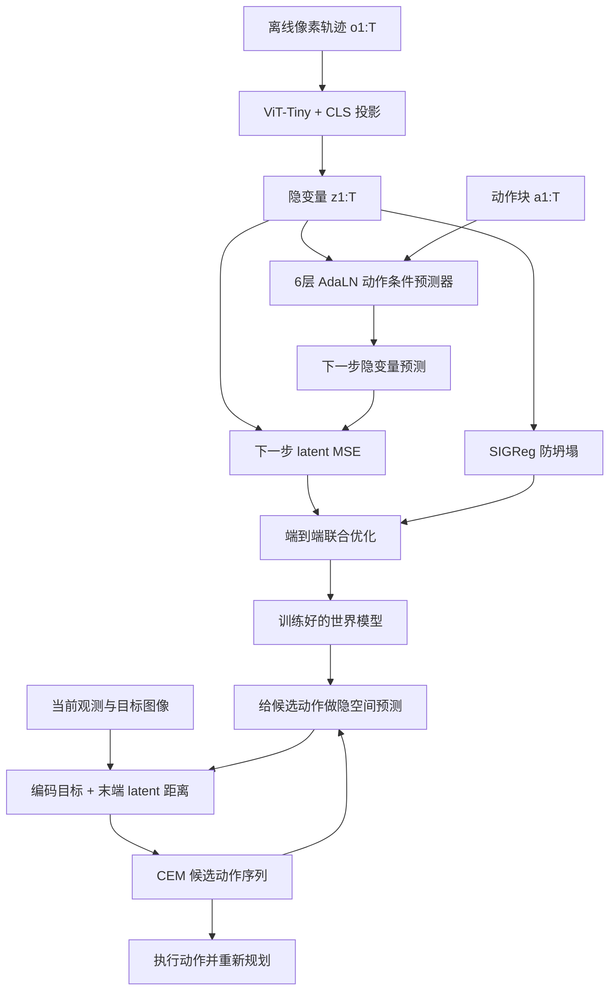
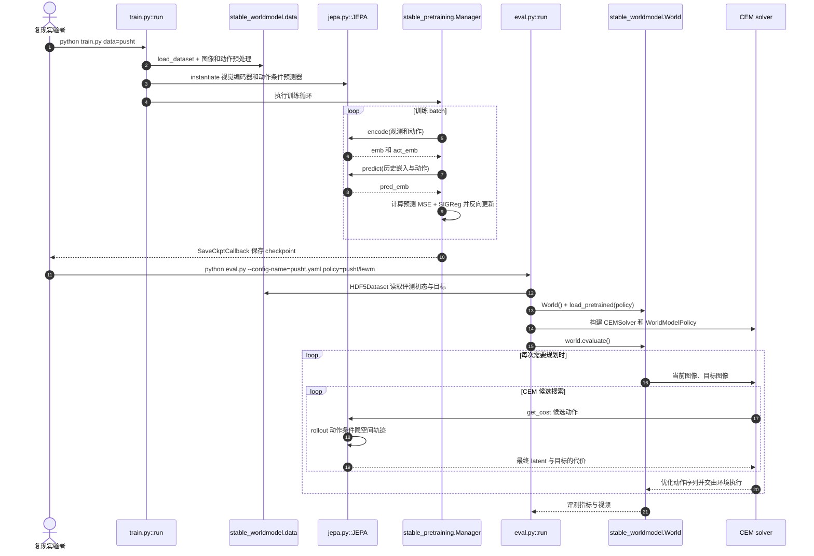

# LeWorldModel / LeWM（像素端到端 JEPA WM · arXiv:2603.19312）

**LeWorldModel（LeWM）**（*Stable End-to-End Joint-Embedding Predictive Architecture from Pixels*，[arXiv:2603.19312v3](https://arxiv.org/html/2603.19312v3)（2026-06-03）；[项目页](https://le-wm.github.io/)；[代码](https://github.com/lucas-maes/le-wm)）把 [LeJEPA](./paper-lejepa.md) 的 SIGReg 接到**动作条件**隐动力学：从原始像素联合训编码器与预测器，测试时在隐空间做 CEM。

## 一句话定义

> **两项损失（下一 embedding MSE + SIGReg）从像素端到端训 15M JEPA，规划比冻结 foundation 编码器的 WM 快一个数量级。**

## 英文缩写速查

| 缩写 | 英文全称 | 简要说明 |
|------|----------|----------|
| LeWM | LeWorldModel | 本文动作条件 JEPA 世界模型 |
| SIGReg | Sketched Isotropic Gaussian Regularizer | 防坍塌；产出**稠密**高斯码 |
| CEM | Cross-Entropy Method | 测试时隐空间 MPC |
| PLDM | Planning with Latent Dynamics Models | 端到端对照（VICReg 多损失） |
| DINO-WM | DINO World Model | 冻结 DINOv2 + 规划对照 |

## 为什么重要

- 腾讯文里 LpWM 的「稠密对照」就是本页，不是口头基线。
- [INTACT](./paper-intact.md) 的世界模型规划对照包含 LeWM 家族。
- [LG-DKGP](./paper-lg-dkgp.md) 在冻结 LeWM 上另学历史动作连续性先验，增加门控动作历史、深核 GP 残差和 CEM 搜索；这是后续工作，不属于 LeWM 原论文贡献。
- 证明：防坍塌不必冻结大视觉模型，也不必 6–7 项 VICReg 汤。

## 核心信息

| 项 | 内容 |
|----|------|
| **机构** | Mila / 蒙特利尔大学；纽约大学；Samsung SAIL；布朗大学 |
| **规模** | ~15M（ViT-Tiny 编码器 + 6 层 AdaLN 预测器） |
| **数据** | 离线、无奖励的观测–动作轨迹 |
| **规划** | CEM，典型 <1 s；相对 DINO-WM 至 **48×** |
| **开源** | **已开源** MIT；HF `quentinll/lewm` |

## 核心原理（方法栈）

\[
z_t=\mathrm{enc}(o_t),\quad \hat z_{t+1}=\mathrm{pred}(z_t,a_t)
\]

训练损失 = \(\|\hat z_{t+1}-z_{t+1}\|_2^2 + \lambda\,\mathrm{SIGReg}(Z)\)：SIGReg 以随机一维投影的正态性检验，约束 latent 分布匹配各向同性高斯。论文默认投影数 \(M=1024\)、\(\lambda=0.1\)；当前公开训练配置 `config/train/lewm.yaml` 使用 \(\lambda=0.09\)，需区分论文和源码配置。训练时不使用 stop-gradient / EMA / 预训练冻结编码器。测试时固定世界模型，CEM 最小化预测终态与目标 latent 的**平方**距离。

## 源码运行时序图

训练：`uv venv --python=3.10`、`uv pip install stable-worldmodel[train,env]`、`python train.py data=pusht`；评测：`python eval.py --config-name=pusht.yaml policy=pusht/lewm`。训练由 `train.py::lejepa_forward` 计算两项损失，评测由 `eval.py::run` 调用 stable-worldmodel 的求解器；这是源码静态核对，不代表本地已复现。

## 实验与评测

- **速度：** 图像用 192 维单个 [CLS] latent（约 DINO-WM 视觉 token 数的 1/200）；论文指定设置下规划用时**最高**快 48×，不能推导高频真机控制已达标。
- **PushT：** Appendix G Table 5：LeWM **96.0±2.83%**，PLDM **78.0±5.0%**，DINO-WM **92.0±1.63%**（50 条评测轨迹、目标 25 步内可达、预算 50 步）；相对 PLDM +18 个百分点。像素-only 设置在论文指定对照中超过使用本体感觉的 DINO-WM。
- **OGBench-Cube：** DINO-WM 略好（3D 外观更难端到端）。
- **Two-Room：** LeWM 较差——低本征维 vs 高维高斯先验。
- VoE：传送显著抬高 surprise，变色不显著。

## 工程实践

- 论文报道 ~15M 参数可在单卡数小时训练；作者代码 `train.py` 采用 Hydra / Lightning，模型在 `jepa.py`，评测在 `eval.py`，依赖 stable-worldmodel / stable-pretraining。
- **复现路径：** 先准备 HF HDF5 数据与 `$STABLEWM_HOME`，运行 `python train.py data=pusht`，再以 `python eval.py --config-name=pusht.yaml policy=pusht/lewm` 评测。HF `weights.pt` 须先转换为 `*_object.ckpt`，评测 `policy` 写不带后缀的相对路径。
- **规划设定（Appendix D）：** CEM 每轮 300 候选、30 elite；PushT **最多30轮**、其余任务**最多10轮**；horizon 5 × frame-skip 5 = 25 环境动作。不要将 PushT 的迭代次数泛化到全部任务。
- 数据必须覆盖动态，不要求专家最优。
- 稠密码让浅预测器在 PushT 上失败——要降预测器容量请看 [LpWM](./paper-lpwm.md)。

## 局限与风险

- 仿真 2D/3D 操作，不是真机 VLA。
- SIGReg 在极简环境会过正则。
- 规划仍在测试时跑 CEM，不是 ActEffect 那种部署卸 WM。

## 与其他工作对比

| 工作 | 关系 |
|------|------|
| PLDM | 同为端到端；7 项损失不稳 |
| DINO-WM | 冻结大编码器；本页更小更快 |
| [LpWM](./paper-lpwm.md) | 同一梯子，稀疏目标 |
| [LeVJEPA](./paper-levjepa.md) | 无动作、无规划 |
| [Traj-LeWM](./paper-traj-lewm.md) | 同骨干 + LTC 路径感知规划（+3~+14 pp） |
| [MotionJEPA](./paper-motionjepa.md) | 同 LeWM 栈 + DISReg；静态 distractor CEM 均值 +61/+58 pp vs LeWM（25/50 步） |
| [SRD](./paper-state-readout-decoupling.md) | 解耦 rollout 接口，减长视界误差累积 |

## 结论

**总判：LeWM 用 latent 预测 MSE + SIGReg 将像素端到端世界模型训练简化为两项损失，在四个仿真控制环境保持有竞争力的规划性能与更低计算成本；尚未证明高频真机实时部署。**

1. 复现从 HF 数据 + `train.py data=pusht` 起。
2. 比速度用规划墙钟，别只用成功率。
3. Two-Room 掉点是先验不匹配，不是实现 bug。
4. 要更浅的预测器或可读 support，换 LpWM。

## 关联页面

- [AD-E2E-JEPA](./paper-ad-e2e-jepa.md) — 自动驾驶目标条件规划：冻结 DINOv3 并以 SIGReg projector 压缩 patch 表征，与 LeWM 像素端到端路线互补。
- [MotionJEPA](./paper-motionjepa.md) — DISReg 防时间坍塌与 distractor 规划
- [Traj-LeWM](./paper-traj-lewm.md) — 潜轨迹代价扩展
- [State–Readout Decoupling](./paper-state-readout-decoupling.md) — rollout 解耦
- [CausalVAE WM Plug-in](./paper-causalvae-world-models.md) — 同组因果动力学线
- [LeJEPA](./paper-lejepa.md) — SIGReg 出处：随机 1D 投影 + Epps–Pulley 特征函数检验，时间/内存对维数与 batch 近似线性；原文只做图像 SSL，无动作条件或机器人闭环评测（arXiv:2511.08544）
- [LpWM](./paper-lpwm.md)
- [LeVJEPA](./paper-levjepa.md)
- [Music-JEPA](./paper-music-jepa.md) — 同一 JEPA 框架迁移到音频动作条件动力学
- [INTACT](./paper-intact.md)
- [潜空间想象](../concepts/latent-imagination.md)
- [生成式世界模型](../methods/generative-world-models.md)

## 参考来源

- [LeWM v3 原文通读归档（§1–6 / Appendix A–I）](../../sources/papers/lewm_arxiv_2603_19312.md)
- [lucas-maes/le-wm](../../sources/repos/le-wm.md)
- [项目页归档](../../sources/sites/le-wm-github-io.md)
- [腾讯科技访谈归档](../../sources/blogs/wechat_tencent_world_model_questions_2026-09-05.md)

## 推荐继续阅读

- [arXiv:2603.19312v3（HTML 全文）](https://arxiv.org/html/2603.19312v3)
- [项目页](https://le-wm.github.io/)
