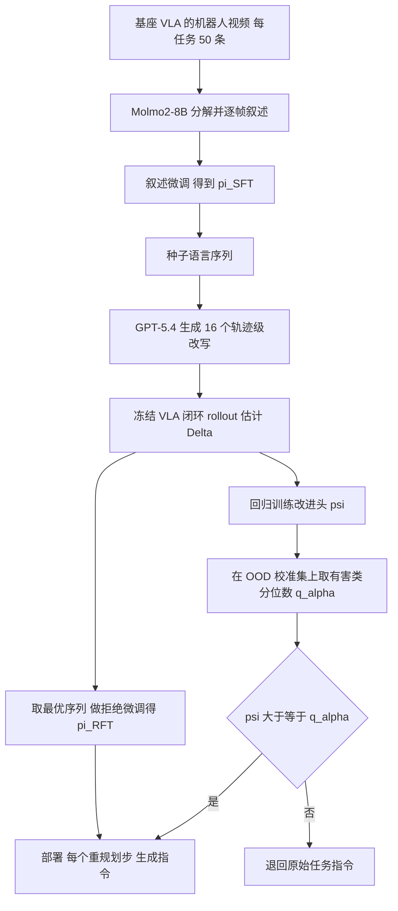

# Learning What to Say to Your VLA（LFP，arXiv:2606.12299）

*Learning What to Say to Your VLA: Mostly Harmless Vision Language Action Model Steering*（Jeong, Swamy, Bajcsy，CMU，[arXiv:2606.12299](https://arxiv.org/abs/2606.12299)，CoRL 2026 清单第 086 篇，P2 / Spotlight）。

## 一句话定义

**不改冻结 VLA 的权重，只训练一个小 VLM 作为语言反馈策略（LFP），在每个重规划步生成新的语言指令喂给 VLA，并用保形预测校准的改进头判断「改写是否值得」，不值得就退回原始指令。**

## 英文缩写速查

| 缩写 | 英文全称 | 简要说明 |
|------|----------|----------|
| VLA | Vision-Language-Action | 视觉-语言-动作策略，这里指被冻结的 π0.5 |
| LFP | Language Feedback Policy | 论文要学的语言策略，输入观测与任务描述，输出一句指令 |
| RFT | Rejection Fine-Tuning | 只用高改进样本做监督微调（专家迭代式），得到 π_RFT |
| CP | Conformal Prediction | 保形预测，用校准集给出有限样本的误差率保证 |
| FPR | False Positive Rate | 这里指「改写其实有害却仍改写」的比例 |
| ID / OOD | In-/Out-of-Distribution | 相对 LFP 训练环境而言的分布内 / 外 |
| SOOD / VOOD | Semantic / Visual OOD | 真机里语义改写 / 视觉干扰物扰动 |
| Δ | language improvement | 某语言序列相对原指令的成功率增量（式 2） |

## 为什么重要

- 作者自述（第 1 节）：VLA 对措辞很敏感，近义指令可能差异巨大，有些技能靠提示根本激发不出来；因此需要一个会「试」的语言层，而不是人工换说法。
- 不碰 VLA 权重，也不需要 VLA 的原训练数据（摘要），对只能拿到闭源或冻结 checkpoint 的部署场景有吸引力。
- 把「何时不该干预」作为一等问题，用保形预测给出 FPR 的有限样本控制（第 4 节、附录 7.2），这点与多数只追求平均提升的 prompt 优化工作不同。

## 核心原理与流程总览

三阶段（第 4.1 节）：叙述微调给出局部语言先验，交互式搜索找出真正提升闭环成功率的语言，保形校准决定部署时何时放行。

关键公式与设计（均出自第 3-4 节）：
- 语言改进 Δ 定义为「用语言序列 ℓ0:T 的期望成功率」减「重复原指令 T 次的期望成功率」（式 2）。
- 改进头 ψ 对初始观测与任务描述回归 Δ̂，平方损失（式 6）；附录表 5：冻结 π_RFT 的最后隐藏层特征，MLP d→64→1。
- 保形阈值：q̂α 取有害样本（Δ̂<0）得分的有限样本分位数（式 8），保证 P(ψ(X) ≥ q̂α | Y=0) ≤ α（式 7 / 9，在可交换性假设下）。

## 工程实践

- **VLA 与环境（第 5.1 节）：** 仿真 π0.5-LIBERO，真机 π0.5-DROID，Franka 加腕部与第三人称相机；VLA 不微调。
- **LFP 训练（第 5.1 节、表 3-4）：** Qwen3-VL-4B-Instruct，LoRA（r=64，α=128），AdamW，学习率 1e-5，1 个 epoch，贪心解码。
- **搜索预算（附录 7.1）：** 仿真每个序列先 25 次 rollout，保留前 8 个再追加 75 次；真机先 10 次，前 8 个再追加 20 次；拒绝微调每任务用 50 条成功的同策略轨迹。训练使用单张 A6000 Ada。
- **校准（附录 7.1）：** 每个扰动组合 20 个校准样本，来自 LFP 与 ψ 都没训练过的视觉与语义 OOD 扰动。
- **部署：** LIBERO 每 5 个环境步、DROID 每 8 个环境步查询一次 LFP（附录 7.1）。
- **延迟（附录表 13）：** VLA 单独 68 ms（14.7 Hz）；加 π_RFT 后总计 274 ms（3.6 Hz），瓶颈是自回归语言生成。作者建议蒸馏、缓存或异步更新（未验证）。
- **提示词模板：** 任务分解、叙述、改写、闭环指令四个模板见附录图 8-11。

## 与清单说法的核对

清单摘要：「Searches for language that improves a frozen VLA's closed-loop success and distills it into a test-time language feedback policy.」

| 清单措辞 | 论文核对 |
|----------|----------|
| 搜索能改善冻结 VLA 闭环成功率的语言 | 属实。搜索范围是围绕叙述种子的局部改写（N=16，轨迹级），不是开放词表搜索（第 4 节、第 6 节自述为局限） |
| 蒸馏成测试时语言反馈策略 | 属实，即拒绝微调得到 π_RFT（式 5）。但清单略去了论文的另一半：改进头与保形校准的拒绝机制，也即标题里的「mostly harmless」 |
| 仿真还是真机 | 清单未区分；论文两者都做：LIBERO-OOD 仿真与 Franka 真机，VLA 分别为 π0.5-LIBERO 与 π0.5-DROID |
| 「harmless」的含义 | 论文只对「改写有害」的比例给出可交换性假设下的上界 α，且校准分布与测试分布同分布才成立；并非对任意分布外情形的保证（第 4 节，式 7） |
| 摘要里的 24.7% / 65.0% | 摘要未说明是绝对还是相对、用哪个模型。我用表 10 与表 12 复算：真机四个标称任务 π_CP 均值 82.5% 对 π_VLA 50.0%，相对提升 65.0%，与摘要吻合；仿真训练环境 63.8 对 51.2 相对提升约 24.6%（表中为一位小数，推测摘要的 24.7% 是同一口径）。均是相对提升，不是百分点 |

## 局限

论文自述（第 6 节）：
- 语言不总是最佳的控制通道，这也是设计拒绝机制的原因；未来要和改观测、改隐状态、改动作生成互补研究。
- 语言搜索空间仍然巨大，本文只在固定序列附近做改写式局部搜索。

我的观察（核对论文数据得到，非作者自述）：
- 新组合任务上并非全面提升：表 11 中任务 15 上 π_RFT 为 30.0%，低于 π_VLA 的 40.0%；任务 14 为 0%；任务 16-22 所有方法均为 0%。「steers unseen compositions」只在部分任务成立。
- 仿真 Visual-Scene 条件下未校准的 π_RFT（88.5）低于 π_VLA（89.8），校准后的 π_CP 为 90.9（表 10）；在 LIBERO-10 等 VLA 已接近饱和的条件下，增益主要来自校准而非搜索。
- 「真机 FPR 2.22%」（表 1）所基于的有害样本数论文未给出，真机每个任务条件只有 30 次 rollout，估计方差未报告，且校准与评估使用同类扰动。
- 真机标称任务同时是训练任务，「seen environments」上的提升不代表泛化；真机每个格子仅 30 次试验（第 5.2 节），无置信区间。
- 搜索依赖 GPT-5.4 与 Molmo2-8B 等大模型做离线教师，且 rollout 成本（仿真每序列 100 次、真机 30 次）未折算进「样本效率」对比；对比 π_VLA-SFT 的数据量只算了成功轨迹条数（第 5.2 节、图 5）。
- 部署延迟增至约 4 倍（表 13）。
- 仅验证 π0.5 一类 VLA 与桌面抓放任务；是否适用于其他 VLA 或需要新技能的任务，论文未验证。

## 关联页面

- [VLA（Vision-Language-Action）](../methods/vla.md)
- [基础策略（Foundation Policy）](../concepts/foundation-policy.md)
- [LoRA](../concepts/lora.md)
- [流匹配具身策略](../concepts/flow-matching-embodied-policy.md)
- [π0.5 论文页](./paper-pi05-open-world-vla.md)
- [LIBERO 基准](./libero-benchmark.md)
- [DROID 策略学习](./droid-policy-learning.md)
- [Molmo2](./molmo2-vlm.md)
- [Qwen3-VL](./qwen3-vl.md)
- [类条件保形 STL 推断](./paper-class-conditional-conformal-stl-inference.md)
- [DreamSteer：VLA 部署期操控](./paper-dreamsteer-vla-deployment-steering.md)
- [SayCan](./paper-saycan.md)

## 参考来源

- [来源归档：lfp-vla-language-steering_arxiv_2606_12299.md](../../sources/papers/lfp-vla-language-steering_arxiv_2606_12299.md)
- [arXiv:2606.12299](https://arxiv.org/abs/2606.12299)

## 继续阅读

- [VLA 方法页](../methods/vla.md)
- [arXiv PDF](https://arxiv.org/pdf/2606.12299v1)
- 论文相关工作：Wu 等 *Do What You Say*（arXiv:2510.16281，LIBERO-OOD 来源）、Jain 等 *A smooth sea never made a skilled sailor*（arXiv:2506.05294，学习搜索）
