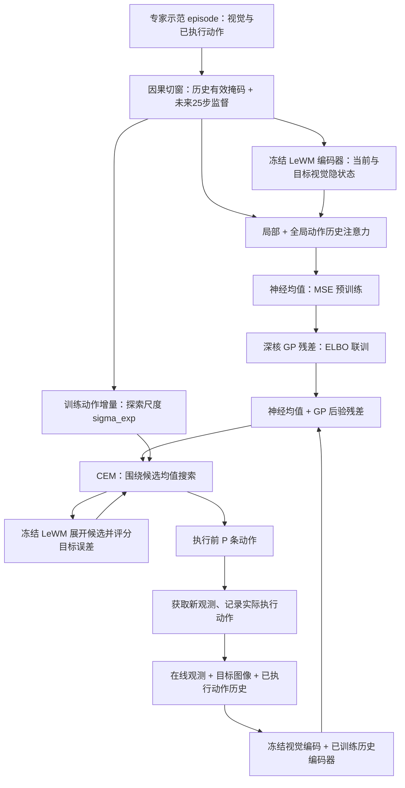
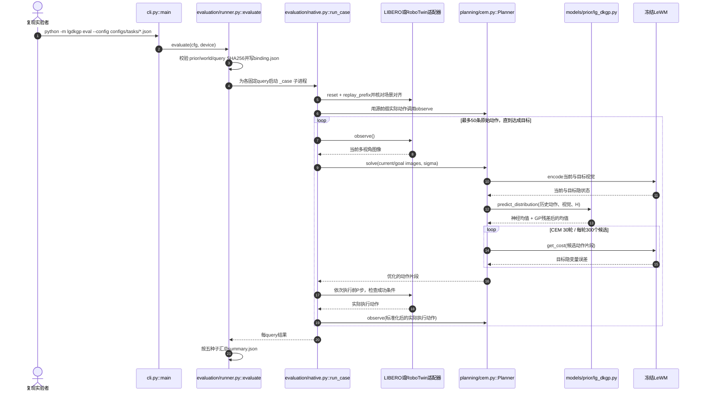

# LG-DKGP：面向世界模型规划的连续性感知动作先验 / Rethinking Actions: Continuity-Aware Priors for World-Model Planning

**论文：** [arXiv:2611.16645v1](https://arxiv.org/html/2611.16645v1)（2026-11-12）  
**作者：** Shaobo Yang、Zichen Ai、Ziyang Ma、Qian Yang、Bin Fang  
**开源代码：** [oliverstack-byte/LG-DKGP](https://github.com/oliverstack-byte/LG-DKGP)

## 一句话定义

**LG-DKGP** 学习专家示范中**已执行动作如何延续**：从当前/目标视觉隐状态与历史动作生成「神经均值 + 高斯过程残差」的连续动作候选中心，再让冻结世界模型引导 CEM 搜索可达目标的动作序列。

## 英文缩写速查

| 缩写 | 英文全称 | 简要说明 |
|---|---|---|
| LG-DKGP | Locality-Gated Deep-Kernel Gaussian-Process Prior | 本文局部/全局门控的深核 GP 动作先验 |
| GP | Gaussian Process | 对神经均值未拟合的时间相关动作残差建模 |
| LeWM | LeWorldModel | 冻结的动作条件视觉世界模型，负责预测与打分 |
| CEM | Cross-Entropy Method | 对动作候选采样、筛选精英并重拟合搜索分布 |
| MPC | Model Predictive Control | 仅执行部分规划动作，再根据新观测滚动重规划 |
| MMD² | Squared Maximum Mean Discrepancy | 对比规划动作与专家转移特征分布的距离 |
| ELBO | Evidence Lower Bound | 训练稀疏变分 GP 的优化目标 |
| NLL | Negative Log-Likelihood | 联合训练阶段的验证检查点选择指标 |

## 为什么重要

- 仅让世界模型预测得准，不代表其采样的**动作片段**符合专家行为的时间结构；缺乏动作先验时会搜索出抖动、反复折返的候选。
- 论文跨五个环境将每条示范动作在 episode 内打乱，发现相邻动作差显著增大，说明动作顺序不仅是数值集合，更包含可利用的连续性信息。
- 与泛化的「相邻动作差越小越好」不同，本文拟合的是**专家有目的的动作延续**：急停、接触阶段切换也可能属于正确动作，不应被简单平滑掉。
- 方法在 [LeWM](./paper-lewm.md) 外另训动作提议先验，区分「提议什么动作」与「世界模型评估哪些动作接近目标」。

## 核心机制与方法栈

### 1）执行历史的局部门控注意力

当前观测与目标观测经冻结编码器得到视觉隐变量；历史输入是至多 32 条先前**实际执行过**的动作、有效位掩码，以及相邻有效动作的增量。一个两层、每层四头、宽 128 的编码器同时做：

- **Global attention：** 全部有效动作提供较长期的阶段/轨迹上下文。
- **Local attention：** 在注意力分数上减去与动作年龄有关的可学习非负惩罚，更关注近期变化。
- **Locality gate：** 依据当前查询与两个分支输出，自适应融合局部/全局信息。没有有效历史时使用学习的回退向量。

视觉条件与历史特征组合为 \\(r_t=[\\bar z_t;\\bar z_g;h_t]\\)。训练时未来专家动作只作监督标签，线上规划不读取这些标签。

### 2）神经均值与时间 GP 残差

对于未来第 \\(\\ell\\) 个动作、坐标 \\(j\\)，先验的基本形式为：

\\[
\\widetilde a_j(\\ell)=m_{\\theta,j}(\\ell;\\mathcal C_t)+f_j(x_{t,\\ell})+\\epsilon_{\\ell,j}.
\\]

- 神经均值预测非线性动作延续；深核 GP 对剩余误差建模，使用学习的 RBF 查询/上下文特征与 Matérn-3/2 时间核；不同动作坐标的 GP 独立建模。
- 每个动作坐标使用 128 个诱导点。这里的**连续性**是给定上下文下无噪声动作过程的均方连续，而非必须约束每步机械臂速度/加速度。
- **两阶段训练：** 先以 MSE 训练神经均值，再以变分 ELBO 联训历史编码器、神经均值、GP 残差；始终冻结视觉编码器和世界模型预测器。模型分别依验证 MSE 与联合 NLL 选最佳检查点。

### 3）专家动作增量定标的 CEM

使用训练示范的**相邻标准化动作平方增量**估计各任务的各向同性探索尺度 \\(\\sigma_{\\mathrm{exp}}\\)，而非对全部任务套用固定扰动幅度；采样中心是神经均值加 GP 后验均值。

CEM 对动作片段候选调用冻结 LeWM 的 \\(\\|F_\\omega^{(H)}(z_t,a)-z_g\\|_2^2\\) 目标分数，在同等规划预算下筛选更接近目标隐变量的片段。主设置每轮 300 候选、30 轮、30 elite（**一次规划 9,000 次候选评分**），预测/执行长度 H=P=25，最多执行 50 条原始动作，再根据新观测重新规划。

## 流程总览

按 [论文 §3](https://arxiv.org/html/2611.16645v1) 的实际训练/评测职责划分：



## 源码运行时序图

官方仓库含可运行训练及评测入口。下面按照 [CLI](https://github.com/oliverstack-byte/LG-DKGP/blob/main/src/lgdkgp/cli.py)、[Planner](https://github.com/oliverstack-byte/LG-DKGP/blob/main/src/lgdkgp/planning/cem.py)、[native 评测](https://github.com/oliverstack-byte/LG-DKGP/blob/main/src/lgdkgp/evaluation/native.py) 核对；以 LIBERO/RoboTwin 的 eval 分支为例（PushT/Cube 走 evaluation/pc.py）：



代码和离线数据归档： [lg-dkgp.md](../../sources/repos/lg-dkgp.md)。**该图是源码静态分析，不代表已在本机运行仿真或对齐论文数值。**

## 实验与评测

论文主文 Table 2：五种评测种子 101、202、303、404、505，任务间取不加权平均；下表为作者报告成功率（%）：

| 方法 | PushT | Cube | LIBERO Caddy | LIBERO Scene2 | RoboTwin | Macro |
|---|---:|---:|---:|---:|---:|---:|
| LeWM | 93.60 | 63.60 | 55.31 | 69.88 | 10.91 | 58.66 |
| INTACT | 64.40 | 92.00 | 80.97 | **77.53** | 40.26 | 71.03 |
| PRISM（world-model planning，同名异项目需区分） | 94.00 | 87.60 | 56.78 | 56.91 | 13.01 | 61.66 |
| LG-DKGP | **97.60** | **98.80** | **83.32** | 76.96 | **78.66** | **87.07** |

**口径提醒：** PushT/Cube 是仿真环境原生任务成功；Caddy/Scene2 使用演示片段的**局部目标**达到标准；RoboTwin 使用局部目标或已验证原生终态的「或」条件。Macro 87.07% **不是五种长程完整任务的统一成功率**，也不是真机成功率。

**关键消融：** 去掉 GP 残差使 Macro 降 3.80 个百分点；将专家增量标定的探索尺度换为固定 \\(\\sigma=0.3\\)，Macro 从 87.07% 降为 74.92%；只直接执行组合均值与额外运行 CEM，在 PushT 上由 58.40% 增至 97.60%。这些结果说明连续动作提议与目标条件搜索作用互补。

## 结论

**核心价值是让动作提议符合专家示范的时间结构，并由冻结世界模型选择朝向目标的候选；性能提升不能归因于「越平滑越好」或单独的 GP。**

1. **先核对动作历史的因果性**：部署输入只能含已执行命令，不能把训练未来动作标签接入规划上下文。
2. **不要只复制神经均值**：GP 残差和目标条件 CEM 解决不同部分，需分别做 ablation。
3. **探索噪声要按训练动作尺度设置**：相同固定噪声在 RoboTwin 的结果尤其差。
4. **比较成功率先统一任务定义**：局部片段目标不能直接宣称真实长程操作泛化。
5. **复现必须保留配对关系**：每任务的 prior、LeWM、action normalization、query/fixture manifest 必须匹配，不能交叉混用。
6. **别把规划成本忽略**：每次 CEM 调用 9,000 候选评分，论文未证明该设置满足实时真机控制频率。

## 与其他工作对比

- [LeWM](./paper-lewm.md)：提供像素端到端动作条件世界模型；LG-DKGP 保留冻结 LeWM，再学习基于历史的动作先验，改进候选生成/搜索。
- [INTACT](./paper-intact.md)：倾向学意图到动作的直接映射，主评测为 search-free；LG-DKGP 保留高预算搜索，更偏向**目标导向的候选优化**，不应混淆延迟。
- [MPC](../methods/model-predictive-control.md)：同样采用滚动时域计划与重新观测，但 LG-DKGP 的搜索代价来自**视觉隐空间预测器**，不是明确可微刚体动力学的 MPC 求解。
- 论文 PRISM（arXiv:2606.07974）是**世界模型先验引导想象采样**，注意并非本站另一个 [PRISM 多项式本体表征](./paper-prism.md)（arXiv:2607.23473）。

## 工程实践

**开源状态：** 已发布 Python 训练/评测源码，包含 prepare、train --stage mean/gp、train-world、eval/check 命令及五任务 configs；大型 checkpoint、数据和 native fixtures 在外部另行分发。源码仓库 [README](https://github.com/oliverstack-byte/LG-DKGP/blob/main/README.md) 明确要求 Linux x86-64、Python 3.10、单 GPU，并为 pc/libero/robotwin 分别装互斥依赖。

以 PushT 为例，须先准备数据与**匹配的模型权重**：

```bash
uv sync --locked --extra pc
uv run --locked --no-sync python -m lgdkgp prepare --config configs/tasks/pusht.json
uv run --locked --no-sync python -m lgdkgp train --config configs/tasks/pusht.json --stage mean
uv run --locked --no-sync python -m lgdkgp train --config configs/tasks/pusht.json --stage gp
uv run --locked --no-sync python -m lgdkgp eval --config configs/tasks/pusht.json
```

- 首次完整训练世界模型时，先运行 train-world 并把其产生的权重路径显式交给 prepare/eval；已有配对权重时可复用。
- eval 要求已经完成的 gp-stage checkpoint，不是 mean.pt；结果保存 summary.json（种子统计）与 binding.json（模型/query SHA256）。
- 调试关注：历史有效掩码、action normalizer、local/global gate、GP 训练的验证 NLL、专家增量 sigma、规划候选次数、模拟器成功判据与 checkpoint 校验。

## 局限与风险

- **仅五个仿真环境**：没有本文 LG-DKGP 的真机实验结果或保证实时的部署延迟；LIBERO/RoboTwin 的主指标部分是局部片段目标。
- **历史与规划时域敏感**：RoboTwin 的长历史在 H=P=25 有帮助，但改短规划/执行时域可能改变最佳历史长度；超出 25 步预测范围的目标成功率下降。
- **视觉条件有任务差异**：仅历史条件的变体在 Caddy、Scene2、RoboTwin 分项可能反而优于全模型，不能声称视觉条件处处有益。
- **MMD² 不等于动作质量**：附录显示常数动作在部分任务上的动作结构差异比 LG-DKGP 更小，必须与闭环成功率联合理解。
- **复现依赖较重**：SAGE 原生数据规模大，各模拟器运行栈不相容；此处原文/源码完成静态核对，未实测运行或复算论文结果。

## 关联页面

- 世界模型基座：[LeWM](./paper-lewm.md)
- 搜索与无搜索路线：[INTACT](./paper-intact.md)
- 控制范式：[MPC](../methods/model-predictive-control.md)、[Model-Based RL](../methods/model-based-rl.md)
- 世界模型方向：[生成式世界模型](../methods/generative-world-models.md)

## 参考来源

- [论文全文核对归档：arXiv:2611.16645v1](../../sources/papers/lg_dkgp_arxiv_2611_16645.md)
- [官方源码、运行路径与开放范围归档](../../sources/repos/lg-dkgp.md)
- [论文 HTML v1](https://arxiv.org/html/2611.16645v1)
- [官方代码及 README](https://github.com/oliverstack-byte/LG-DKGP)

## 推荐继续阅读

- [论文原文（含完整附录与实验条件）](https://arxiv.org/html/2611.16645v1)
- [LG-DKGP GitHub：配置、训练、评测与资产下载说明](https://github.com/oliverstack-byte/LG-DKGP)
- [LeWM 研究背景](./paper-lewm.md) 与 [INTACT 对比](./paper-intact.md)
