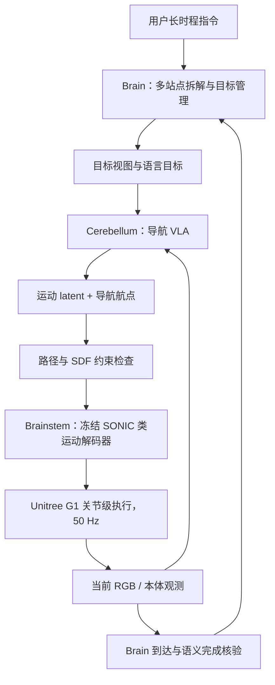

# LHNav：面向 Unitree G1 的长时程分层人形导航
**LHNav: Long-Horizon Humanoid Navigation**

## 一句话定义

LHNav 用**慢速语言任务管理器、视觉导航动作生成器、50 Hz 冻结低层人形运动解码器**分离「去哪里、如何走、如何稳定执行」的问题，以免把跨房间多目标任务直接交给一个低层关节策略。

## 英文缩写速查

| 缩写 | 英文全称 | 简要说明 |
|---|---|---|
| VLA | Vision-Language-Action | 视觉、语言和动作条件策略 |
| VLM | Vision-Language Model | 进行语义目标解析、完成判定的视觉语言模型 |
| SDF | Signed Distance Field | 用于距离和障碍/穿越约束的几何表示 |
| FSQ | Finite Scalar Quantization | 低层运动 latent 的离散化机制 |
| G1 | Unitree G1 | 作者的真机人形机器人平台 |
| SR | Success Rate | 按目标距离阈值定义的导航成功率 |

## 核心信息

| 项目 | 核验内容 |
|---|---|
| 论文 | [arXiv:2611.12136v1](https://arxiv.org/html/2611.12136v1) |
| 团队 | 浙江大学、Robbyant、香港大学（详见原文） |
| 官方主页 | [LHNav](https://robbyant-research.github.io/LHNav/) |
| 实验载体 | Unitree G1、基于仿真场景的 held-out 导航评测 |
| 官方 GitHub | [robbyant-research/LHNav](https://github.com/robbyant-research/LHNav)，**当前仅有网页文件，未核得可执行模型/部署代码** |
| 核心分层 | Brain（任务/到达确认）+ Cerebellum（VLA 航点和运动 token）+ Brainstem（低层运动解码） |

## 为什么重要

真实家庭的「先去桌边，再去门口，然后回到客厅」不只是短时避障：语义目标、抵达判定、连续导航动作与双足安全控制处于不同时间尺度。LHNav 将这些模块拆开；应与 [DASH 异步控制](./paper-dash-async-humanoid-vla.md) 比较：DASH 是**同一控制任务内快慢信息的调度**，LHNav 是**任务级→导航级→运动级的层级接口**。

## 流程总览（论文架构与训练/执行路径）

图是**论文层级信号流**，非已公开源码函数调用。训练数据由仿真的参考运动、导航路径和视觉渲染共同提供；Brainstem 的解码器与 Cerebellum 的动作生成不应混同。

## 核心原理

### 1. 多频率解耦

- **Brain：** 低频 VLM/工具链把用户指令拆分目标，检查「是否到达」并决定下一目标，避免在每个电机周期调用大模型。
- **Cerebellum：** 结合目标图像、当前第一视角 RGB 与本体观测，生成一段候选运动 latent / 航点；论文采用 GR00T N1.7 系 VLA 主干并对导航做专门适配。
- **Brainstem：** 冻结的动作解码/跟踪模型将中层表征转为连续全身动作，服务于稳定双足执行；控制更新 50 Hz，与上层约 8 Hz 的动作决策频率不相同。

### 2. 训练配方

作者利用室内场景中的几何规划与仿真运动生成示范，将带障碍约束的规划路径、双足可跟踪动作和相机观测对齐。使用 SDF 约束减少穿越不可通行几何的情况；**2D 全局路径不等于直接可上机的稳定关节轨迹**。独立的低层步行跟踪先验承担动作连续性。

### 3. 长时程成功的判据

单个目标的 `SR@distance`、与障碍碰撞、摔倒、以及多目标指令整体完成是不同指标。Brain 的主动到达核验有助于避免「走过目标却继续执行」，但不保证所有视觉条件可靠。

## 实验与评测

| 指标（作者协议） | LHNav | OmniNav | DualVLN |
|---|---:|---:|---:|
| 仿真 522 episodes，SR@0.5m | **52.3%** | 36.0% | 18.6% |
| SR@1.5m | **75.7%** | 69.0% | 48.7% |
| Collision rate | **8.6%** | 19.5% | 25.8% |
| Falls（次数） | **0** | 7 | 91 |

- 长时程任务：作者报告 **45 个任务约 75.56%** 整体完成；G1 三站点任务 **4/5**。这与上表短程/单目标仿真不是同一测试协议。
- 真实 G1 的单目标移动实验包含 25/25 的设置，但不能据此断言多目标导航 100%。
- 论文的“object rearrangement”环境变化测试评估**导航目标适应**，不要误解为 G1 完成物体抓取/摆放。

## 与其他工作对比

- [视觉语言导航任务](../tasks/vision-language-navigation.md)：提供语言目标到视觉定位的任务定义；LHNav 新增长时程任务管理与双足低层控制对接。
- [人形移动](../tasks/humanoid-locomotion.md)：强调稳态步行/接触与地形适应，LHNav 则将这些能力作为导航任务的执行底座。
- [DASH](./paper-dash-async-humanoid-vla.md)：低频语义与高频视觉动作**异步融合**，不是 LHNav 的多目标分层监督。
- [ExoStack](./paper-exostack.md)：另一种层级控制/感知软件栈，面对的是外骨骼人机协同而非自主导航。

## 源码运行时序图

**不适用（截至 2026-11-11）：** [官方仓](https://github.com/robbyant-research/LHNav) 只有项目主页的静态文件，README 仅为项目名；没有可检查的训练入口、推理接口、模型权重或 G1 驱动程序。不能凭论文框图伪造 `sequenceDiagram`。

## 工程实践

1. 复现实验应先落实 G1 的低层运动策略和急停/碰撞保护，再对接相机、目标图像、视觉导航动作与时序缓存。
2. 上机记录导航动作频率、50 Hz 解码周期、目标切换、实际里程/碰撞/跌倒及相机延迟；独立报告整体任务完成率与单目标 SR。
3. 上述建议是工程迁移检查表，**不是**官方已发布的 G1 一键部署教程。

## 局限与风险

- 官方未开放可识别的可执行训练/推理/G1 部署代码；本文指标不能独立复现。
- 目标遮挡、反光和多层空间可影响到达判断；小规模真机多站点评估不足以证明任意家庭任务泛化。
- 仿真碰撞与摔倒指标不代替现实机器人硬件安全保障。

## 结论

**LHNav 的主要贡献是人形长时程语义导航的三层职责分离，而非单靠更大的运动策略获得全部性能。**

1. 保留目标级与运动级不同时间尺度，避免上层推理阻塞关节控制。
2. benchmark 使用相同的阈值/场景/轨迹协议才比较 SR。
3. 区分「多目标完整成功」「单目标成功」「无摔倒」三个独立数字。
4. 实现未公开时以论文/仿真结果作为研究线索，不直接宣称可复现或可安全上机。

## 关联页面

- [视觉语言导航（VLN）](../tasks/vision-language-navigation.md)
- [人形运动与稳定控制](../tasks/humanoid-locomotion.md)
- [DASH：快慢分支异步 VLA](./paper-dash-async-humanoid-vla.md)
- [ExoStack：ROS 2 运动/感知软件栈](./paper-exostack.md)

## 参考来源

- [LHNav 全文阅读与指标核对](../../sources/papers/lhnav_arxiv_2611_12136.md)
- [官方项目主页](../../sources/sites/lhnav-official.md)
- [官方 GitHub 开放状态](../../sources/repos/lhnav-official.md)

## 推荐继续阅读

- [论文原文 HTML](https://arxiv.org/html/2611.12136v1)
- [LHNav 官方演示](https://robbyant-research.github.io/LHNav/)
