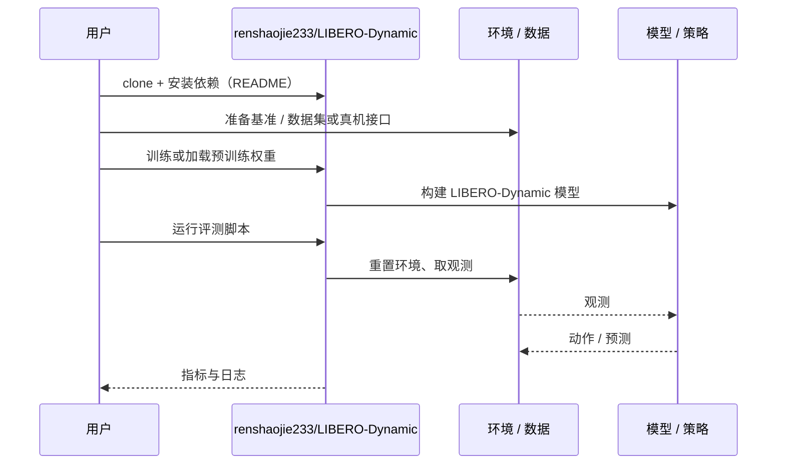

# LIBERO-Dynamic（arXiv:2610.24579）

**LIBERO-Dynamic**（*LIBERO-Dynamic: Benchmarking Robotic Manipulation in Dynamic Environments*，[arXiv:2610.24579](https://arxiv.org/abs/2610.24579)，[项目页](https://renshaojie233.github.io/LIBERO-Dynamic/)，[代码](https://github.com/renshaojie233/LIBERO-Dynamic)）来自 [具身智能小站 2026-11-01 盘点](../../sources/blogs/wechat_embodied_station_56_papers_libero_dynamic_latency_eval_2026-11-01.md)，属「评测与基准」组。

## 一句话定义

**模型在静态桌面上成功，不代表能抓住移动中的目标。**

## 英文缩写速查

| 缩写 | 英文全称 | 简要说明 |
|------|----------|----------|
| LIBERO-Dynamic | LIBERO-Dynamic: Benchmarking Robotic Manipulation in Dynamic Environments | 本文方法 / 基准的简称 |

## 为什么重要

- 模型在思考，目标还在移动。LIBERO-Dynamic把物体运动、实测推理延迟和动作队列放进同一评测：机器人思考时，物理世界继续运行。
- 开源结论：**已开源**（步骤 2.5，2026-11-01）。仓库可达（git ls-remote）。项目页 HTTP 200。
- 同期同组工作见 [动态评测、技能编译与环境潜变量适配：具身智能小站 11-01 期 56 篇阅读坐标](../overview/embodied-station-2026-11-01-56-papers-technology-map.md)。

## 核心机制

| 项 | 内容 |
|----|------|
| **arXiv** | [2610.24579](https://arxiv.org/abs/2610.24579) |
| **开源** | **已开源** |
| **要点** | 模型在静态桌面上成功，不代表能抓住移动中的目标。 |
| **文内指标** | 公众号转述：覆盖全部 40 项 LIBERO 任务，每个模型—执行配置 1,800 回合；同一 π₀.₅ 检查点在各自实测最佳动作时域下，异步 / 同步成功率为 48.4% / 43.1%（各自有限扫描中的最佳点）；结论限定于规定轨迹和标定延迟，复杂随机运动、时延抖动与更广泛真机任务仍待验证。 |

## 源码运行时序图

以下为按仓库入口（`renshaojie233/LIBERO-Dynamic`）推断的通用运行链路；入库日仅核实仓库可达，未逐文件阅读，具体脚本名以 README 为准。

## 实验与评测

- 公众号转述：覆盖全部 40 项 LIBERO 任务，每个模型—执行配置 1,800 回合；同一 π₀.₅ 检查点在各自实测最佳动作时域下，异步 / 同步成功率为 48.4% / 43.1%（各自有限扫描中的最佳点）；结论限定于规定轨迹和标定延迟，复杂随机运动、时延抖动与更广泛真机任务仍待验证。
- **读法：** 本页为索引级摘要，依据公众号转述的官方摘要与仓库信息整理；逐项数字与 baseline 以原文 PDF 为准。

## 与其他工作对比

- 横向索引见 [动态评测、技能编译与环境潜变量适配：具身智能小站 11-01 期 56 篇阅读坐标](../overview/embodied-station-2026-11-01-56-papers-technology-map.md)；同 arXiv 不重复造页。

## 结论

**模型在思考，目标还在移动：结论限定于规定轨迹和标定延迟；复杂随机运动、时延抖动与更广泛真机任务仍待验证。**

1. 开源边界：**已开源** — 仓库可达（git ls-remote）。项目页 HTTP 200。
2. 核心机制：模型在静态桌面上成功，不代表能抓住移动中的目标。
3. 复现与选型前核对任务协议、硬件与基准口径，勿直接横比公众号摘录数字。

## 关联页面

- [simulation-evaluation-infrastructure](../concepts/simulation-evaluation-infrastructure.md)
- [vla](../methods/vla.md)
- [manipulation](../tasks/manipulation.md)
- [embodied-station-2026-11-01-56-papers-technology-map](../overview/embodied-station-2026-11-01-56-papers-technology-map.md)
- [具身大模型评测基准选型闭环](../queries/embodied-eval-benchmark-selection-loop.md) — 评测基准在选型闭环中的定位与取舍

## 参考来源

- [libero_dynamic_arxiv_2610_24579.md](../../sources/papers/libero_dynamic_arxiv_2610_24579.md)
- [wechat_embodied_station_56_papers_libero_dynamic_latency_eval_2026-11-01.md](../../sources/blogs/wechat_embodied_station_56_papers_libero_dynamic_latency_eval_2026-11-01.md)
- [arXiv:2610.24579](https://arxiv.org/abs/2610.24579)

## 推荐继续阅读

- [arXiv PDF](https://arxiv.org/pdf/2610.24579)
- [项目页](https://renshaojie233.github.io/LIBERO-Dynamic/)
- [https://github.com/renshaojie233/LIBERO-Dynamic](https://github.com/renshaojie233/LIBERO-Dynamic)
