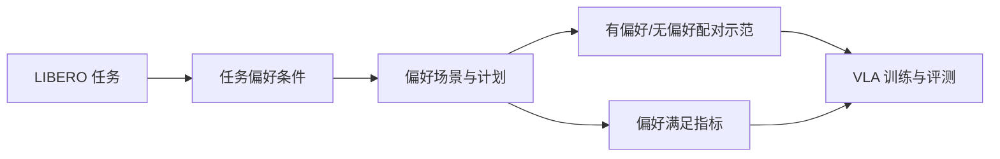

# LIBERO-PeRM：个性化机器人操作基准

## 一句话定义

**LIBERO-PeRM 将用户偏好作为任务执行条件，在受控的 LIBERO 场景中评测策略是否既完成任务、又按用户要求的方式完成。**

## 英文缩写速查

| 缩写 | 英文全称 | 简要说明 |
|------|----------|----------|
| PeRM | Personalized Robotic Manipulation | 个性化机器人操作任务 |
| LIBERO | Lifelong Robot Learning Benchmark | 本基准构建所依托的仿真基准 |
| VLA | Vision-Language-Action | 以视觉与语言条件生成机器人动作的策略 |
| SFT | Supervised Fine-Tuning | 以监督示范微调策略 |

## 为什么重要

传统成功率只回答机器人是否完成任务，不回答它是否遵循用户偏好的动作风格、技能或对象选择。偏好学习若和任务目标混为一谈，模型可能通过改变目标取巧。LIBERO-PeRM 在仿真中把偏好设为可单独控制、可自动评分的变量。

## 方法与基准设计

- **偏好类型：** 运动方式、使用的技能、用户画像/子任务选择。
- **规模：** 项目页列出 312 个任务、五个任务套件、37 个单偏好、18 对偏好，以及约 40.8K 条有/无偏好示范。
- **数据管线：** 从 LIBERO 场景出发，生成偏好条件任务与配对轨迹，再附加子任务元数据和偏好满足指标。
- **研究问题：** 零样本遵循、示范学习效率、跨布局/任务泛化、偏好组合及相互冲突。

## 源码运行时序图

项目页提供 Code 和 Dataset 下载入口，说明包括生成/评测代码、策略服务端和 rollout 客户端；但入口通过页面脚本解析，本次没有独立仓库 URL 或可核验的 README 运行命令，因此当前无法准确标注源码运行模块。

| 项目 | 状态 |
|------|------|
| 源码运行时序图 | **不适用**：独立仓库与运行入口尚未从项目页资源按钮确认 |

## 实验与评测

- 当前 VLA 策略的零样本个性化能力较弱；监督微调可使偏好变得可学习。
- 混合训练较顺序适配更能保留无偏好能力；上下文提示有帮助，但运动偏好学习可能变弱。
- 跨任务泛化、偏好分解和冲突处理仍较困难。

## 局限与风险

- 偏好限定为可用语言表达、可在 LIBERO 中实例化且不改变任务目标的情况。
- 基准的偏好满足度是明确指定的模拟指标，不等同于真实用户长期偏好或未表达的习惯。
- 项目页标注 NeurIPS 2026 Evaluations and Datasets Track；资源下载链接由页面脚本渲染，归档暂以项目页为入口。

## 与其他工作对比

| 基准 | 评测维度 | 与 LIBERO-PeRM 的差异 |
|------|----------|-----------------------|
| [LIBERO](./libero-benchmark.md) | 对象、布局、目标与语言变化下的任务成功率 | PeRM 在其场景上加入偏好条件，并单独计量偏好满足度 |
| [LIBERO-Recover](./paper-libero-recover.md) | 执行失败后的恢复成功率 | 关注出错后能否恢复；PeRM 关注成功时是否按用户方式完成 |
| [LIBERO-VPro](./paper-libero-vpro.md) | 执行期视觉证据扰动下的鲁棒性 | 关注感知扰动；PeRM 的偏好变量通过语言指定 |
| [LIBERO-VIFO](./paper-libero-vifo.md) | 视觉提示的授权/未授权跟随与安全风险 | 关注该不该跟随指令；PeRM 关注能否按合法偏好执行 |

同一 LIBERO 衍生基准族的分数不能横向比较：各基准改变的是不同评测变量。选用 PeRM 时应同时报告任务成功率、偏好满足度与无偏好保持率。

## 结论

**LIBERO-PeRM 把“做对任务”和“按偏好做任务”拆开度量，便于比较个性化能力而不把它混进普通成功率。**

1. 报告偏好遵循率时，同时报告任务成功率与无偏好保持率。
2. 用配对示范比较同一任务在有偏好和无偏好条件下的行为。
3. 跨布局和跨任务测试，避免只记住场景中的偏好线索。
4. 对冲突偏好单独评估，不能用单偏好训练结果推断组合能力。

## 关联页面

- [具身评测基准](../overview/hub-embodied-eval-benchmark.md)
- [视觉语言动作策略](../methods/vla.md)
- [Fast-VLA：在 LIBERO 上评测的高效策略](./paper-fast-vla-once-per-episode.md)

## 参考来源

- [LIBERO-PeRM 论文归档](../../sources/papers/libero_perm_arxiv_2610_22372.md)
- [项目页及代码/数据入口](../../sources/sites/libero-perm.md)

## 推荐继续阅读

- [LIBERO-PeRM 项目页](https://libero-perm.github.io/)
- [arXiv:2610.22372](https://arxiv.org/abs/2610.22372)
