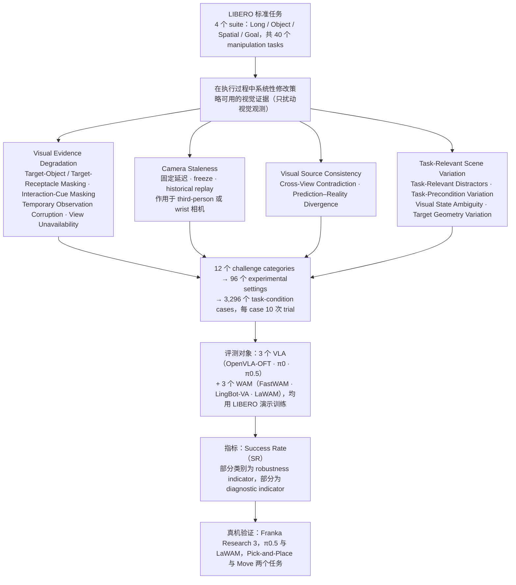

# LIBERO-VPro（arXiv:2609.24350）

**LIBERO-VPro**（*LIBERO-VPro: Benchmarking Closed-Loop Visual Robustness of Robotic Foundation Models*，[arXiv:2609.24350](https://arxiv.org/abs/2609.24350)，[项目页](https://huiqiongli.github.io/LIBERO-VPro/)）来自 [具身智能小站 2026-10-18 盘点](../../sources/blogs/wechat_embodied_station_26_papers_embodiedswe_2026-10-18.md)，属「VLA 评测与部署」组。

## 一句话定义

**在执行时扰动视觉证据（缺失、延迟、多视角矛盾、场景变化），做 LIBERO 上的闭环视觉鲁棒性基准。**

## 英文缩写速查

| 缩写 | 英文全称 | 简要说明 |
|------|----------|----------|
| LIBERO | Lifelong Robot Learning Benchmark | 操作基准套件 |

## 为什么重要

- 只看干净环境成功率会高估鲁棒性；遮住物体仍成功也可能是依赖位置记忆。
- 开源结论：**项目页未列 GitHub**（步骤 2.5，2026-10-18）。项目页 HTTP 200，仅见 “Dataset (soon)” 按钮，未列 GitHub 代码链接。
- 同期同组工作见 [编程智能体造数据与 VLA 闭环评测：具身智能小站 10-18 期 26 篇阅读坐标](../overview/embodied-station-2026-10-18-26-papers-technology-map.md)。

## 流程总览

图依据：基准构建与评测协议图（论文 §III Benchmark Construction A–D、§IV-A Experimental Setup / Evaluation Protocol / Metric、§IV-G Real-World Evaluation、Fig. 1–2）

## 核心机制

| 项 | 内容 |
|----|------|
| **arXiv** | [2609.24350](https://arxiv.org/abs/2609.24350) |
| **开源** | **项目页未列 GitHub** |
| **要点** | 执行期注入视觉扰动：缺失、延迟、多视角矛盾和场景变化，配合诊断实验。 |
| **文内指标** | 公众号提示：诊断实验须结合对照阅读；未给具体数字。 |

## 源码运行时序图

**不适用（项目页未列 GitHub）** — 项目页 HTTP 200，仅见 “Dataset (soon)” 按钮，未列 GitHub 代码链接。 不编造运行脚本；代码公开后再补。

## 实验与评测

- 公众号提示：诊断实验须结合对照阅读；未给具体数字。
- **读法：** 本页为索引级摘要，依据公众号转述的官方摘要与仓库信息整理；逐项数字与 baseline 以原文 PDF 为准。

## 与其他工作对比

- 横向索引见 [编程智能体造数据与 VLA 闭环评测：具身智能小站 10-18 期 26 篇阅读坐标](../overview/embodied-station-2026-10-18-26-papers-technology-map.md)；同 arXiv 不重复造页。

## 结论

**视觉鲁棒性应在闭环中用扰动测，并用对照实验区分“看见”与“记住位置”。**

1. 开源边界：**项目页未列 GitHub** — 项目页 HTTP 200，仅见 “Dataset (soon)” 按钮，未列 GitHub 代码链接。
2. 核心机制：执行期注入视觉扰动：缺失、延迟、多视角矛盾和场景变化，配合诊断实验。
3. 复现与选型前核对任务协议、硬件与基准口径，勿直接横比公众号摘录数字。

## 关联页面

- [vla](../methods/vla.md)
- [simulation-evaluation-infrastructure](../concepts/simulation-evaluation-infrastructure.md)
- [libero-benchmark](./libero-benchmark.md)
- [embodied-station-2026-10-18-26-papers-technology-map](../overview/embodied-station-2026-10-18-26-papers-technology-map.md)
- [具身大模型评测基准选型闭环](../queries/embodied-eval-benchmark-selection-loop.md) — 本页可归入其 ③ 策略任务成功率评测层：在 LIBERO 闭环执行中扰动视觉证据，检验 VLA 成功率的视觉鲁棒性

## 参考来源

- [libero_vpro_arxiv_2609_24350.md](../../sources/papers/libero_vpro_arxiv_2609_24350.md)
- [wechat_embodied_station_26_papers_embodiedswe_2026-10-18.md](../../sources/blogs/wechat_embodied_station_26_papers_embodiedswe_2026-10-18.md)
- [arXiv:2609.24350](https://arxiv.org/abs/2609.24350)
- [arXiv PDF](https://arxiv.org/pdf/2609.24350)：已通读 §I–§III 基准构建（A–D 四个维度）、§IV-A 实验设定与评测协议、§IV-G 真机设定；§IV-B–F 结果分析与附录以略读为准

## 推荐继续阅读

- [arXiv PDF](https://arxiv.org/pdf/2609.24350)
- [项目页](https://huiqiongli.github.io/LIBERO-VPro/)
