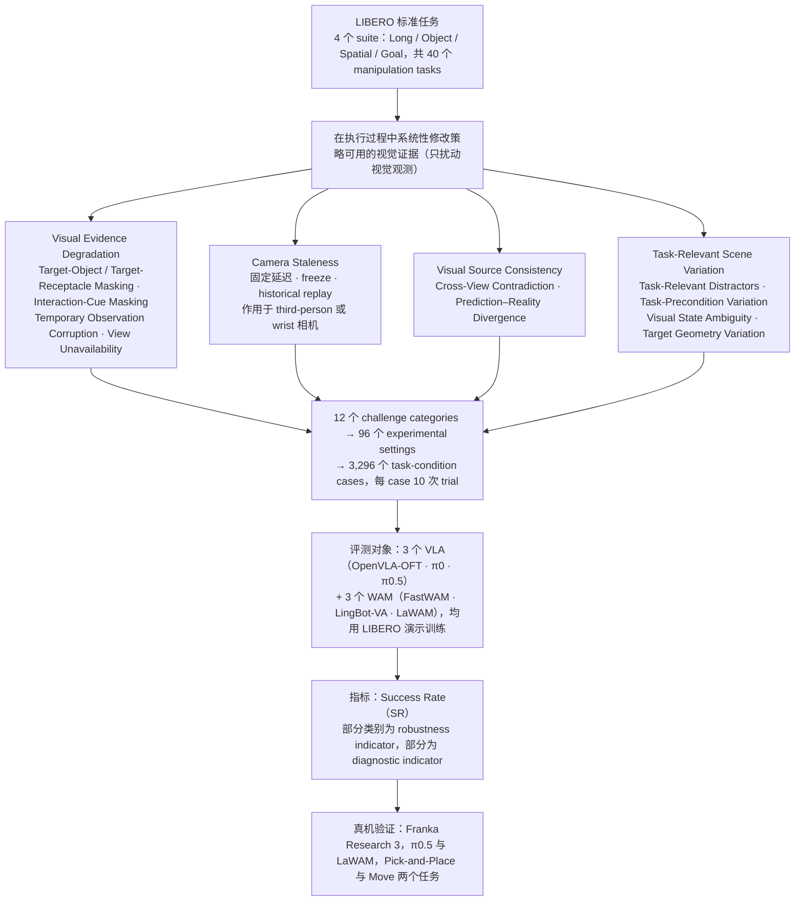
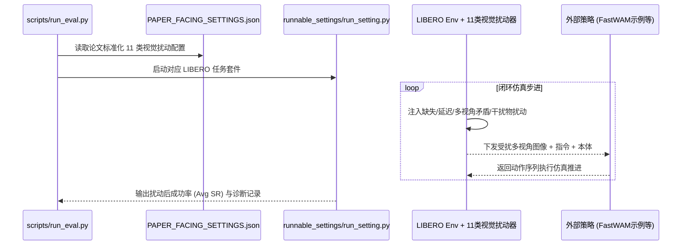

# LIBERO-VPro（arXiv:2609.24350）

**LIBERO-VPro**（*LIBERO-VPro: Benchmarking Closed-Loop Visual Robustness of Robotic Foundation Models*，[arXiv:2609.24350](https://arxiv.org/abs/2609.24350)，[项目页](https://huiqiongli.github.io/LIBERO-VPro/)）来自 [具身智能小站 2026-10-18 盘点](../../sources/blogs/wechat_embodied_station_26_papers_embodiedswe_2026-10-18.md)，属「VLA 评测与部署」组。

## 一句话定义

**在执行时扰动视觉证据（缺失、延迟、多视角矛盾、场景变化），做 LIBERO 上的闭环视觉鲁棒性基准。**

## 英文缩写速查

| 缩写 | 英文全称 | 简要说明 |
|------|----------|----------|
| LIBERO | Lifelong Robot Learning Benchmark | 操作基准套件 |

## 为什么重要

- 只看干净环境成功率会高估鲁棒性；遮住物体仍成功也可能是依赖位置记忆。
- 开源结论：**项目页未列 GitHub**（步骤 2.5，2026-10-18）。项目页 HTTP 200，仅见 “Dataset (soon)” 按钮，未列 GitHub 代码链接。
- 同期同组工作见 [编程智能体造数据与 VLA 闭环评测：具身智能小站 10-18 期 26 篇阅读坐标](../overview/embodied-station-2026-10-18-26-papers-technology-map.md)。

## 流程总览

图依据：基准构建与评测协议图（论文 §III Benchmark Construction A–D、§IV-A Experimental Setup / Evaluation Protocol / Metric、§IV-G Real-World Evaluation、Fig. 1–2）

## 核心机制

| 项 | 内容 |
|----|------|
| **arXiv** | [2609.24350](https://arxiv.org/abs/2609.24350) |
| **开源** | **项目页未列 GitHub** |
| **要点** | 执行期注入视觉扰动：缺失、延迟、多视角矛盾和场景变化，配合诊断实验。 |
| **文内指标** | Table II 11 类视觉扰动 Avg SR：`OpenVLA-OFT 97.0→56.40`、`pi0 92.5→60.55`、`pi0.5 97.2→64.49`、`FastWAM 98.8→66.00`、`LingBot-VA 97.0→67.31`、`LaWAM 98.5→65.68`；同位干扰物 `2.5%–22.25%`；A1/A2 遮挡仍 `>80%–96%`；200 次 FR3 真机验证。 |

## 源码运行时序图

官方仓库 [huiqiongli/LIBERO-VPro-Dataset](https://github.com/huiqiongli/LIBERO-VPro-Dataset)（代码 MIT，资产 CC BY 4.0）已公开评测主入口 `scripts/run_eval.py` 与 FastWAM 示例（OpenVLA-OFT / $\pi_0$ / $\pi_{0.5}$ / LaWAM 推理器仍需外接）：

## 工程实践

- **固定标准化配置文件**：通过 `scripts/run_eval.py` 加载 `PAPER_FACING_SETTINGS.json`，确保对比不同 VLA/WAM 时 11 类视觉扰动参数、随机种子与注入帧率一致。
- **优先做 A1/A2 空间先验遮挡自检**：引入新策略时先跑物体视觉遮挡对照；若模型几乎“盲操作”仍能完成任务，说明策略主要在死记初始场景位姿，而非响应在线视觉反馈。
- **隔离外部模型依赖**：公开仓内置 FastWAM 评测接口，其余基线需按各自推理服务独立封装，注意不同动作分块大小（action chunking）在延迟扰动下的同步对齐。

## 实验与评测

- **Table II 全扰动退化对比（干净环境 → 11 类视觉扰动 Avg SR）**：
  - **OpenVLA-OFT**：`97.0% → 56.40%`
  - **$\pi_0$**：`92.5% → 60.55%`
  - **$\pi_{0.5}$**：`97.2% → 64.49%`
  - **FastWAM**：`98.8% → 66.00%`
  - **LingBot-VA**：`97.0% → 67.31%`
  - **LaWAM**：`98.5% → 65.68%`
- **关键崩塌点与诊断发现**：
  - **同位干扰物（Same-Position Distractor）**：各主流基线表现集体崩塌，成功率跌至 **`2.5%–22.25%`**。
  - **递归 Rollout 退化**：`LingBot-VA` 在递归视频推演模式下整体成功率由 **`97.0%` 跌至 `53.8%`**，长程套件（LIBERO-Long）则由 **`98.0%` 剧降至 `22.0%`**。
  - **空间先验依赖（A1/A2 诊断）**：多项基线在关键目标物体被遮挡后仍保持 **`>80%–96%`** 成功率，证实原始 LIBERO 干净高分对初始摆放位置记忆存在严重捷径依赖。
- **真机验证**：作者在 Franka FR3 实体机械臂完成 **200 次真机 rollout**，证实视角遮挡与视觉延迟同样导致显著退化。

## 局限与风险

- **继承 LIBERO 场景与刚体上限**：评测仍围绕桌面刚体短中程抓取，无法直接覆盖可变形软体交互或移动人形长程家务操作。
- **全基线未单一脚本打包**：仓库聚焦基准配置、数据集资产与 FastWAM 集成示例，全量对比仍依赖用户自行复现各外部模型权重与环境。

## 与其他工作对比

- 横向索引见 [编程智能体造数据与 VLA 闭环评测：具身智能小站 10-18 期 26 篇阅读坐标](../overview/embodied-station-2026-10-18-26-papers-technology-map.md)；相比静态干净重放式评估，LIBERO-VPro 与 [LIBERO Benchmark](./libero-benchmark.md) 形成增量对齐，专攻闭环实时视觉退化。

## 结论

**干净环境下高达 97%–98.8% 的 LIBERO 成功率不能直接等同于真实视觉鲁棒性，11 类执行期视觉扰动下 6 类主流基线均降至 56.40%–67.31%。**

1. **公开仓状态已更新为部分开源**：`huiqiongli/LIBERO-VPro-Dataset` 已开放扰动配置、`scripts/run_eval.py` 与 FastWAM 示例，其余基线模型需自行对接。
2. **揭示两大高频失效机制**：同位干扰物可使成功率塌陷至 `2.5%–22.25%`，而递归世界动作推演在长程任务可跌至 `22.0%`。
3. **诊断必选 A1/A2 对照**：若遮挡关键物体后仍有 `>80%–96%` 成功率，必须警惕位置先验过拟合，先去偏再投入真机或进一步泛化训练。

## 关联页面

- [vla](../methods/vla.md)
- [simulation-evaluation-infrastructure](../concepts/simulation-evaluation-infrastructure.md)
- [libero-benchmark](./libero-benchmark.md)
- [embodied-station-2026-10-18-26-papers-technology-map](../overview/embodied-station-2026-10-18-26-papers-technology-map.md)
- [具身大模型评测基准选型闭环](../queries/embodied-eval-benchmark-selection-loop.md) — 本页可归入其 ③ 策略任务成功率评测层：在 LIBERO 闭环执行中扰动视觉证据，检验 VLA 成功率的视觉鲁棒性

## 参考来源

- [libero_vpro_arxiv_2609_24350.md](../../sources/papers/libero_vpro_arxiv_2609_24350.md)
- [wechat_embodied_station_26_papers_embodiedswe_2026-10-18.md](../../sources/blogs/wechat_embodied_station_26_papers_embodiedswe_2026-10-18.md)
- [arXiv:2609.24350](https://arxiv.org/abs/2609.24350)
- [arXiv PDF](https://arxiv.org/pdf/2609.24350)：已全文通读 `arXiv:2609.24350`（涵盖 Table II、A1/A2 空间先验诊断、递归 rollout 分析与 200 次 FR3 真机验证，并核对 `huiqiongli/LIBERO-VPro-Dataset`）。

## 推荐继续阅读

- [arXiv PDF](https://arxiv.org/pdf/2609.24350)
- [项目页](https://huiqiongli.github.io/LIBERO-VPro/)
