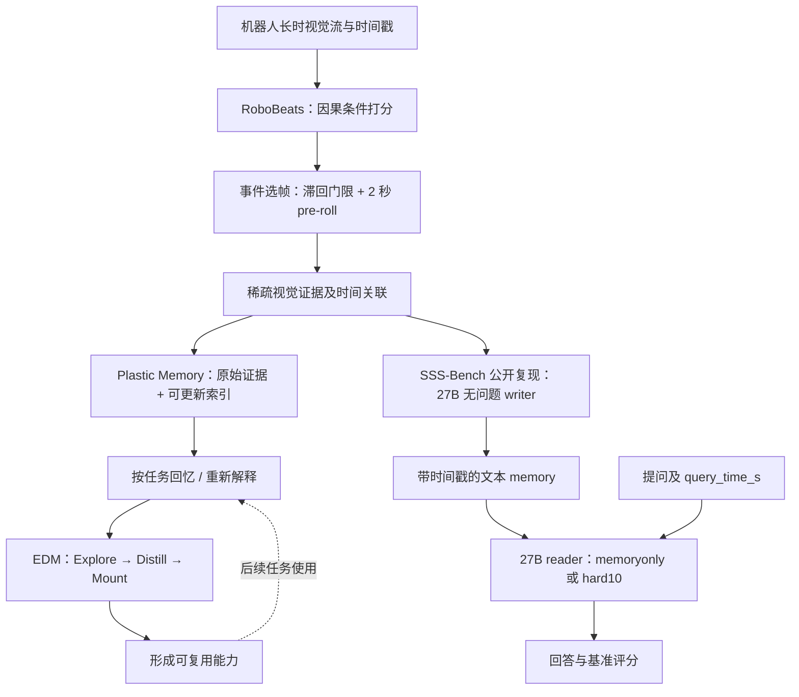
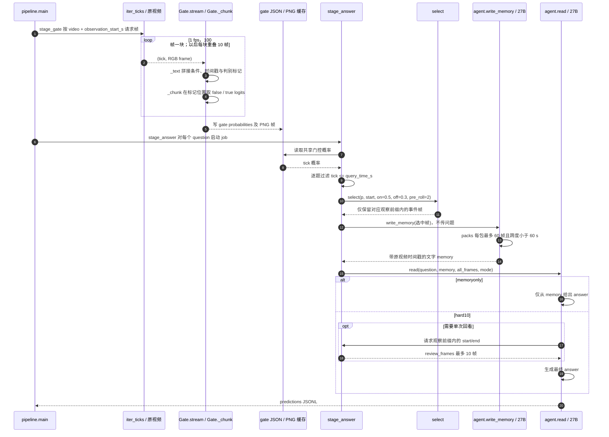

# LIFE：Learning to Live——迈向终身具身智能的一步
**Learning to Live: A Step Toward Lifelong Embodied Intelligence**

## 一句话定义

**LIFE（Lifelong Intelligence from Experience）** 是将机器人长期观察、事件驱动记忆与经验转能力串成一条研究路线的框架：**RoboBeats** 发现值得记住的事件、**Plastic Memory** 保存可追溯且可再解释的视觉证据、**EDM（Explore–Distill–Mount）** 将经验变成后续可复用的能力。它不是一个直接输出关节动作的通用控制策略。

## 英文缩写速查

| 缩写 | 英文全称 | 简要说明 |
|---|---|---|
| LIFE | Lifelong Intelligence from Experience | 基于持续经验积累的终身具身智能框架 |
| VLM | Vision-Language Model | RoboBeats 使用的严格因果视觉语言门控模型 |
| EDM | Explore–Distill–Mount | 探索、蒸馏、挂载可复用能力；与 ReSight 前作相关 |
| SSS-Bench | Sparse-event Streaming Suite | 长时稀疏事件的流式记忆问答评测 |
| LoRA | Low-Rank Adaptation | 公开的 RoboBeats 权重以适配器形式提供 |
| AUROC | Area Under the Receiver Operating Characteristic Curve | 概率门控排序能力指标 |

## 核心信息

| 字段 | 经核验的信息 |
|---|---|
| 论文 | [arXiv:2611.00180v2](https://arxiv.org/abs/2611.00180v2)，2026-11-04 修订 |
| 作者团队 | [LIFE 原论文](https://arxiv.org/html/2611.00180v2)与智元 AgibotTech 官方仓库 |
| 项目页 | [LIFE 官方项目入口](https://agibotgeneral.github.io/life-site/)（当前抓取未能直接读取演示正文） |
| 公开仓库 | [AgibotTech/LIFE](https://github.com/AgibotTech/LIFE)，代码 Apache-2.0 |
| 模型 | [RoboBeats-0.8B](https://huggingface.co/superbigsaw/RoboBeats-0.8B)、[2B](https://huggingface.co/superbigsaw/RoboBeats-2B)、[4B](https://huggingface.co/superbigsaw/RoboBeats-4B)：对应 Qwen3.5 基座的 LoRA adapters |
| 基准 | SSS-Bench：618 个问题、171 段视频、6 个数据集、14 种问题类型；源视频**未随仓库重新分发** |
| 前置研究 | [ReSight: Task-Driven Self-Improving Memory for Embodied Agents](https://arxiv.org/abs/2610.33487)，EDM 的前置工作，不是本篇新论文编号 |
| 开放边界 | **推理 / 部分评测开源**；不能据此声称 Plastic Memory 和 EDM 的完整持续学习运行时、训练栈已全部开源 |

## 为什么重要

一次任务的机器人策略可以靠离线数据训练，但持续运行时会遇到“昨天发生过什么”“关键时刻是哪几秒”“经验如何用于新任务”的问题。连续存所有帧成本高，只存摘要又可能丢证据。LIFE 将**选择性观察 → 可追溯记忆 → 经验复用**分层：有助于将长时视觉感知与机器人策略、环境记忆、故障复盘系统分开设计。

**注意**：论文提出的是终身智能路线，公布的 SSS-Bench 更直接检验**流式视频问答与事件回忆**，不能把该得分视为机器人长期自主动作策略成功率。

## 核心原理

### 1. RoboBeats：严格因果事件门控

- 输入为按时间排序的视觉帧及文字条件；默认离线处理 **1 fps**。在每个已观察帧后附加固定判别标记，计算单 token **false / true** 两类 logits，再 softmax 得到当前条件成立概率。
- **不生成答案 token 写回后续输入**，并禁止读取后续帧：对时刻 t 的判断只依赖不晚于 t 的信息。
- 官方离线源码常量：**100 帧 / chunk，重叠 10 帧、步长 90 帧**；第二块起重叠的 10 帧只提供上下文，避免重复判断。
- 新事件选择采用**滞回**：概率 **> 0.5** 开启事件，**< 0.3** 关闭事件，保留开启前 **2 秒**至事件闭合帧；截止时仍激活的事件保留到截止。
- 官方 2026-11-10 更新另提供带 KV cache reuse 的 **LiveGate**；**离线 Gate._chunk 显式 use_cache=False**，两者不能混为一谈。

### 2. Plastic Memory：事件片段与原始证据同存

- 不只压缩成事件的最终文字结论，而是保存原始图像、时间戳、可用的机器人位姿，以及人物 / 物体 / 事件相关语义字段。
- 后续任务可通过时间、空间视点和语义索引检索，必要时重新观看原始片段或补建索引；它强调**记忆可演化**，并不承诺环境变化下的索引永远正确。
- 事件门控选帧与存储的数据结构要区分：**门控未选中的证据存在漏记风险**；SSS 的复现 writer 进一步把选中的图像压缩为文本 memory，不能说它等同 Plastic Memory 完整存储服务。

### 3. EDM：Explore–Distill–Mount

- 能力不足时探索相关信息 / 交互，蒸馏为可复用知识或工具，再挂载后续使用。
- 该能力扩展机制与 [ReSight（arXiv:2610.33487）](https://arxiv.org/abs/2610.33487) 关联；ReSight 的实验不可直接当作 LIFE 在当前 SSS-Bench 或 24 小时观察上的额外结果。
- **区分**记忆的检索 / 问答和真正的机器人闭环动作学习。公开的门控与 writer/reader 脚本本身不执行新的机器人控制策略优化。

## 流程总览（依据论文方法及公开 SSS-Bench 复现）

上图左侧为论文 LIFE 的系统研究主线；右侧 **SSS-Bench writer/reader 为公开的评测实现**，不应误认为它覆盖论文主张的全部 Plastic Memory / EDM 子系统。

## 源码运行时序图（基于 gate.py、pipeline.py、agent.py）

**严格截止**：上游 gate 可能为同一视频起点预计算到多道题中最晚的截止时间，但 **stage_answer 对每一道题重新按 query_time_s 截断**，随后才进行选帧与 memory 写入；hard10 的回看时间窗也受该题的观测边界约束。时间索引使用**原视频时钟**。

## 实验与评测

### 官方发布的 SSS-Bench

| 指标 | 公开基准事实 / 注意点 |
|---|---|
| 样本规模 | 618 题 / 171 段视频 / 6 来源，最长 30 min；中位观测长度 18 min |
| 问题类型 | 14 种类型；260 数值题、358 语义短答 |
| 因果性 | 每题只允许读取 [observation_start_s, query_time_s] 内的帧 |
| 计分 | 数值规则确定性计分；语义答案使用 Qwen3.8-27B judge 与参考 rubric |
| 标注出处 | 官方 README 明示参考由 LLM 辅助起草、视觉模型独立复核，**不是人工标注** |
| 可复现前提 | 源视频须按各原始协议单独下载，且复现脚本默认使用多 GPU 与 27B writer/reader |

### 论文结果的读法（作者报告，未独立复现）

- 在检测与流式任务上，RoboBeats 重点检验事件**何时发生**及持续多久。论文中 Charades-STA R@0.5、StreamingBench 首次触发等指标属于**不同评测协议**，不可相互替代。
- SSS-Bench 在长观测区间的选择性记忆更有意义；但保留较少帧不保证所有 reader 的精度都优于全帧基线。原论文展示了**效率—准确率的具体权衡**，并非无条件同时领先。
- 24 小时的真实机器人观察案例采用**录像及后续回放评估**；论文给出 LIFE 在 6 类问题 × 3 次运行中的汇总表现。该案例不构成已证明“多年运行、主动在线学习并不断增强实机控制”的证据。
- **不要误用前作指标**：ReSight 关于 EDM 检索、导航的性能验证属于前置论文研究。

## 与其他工作对比

| 路线 | 记忆对象 / 机制 | 与 LIFE 的边界 |
|---|---|---|
| [Agent 记忆与 dreaming](../concepts/agent-memory-and-dreaming.md) | 会话日志、wiki 索引与异步整理 | 面向通用 agent；LIFE 把视频事件与可再解释原始视觉证据纳入机器人连续观察 |
| [Spatial Memory Agent](./paper-spatial-memory-agent.md) | 冻结 VLM + verifier 认可的空间过程性 lesson | 更强调单任务的空间推理经验；LIFE 强调长时流式感知与演化的视觉记忆 |
| [Mem4Act](./paper-mem4act-latent-memory.md) | 机器人操作中的 latent memory | 面向具体策略上下文，和 LIFE 的证据库 / 事件门控粒度不同 |
| [ReSight](https://arxiv.org/abs/2610.33487) | 任务驱动记忆与 EDM 自改进 | 是 LIFE 引用的前置工作，不应当作为 LIFE 的独立重复实体 |

## 工程实践

| 环节 | 可执行入口 / 配置与检查 |
|---|---|
| 安装 | `git clone https://github.com/AgibotTech/LIFE.git && cd LIFE && pip install -r requirements.txt` |
| RoboBeats 离线推理 | `python -m robobeats my_video.mp4 --gate-model superbigsaw/RoboBeats-2B --out probs.json` |
| 实时 Demo | `python -m robobeats.serve --gate-model superbigsaw/RoboBeats-2B`；浏览器本机 localhost:8000 |
| 复现 SSS-Bench | `SSS_DATA_ROOT=/path/to/videos LLM_MODEL=/path/to/Qwen3.8-27B GATE=2B bash sss_bench/scripts/run_robobeats.sh` |
| 脚本入口 | `python -m sss_bench.reproduce.pipeline gate` 和 `... answer`，随后 `python -m sss_bench.evaluate` |
| 实现与许可 | 代码 Apache-2.0；SSS-Bench 数据 / rubric CC BY-NC 4.0，视频按来源许可 |
| 硬件条件 | 官方 README 的 PyTorch CUDA 13 构建要求较新驱动；复现默认多 GPU + 27B 模型，依环境调整 |
| 本次核验 | 静态审阅核心源码和论文；**未运行模型、benchmark 或长期实机实验** |

**工程排查要点**：先对齐原视频时间戳和 1 fps 帧提取；核验 chunk 交界处的 overlap 只是上下文；检查缓存中每个问题的 cutoff 和 `hard10` 的一次性 10 帧回看；分别统计候选帧、保留帧、writer tokens 和按题型的准确率，而非只看最终总分。

## 结论

**LIFE 最值得复用的是“因果门控保留稀疏证据 + 可追溯记忆 + 按需将经验变为能力”的分层设计；公开代码目前最有复现价值的是 RoboBeats 和 SSS-Bench 的严格因果运行时。**

1. **先建立时间不泄漏的基准**：每题从 observation_start_s 到 query_time_s 截断，再建立记忆；跨问题共享 gate cache 不得让未来帧进入单题答案。
2. **事件选择是压缩而非真值**：0.5/0.3 的滞回与 2 秒 pre-roll 可能漏掉没有明显事件峰值的重要证据。
3. **存原始帧以便重解释**：后续空间地图、OCR 或动作解释的更新需要保留证据出处。
4. **区分离线和在线性能**：Gate._chunk 不复用 KV cache；实时 LiveGate 是另一个实现，需单独 benchmark。
5. **结果分层归因**：SSS-Bench 的答题指标、24 小时回放案例和前作 ReSight 的 EDM 评测不能混作长期机器人自主学习能力。
6. **采用前核查许可证和算力**：源视频无法随基准随意分发；默认 27B writer/reader 的工程成本不低。

## 局限与风险

- **终身验证不足**：基准以最长 30 min 视频和一天的记录 / 回放为主；跨月、多机器人、多任务变化与在线动作闭环的长期稳定性仍待验证。
- **记忆错误会积累**：视点关联、对象身份、过时信息和检测漏报都可能被后续检索放大，需要溯源与冲突处理。
- **动作与安全并未闭环**：公开视频问答评分不代表自主探索或控制系统具有实机安全保证。
- **上游代码开放不完整**：公开主要是门控、权重、benchmark 与复现；论文概念中的完整 Plastic Memory / EDM 端到端服务未在本次核验中确认为可直接部署。
- **评测标注来源**：SSS-Bench 官方 README 明示标注来自 LLM 辅助与视觉模型复核，并非独立人工真值。
- **项目展示页核验受限**：官方项目 URL 可从 README 核对，但本次未能直接读其演示正文，未虚报演示内容通读。

## 关联页面

- [Agent 记忆与 dreaming](../concepts/agent-memory-and-dreaming.md) — 记忆形成、检索、修正与后台整理
- [Spatial Memory Agent](./paper-spatial-memory-agent.md) — 经验与空间过程性记忆
- [Mem4Act](./paper-mem4act-latent-memory.md) — 面向具身动作的记忆
- [ReKi-VLA](./paper-reki-vla-register-memory.md) — VLA 中的记忆与长期状态
- [ReSight 原始论文](https://arxiv.org/abs/2610.33487) — EDM 前置研究
- [具身大模型评测基准选型闭环](../queries/embodied-eval-benchmark-selection-loop.md) — SSS-Bench 等流式事件评测在具身基准选型中的位置
- [机器人视觉感知栈选型闭环](../queries/robot-perception-stack-selection-loop.md) — RoboBeats 视觉事件检测在感知栈中的分工

## 参考来源

- [LIFE v2 论文通读归档](../../sources/papers/life_arxiv_2611_00180_v2.md)
- [LIFE 官方仓库及运行入口源码核验](../../sources/repos/life-official.md)
- [LIFE 官方项目页与开放状态归档](../../sources/sites/life-project.md)
- [LIFE 官方仓库](https://github.com/AgibotTech/LIFE)：README、robobeats/gate.py、sss_bench/reproduce/pipeline.py、sss_bench/reproduce/agent.py

## 推荐继续阅读

- [arXiv 论文 v2 HTML 全文](https://arxiv.org/html/2611.00180v2)
- [RoboBeats 官方实现](https://github.com/AgibotTech/LIFE/blob/main/robobeats/gate.py)
- [SSS-Bench 官方复现说明](https://github.com/AgibotTech/LIFE/blob/main/sss_bench/README.md)
- [ReSight：任务驱动自改进记忆](https://arxiv.org/abs/2610.33487)
