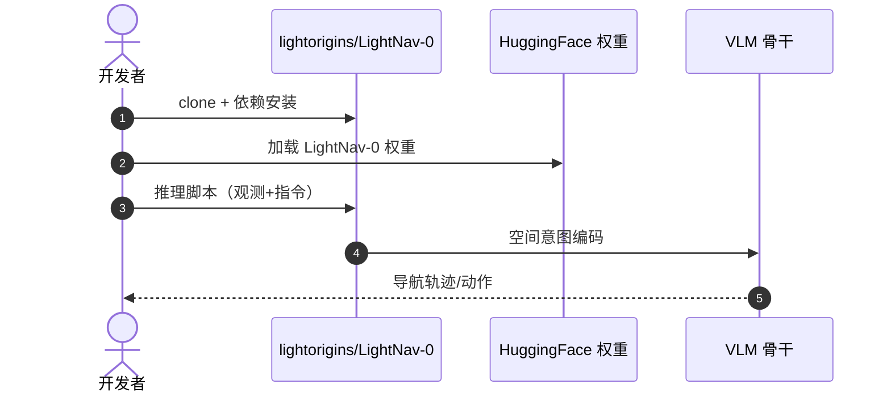

# LightNav-0：激发 VLM 空间智能的通用具身导航

**LightNav-0**（*Eliciting VLM Spatial Intelligence for Generalist Embodied Navigation*，[arXiv:2608.30935](https://arxiv.org/abs/2608.30935)，[项目页](https://www.lightorigins.com/en/blog/lightnav-0)，[代码](https://github.com/lightorigins/LightNav-0)）由 **亮源新创（Light Origins）** 提出：通过 **统一 token 接口** 对齐预训练 **VLM** 的空间智能——**dual-channel pointing** 表达任务、场景与本体无关的空间意图，**residual vector-quantized action tokenizer** 映射为精确轨迹。

## 一句话定义

**导航泛化的关键不是再接一堆任务头，而是用统一 token 把空间意图编码清楚，再让 VLM 直接出轨迹。**

## 英文缩写速查

| 缩写 | 英文全称 | 简要说明 |
|------|----------|----------|
| VLM | Vision-Language Model | 视觉-语言多模态模型 |
| RVQ | Residual Vector Quantization | 残差向量量化动作离散化 |
| SFT | Supervised Fine-Tuning | 监督微调 |
| RL | Reinforcement Learning | 强化学习后训练阶段 |

## 为什么重要

- 纳入 [2026-09-01 七篇盘点](../../sources/blogs/wechat_embodied_station_7_papers_open_source_system_loop_2026-09-01.md) 的「VLM 空间智能 → 导航」支线。
- 论文报告在 **10 个公开导航仿真** 设置上取得 **当时最优** 的单目成功率（2026-09 投稿口径，后续工作可能已刷新）。
- 真机展示 **人形 / 四足 / 轮式 / 空中** 跨本体 **零样本** 泛化。
- 训练语料 **2K+ 场景、4K+ 小时**；**已开源** 代码与 Hugging Face 权重。

## 核心信息

| 项 | 内容 |
|----|------|
| **机构** | 亮源新创（Light Origins） |
| **数据** | 2K+ 场景，4K+ 小时 |
| **任务** | 指令跟随、开放词汇目标导航、视觉跟踪 |
| **训练** | 视觉历史压缩、ER mid-training、SFT、RL |
| **开源** | **已开源** [lightorigins/LightNav-0](https://github.com/lightorigins/LightNav-0)；[HF 权重](https://huggingface.co/LightOriginsHQ/LightNav-0) |

### 流程总览

## 核心原理

> 以下依据 arXiv:2608.30935 全文通读（[读书归档](../../sources/papers/lightnav0_reading_arxiv_2608_30935_ln0r.md)）。

- **骨干与接口**：Qwen3-VL-4B-Instruct 不加任务头，仅扩充词表；每步输出 = 1 个 affordance 点 token + 1 个 object 点 token + 3 个 RVQ 动作 token，解码为 10 个未来 SE(2) 路点。
- **Dual-channel pointing**：点编码为单个图像网格 token（两通道用不同 token 族），保留索引表示停止 / 原地转向 / 目标不可见；定长前缀充当潜在空间 CoT，不产生变长文本推理。消融去掉 pointing 监督后平均 SR 从 63.0 降到 54.7。
- **RVQ 动作 tokenizer**：3 级、每级 256 码字；任意非空前缀都可解码出可执行轨迹，可只生成前 1 到 2 级换取更低解码开销；三级 ADE 0.72 cm，对比单 token 4096 词表的 2.48 cm。
- **视觉历史压缩**：采样率与池化步长随帧龄指数衰减，在固定视觉 token 预算内兼顾近处细节与远期上下文。
- **训练栈**：ER mid-training（LightNav-ER，约 170 H100 小时）→ SFT 含 DAgger（约 950 H100 小时，77.6% 导航 / 22.4% ER 复习）→ GRPO 在线 RL（终端标量奖励，G=8）。因动作即 token，对数概率精确，GRPO 无需额外 MDP 改写或 critic。
- **缩放结论**：2B 到 4B 收益明显，8B 不稳定；环境多样性比单纯加数据更有效（论文自述）。

## 评测

| 设置 | 读法 |
|------|------|
| 10 个公开导航仿真 | 单目成功率为论文投稿时（2026-09）各设置最优 |
| 真机跨本体 | 未见场景语言指令自主导航 |

## 结论

**通用导航应统一空间意图编码，而不是为每个任务/本体堆专用头。**

- dual-channel pointing 解耦任务、场景与本体
- RVQ tokenizer 把空间意图映射为可执行轨迹
- 大规模仿真数据 + mid-training/SFT/RL 组合训练
- 10 个仿真基准上论文口径最优 + 真机跨本体零样本
- 代码与 HF 权重已发布，可复现推理管线
- 对 VLM 空间智能的「导航出口」有直接工程参考

## 源码运行时序图

## 工程实践

- **部署形态**：单进程 vLLM 服务，论文报告 RTX 4090 上约 4 ms / 生成 token；每步最多 2 个指针 token + 3 个动作 token；资源受限时可只取前 1 到 2 级 RVQ。
- **与机器人对接**：LightNav-0 只输出 10 个 SE(2) 路点；共享 trajectory follower 通过里程计与速度指令接入各平台自带的运动策略（人形 LightBot-0、Go2、LimX TRON 1、自研四旋翼）。
- **相机鲁棒性**：训练时随机化 FoV（90–130 度）、相机高度（0.5–1.5 m）、俯仰（±15 度）；换传感器仍需自测。
- **复现成本（论文自述）**：RL 阶段单节点 8×H100；主要瓶颈是仿真吞吐而非梯度计算，故仿真与推理服务解耦。
- **数据与评测**：INSIGHT-Bench（1,683 训练场景 / 210 评测场景）提供场景 × 指令类型二维诊断；见 [INSIGHT-Bench](./insight-bench.md)。
- **读数提醒**：RxR 上 nDTW（67.4）低于 DualVLN（70.0）；EVT 部分指标上 CoMaTrack / ReferTrack 仍占优；多视角方法在 R2R 上仍略强，即「全面最优」只是成功率口径。

## 局限与风险

- **仿真—真机差距：** 真机 demo 为精选场景，极端光照/动态障碍泛化待验证。
- **算力：** VLM 骨干推理延迟需结合部署平台评估。
- **数据引擎：** 大规模仿真数据生成细节以仓库 README 为准。
- **单一决策通路（论文自述）：** 未分离高频局部避障与低频语义规划，作者将双系统列为后续方向。

## 与其他工作对比

| 维度 | LightNav-0 | 模块化导航栈（建图 + 规划） | 任务专用导航策略头 | 通用 VLA 直出动作 |
|------|-----------|------------------------|-----------------|-----------------|
| 空间意图表示 | **dual-channel pointing**，任务/场景/本体无关 | 显式地图坐标 | 各任务自定义 | 语言 + 视觉隐式 |
| 动作接口 | **RVQ token → 轨迹** | 规划器输出路径 | 各头自定义 | 连续动作或 token |
| 跨本体 | 人形/四足/轮式/空中零样本演示 | 需重配运动学与规划参数 | **基本不迁移** | 依训练本体分布 |
| 传感前提 | **单目** | 常需深度/激光 | 依任务 | 依模型 |
| 主要软肋 | VLM 骨干推理延迟 | 建图失效即全栈失效 | 任务数一多就爆头 | 空间精度 |

- **对比读法**：本文的增益声明是「统一 token 接口 + 大规模数据」，不是更强的 VLM 骨干；与模块化栈比较时要注意后者在已建图的结构化场景里仍有确定性优势。
- **数字的时效与口径**：10 个仿真设置上的最优成绩为 2026-09 投稿口径的单目设置，跨传感配置（RGB-D/LiDAR）或跨评测协议均不可横比。
- **真机结论是演示级**：跨本体零样本为精选场景 demo，极端光照与动态障碍未覆盖（见「局限与风险」）。

## 关联页面

- [Light-O1](./light-o1.md) — 同机构规模化预训练段：人类动作预训练全身智能
- [Light REACT](./light-react.md) — 同机构规模化部署段：全身韧性 ICL
- [视觉–语言导航（VLN）](../tasks/vision-language-navigation.md)
- [VLA](../methods/vla.md)
- [开源系统闭环 7 篇地图](../overview/open-source-system-loop-7-papers-technology-map.md)
- [国内具身开源全景（76 家 · 424 项）](../overview/china-domestic-embodied-opensource-76-companies-technology-map.md) — 本页为该清单对应条目的 站内对应条目页
- [424 项覆盖索引](../queries/china-domestic-opensource-424-coverage.md) — 同公司其它开源入口

## 推荐继续阅读

- [LightNav-0 项目页](https://www.lightorigins.com/en/blog/lightnav-0)
- [INSIGHT-Bench 评测站](https://lightorigins.github.io/Light-INSIGHT-Bench/)
- [arXiv:2608.30935](https://arxiv.org/abs/2608.30935)

## 参考来源

- [lightnav0_arxiv_2608_30935.md](../../sources/papers/lightnav0_arxiv_2608_30935.md)
- [具身智能小站 2026-09-01 七篇盘点](../../sources/blogs/wechat_embodied_station_7_papers_open_source_system_loop_2026-09-01.md)
- [LightNav-0 项目页](../../sources/sites/lightnav-0.md)
- [INSIGHT-Bench 项目页](../../sources/sites/light-insight-bench.md)
- [lightorigins/LightNav-0](../../sources/repos/lightorigins-lightnav-0.md)
- [lightorigins/Light-INSIGHT-Bench](../../sources/repos/lightorigins-light-insight-bench.md)
- [LightNav-0 源码归档](../../sources/repos/lightnav-0.md)（<https://github.com/lightorigins/LightNav-0>）
- [国内具身智能开源全景（微信公众号）](../../sources/blogs/wechat_embodied_station_domestic_opensource_panorama_2026-09-06.md)
