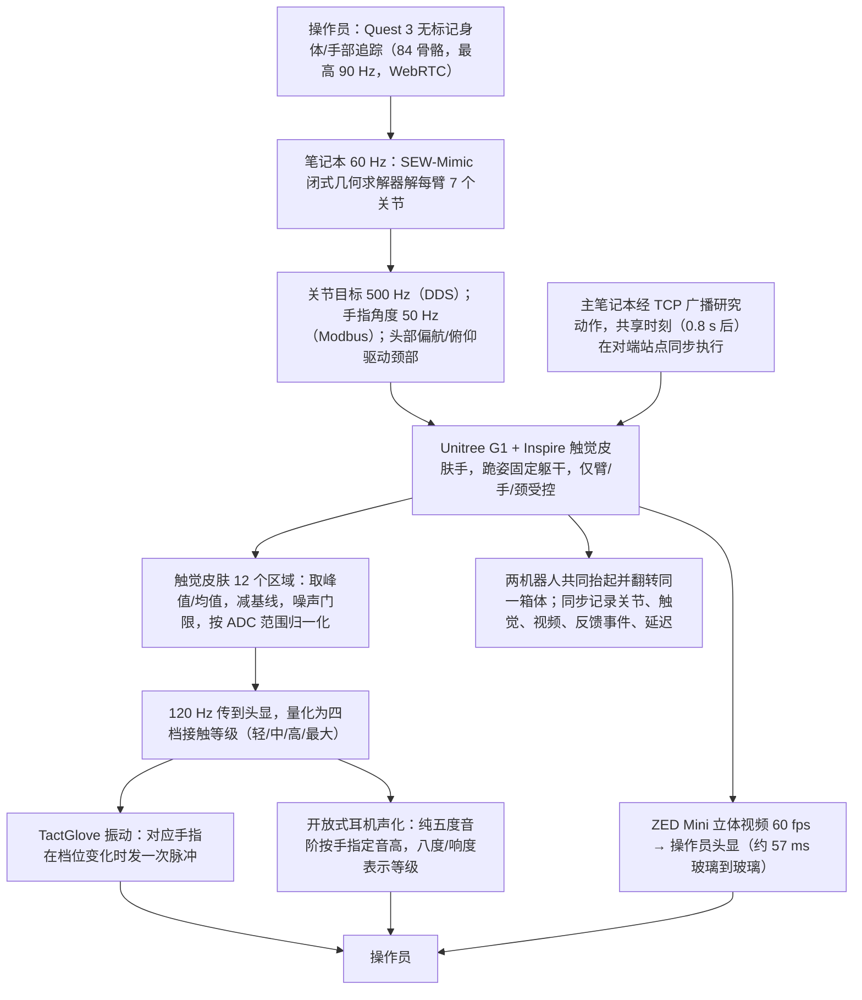

# Lightweight Contact Feedback Teleop（arXiv:2610.24257）

**Lightweight Contact Feedback Teleop**（*Evaluating Lightweight Contact Feedback in Dual-Operator Collaborative Humanoid Teleoperation*，[arXiv:2610.24257](https://arxiv.org/abs/2610.24257)，[项目页](https://xrt-teleop.github.io)）来自 [具身智能小站 2026-11-01 盘点](../../sources/blogs/wechat_embodied_station_56_papers_libero_dynamic_latency_eval_2026-11-01.md)，属「人形与腿足控制」组。

## 一句话定义

**XRT为双人双人形协作提供指尖振动与声音接触提示；配对实验中振动更受认可，但完成时间和失败率未检出条件差异，练习效应不可忽视。**

## 英文缩写速查

| 缩写 | 英文全称 | 简要说明 |
|------|----------|----------|
| Lightweight Contact Feedback Teleop | Evaluating Lightweight Contact Feedback in Dual-Operator Collaborative Humanoid Teleoperation | 本文方法 / 基准的简称 |

## 为什么重要

- 遥操作触觉更易懂，不等于完成更快。
- 开源结论：**项目页未列 GitHub**（步骤 2.5，2026-11-01）。项目页 HTTP 200，未见 GitHub 链接或 coming soon 字样。
- 同期同组工作见 [动态评测、技能编译与环境潜变量适配：具身智能小站 11-01 期 56 篇阅读坐标](../overview/embodied-station-2026-11-01-56-papers-technology-map.md)。

## 流程总览

图依据：论文 §III-B 至 §III-E / Fig.1、Fig.2、Table I。

## 核心机制

| 项 | 内容 |
|----|------|
| **arXiv** | [2610.24257](https://arxiv.org/abs/2610.24257) |
| **开源** | **项目页未列 GitHub** |
| **要点** | XRT为双人双人形协作提供指尖振动与声音接触提示；配对实验中振动更受认可，但完成时间和失败率未检出条件差异，练习效应不可忽视。 |
| **文内指标** | 公众号未给具体数字，本页不引用。 |

## 源码运行时序图

**不适用（项目页未列 GitHub）** — 项目页 HTTP 200，未见 GitHub 链接或 coming soon 字样。 不编造运行脚本；代码公开后再补。

## 实验与评测

- 公众号未给具体数字，本页不引用。
- **读法：** 本页为索引级摘要，依据公众号转述的官方摘要与仓库信息整理；逐项数字与 baseline 以原文 PDF 为准。

## 与其他工作对比

- 横向索引见 [动态评测、技能编译与环境潜变量适配：具身智能小站 11-01 期 56 篇阅读坐标](../overview/embodied-station-2026-11-01-56-papers-technology-map.md)；同 arXiv 不重复造页。

## 结论

**遥操作触觉更易懂，不等于完成更快：XRT为双人双人形协作提供指尖振动与声音接触提示；配对实验中振动更受认可，但完成时间和失败率未检出条件差异，练习效应不可忽视。**

1. 开源边界：**项目页未列 GitHub** — 项目页 HTTP 200，未见 GitHub 链接或 coming soon 字样。
2. 核心机制：XRT为双人双人形协作提供指尖振动与声音接触提示；配对实验中振动更受认可，但完成时间和失败率未检出条件差异，练习效应不可忽视。
3. 复现与选型前核对任务协议、硬件与基准口径，勿直接横比公众号摘录数字。

## 关联页面

- [locomotion](../tasks/locomotion.md)
- [motion-retargeting](../concepts/motion-retargeting.md)
- [sim2real](../concepts/sim2real.md)
- [teleoperation](../tasks/teleoperation.md)
- [embodied-station-2026-11-01-56-papers-technology-map](../overview/embodied-station-2026-11-01-56-papers-technology-map.md)

## 参考来源

- [lightweight_contact_feedback_teleop_arxiv_2610_24257.md](../../sources/papers/lightweight_contact_feedback_teleop_arxiv_2610_24257.md)
- [wechat_embodied_station_56_papers_libero_dynamic_latency_eval_2026-11-01.md](../../sources/blogs/wechat_embodied_station_56_papers_libero_dynamic_latency_eval_2026-11-01.md)
- [arXiv:2610.24257](https://arxiv.org/abs/2610.24257)
- [arXiv PDF](https://arxiv.org/pdf/2610.24257)：已通读全文：XRT 系统（重定向、接触信号与两种反馈显示、锁步控制）与用户研究设计（§III、§IV）

## 推荐继续阅读

- [arXiv PDF](https://arxiv.org/pdf/2610.24257)
- [项目页](https://xrt-teleop.github.io)
