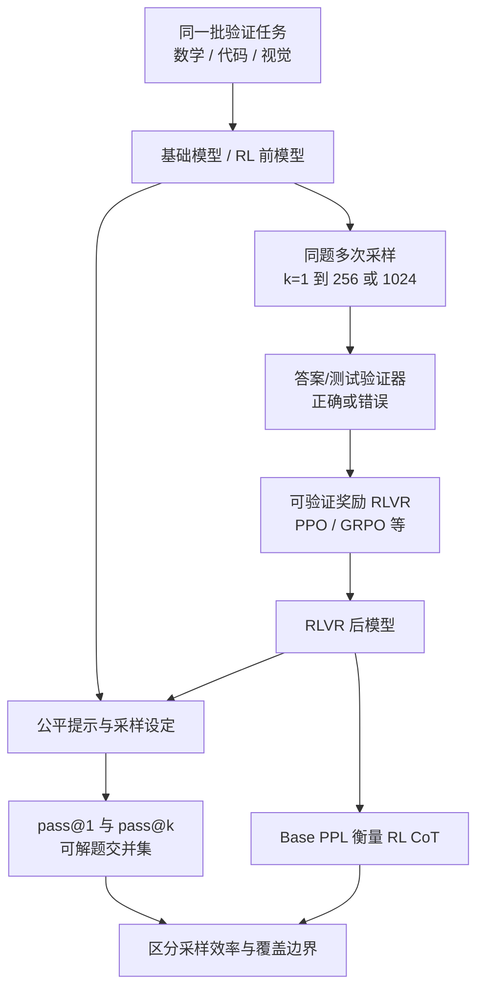
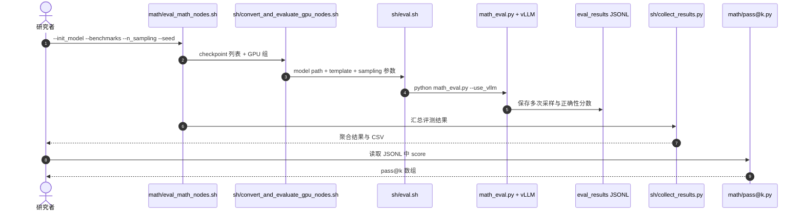

# Does Reinforcement Learning Really Incentivize Reasoning Capacity in LLMs Beyond the Base Model? / 强化学习真的能超越基础模型的推理能力边界吗？

论文 **Limit of RLVR**（清华大学 LeapLab / 上海交通大学，[arXiv:2504.13837v5](https://arxiv.org/abs/2504.13837v5)，NeurIPS 2025）系统检验以可验证结果奖励训练语言模型之后，究竟是**更容易命中已会的解**，还是**增加了基础模型原本无法解决的题**。

> **链接校正：** 本论文的唯一主编号是 **2504.13837**；原始请求给出的 **2608.24053** 是另一篇 WeMM-Embedding 论文，不作为本页身份。

## 一句话定义

**在相同问题与可比采样设定下，用小 k 的命中效率与大 k 的可解题覆盖率拆分 RLVR 的收益：单次更准不等于能力边界更广。**

## 英文缩写速查

| 缩写 | 英文全称 | 简要说明 |
|------|----------|----------|
| RLVR | Reinforcement Learning with Verifiable Rewards | 用可验证结果（多为二元正确性）强化学习 |
| LLM | Large Language Model | 语言模型的基础模型与 RL 后训练模型 |
| CoT | Chain of Thought | 推理轨迹，作者人工核查是否为有效推理 |
| GRPO | Group Relative Policy Optimization | 同题组内归一化回报的后训练算法 |
| PPL | Perplexity | 用基础模型衡量 RL 输出轨迹的似然 |
| SE | Sampling Efficiency | 有限采样预算下获得正确结果的效率 |

## 为什么重要

- **评价角度：** pass@1 适合关心单次回答的场景，pass@k（k 很大时）衡量**有限预算下出现至少一条正确轨迹的题目比例**；两者回答的问题不同。
- **训练诊断：** 只盯平均奖励与 pass@1，可能遗漏长尾问题失去可解轨迹的情况；需要对照 RL 前后的 pass@k 曲线、采样熵与题目集合差异。
- **机器人研究的可迁移方法论：** 对 VLA/具身规划器可借鉴“单次可靠性 vs 多尝试覆盖”的评测框架，但本论文**没有机器人控制、物理环境或真机实验**，不能直接宣称机器人 RL 也有同一结论。

## 核心信息

| 项 | 内容 |
|----|------|
| 机构 | 清华大学（Tsinghua University，LeapLab）；上海交通大学（Shanghai Jiao Tong University） |
| 论文 | NeurIPS 2025；[arXiv:2504.13837v5](https://arxiv.org/html/2504.13837v5)（2025-11-24） |
| 核心方法 | 相同问题的 base / RLVR 对照；pass@k 曲线、可解题重叠、CoT 人工校验、基座 PPL 分析 |
| 任务 | 数学（GSM8K、MATH500、Minerva、AIME24 等）；编程（LiveCodeBench、HumanEval+、MBPP+）；视觉推理（MathVista、MathVision） |
| 训练算法对比 | PPO、GRPO、Reinforce++、RLOO、ReMax、DAPO |
| 开源 | **部分开源**：公开数学/DeepCoder 评测脚本；未核实存在完整统一训练流水线，见 [源码归档](../../sources/repos/limit-of-rlvr.md) |

## 核心原理

1. **区分两种能力表现：** RLVR 用验证器对回答给出 $r\in\{0,1\}$，更新策略以提高正确回答的概率。pass@1 增长意味着低预算更容易成功；pass@k 则统计同题重复采样 $k$ 次至少成功一次的比例，较大 k 用于探索有限计算预算内的可解问题覆盖。
2. **公平比较：** 主要评测采用相同的 zero-shot 提示、temperature=0.6、top-p=0.95 和最多 16,384 tokens（论文 §3）；数学多数从预训练 base 直接做 zero-RL，代码和视觉实验也包含 instruct 模型作为 RL 前起点。
3. **拆分题目集合：** 记录 base 和 RL 是否各自能在 k 次内解出同一题；“RL 独有可解题”极少，反而较多题目只被 base 的多样性采样覆盖。
4. **解释分布变化：** 用基座模型的 PPL 衡量 RL 模型生成的 CoT；论文发现 RL 输出在基座原有高概率区域内，显示对有奖励轨迹的概率重分配，而非足以证明凭空创生新解法。
5. **对照蒸馏：** 强教师提供新的推理轨迹，蒸馏学生的 pass@k 曲线明显上移；这与只靠自身二元结果反馈的 RLVR 实验设置不同。

## 流程总览

该图概括**论文的训练与评测方法关系**，不是声称官方仓库提供一键完成训练的入口。

## 源码运行时序图

官方代码 [LeapLabTHU/limit-of-RLVR](https://github.com/LeapLabTHU/limit-of-RLVR) 中的数学评测路径（已检查脚本与 README）：

编程评测是独立入口：code/DeepCoder/scripts/eval/eval_model.sh → python3 -m verl.trainer.main_generation_vllm2 → 输出 parquet 与结果文件；详见 [官方代码归档](../../sources/repos/limit-of-rlvr.md)。**此处为静态代码核验，未执行 GPU 实验。**

## 工程实践

| 检查项 | 可执行建议 |
|--------|------------|
| 评测组合 | 同时报告 pass@1、pass@8/32、pass@128/256 及题目层面的 base-only / RL-only 覆盖（根据样本预算选 k） |
| 采样条件 | 固定 prompt、token 限制与温度，记录 seed、top-p、验证器及抽样数量；扩大 k 时报告计算成本 |
| RL 训练监控 | 不只看平均奖励；对照不同 step 的 pass@k、输出熵和长尾问题 |
| 代码复现 | 数学入口需配置本地 init_model_path 与 W&B 变量；DeepCoder 入口有硬编码 HOME / GPU 配置，先适配环境 |
| 具身外推 | 可为云端规划器设计多候选评测；机器人须另外测闭环 success、恢复策略、延迟和安全，不能把文本数字当真机结果 |

## 实验与评测

- **数学：** Minerva 的 32B 对照在 k=128 时，base 的 pass@k 比 RLVR 高约 **9 个百分点**（§3.1）。
- **可解题集合（Table 2）：** AIME24、k=1024：两者均可解 **63.3%**，只 base **13.3%**，只 RLVR **0.0%**；MATH500、k=128：分别 **92.4% / 3.6% / 1.0%**。
- **算法比较（Appendix C.5 Table 3，Omni-MATH Test）：**

| 模型 | pass@1 | pass@256 |
|------|-------:|---------:|
| Qwen2.5-7B Base | 10.2% | 69.1% |
| GRPO | 25.1% | 68.3% |
| PPO | 26.8% | 69.2% |
| RLOO | 28.1% | 69.2% |
| DAPO | 26.5% | 67.0% |

- **训练步数：** GRPO 150→300→450 steps，同分布外 Omni-MATH Test 的 pass@1 为 **25.1→27.1→28.3%**，pass@256 为 **68.3→66.6→63.9%**（Appendix Table 4）。
- **编程/视觉：** LiveCodeBench、HumanEval+、MBPP+ 与 MathVista/MathVision 的 pass@k 曲线显示类似分化；编程代码通过单元测试可减少“幸运猜答案”的干扰（§3.2–§3.3）。
- **强模型例外检查：** Magistral-Medium 初步实验在 k=1 有显著收益，大 k 差距收缩；作者保留更大训练预算是否改写结论的开放性（§4.6）。

## 与其他工作对比

| 对比方向 | 核心机制 / 评测对象 | 与 Limit of RLVR 的关键差异（依据原文 §4 与附录） |
|----------|---------------------|---------------------------------------------------|
| **强教师蒸馏（如 DeepSeek-R1-Distill-Qwen-7B）** | 外部强教师提供新的 CoT 推理轨迹监督 | 原文 §4.2 显示蒸馏可上移大 k 的 pass@k 曲线，引入基座原本缺少的解法；纯二元结果奖励 RLVR 仅在基座既有高似然轨迹内重分配概率 |
| **[Reasoning with Sampling](./paper-reasoning-with-sampling.md)** | 测试时不改权重的重采样 / 推理时计算分配 | 与训练期分布锐化的多样性成本形成对照：两者都面临「单次命中效率 vs 大预算覆盖」权衡 |
| **[DASH-OPSD](./paper-dash-opsd.md)** | 引入额外自蒸馏 / 过程监督信号 | 脱离仅依赖二元终态对错的稀疏 RLVR 设定，补充了更细粒度的训练信息源 |
| **[具身大模型评测基准选型闭环](../queries/embodied-eval-benchmark-selection-loop.md)** | 仿真/真机闭环成功率、恢复策略、延迟与硬件安全 | 本论文仅评估数学/代码/视觉推理的文本 pass@k，不含物理环境与机器人闭环实验，结论不可直接外推到具身 RL |

## 结论

**在本文覆盖的二元可验证奖励实验中，RLVR 的主要可见收益是提高已可解问题的采样效率，而非稳定拓宽基础模型的多次采样可解范围。**

1. **不要只交 pass@1。** 必须报告可比预算下的大 k 曲线和长尾题目覆盖。
2. **把“答对更频繁”与“新增可解题”分开。** 前者是很有价值的工程收益，不能自动推导后者。
3. **警惕探索收窄。** 平均分与训练 step 上升时，大 k 覆盖可能下降。
4. **有新知识来源时优先做蒸馏对照。** 教师推理轨迹提供了 RLVR 二元奖励中不存在的信息。
5. **保持研究边界。** 这不是“强化学习不能学新技能”的一般性定理，也不适用于未经验证的机器人闭环。

## 局限与风险

- pass@k 是**有限采样代理指标**，不等于绝对理论上限；与推理预算、温度、seed、token 截断和判题质量有关。
- 数学/代码/视觉使用的 RL 前模型可能不同；本文最有力的结论来自对应受控对照，不应混成所有 LLM 后训练的因果断言。
- 强模型、密集过程奖励、课程探索、复杂工具调用、多轮环境交互仍有待独立实验；原文 §5、§7 明确保留这些空间。
- 作者仓库提供公开**评测**代码，但有未填配置与硬编码路径，尚未验证开箱复现；论文结论不是机器人真机结论。

## 关联页面

- [GRPO](../methods/grpo.md) — 比较组相对优化与 pass@k 的关系。
- [Reinforcement Learning](../methods/reinforcement-learning.md) — 区分经典 RL 交互探索与二元 RLVR。
- [Reasoning with Sampling](./paper-reasoning-with-sampling.md) — 不更改权重的采样改良，与本研究的多样性成本视角对照。
- [AI Agent Evaluation](../concepts/ai-agent-evaluation.md) — 区分重复尝试与稳定执行。
- [DASH-OPSD](./paper-dash-opsd.md) — 与自蒸馏等额外监督路线比较。
- [RSI 纵深路线](../../roadmap/depth-rsi.md) — 权重改进与能力边界判别。
- [具身大模型评测基准选型闭环](../queries/embodied-eval-benchmark-selection-loop.md) — 边界对照：本页讨论数学/编程/视觉推理的 pass@k 采样效率，机器人任务仍须按具身闭环评测基准单独验证。

## 参考来源

- [论文全文核读归档](../../sources/papers/limit_of_rlvr_arxiv_2504_13837.md)
- [官方项目页核查](../../sources/sites/limit-of-rlvr.md)
- [官方评测源码核查](../../sources/repos/limit-of-rlvr.md)
- [arXiv:2504.13837v5 正文](https://arxiv.org/html/2504.13837v5)
- [NeurIPS 2025 论文集](https://proceedings.neurips.cc/paper_files/paper/2025/hash/537d5aa768c2d534016a4d06f87bc8fb-Abstract-Conference.html)

## 推荐继续阅读

- [Limit of RLVR 官方 Q&A](https://limit-of-rlvr.github.io/)
- [LeapLabTHU 官方代码](https://github.com/LeapLabTHU/limit-of-RLVR)
- [Reasoning with Sampling](./paper-reasoning-with-sampling.md) — 测试时重采样与训练期分布重塑的对照。
