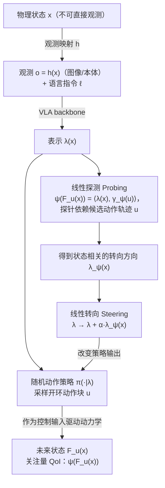

# The Linear Representation Hypothesis for Vision-Language-Action Models

该工作检验VLA潜在表示是否存在可线性操控的任务变量。

## 英文缩写速查

| 缩写 | 英文全称 | 简要说明 |
|---|---|---|
| VLA | Vision-Language-Action | 视觉与指令条件化的机器人动作策略。 |
| WM | World Model | 预测行动后的环境变化。 |
| WAM | World Action Model | 联合建模未来视觉和动作。 |

## 为什么重要

该工作检验VLA潜在表示是否存在可线性操控的任务变量。 评读时应将问题、观测条件与执行接口一并记录，避免从单个演示或指标外推能力。

## 流程总览

图依据：论文 §1 背景（VLA pipeline）、§2–§3 / Fig.1（探测与转向的定义）；在 OpenVLA-OFT 上沿 D_ϕ^T λ_ψ 方向转向的实现细节（经动作头链式法则）仅略读，未入图。

## 方法栈

分析表示方向与动作及任务变量关系；先在受控平面导航环境的解析 oracle 表示上验证，再在预训练 OpenVLA-OFT（LIBERO-10）上检验线性探测与转向（依据 arXiv:2609.30996 摘要、§1 贡献 4、§6）。

## 实验与评测

两组实验（依据 arXiv:2609.30996 §5、§6）：(1) 受控 oracle 设定：平面控制系统、指令「Navigate to the goal.」，Chen–Fliess 解析表示，精确验证探测与转向机制；(2) 预训练 OpenVLA-OFT（LIBERO-10 微调检查点）：在一个双马克杯任务上采集 788 个状态（50 种布局），其中 404 个状态各执行 32 个候选动作块，检验探测与转向。论文自述为概念验证（proof of concept），并指出找到同时适合探测与转向的表示 λ 仍是开放问题；未测试人形机器人。

## 与其他工作对比

这是表示假设检验，不是已验证通用控制接口；证据边界比单一分数更重要。

## 工程实践

当前归档仅核实到arXiv入口，未核实可运行官方代码。

## 源码运行时序图

**不适用**：当前没有核实到该论文的可运行官方训练、推理或部署入口。

## 结论

**一句话总判：** 该工作检验VLA潜在表示是否存在可线性操控的任务变量。

1. 核对方法实际改变的是数据、表征、规划、控制还是评测。
2. 只把论文覆盖的任务、平台与扰动范围当作证据。
3. 复现前确认代码、权重、数据许可和硬件依赖状态。

## 局限与风险

这是表示假设检验，不是已验证通用控制接口；证据边界比单一分数更重要。 当前导读以用户提供的文章和预印本题录为索引；详细配置与结果应核对论文全文。

## 关联页面

- [Day 5 导读](../overview/humanoid-motion-intelligence-day5-world-models-decision.md)
- [生成式世界模型](../methods/generative-world-models.md)

## 参考来源

- [Day 5 原文归档](../../sources/blogs/humanoid_motion_intelligence_day5_world_models_decision_2026_10_06.md)
- [arXiv:2609.30996](https://arxiv.org/abs/2609.30996)
- [arXiv PDF](https://arxiv.org/pdf/2609.30996)：已通读方法部分（实验与附录以略读为准）：摘要、§1 引言与背景、§2 控制论表述、§3 线性探测与转向定义、§4 引言；定理证明与实验为略读
- 核对（2026-11-02）：对照 arXiv:2609.30996 摘要、§1、§5 实验与 §6 结论；原「实验限于导航仿真」有误，已改为 oracle 导航设定 + OpenVLA-OFT/LIBERO-10 两组实验。

## 推荐继续阅读

- [Day 5 导读](../overview/humanoid-motion-intelligence-day5-world-models-decision.md)
