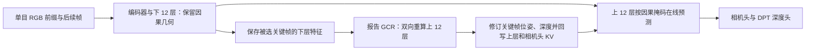
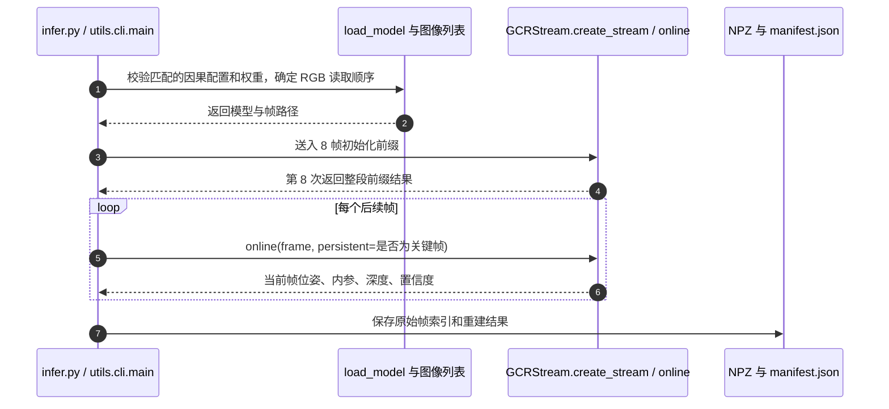

# LingBot-Map 2.0：可重整合的流式 3D 重建（Reconsolidatable Streaming 3D Reconstruction）

## 一句话定义

用始终因果的下层保留相机流的坐标基准，用可切换双向注意力的上层重新联合处理已见关键帧，并将修订后的场景上下文写回缓存供后续帧使用。

## 英文缩写速查

| 缩写 | 英文全称 | 简要说明 |
|------|----------|----------|
| GCR | Geometric Context Reconsolidation | 几何上下文重整合 |
| GCA | Geometric Context Attention | 跨帧几何上下文注意力 |
| KV | Key–Value | 流式注意力的键值缓存 |
| DPT | Dense Prediction Transformer | 将多层图像特征映射成深度 |
| ATE | Absolute Trajectory Error | 对齐后的绝对轨迹误差 |

## 为什么重要

[初版 LingBot-Map](paper-lingbot-map.md) 聚焦如何低成本读取历史；2.0 报告问的是如何修订历史并让新帧受益。与只对输出姿态做后端修正不同，GCR 更新上层和相机头的上下文，让后续帧真正读到修订后的记忆。

| 项目 | 内容 |
|------|------|
| 机构 | 蚂蚁灵波科技（Robbyant） |
| 主输入 | 未标定单目 RGB 图像流 |
| 输出 | 相机位姿/内参、稠密深度及置信度，深度与平移尺度未定 |

## 核心机制

- 24 层交替做帧内注意力及跨帧 GCA。前 12 层始终按因果规则处理，除联合编码的初始化前缀外不会用未来帧；后 12 层平时因果，触发 GCR 时只对已保存的关键帧及其下层特征重跑双向注意力。DPT 融合第 5、12、18、24 层特征。
- 活跃缓存由前缀、近窗的稠密 patch token、旧关键帧的紧凑上下文组成；非关键帧有输出，但临时 KV 槽回滚。报告中的重整合重算关键帧位姿和深度并回写上层 KV；非关键帧深度保留在线值，轨迹评估对其位姿补插。
- 先用离线多视图训练几何，再用长序列训练因果基座；之后训练等概率混合因果、全双向、双向前缀接因果后缀三种掩码。对预测与真值分别按同一前缀定义归一化尺度，并显式监督相邻帧相对位姿以降低抖动。强行给纯因果权重打开双向掩码并不替代混合训练（表 5）。

## 流程总览

## 源码运行时序图

这里的 `GCRStream` 是公开因果流式类，不代表提供报告中双向重整合或回写入口。

## 工程实践

- `infer.py` 支持自然排序的图像目录或显式 JSON 列表。默认 Uniform320 stride 用全序列长度计算，实时未知长度的相机流应自行选择持久关键帧。非关键帧不推进提交时钟；处理端应保留独立帧号，落盘 `raw_indices` 就是这个用途。
- `demo.py --predictions` 能从既有预测可视化而不重新加载模型；含原始帧和深度时可投影点云。仓库声明运行模型需支持 BF16 的 CUDA GPU、PyTorch 2.8+ 和 FlashInfer。
- 在 CPU 用占位模型走官方 CLI 验证 10 帧输入的自然排序、8 帧前缀、持久帧选择、NPZ 原始索引和完整 manifest；这是接口级测试，不验证真实几何或吞吐。
- 源码、演示及评测套件已发布；Hugging Face 和 ModelScope 是纯因果基座的权重入口，截至 2026-11-27，Hugging Face 基座配置与约 4.63 GB 权重直链匿名可达，ModelScope 文件列表列出同规格和校验值；README 的私有提示已与当日访问状态不一致。未下载整份权重或运行 GPU 重建。官方代码及基座权重采用 CC BY-NC 4.0，不可直接当成商业友好许可。

## 实验与评测

以下为报告作者结果，未独立复现。表 2 的长轨迹 ATE 为逐序列 Sim(3) 对齐后的均值，不是裸输出米制精度。表 6 用同一整条轨迹对齐，保留关键帧走到 75% 时只修订一次，再恢复因果推理。

| 评测与口径 | 纯在线 | GCR |
|------------|-------:|----:|
| CroCoDL 相机 AUC@30（表 3） | 66.82% | 85.30%（末尾重整合） |
| CroCoDL 稠密重建 F1，0.25 m 阈值（表 4） | 67.03% | 77.14%（末尾重整合） |
| KITTI 后段 ATE（表 6） | 21.21 m | 14.22 m（75% 触发）；8.40 m（末尾重整合） |
| Oxford Spires 后段 ATE（表 6） | 6.96 m | 4.33 m（75% 触发）；2.85 m（末尾重整合） |

## 与相关工作对比

表 2 的 VBR / Oxford Spires / KITTI 纯在线 ATE 分别是 17.01 / 6.17 / 17.56 m，V1 是 31.12 / 8.25 / 24.07 m。表 4 上 EuRoC 的在线 F1 85.72% 低于 V1 的 88.02%，所以不能把最终重整合模型的收益归到所有在线场景。

## 结论

报告的关键增量不是另一条外部位姿优化链，而是修订模型会继续使用的内部几何记忆。

- 即时反馈先看纯因果一列；回顾性制图另分中途触发和末尾触发。
- 想验证收益，要对同一序列分别测在线与重整合后段误差，不把全局对齐当作在线获得绝对尺度。
- 评估部署时按公开基座实测延时；不要把论文 GCR 模式的结果或速度写成当前下载版的规格。
- 机器人要用米制地图时，另引入可验证的外部尺度、坐标变换与漂移检查。

## 局限与风险

- 长时持久化关键帧上下文及下层特征随关键帧数线性增长；重整合的全双向注意力计算随关键帧数二次增长。
- 单目无绝对尺度，弱纹理与急速运动缺少惯性/测距补充；不替代生产导航的定位冗余或碰撞地图。
- 报告不要求显式回环检测触发 GCR，但不能解释为无重叠图像也能可靠修正或具备跨会话可靠重定位。

## 关联页面

- [LingBot-Map 方法](../methods/lingbot-map.md)
- [视觉 3D 重建方法](../methods/visual-3d-reconstruction.md)
- [状态估计](../concepts/state-estimation.md)
- [机器人视觉感知栈选型闭环](../queries/robot-perception-stack-selection-loop.md) — 流式前馈 3D 重建在感知栈「表征层」的定位与选型口径
- [导航纵深路线](../../roadmap/depth-navigation.md)
- [Real2Sim 纵深路线](../../roadmap/depth-real2sim.md)

## 参考来源

- [技术报告归档](../../sources/papers/lingbot_map_v2_report.md)
- [官方项目主页归档](../../sources/sites/lingbot-map-v2.md)
- [公开代码与权重归档](../../sources/repos/lingbot-map-v2.md)

## 推荐继续阅读

- [V1 原文：Geometric Context Transformer for Streaming 3D Reconstruction](https://arxiv.org/abs/2604.14141)
