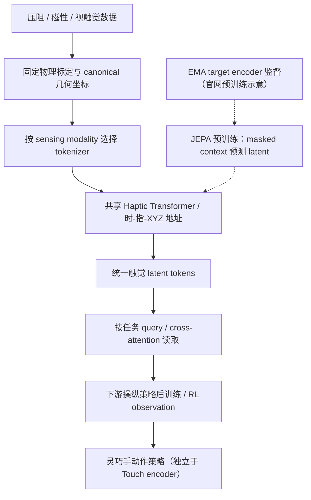
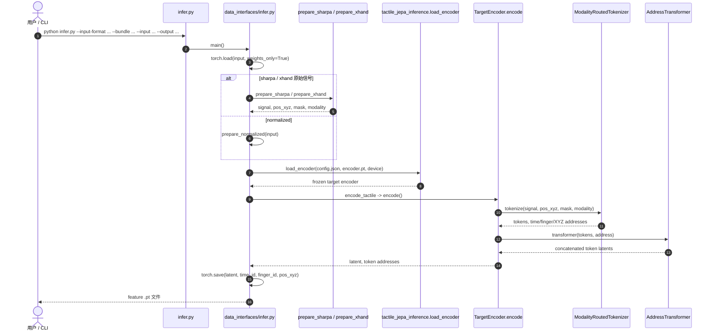

# LingBot-Touch：面向通用灵巧操作的异构触觉基础表征模型
**Learning Heterogeneous Tactile Representation for General Dexterous Manipulation**

> **核验状态：待完成技术报告全文阅读。** 官网、GitHub README、推理源码和 HF 模型卡已核实；论文 PDF 为 19 MB Git LFS 文件，当前工具未获取其正文。以下实验数字只按官方网页的明确文本标注，不声称完成论文全篇或独立复现。

## 一句话定义

**LingBot-Touch** 通过模态专用的触觉 tokenization、统一几何地址以及共享 Haptic Transformer，把异构触觉时空观测编码为可复用的潜变量表征，供下游灵巧操作策略使用；它是**触觉 encoder**，而不是独立输出机器人动作的 VLA 策略。

## 英文缩写速查

| 缩写 | 英文全称 | 简要说明 |
|---|---|---|
| JEPA | Joint-Embedding Predictive Architecture | 在潜空间预测上下文表征而非直接重建原信号 |
| HaT | Haptic Transformer | 官方模型中的共享触觉 Transformer |
| RoPE | Rotary Position Embedding | 结合时间、手指和三维空间地址的旋转位置编码 |
| VLA | Vision-Language-Action | 可消费触觉特征的机器人动作策略 |
| RL | Reinforcement Learning | 官网评估的 12 项仿真强化学习任务 |
| EMA | Exponential Moving Average | 官网预训练示意中的 target encoder 更新机制 |

## 核心信息

| 维度 | 公开信息与核验口径 |
|---|---|
| 机构 | 蚂蚁灵波（Robbyant，蚂蚁集团旗下） |
| 论文 | [官方技术报告 PDF](https://github.com/Robbyant/lingbot-touch/blob/main/paper/Learning_Heterogeneous_Tactile_Representation_for_General_Dexterous_Manipulation.pdf)（PDF 正文未读完） |
| 主页 | [LingBot-Touch](https://technology.robbyant.com/lingbot-touch) |
| 代码 | [Robbyant/lingbot-touch](https://github.com/Robbyant/lingbot-touch)：Apache-2.0 |
| 权重 | [HF Tiny](https://huggingface.co/robbyant/lingbot-touch-tiny) · [HF Small](https://huggingface.co/robbyant/lingbot-touch-small) · [ModelScope 集合](https://www.modelscope.cn/collections/Robbyant/LingBot-Touch) |
| 触觉语料 | 官方网页：**4,983 小时 / 464,431 episodes / ~1.33B 帧** |
| 三种输入 | 磁性（XYZ）、压阻（标量）、视触觉（解码后的标量，非原始 RGB） |
| 官方真机演示 | **26 项**（Sharpa Wave 20，XHand 6；每任务 20 trials） |
| 官方仿真 RL | **12 项**，网页标注每任务 3 random seeds |
| 参数规模 | 官网明确 HaT-Tiny **5.46M** 参数；Small 以相应配置文件为准 |

## 为什么重要

- **跨硬件迁移的接口问题：** 不同传感原理的数值维度、taxel 数、手指布局与幅值范围差异很大；共享表征的前提是先验证物理标定、坐标与适配。
- **避免直接硬塞 raw tactile：** 项目将冻结触觉 token 提供给下游机器人策略，而非假设 raw 信号天然兼容跨策略的输入分布。
- **与视觉/VLA 互补：** 接触压力、打滑和局部力学变化可能不在相机视野内；本模型填补触觉观测，不负责动作生成。
- **已能试推理：** 官方开放 Tiny/Small target encoder + CLI、Sharpa/XHand 两种可核验 adapter、样例数据；区别于完整预训练代码开源。

## 流程总览（据官网与 README，非 PDF 全文图复刻）

实线表达官网/README 的部署数据流；虚线表示官网预训练示意所述机制，**未对论文中的 loss 定义或训练时间表做未经核实的推断**。

## 核心原理

### 1. 模态与几何统一

磁性传感器以 `[X,Y,Z]` 输入；压阻、视触觉的**解码标量**进入 Z，XY 置零。每个 taxel 同时对应 canonical space 的 `pos_xyz`，模态选择必须由传感原理确定，而不是由张量大小自动推断。内部采用模态路由 tokenizer + 共享 Transformer；RoPE 对时间、手指及 XYZ 地址编码。

### 2. 冻结 token 用作下游策略观测

推理接口消费 `signal:[B,T,5,M,3]`、`pos_xyz`、`coverage_mask:[5,M]`，导出 `latent:[B,N,C]` 及 `time_id`、`finger_id`、`pos_xyz`。作者推荐任务相关 query / cross-attention，而非一律 mean pooling；经过 Transformer 全局 self-attention 的 token 不代表其地址处单个 taxel 的纯局部信号。

### 3. 论文与项目自报实验

| 评价范围 | 可核验事实 |
|---|---|
| 预训练 | 官网给出三模态 4,983 小时；压阻 2,197 h、磁性 1,136 h、视触觉 1,650 h |
| 真机 | 官网展示 26 项，20 trials/task，比较原策略、raw touch 与冻结 Touch features 后训练 |
| 仿真 RL | 官网列出 12 个任务，比较 5 种观测配置；3 seeds/task |
| Scaling | 官网展示数据量增长时的性能曲线；当前文本不能给出可靠的完整曲线数值 |

**注意：** 这些均为作者发布的实验或演示。本次没有独立复现；技术报告未逐表读取，因此不编造置信区间、训练 GPU、精确提升幅度与跨本体外推结论。

## 结论

**LingBot-Touch 的核心贡献是统一触觉观测的冻结表征接口，而不是直接取代机器人控制模型；其具体实验增益仍待报告原文逐表确认。**

1. 新传感器先验证 taxel 坐标、左右手、坐标轴和固定数值范围，再导入模型。
2. 下游优先试任务条件 cross-attention 读取 token，与 raw tactile 及 no-tactile baseline 做同预算对照。
3. 首先用公开 Sharpa/XHand 样例与 Tiny bundle 做 shape / validity smoke test，再扩展到真实机器人。
4. 区分「冻结 encoder 不重训」与「机器人任务策略不需要后训练」两个不同主张。
5. 关注原始论文完整指标、训练数据和预训练权重可复现边界，确认后再将此页标记完成。

## 源码运行时序图（实际发布的推理实现）

与[官方代码入口核验](../../sources/repos/lingbot-touch-official.md)一致。这是**特征提取推理链**，源码 release 不包含论文预训练 trainer，也没有在此入口里调用 LingBot-VLA 或真实灵巧手驱动。

## 工程实践

1. 下载匹配的 `config.json` 与 `encoder.pt` 到 `checkpoints/lingbot-touch-tiny/`，运行 `python infer.py --input-format sharpa --bundle checkpoints/lingbot-touch-tiny --input sample_data/sharpa/001_left.pt --output outputs_left.pt --device cpu`。
2. 官方验证环境 Linux / Python 3.12.13 / PyTorch 2.11.0 / NumPy 2.4.4；CUDA 分支按照 README 设 `--device cuda:0`。
3. Sharpa 示例直接使用已有 canonical 坐标；XHand 原始 120 taxel 依校验过的固定映射采样至 96。**不得二次几何变换或二次归一化**。
4. `coverage_mask` 只标记该 taxel 是否真实存在，零压力的真实 taxel 必须为 True；不能作为 contact mask。
5. **开放边界：** README / HF 模型卡只提供冻结 target encoder、接口、部分样例；训练用 predictor、pretraining trainer、训练数据与策略 downstream heads 未随该发行包提供。

## 局限与风险

- **报告未通读：** 此 PR 保持 Draft，原文损失函数、消融与定量置信区间未核实，不能标记 complete 或 3/3。
- **跨硬件不是免标定：** 新布局必须核验几何参考、轴序、力方向和传感器固定数值标度；匹配张量 shape 不是匹配物理语义。
- **频率约束：** Tiny/Small 的 tubelet_size 分别为 2/4；时间窗 T 必须可整除。README 的高频能力陈述不代表提供了本机部署端到端延迟测试。
- **真实机闭环需额外工作：** 公开 CLI 只输出 feature，不包含原策略后训练头、策略接口/频率协调、碰撞与力安全边界，也未提供独立真机复现实验数据。

## 关联页面

- [Robbyant（蚂蚁灵波）](./robbyant.md)：团队及 LingBot 模型家族
- [LingBot-VLA](./lingbot-vla.md)：视觉-语言-动作策略，与触觉特征互补
- [LingBot-VLA 2.0](./lingbot-vla-v2.md)：另一条动作策略线
- [机器人 Manipulation 任务](../tasks/manipulation.md)：灵巧操作任务背景

## 参考来源

- [官方技术报告读取状态与后续核验清单](../../sources/papers/lingbot-touch-technical-report.md)
- [官方项目主页全文核验](../../sources/sites/lingbot-touch-official.md)
- [推理源码 / HF 权重与输入接口核验](../../sources/repos/lingbot-touch-official.md)

## 推荐继续阅读

- [LingBot-Touch 官方项目主页](https://technology.robbyant.com/lingbot-touch)
- [GitHub 官方推理代码](https://github.com/Robbyant/lingbot-touch)
- [技术报告 PDF](https://github.com/Robbyant/lingbot-touch/blob/main/paper/Learning_Heterogeneous_Tactile_Representation_for_General_Dexterous_Manipulation.pdf)
- [Hugging Face Tiny/Small 集合](https://huggingface.co/collections/robbyant/lingbot-touch)
