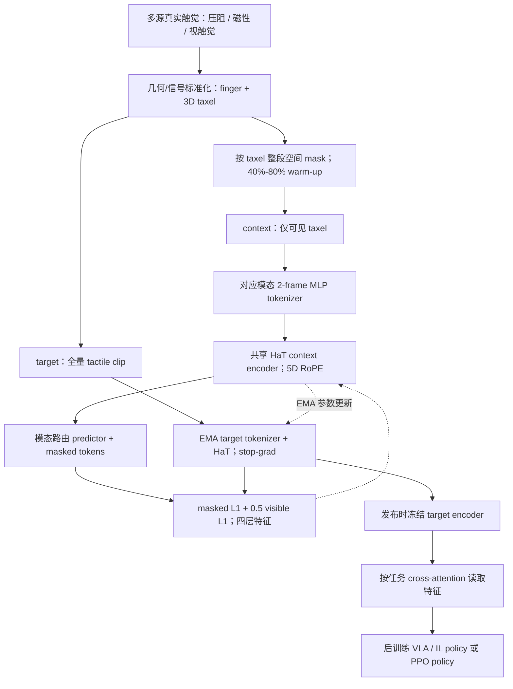
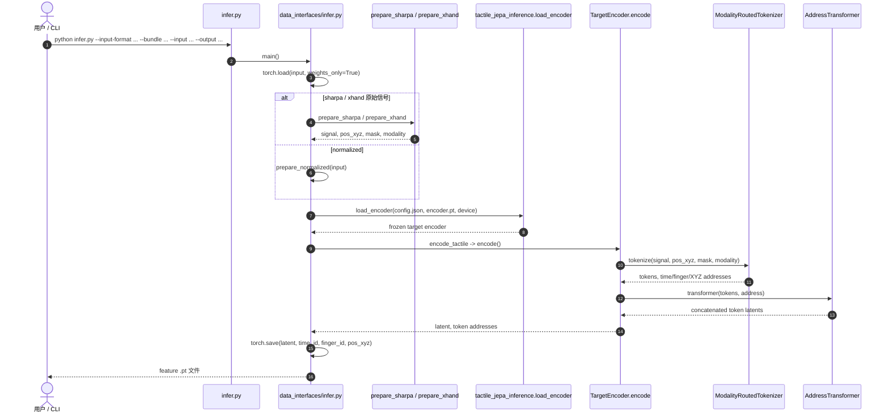

# LingBot-Touch：面向通用灵巧操作的异构触觉基础表征模型
**Learning Heterogeneous Tactile Representation for General Dexterous Manipulation**

> **核验状态：已通读技术报告全文（27 页，包括 §1–6、附录 A–C、Tables 1–8、Figures 1–16 与 References 1–37）。** 从 Git LFS 下载的正式 PDF 经 SHA-256 `1d68b6ce43470b9ffbdfd7425480581845b2515eb7897661e26152c5b257a3ce` 核对。以下实验为**论文作者报告**，不代表独立复现。

## 一句话定义

**LingBot-Touch** 通过模态专用的触觉 tokenization、统一几何地址以及共享 Haptic Transformer，把异构触觉时空观测编码为可复用的潜变量表征，供下游灵巧操作策略使用；它是**触觉 encoder**，而不是独立输出机器人动作的 VLA 策略。

## 英文缩写速查

| 缩写 | 英文全称 | 简要说明 |
|---|---|---|
| JEPA | Joint-Embedding Predictive Architecture | 在潜空间预测上下文表征而非直接重建原信号 |
| HaT | Haptic Transformer | 官方模型中的共享触觉 Transformer |
| RoPE | Rotary Position Embedding | 结合时间、手指和三维空间地址的旋转位置编码 |
| VLA | Vision-Language-Action | 可消费触觉特征的机器人动作策略 |
| RL | Reinforcement Learning | 官网评估的 12 项仿真强化学习任务 |
| EMA | Exponential Moving Average | 官网预训练示意中的 target encoder 更新机制 |

## 核心信息

| 维度 | 公开信息与核验口径 |
|---|---|
| 机构 | 蚂蚁灵波（Robbyant，蚂蚁集团旗下） |
| 论文 | [官方技术报告 PDF](https://github.com/Robbyant/lingbot-touch/blob/main/paper/Learning_Heterogeneous_Tactile_Representation_for_General_Dexterous_Manipulation.pdf)（27 页全文与附录已核验） |
| 主页 | [LingBot-Touch](https://technology.robbyant.com/lingbot-touch) |
| 代码 | [Robbyant/lingbot-touch](https://github.com/Robbyant/lingbot-touch)：Apache-2.0 |
| 权重 | [HF Tiny](https://huggingface.co/robbyant/lingbot-touch-tiny) · [HF Small](https://huggingface.co/robbyant/lingbot-touch-small) · [ModelScope 集合](https://www.modelscope.cn/collections/Robbyant/LingBot-Touch) |
| 触觉语料 | 官方网页：**4,983 小时 / 464,431 episodes / ~1.33B 帧** |
| 三种输入 | 磁性（XYZ）、压阻（标量）、视触觉（解码后的标量，非原始 RGB） |
| 官方真机演示 | **26 项**（Sharpa Wave 20，XHand 6；每任务 20 trials） |
| 官方仿真 RL | **12 项**，网页标注每任务 3 random seeds |
| 参数规模 | 论文 §4.1：HaT-Tiny **5.46M / 192 hidden**、HaT-Small **21.76M / 384 hidden**；二者均为 **12 层 Transformer**，不包含 predictor/策略头 |

## 为什么重要

- **跨硬件迁移的接口问题：** 不同传感原理的数值维度、taxel 数、手指布局与幅值范围差异很大；共享表征的前提是先验证物理标定、坐标与适配。
- **避免直接硬塞 raw tactile：** 项目将冻结触觉 token 提供给下游机器人策略，而非假设 raw 信号天然兼容跨策略的输入分布。
- **与视觉/VLA 互补：** 接触压力、打滑和局部力学变化可能不在相机视野内；本模型填补触觉观测，不负责动作生成。
- **已能试推理：** 官方开放 Tiny/Small target encoder + CLI、Sharpa/XHand 两种可核验 adapter、样例数据；区别于完整预训练代码开源。

## 流程总览（论文 Figure 3、§3.1–3.3）



训练期区分 context、predictor、EMA target 三支；**部署时只保留冻结 target encoder 作为触觉特征提取器**。虚线只表示训练监督/EMA 更新，不是部署推理依赖；见[论文精读](../../sources/papers/lingbot-touch-technical-report.md)和[实际源码调用链](../../sources/repos/lingbot-touch-official.md)。

## 核心原理

### 1. 异构接口：不是统一传感器原始数值，而是统一物理位置和上下文（论文式 1–2）

给每个有效 taxel 定义规范化位置 `p_i=αp̃_i+b`，其中旋转/缩放/偏移均取自**离线测量的传感器-手指模板**。每个 token 保留 `(t, finger, x, y, z)` 五维地址，并以 5D RoPE 应用于注意力 Q/K。磁性传感三轴数据与压阻/视触觉的解码标量，经过固定幅度归一化与**各自的模态 tokenizer**后进入同一个 HaT（shared Haptic Transformer）；其中原始 RGB 不是此模型公开推理接口的输入。

### 2. Tactile-JEPA：mask 的 contact semantics（论文式 3–4）

默认每 **2 帧 × 单 taxel 3 通道** tokenization；context encoder 只看 visible taxel，target encoder 用 EMA 的参数处理完整输入，group-routed predictor 用可见表示 + mask token 预测所有位置。论文训练目标同时监督 masked 与 visible：

```text
L = mean_masked L1(pred, stopgrad(target)) + 0.5 × mean_visible L1(pred, stopgrad(target))
```

四个 HaT 层的特征分别正规化后拼接为 token 表征。**空间 mask 按整段时间同步**，掩码从 40% 经过 300 optimizer updates 线性提升到 80%，共训练 200,000 updates；避免把很稀疏的接触事件在起步阶段全部遮蔽。只有 online encoder / predictor 被梯度更新，EMA target 不经反向传播。

### 3. Layout augmentation：为什么能处理陌生型号（论文 §3.3）

磁性每指以 24/32/48/64/76/96 点随机训练；视触觉 32/96/200 点；低分辨率压阻保留原生布局。taxel 的点位抖动满足 `||δ_i||₂ ≤ 0.5 d_i`（同指最近邻点距）；同一片段的时间窗及 context / target 共用扰动。跨硬件推理时无需调触觉 encoder 权重，但**新硬件依旧必须完成物理定标和点序/左右手映射**。

### 4. 冻结表征如何进入真实机器人（论文 §5.1）

真机采用 **30Hz 的 16 帧** tactile history，Tiny 5.46M 冻结 target encoder 生成 token，trainable cross-attention 每手压缩成 **40 个 token**，再映射到各策略 conditioning dim，与视觉和 proprioception 一起用于**后训练的策略**；相对于 T-Rex / π0.5 / LingBot-VLA，encoder 参数量增加 **0.16% / 0.15% / 0.13%**。策略本身仍需使用演示进行 post-training。

## 实验与评测（论文 §4–5）

### 触觉探针：Tiny / Small 与已见/未见 sensor 的不同口径（Figures 5–8）

§4.1–4.2 默认是 **5K 预训练的 Small（21.76M）** + 冻结 encoder 后训练 probe；Sharpa Wave 在预训练中见过，XHand1 的**传感器型号**没有见过。五个 probes 对接触强度、中心、覆盖面积、未来力变化和 tactile-to-video retrieval 进行评估：

| Sensor | Force MAE | Center error | Coverage MAE | Future force MAE | Retrieval Recall@5 |
|---|---:|---:|---:|---:|---:|
| Sharpa Touch | **0.81 N** | **0.12 mm** | **0.66 pp** | **1.04 N** | **72.6%** |
| Sharpa FTP-1 | 2.31 N | 2.19 mm | 2.90 pp | 1.67 N | 16.5% |
| XHand1 Touch | **1.32 N** | **0.16 mm** | **0.43 pp** | **1.45 N** | **47.1%** |
| XHand1 FTP-1 | 3.72 N | 5.89 mm | 4.39 pp | 2.00 N | 6.0% |

FTP-1 基线需要额外训练 sensor-specific adapter + probe（100 epochs）；Touch 只训练 probe，勿把比较理解成所有触觉 encoder 的统一公平排行榜。

### 26 真机任务：四种动作策略（Table 2、Figure 11）

**此表使用 Tiny，Table 2 注明预训练时长为 4K 小时；不是 Small 5K 探针实验。** 每任务 20 次连续 trial，按 Appendix B 的部分多阶段评分规则评测；post-training 每任务 200 demos，双手任务 500 demos。

| 策略 | 无触觉 | 加冻结 LingBot-Touch | 增量 |
|---|---:|---:|---:|
| Diffusion Policy | 21.6% | 35.6% | +13.9 pp |
| π0.5 | 48.1% | 69.9% | +21.8 pp |
| LingBot-VLA | 48.3% | 73.1% | +24.8 pp |
| T-Rex | 45.4% | 68.6% | +23.2 pp |

**104 组 task×policy**中，Touch 得分最高 **89** 组、不低于原策略 **99** 组；它低于原策略 5 组，低于直接 raw tactile 9 组；raw tactile 反而使 **22** 组退步。**XHand1 六任务**上 LingBot-VLA 从 57.21% 升到 75.04%，而简单加入 raw tactile 不变，支持 encoder 跨未见硬件的迁移，而非零样本机器人策略全自动迁移。

### 仿真 PPO：对触觉输入的五路对照（Table 3、Figure 12）

12 个任务实例（Sharpa 8、XHand1 4），每任务 3 seeds；成功率等权均值：

| No touch | Binary contact | Raw tactile | Trainable tactile CNN | Frozen Touch |
|---:|---:|---:|---:|---:|
| 21.4% | 30.3% | 38.5% | 45.6% | **69.0%** |

Touch 的 across-seed 成功率标准差平均 **3.9 pp**，最高 **9.2 pp**；Plate spinning（Sharpa）97.4%，Pen spinning 97.1%。仿真采用 geometry-based tactile penetration map 和 8 帧历史，不表示已经提供真机-仿真环境一键复现。

### Scaling、JEPA 对照与消融（Figures 7–9、Table 1）

- **数据/模型容量：** Small 从 1K 到 5K 在所有 probing 指标提升或持平；**Tiny 在 4K 左右趋于饱和、5K 时检索下降**。固定某传感器自身样本量增加异源数据，8 项测试有 7 项更好；**固定总预算**时单源模型在自己传感器的 8 项中 7 项更好（空间精度与混合效果有 trade-off）。
- **JEPA vs MAE/VAE（matched 1K / 4K）：** 1K Touch 接触中心 0.90mm、top-5 recall 32.1%，VAE 3.03mm/4.4%，MAE 3.07mm/5.6%；4K Touch 0.32mm/49.3%，重建任务的 VAE 数据增加反而可能退化。
- **Table 1 是 1K Tiny 的 ablation 默认配置**（90% mask、4 frame、tubelet 1、固定 EMA），**不是最终超参**：80% mask 在五项 probe 上优于 90%；位置和值联合增强、按模态路由边界、0.999→1.0 EMA 更可靠；context loss 带来的收益不一致。论文 30Hz 视触觉的更长窗及 2/4-frame tubelet 结论不能直接移植到不同采样率。

### 政策表现与预训练规模（Figure 13）

同一 LingBot-VLA 主干和五项 Sharpa 任务，原策略平均 **55.9%**；分别接 **1K/2K/3K/4K/5K** 预训练的 Touch 得 **69.8/74.3/77.4/81.4/82.2%**，以 FTP-1 encoder 替代得 **67.5%**。这一组 **5K** 是 §5.4 的 scaling study，不能误归于 Table 2 的 4K 结果。

## 结论

**LingBot-Touch 的贡献是将异构触觉读数转换为共享的、可被策略后训练利用的接触潜变量；其原文也明确了多源混训、模型容量及任务依赖的限制。**

1. 新传感器先验证 taxel 坐标、左右手、坐标轴、channel scaling；仅匹配 tensor shape 不足以跨硬件部署。
2. 下游推荐 attention-conditioned readout，并与 no-touch / raw-touch / joint-trained tactile CNN 作受控对照；不是简单 mean pooling 或无监督直接输出电机力矩。
3. 牢记 **5K Small probing、4K Tiny Table 2、5K Tiny Figure 13** 是三种不同实验口径，不能合并计算一个准确率。
4. 按本文实测，触觉 raw input 在部分任务会变差，训练数据有限时优先验证 frozen embedding 是否真正带来增益。
5. 论文没有发布完整预训练训练器、五千小时原始数据或端到端机器人策略；可复现实验应从官方 sample + Tiny/Small 的冻结 encoder 开始。


## 源码运行时序图（实际发布的推理实现）



与[官方代码入口核验](../../sources/repos/lingbot-touch-official.md)一致。这是**特征提取推理链**，源码 release 不包含论文预训练 trainer，也没有在此入口里调用 LingBot-VLA 或真实灵巧手驱动。

## 工程实践

1. 下载匹配的 `config.json` 与 `encoder.pt` 到 `checkpoints/lingbot-touch-tiny/`，运行 `python infer.py --input-format sharpa --bundle checkpoints/lingbot-touch-tiny --input sample_data/sharpa/001_left.pt --output outputs_left.pt --device cpu`。
2. 官方验证环境 Linux / Python 3.12.13 / PyTorch 2.11.0 / NumPy 2.4.4；CUDA 分支按照 README 设 `--device cuda:0`。
3. Sharpa 示例直接使用已有 canonical 坐标；XHand 原始 120 taxel 依校验过的固定映射采样至 96。**不得二次几何变换或二次归一化**。
4. `coverage_mask` 只标记该 taxel 是否真实存在，零压力的真实 taxel 必须为 True；不能作为 contact mask。
5. **开放边界：** README / HF 模型卡只提供冻结 target encoder、接口、部分样例；训练用 predictor、pretraining trainer、训练数据与策略 downstream heads 未随该发行包提供。

## 局限与风险

- **论文 §6 明确限制：** 真机和仿真手型仍需扩展；电容式传感数据因质量不达标未进入预训练；数据主要覆盖指尖，手掌和手指其他区域的接触尚不足。
- **不能混用指标：** 探针测量本体表征，不等于成功执行机器人任务；实验均为作者自报，没有在本 PR 独立重训/真机复现实验。
- **跨硬件不是免校准：** 新 taxel 必须核验坐标轴、手指编号、几何参考、力方向和固定数值范围，且下游策略仍需 post-training。
- **频率与时窗：** Tiny/Small inference bundle 的 tubelet_size 分别 2/4；时间窗需整除，并不代表任一实际机器人都可稳定达到某 Hz 端到端闭环。
- **开放程度：** GitHub README 与模型卡提供冻结 target encoder、推理输入适配与样例；不含完整 pretraining predictor/trainer、规模化数据集、真实策略训练头和 robot safety stack。


## 关联页面

- [Robbyant（蚂蚁灵波）](./robbyant.md)：团队及 LingBot 模型家族
- [LingBot-VLA](./lingbot-vla.md)：视觉-语言-动作策略，与触觉特征互补
- [LingBot-VLA 2.0](./lingbot-vla-v2.md)：另一条动作策略线
- [机器人 Manipulation 任务](../tasks/manipulation.md)：灵巧操作任务背景

## 参考来源

- [官方技术报告读取状态与后续核验清单](../../sources/papers/lingbot-touch-technical-report.md)
- [官方项目主页全文核验](../../sources/sites/lingbot-touch-official.md)
- [推理源码 / HF 权重与输入接口核验](../../sources/repos/lingbot-touch-official.md)

## 推荐继续阅读

- [LingBot-Touch 官方项目主页](https://technology.robbyant.com/lingbot-touch)
- [GitHub 官方推理代码](https://github.com/Robbyant/lingbot-touch)
- [技术报告 PDF](https://github.com/Robbyant/lingbot-touch/blob/main/paper/Learning_Heterogeneous_Tactile_Representation_for_General_Dexterous_Manipulation.pdf)
- [Hugging Face Tiny/Small 集合](https://huggingface.co/collections/robbyant/lingbot-touch)
