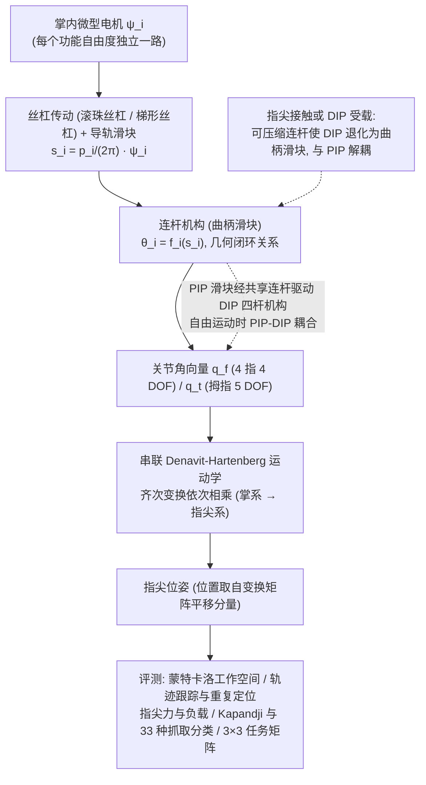

# 连杆驱动人形灵巧手：基于连杆驱动的全关节人形灵巧手

**连杆驱动人形灵巧手**（*A Fully Articulated Humanoid Dexterous Hand with Human-Level Joint Structure Enabled by Linkage-Based Actuation*，[arXiv:2610.36789](https://arxiv.org/abs/2610.36789)）收录于 senlanke「具身运控lab」10-26–10-30 前沿论文动态（人形/四足）。本页依据**周报条目 + arXiv 摘要页**整理，未逐页核对正文 PDF；指标与结论以论文为准。

## 一句话定义

**连杆驱动人形灵巧手：基于连杆驱动的全关节人形灵巧手——Torch-Hand 采用全连杆传动，具有 21 自由度，其中拇指具有五自由度和多轴腕掌关节；所有执行器位于手掌内，并通过机械解耦减少非目标关节联动。**

## 英文缩写速查

| 缩写 | 英文全称 | 简要说明 |
|------|----------|----------|
| RL | Reinforcement Learning | 强化学习 |
| WBC | Whole-Body Control | 全身控制 |

## 为什么重要

- 周报所述待解决的问题：现有灵巧手难以同时实现类人关节结构、高负载、机械可靠性和简单可控性。

## 流程总览

图依据：论文 Results（Theory model、Kinematic analysis / Fig.2–3）与 Methods（Actuation, linkage transmission and serial kinematic modeling）

## 核心机制

| 项 | 内容 |
|----|------|
| **arXiv** | [2610.36789](https://arxiv.org/abs/2610.36789) · [PDF](https://arxiv.org/pdf/2610.36789) |
| **作者（arXiv）** | Li, Jihao, Wang, Jianguo, Guo, Haotian, Wang, Yanzhe, Lu, Guodong, Dong, Huixu |
| **机构（周报所述，未逐条核实）** | 浙江大学机械工程学院、浙江大学机器人研究院 |
| **arXiv 评论栏** | （无） |
| **开源** | arXiv 摘要页与评论未见代码或项目页链接（仅核对 arXiv 摘要页，不代表未发布）（2026-11-02） |
| **周报所述创新点** | Torch-Hand 采用全连杆传动，具有 21 自由度，其中拇指具有五自由度和多轴腕掌关节；所有执行器位于手掌内，并通过机械解耦减少非目标关节联动。 |

### arXiv 摘要节选（英文原文）

> Humanoid dexterous hands are a core component of embodied intelligence, enabling robots to translate high-level intent into rich and adaptive physical interaction. However, existing designs remain constrained by a persistent trade-off among anthropomorphic kinematic complexity, mechanical robustness, load capacity and control simplicity, limiting dexterous manipulation in unstructured environments.

## 源码运行时序图

**不适用**：arXiv 摘要页与评论未见代码或项目页链接（仅核对 arXiv 摘要页，不代表未发布），无可对齐的官方代码流程。

## 实验与评测

- 周报与摘要给出的数字/场景已写入上表「创新点」与摘要节选；其余实验细节、基线与成功率定义请回到论文正文。
- 读法：先对齐任务设定、传感器与成功定义（仿真/真机），再解读 headline 数字，勿跨论文直接比较。

## 与其他工作对比

| 维度 | 读法 |
|------|------|
| **同周对照** | 见 [人形/四足周报技术地图](../overview/senlanke-weekly-2026-10-26-30-humanoid-quadruped-technology-map.md)，按方向浏览同期论文 |
| **开源状态** | arXiv 摘要页与评论未见代码或项目页链接（仅核对 arXiv 摘要页，不代表未发布） |

## 结论

**连杆驱动人形灵巧手：基于连杆驱动的全关节人形灵巧手。**

1. 本页是入库级摘要，复现前请核对论文正文、附录与代码仓库。
2. 指标须连同实验条件解读。
3. 关注 arXiv 版本更新与代码发布。

## 关联页面

- [senlanke-weekly-2026-10-26-30-humanoid-quadruped-technology-map](../overview/senlanke-weekly-2026-10-26-30-humanoid-quadruped-technology-map.md)
- [humanoid-locomotion](../tasks/humanoid-locomotion.md)
- [reinforcement-learning](../methods/reinforcement-learning.md)

## 参考来源

- [linkage-driven-humanoid-dexterous-hand_arxiv_2610_36789.md](../../sources/papers/linkage-driven-humanoid-dexterous-hand_arxiv_2610_36789.md)
- [wechat_senlanke_weekly_humanoid_quadruped_2026-10-26_30.md](../../sources/blogs/wechat_senlanke_weekly_humanoid_quadruped_2026-10-26_30.md)
- [arXiv:2610.36789](https://arxiv.org/abs/2610.36789)
- [arXiv PDF](https://arxiv.org/pdf/2610.36789)：已通读全文：Results 的理论模型与运动学分析、Methods 的机械设计/装配/传动与串联运动学建模；实验与补充材料仅读要点

## 推荐继续阅读

- [arXiv PDF](https://arxiv.org/pdf/2610.36789)
