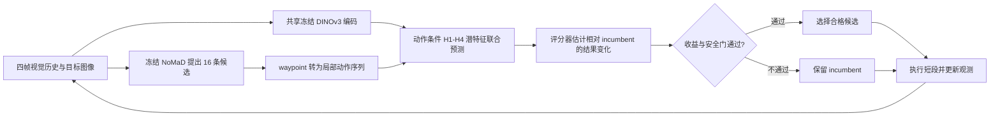

# LiteNWM：用潜空间未来筛选视觉导航轨迹

**LiteNWM**（*LiteNWM: Efficient Latent World Models for Onboard Visual Navigation in the Wild*，[arXiv:2610.12368](https://arxiv.org/abs/2610.12368)，南京大学、Imperial College London、Sony AI、北京邮电大学）是插在视觉导航策略之后的轨迹评估器：它共享当前观测和目标的视觉编码，在潜空间联合预测候选动作的短期后果，再相对 incumbent 筛选，不需要给每条候选轨迹生成未来 RGB 视频。

## 一句话定义

**LiteNWM 保留已有导航策略生成候选轨迹，只用共享编码和多时域潜空间预测评估候选是否更可能走向目标。**

## 英文缩写速查

| 缩写 | 英文全称 | 简要说明 |
|------|----------|----------|
| NWM | Navigation World Model | 预测候选动作未来观测、辅助视觉导航选轨迹的世界模型。 |
| ATE | Absolute Trajectory Error | 预测轨迹相对参考轨迹的整体平移误差，越低越好。 |
| RPE | Relative Pose Error | 相邻预测 waypoint 间的相对运动误差。 |
| FDE | Final Displacement Error | 预测终点与参考终点之间的距离。 |
| CEM | Cross-Entropy Method | 通过迭代采样优化候选轨迹的搜索方法。 |
| SR | Success Rate | 真机任务达到论文成功条件的试验比例。 |

## 为什么重要

- **让未来评估进入实时预算：** 论文的 profiling 显示，逐候选生成 RGB 未来图像占 NoMaD+NWM-XL 已测组件延迟的 97.6%。LiteNWM 把历史和目标编码共享给候选，并一次性评估多个潜在未来，直接移除 RGB 解码环节。
- **把策略与评估器拆开：** NoMaD 负责“提出怎么走”，LiteNWM 负责“比较这些走法的后果”。同一评估器也可借助确定性动作适配器接收 MBRA 候选，不必针对 proposer 单独训练。
- **提供车载闭环证据：** 除离线轨迹评测外，论文还在 Unitree Go2 EDU 的 Jetson Orin 上部署，并在未见室内和室外场景运行滚动重规划。

## 核心信息

| 项 | 内容 |
|----|------|
| 任务 | 单目 RGB + 视觉目标图像的移动机器人导航与候选轨迹重排序 |
| 默认 proposer | 冻结 NoMaD；每轮生成 16 个 challenger，另保留 incumbent |
| 视觉编码 | 冻结 DINOv3；同一状态下观测历史 / 目标对所有候选共享编码 |
| 预测 | 动作条件 latent predictor，联合输出 H1–H4 未来特征；不做自回归反馈或 RGB 解码 |
| 评分 | 结合预测未来、当前视觉状态、目标、动作与候选集上下文，预测候选相对 incumbent 的误差变化 |
| 离线数据 | RECON、SCAND、SACSoN；每域 100 个 query states，4 个候选生成种子 |
| 真机 | Unitree Go2 EDU；论文说明在板载 Jetson Orin 上运行 |
| 机构 | 南京大学（NJU）、Imperial College London、Sony AI、北京邮电大学（BUPT） |
| 发布状态 | 截至 2026-10-14，arXiv 正文未列独立项目页或官方代码仓库链接；尚无公开可复现仓库可据此核验 |

## 核心方法

### 轨迹评估流水线

### 共享编码与未来预测

1. **策略生成候选。** 冻结的目标条件策略接收四帧视觉历史和目标图像。默认 NoMaD 生成 16 条长度为四步的局部轨迹；确定性输出作为 incumbent 保留。动作写为每步的局部位移与偏航变化。
2. **视觉输入只编码一次。** 冻结 DINOv3 及轻量 adapter 编码历史和 goal，各候选共享这些特征；世界模型预测器本身不把 goal 当作输入，goal 特征主要进入后续 scorer。
3. **按动作联合预测 H1–H4。** 动作经过 SE(2) 累积得到各时域位姿，位姿条件的特征 warp 初始化预测 query。六个因子化模块整合动作 token 与历史 memory，四个未来 latent 一次联合预测，无需逐帧自回归反馈。
4. **相对 incumbent 评分。** scorer 估计候选与 incumbent 在 ATE、平移 RPE、FDE 和综合目标上的变化，并结合三成员模型集成、不确定性校准及预测伤害 / 双指标改善概率进行筛选。物理与候选支持检查不通过或没有合格 challenger 时，保留 incumbent。
5. **滚动执行。** 执行选中轨迹的短段，读取新视觉历史，再生成和筛选下一轮候选。模型部署期间保持冻结。

## 实验与评测

### 离线轨迹重排序

RECON、SCAND、SACSoN 三域各取 100 个 query states，预测长度 H=4；四个 proposer 随机种子对应 1,200 个 state–seed 评估。候选池以冻结 NoMaD 的相同 16 条 challenger 作为起点，并与 NoMaD+NWM-XL 等未来评估基线比较。

- 相比 NoMaD+NWM-XL，三域宏平均 ATE 降低 **17.56%**；各域分别降低 25.21%、14.98%、14.71%。
- 以归一化终点误差定义的离线 SR@1 在 RECON、SCAND、SACSoN 分别提高 **6.5、3.5、7.0 个百分点**。这项指标是离线 endpoint agreement，不等同于真机导航成功率。
- 冻结 LiteNWM 适配到 MBRA 后，三域宏平均 ATE 降低 **16.2%**，无需 proposer 专属训练或校准。

### 端到端速度与真机运行

| 指标 | LiteNWM 结果 | 对照 / 口径 |
|------|--------------|-------------|
| RTX 5090 端到端耗时 | 每状态 0.691 s | 包括候选生成、未来评估、评分、细化与最终选择 |
| 相对 NoMaD+NWM-XL 加速 | **128.00×** | 摘要与正文 IV-E 的完整端到端主比较 |
| 相对 NoMaD+NWM-S 加速 | **16.86×** | 同硬件和计时边界 |
| Go2 EDU 真机成功率 | **83.3%** | LiteNWM 30 次；NoMaD 为 43.3%（30 次） |
| Go2 EDU SPL | **0.810** | LiteNWM；NoMaD 为 0.409 |

真机三个场景分别为开放室内、杂乱室内、室外庭院，每种方法每场景 10 次。成功要求机器人进入校准的 1 米目标半径、目标观测一致、偏航误差不超过 60°，且条件持续至少 1 秒或随后正常停止。机载 Jetson Orin 部署时，论文采用候选接受门，必要时才运行最多三轮 CEM 细化。

**对比时的边界：** NWM baseline 的原始任务采用 H=8，本文匹配评测用 H=4；论文指出时域适配、terminal LPIPS 与几何误差目标不完全一致等因素可能影响 NWM 表现。因此 128× 是本文设定下完整系统的实测比较，不应外推成所有导航模型上的固定加速比。论文摘要与 IV-E 写 128.00×，结论段个别速度比数值有出入，本文采用摘要和 IV-E 主比较。

## 结论

**LiteNWM 的主要价值是把昂贵的逐候选图像生成替换成共享视觉编码与联合潜预测，让既有视觉导航策略获得更快的未来感知式重排序。**

1. **适合改造已有 proposer–evaluator 栈：** 保留冻结策略，仅在候选产生后接入预测器和 scorer；迁移 proposer 时可先统一局部动作接口。
2. **关键计算节省来自消除候选 RGB rollout：** 共享输入编码和多时域联合预测比单独优化 predictor 的毫秒数更能解释端到端 128× 对照结果。
3. **评分器有显式拒绝 / 回退机制：** 无候选通过增益与 harm gate 时保留 incumbent，避免每轮重排序强行替换现有动作。
4. **真机结果具参考价值但样本仍小：** 83.3% 对 43.3% 来自 Go2 EDU 三场景各 10 次，适合作为部署可行性证据，不能代表大规模场景泛化。
5. **复现状态尚不能确认：** 论文没有提供官方代码链接；复现前需等待作者公开实现及数据 / 权重细节。

## 局限与风险

- **短视界与局部动作：** 主要评测用 H=4，目标是本地轨迹选择，并不证明可替代全局规划、地图构建或长程任务推理。
- **训练和实现复现受限：** 截至入库日，arXiv v1 未链接官方代码仓库；论文指标可读，但不能直接核验代码、权重、训练脚本和 Go2 控制接口。
- **指标不可混用：** 离线 ATE / RPE / FDE / SR@1 衡量轨迹预测 / 选择表现；真机 SR / SPL 统计完整闭环试验，两组结果各有不同口径。
- **基线适配影响公平性：** NWM 原始 H=8 与本论文 H=4 的比较有时域适配差异；速度比应限于论文给定配置和 RTX 5090 / Jetson Orin 测试条件。
- **预印本数据存在表述差异：** 摘要与 IV-E 给出 NoMaD+NWM-XL 加速 128.00×，结论段有不同速度比；引用时需保留出处位置和比较条件。

## 与其他工作对比

| 工作 | 预测 / 选择方式 | LiteNWM 的区别 |
|------|-----------------|----------------|
| [NWM](./paper-sa-2412-03572-nwm-navigation-world-models.md) | 条件生成 RGB 未来，并用未来观测评估路径 | LiteNWM 用候选相关 latent 未来特征评分，不逐候选解码图像；保留 proposer–evaluator 分离 |
| [NavWAM](./paper-navwam-goal-conditioned-visual-navigation-wam.md) | 联合生成未来观测、goal value 与 action chunk，直接形成策略 | NavWAM 联合动作输出；LiteNWM 聚焦冻结导航策略后的候选评估模块 |
| [生成式世界模型方法页](../methods/generative-world-models.md) | 汇总可控生成、潜空间预测与规划接口 | LiteNWM 是无需像素重建的导航候选打分实例 |

## 工程实践

- **集成位置：** 接在现有导航策略候选输出后；需将 waypoint 转换为一致的短程局部动作表示，并提供一个可回退的 incumbent。
- **输入 / 输出：** 输入四帧 RGB 历史、目标图像、16 个候选局部动作序列与 incumbent；输出候选相对结果评分及被接受的短段动作。
- **部署信息：** 真机实验在 Unitree Go2 EDU 的 Jetson Orin 上运行；论文同时使用 RTX 5090 测量统一端到端延迟。不同设备和计时边界不能直接横比。
- **代码状态（核查日 2026-10-14）：** **不适用（无官方可运行仓库链接）**。arXiv 页面未提供项目页或代码 URL；因此当前不能按官方 README 画出源码运行时序图，也不把论文系统标记为已开源。
- **上线验证建议：** 分开记录候选生成、共享编码、latent prediction、打分筛选和实际机器人执行的耗时；此外统计 incumbent 回退率、误选率和成功率，避免只报告 predictor 前向时间。

## 关联页面

- [生成式世界模型](../methods/generative-world-models.md)
- [模型预测控制](../methods/model-predictive-control.md)
- [视觉–语言导航任务](../tasks/vision-language-navigation.md)
- [NWM：Navigation World Models](./paper-sa-2412-03572-nwm-navigation-world-models.md)
- [NavWAM：目标条件导航世界–动作模型](./paper-navwam-goal-conditioned-visual-navigation-wam.md)

## 参考来源

- [LiteNWM 论文归档](../../sources/papers/litenwm_arxiv_2610_12368.md)
- [arXiv:2610.12368v1 HTML 正文](https://arxiv.org/html/2610.12368v1)
- [arXiv 摘要页](https://arxiv.org/abs/2610.12368)

## 推荐继续阅读

- [Navigation World Models（NWM）](https://arxiv.org/abs/2412.03572)
- [NavWAM](https://arxiv.org/abs/2606.13494)
- [Latent-Space Autoregressive World Model for Efficient and Robust Image-Goal Navigation](https://arxiv.org/abs/2511.11011)
