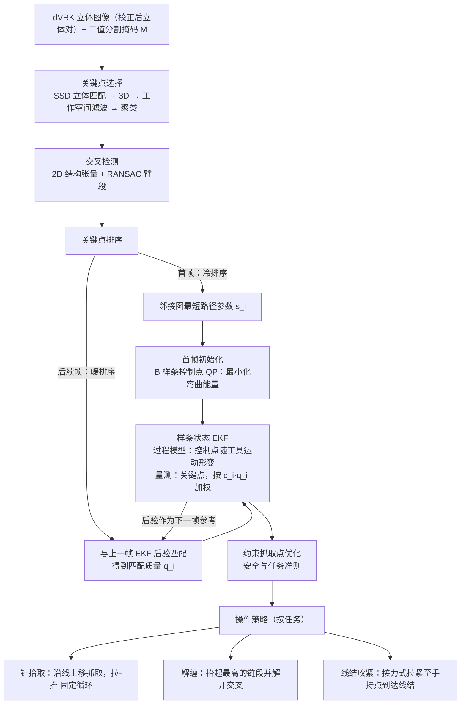

# Live Thread Reconstruction：面向自主操作的实时线状物体重建

**Live Thread Reconstruction**（*Live Thread Reconstruction for Autonomous Manipulation*，[arXiv:2610.30694](https://arxiv.org/abs/2610.30694)）收录于 senlanke「具身运控lab」10-19–10-23 前沿论文动态（Manipulation）。本页依据**周报条目 + arXiv 摘要页**整理，流程图依据论文方法部分（见参考来源），未逐页核对实验数字；指标与结论以论文为准。

## 一句话定义

**Live Thread Reconstruction：面向自主操作的实时线状物体重建——研究操作过程中的实时线状物体重建，使机器人能够利用更新后的物体几何状态辅助自主操作。**

## 英文缩写速查

| 缩写 | 英文全称 | 简要说明 |
|------|----------|----------|
| VLA | Vision-Language-Action | 视觉–语言–动作模型 |
| IL | Imitation Learning | 模仿学习 |

## 为什么重要

- 周报所述待解决的问题：线状柔性物体容易发生弯曲、遮挡和形变，机器人需要持续估计其形状才能进行精细操作。

## 流程总览

图依据：论文 §I（四个组成部分）、§II-A–F、Fig. 1–2；“抓取点优化 → 操作”的衔接依据引言对四个组成部分的顺序描述。

## 核心机制

| 项 | 内容 |
|----|------|
| **arXiv** | [2610.30694](https://arxiv.org/abs/2610.30694) · [PDF](https://arxiv.org/pdf/2610.30694) |
| **作者（arXiv）** | Emma Huang, Omar Hernandez, Zih-Yun Chiu, Michael Yip |
| **机构（周报所述，未逐条核实）** | 待核实（作者：Emma Huang、Omar Hernandez、Zih-Yun Chiu、Michael Yip）。 |
| **arXiv 评论栏** | （无） |
| **开源** | arXiv 摘要页与评论未见代码或项目页链接（仅核对 arXiv 摘要页，不代表未发布）（2026-10-26） |
| **周报所述创新点** | 研究操作过程中的实时线状物体重建，使机器人能够利用更新后的物体几何状态辅助自主操作。 |

### arXiv 摘要节选（英文原文）

> Autonomous robotic surgery has drawn increased attention in recent years due to its potential to relieve surgeons of time-consuming, mentally straining, and tedious tasks, particularly during prolonged operations. One suitable task for automation is suturing, which involves tracking the thread as it deforms during needle retrieval, de-tangling, knot tightening, and other tasks.

## 源码运行时序图

**不适用**：arXiv 摘要页与评论未见代码或项目页链接（仅核对 arXiv 摘要页，不代表未发布），无可对齐的官方代码流程。

## 实验与评测

- 周报与摘要给出的数字/场景已写入上表「创新点」与摘要节选；其余实验细节、基线与成功率定义请回到论文正文。
- 读法：先对齐任务设定、传感器与成功定义（仿真/真机），再解读 headline 数字，勿跨论文直接比较。

## 与其他工作对比

| 维度 | 读法 |
|------|------|
| **同周对照** | 见 [Manipulation周报技术地图](../overview/senlanke-weekly-2026-10-19-23-manipulation-technology-map.md)，按方向浏览同期论文 |
| **开源状态** | arXiv 摘要页与评论未见代码或项目页链接（仅核对 arXiv 摘要页，不代表未发布） |

## 结论

**Live Thread Reconstruction：面向自主操作的实时线状物体重建。**

1. 本页是入库级摘要，复现前请核对论文正文、附录与代码仓库。
2. 指标须连同实验条件解读。
3. 关注 arXiv 版本更新与代码发布。

## 关联页面

- [senlanke-weekly-2026-10-19-23-manipulation-technology-map](../overview/senlanke-weekly-2026-10-19-23-manipulation-technology-map.md)
- [manipulation](../tasks/manipulation.md)
- [vla](../methods/vla.md)

## 参考来源

- [live-thread-reconstruction-manipulation_arxiv_2610_30694.md](../../sources/papers/live-thread-reconstruction-manipulation_arxiv_2610_30694.md)
- [wechat_senlanke_weekly_manipulation_2026-10-19_23.md](../../sources/blogs/wechat_senlanke_weekly_manipulation_2026-10-19_23.md)
- [arXiv:2610.30694](https://arxiv.org/abs/2610.30694)
- [arXiv PDF](https://arxiv.org/pdf/2610.30694)：已通读方法部分（实验与附录以略读为准）：§I–III（引言、方法全文、实验设定与结果）

## 推荐继续阅读

- [arXiv PDF](https://arxiv.org/pdf/2610.30694)
