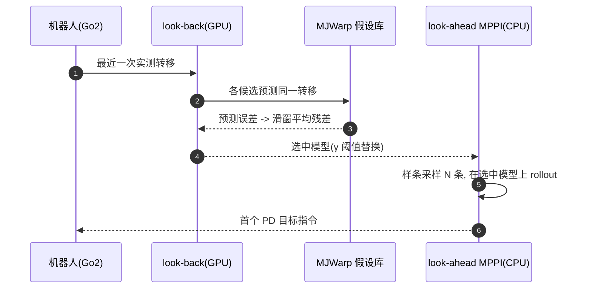

# LLA-MPPI：用 GPU 并行仿真做腿式全身控制的在线自适应

**LLA-MPPI**（Look-Back, Look-Ahead MPPI；[arXiv:2610.10465](https://arxiv.org/abs/2610.10465)，[项目页](https://lla-control.github.io)）把腿式机器人的「适应」做成一个**模型选择**问题：在 GPU 上同时运行 K 个物理参数或结构假设不同的完整接触仿真器，用最近一小段实测转移的预测误差挑出最能解释当前动力学的那个（look-back），再让全身 [MPPI](../methods/mppi.md) 通过它前瞻规划（look-ahead）。

## 一句话定义

**不训练、不做显式参数辨识：用一个批量仿真器库「回看」选模型、用 MPPI「前瞻」做规划，负载变化、断腿和物体质量变化后控制器在线换模型。**

## 英文缩写速查

| 缩写 | 英文全称 | 简要说明 |
|------|----------|----------|
| LLA | Look-Back, Look-Ahead | 回看选模型、前瞻做规划的两段式结构 |
| MPPI | Model Predictive Path Integral | 基于采样与指数加权的模型预测控制 |
| MJWarp | MuJoCo Warp | 论文用的 GPU 批量 MuJoCo 后端（1.12.0） |
| DOB | Disturbance Observer | 基线：逆动力学残差估计外部扰动力 |
| CPE | Continuous Parameter Estimation | 基线：在连续参数上做粒子滤波 |
| DR | Domain Randomization | RL 对照 PPO-DR 的训练方式 |

## 为什么重要

- 固定标称模型的实时控制器在载荷、摩擦、坡度、执行器故障下退化（论文中标称 MPPI 仅 25.5% 成功率），离线 RL 需要提前覆盖变化范围。
- 它给出第三条路：用 GPU 并行把「候选世界」摆在在线闭环里，假设是**物理可解释**的（哪条腿坏了、哪侧多了几公斤），便于调试。
- 与 RL 对照时无离线训练成本，代价是每步在线约 14.4 ms 的 GPU/CPU 计算。

## 方法栈总览

## 方法

- **假设库：** 连续参数（载荷、摩擦、坡度等）离散成网格，离散结构条件（哪条腿受损）枚举，取笛卡尔积；全部放进同一个批量 MJWarp 模型并整步 CUDA-graph 化，推进成本几乎不随 K 增加，直到 GPU 饱和。
- **回看选择：** 每个候选预测最近一次实测转移，残差取加权范数并在窗口 W 上平均；最低者仅在得分低于 γ × 现任者时替换（防抖），可附加持续步数；窗口填满前用标称模型。
- **前瞻规划：** 全身 MPPI 在选中模型上采样 N 条控制序列，对 J 个样条控制点加噪并裁剪到执行器范围；代价含跟踪、PD 力矩指令与任务项及终端系数 ρ，指数加权（温度 λ）更新标称序列，首个指令执行、序列平移热启动。
- **异步：** look-back 异步运行，规划使用的选择可能比最新转移滞后至多一个周期。
- **任务相关设置：** 非对称载荷 K=10,000（左右各 0–4 kg）；腿锁死 K=5（标称+每腿一个）；斜坡+摩擦 K=10,000（0–20°、0.1–1.0）；变质量推箱 K=100（1–15 kg），箱位置代价权重按所选质量/标称质量缩放。
- 论文可见正文未给出 N、H 与控制频率（原文未核实）。

## 实验与评测

四个仿真任务各 50 次随机试验，每方法共 200 回合：

| 方法 | 成功率 | ≥90% 任务数 | 跌倒率 | 求解时间 |
|---|---|---|---|---|
| 标称 MPPI | 25.5% | 1/4 | 65.3% | 16.57 ms |
| DOB-MPPI | 42.5% | 1/4 | 33.3% | 15.43 ms |
| CPE（粒子滤波） | 74.0% | 1/4 | 21.3% | 18.54 ms |
| **LLA-MPPI** | **97.5%** | **4/4** | 0.0% | 17.60 ms |
| Oracle-MPPI（给定真模型） | 98.5% | 4/4 | 0.0% | 17.77 ms |

- LLA-MPPI 比标称 MPPI 的更新耗时只多约 1.03 ms，是唯一在每个任务都 ≥90% 的可实现方法。
- **Go2 真机：** OptiTrack 给基座位姿/速度与箱子位置；加 2.3 kg 右侧载荷时只有 LLA-MPPI 到达目标；后左腿中途失能仍能平衡到达；推箱质量两次增加，LLA-MPPI 约 74 s 完成，标称 MPPI 约 166 s。试验次数论文未报告。
- **对 RL：** PPO-DR（nominal）需 48.5 min 离线训练、46M 样本到 90%；PPO-DR（heavy）54.7 min、92M 样本到 90%；LLA-MPPI 无离线训练，在线 14.4 ± 1.2 ms/步（RTX 4070 Laptop）。RL 的量化成功率未报告，只有代表性轨迹。
- **消融：** W 呈 U 形（短窗噪声敏感、长窗陈旧）；库越大误差越小，测试最佳 (K, W) = (257, 25)。

## 源码运行时序图

不适用：截至 2026-10-12 项目页只有 “coming soon”，arXiv 页面也未给出仓库，没有可对齐的官方目录或脚本。以下为按论文描述画的推断性闭环（非源码）：

## 工程实践

- 把假设库当成「可解释故障字典」设计：能枚举的离散结构（断腿）用枚举，连续量用网格，并给持续步数避免抖动。
- 窗口 W 与库规模 K 要联调；论文消融提示 W≈20–25 附近较好。
- 在线 GPU 需求：论文最大库 K=10,000，在 RTX 4070 Laptop 上 look-back 时间在饱和前近乎不随 K 变化。
- 开源状态：项目页占位、无代码（核查见 [项目页归档](../../sources/sites/lla_control_github_io.md)），当前无法直接复现。

## 结论

**LLA-MPPI 用「GPU 批量仿真选模型 + MPPI 前瞻规划」把腿式控制器的适应变成在线假设检验，在 4 个扰动任务上接近拿到真模型的 Oracle。**

1. 适应可以是模型选择而非梯度学习：K 个候选一次 CUDA graph 推进。
2. 用滑窗平均残差 + 替换阈值 γ 抑制噪声造成的模型抖动。
3. 假设物理可解释，便于诊断，但覆盖范围由设计时的库决定。
4. 与 PPO-DR 相比省掉离线训练，换来每步约 14 ms 在线计算。
5. 真机证据来自三个演示且试验数未报告，不应外推为统计结论。
6. 代码未发布前不宜在工程上依赖，可先借鉴思路。

## 局限与风险

- 假设库有限、设计时固定；未知故障类型落在库外时无法表达（作者列出自适应库细化为未来工作）。
- 候选在近期运动未激励相关量时不可区分（如不接触的静止物体质量）。
- 选择滞后至多一个 look-back 周期。
- 真机依赖 OptiTrack 提供状态，非纯机载；无离线标定但有外部定位。
- 开源状态：截至 2026-10-12 未发布。

## 与其他工作对比

| 对照 | 差异读法 |
|---|---|
| [未知动态载荷下的腿式适应](./paper-legged-load-adapt-unknown-dynamic-load.md) | 该文用特权教师–学生 RL 训练离线策略；LLA-MPPI 不训练，在线选模型 |
| [MPPI](../methods/mppi.md) / [MPC](../methods/model-predictive-control.md) | 沿用采样式规划，创新在于规划所用模型随观测在线切换 |
| DOB / CPE 基线 | DOB 只估外力；CPE 在连续参数上滤波，论文中分别 42.5% / 74.0% |
| PPO-DR | 需离线训练与覆盖随机化范围；LLA-MPPI 在线计算更重 |

## 关联页面

- [人形/四足前沿周报 2026-10-05~10-09](../overview/frontier-humanoid-quadruped-2026-10-05-10-09.md) — 本文所在周报汇总页
- [运动控制任务页](../tasks/locomotion.md)
- [MPPI](../methods/mppi.md) / [模型预测控制](../methods/model-predictive-control.md)
- [全身控制](../concepts/whole-body-control.md)
- [MuJoCo Warp](./mujoco-warp.md) — 批量仿真后端
- [未知动态载荷下的腿式适应](./paper-legged-load-adapt-unknown-dynamic-load.md)

## 参考来源

- [lla_mppi_arxiv_2610_10465.md](../../sources/papers/lla_mppi_arxiv_2610_10465.md) — 论文摘录
- [lla_control_github_io.md](../../sources/sites/lla_control_github_io.md) — 项目页核查（coming soon）
- [周报来源归档](../../sources/blogs/frontier_humanoid_quadruped_2026_10_05_10_09.md)
- [arXiv:2610.10465](https://arxiv.org/abs/2610.10465)

## 推荐继续阅读

- [arXiv HTML 全文](https://arxiv.org/html/2610.10465v1)
- [项目页](https://lla-control.github.io)
- [MuJoCo Warp 仓库](https://github.com/google-deepmind/mujoco_warp)
