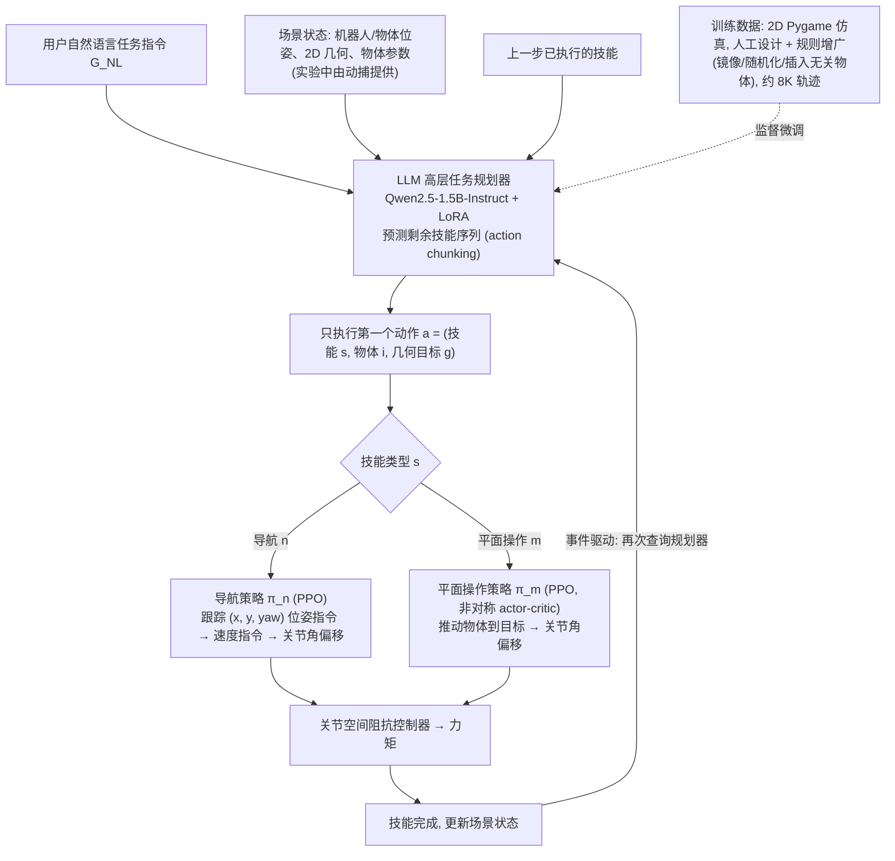

# LLM 引导平面移动操作：大语言模型引导的四足平面移动操作

**LLM 引导平面移动操作**（*LLM-guided Planar Loco-Manipulation for Quadruped Robots*，[arXiv:2610.40248](https://arxiv.org/abs/2610.40248)）收录于 senlanke「具身运控lab」10-26–10-30 前沿论文动态（人形/四足）。本页依据**周报条目 + arXiv 摘要页**整理，未逐页核对正文 PDF；指标与结论以论文为准。

## 一句话定义

**LLM 引导平面移动操作：大语言模型引导的四足平面移动操作——LoRA 微调的语言任务规划器将语言指令和结构化场景转换为可变长度参数化动作；底层端到端全身推动策略在仿真中达到 93.3% 成功率，并在实机 45 次实验中完成 34 次端到端任务。**

## 英文缩写速查

| 缩写 | 英文全称 | 简要说明 |
|------|----------|----------|
| RL | Reinforcement Learning | 强化学习 |
| WBC | Whole-Body Control | 全身控制 |

## 为什么重要

- 周报所述待解决的问题：障碍物可移动时，机器人需要联合选择操作技能、目标物体和几何作用点，而非只规划无碰撞路径。

## 流程总览

图依据：论文 §II / Fig.1（部署流程）、§III-A/B/C（操作策略、导航策略、LLM 任务规划器）

## 核心机制

| 项 | 内容 |
|----|------|
| **arXiv** | [2610.40248](https://arxiv.org/abs/2610.40248) · [PDF](https://arxiv.org/pdf/2610.40248) |
| **作者（arXiv）** | Jetti, Georges, Khayyat, Michael, Sleiman, Jean-Pierre, Arrigoni, Stefano, Braghin, Francesco |
| **机构（周报所述，未逐条核实）** | 米兰理工大学、Robotics and AI Institute、Flexion Robotics |
| **arXiv 评论栏** | （无） |
| **开源** | arXiv 摘要页与评论未见代码或项目页链接（仅核对 arXiv 摘要页，不代表未发布）（2026-11-02） |
| **周报所述创新点** | LoRA 微调的语言任务规划器将语言指令和结构化场景转换为可变长度参数化动作；底层端到端全身推动策略在仿真中达到 93.3% 成功率，并在实机 45 次实验中完成 34 次端到端任务。 |

### arXiv 摘要节选（英文原文）

> Robotic navigation typically assumes a collision-free route to the goal exists; in cluttered environments with movable obstacles, however, reaching the goal may require physical interaction. Classical solutions encode these behaviors through geometric rules and task-specific logic, while learning-based approaches often constrain the decision space to low-dimensional motion commands or predefined action sets.

## 源码运行时序图

**不适用**：arXiv 摘要页与评论未见代码或项目页链接（仅核对 arXiv 摘要页，不代表未发布），无可对齐的官方代码流程。

## 实验与评测

- 周报与摘要给出的数字/场景已写入上表「创新点」与摘要节选；其余实验细节、基线与成功率定义请回到论文正文。
- 读法：先对齐任务设定、传感器与成功定义（仿真/真机），再解读 headline 数字，勿跨论文直接比较。

## 与其他工作对比

| 维度 | 读法 |
|------|------|
| **同周对照** | 见 [人形/四足周报技术地图](../overview/senlanke-weekly-2026-10-26-30-humanoid-quadruped-technology-map.md)，按方向浏览同期论文 |
| **开源状态** | arXiv 摘要页与评论未见代码或项目页链接（仅核对 arXiv 摘要页，不代表未发布） |

## 结论

**LLM 引导平面移动操作：大语言模型引导的四足平面移动操作。**

1. 本页是入库级摘要，复现前请核对论文正文、附录与代码仓库。
2. 指标须连同实验条件解读。
3. 关注 arXiv 版本更新与代码发布。

## 关联页面

- [senlanke-weekly-2026-10-26-30-humanoid-quadruped-technology-map](../overview/senlanke-weekly-2026-10-26-30-humanoid-quadruped-technology-map.md)
- [locomotion](../tasks/locomotion.md)
- [reinforcement-learning](../methods/reinforcement-learning.md)

## 参考来源

- [llm-guided-planar-loco-manipulation-quadruped_arxiv_2610_40248.md](../../sources/papers/llm-guided-planar-loco-manipulation-quadruped_arxiv_2610_40248.md)
- [wechat_senlanke_weekly_humanoid_quadruped_2026-10-26_30.md](../../sources/blogs/wechat_senlanke_weekly_humanoid_quadruped_2026-10-26_30.md)
- [arXiv:2610.40248](https://arxiv.org/abs/2610.40248)
- [arXiv PDF](https://arxiv.org/pdf/2610.40248)：已通读全文：§II 预备、§III 方法（平面操作策略、导航策略、LLM 高层规划器）；§IV 实验仅读要点、附录未读

## 推荐继续阅读

- [arXiv PDF](https://arxiv.org/pdf/2610.40248)
