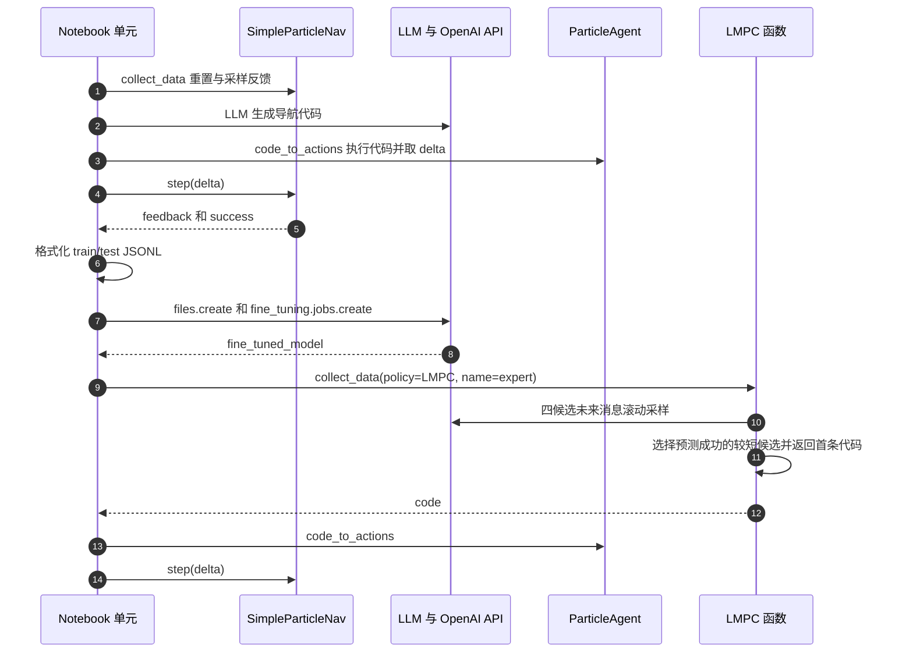

# LMPC：学习人机交互动态以减少机器人教学轮数

## 一句话定义

LMPC 用成功教学对话微调语言模型以预测后续人机交互，并在推理时滚动搜索通向成功的短对话路径。

## 英文缩写速查

| 缩写 | 英文全称 | 简要说明 |
|---|---|---|
| LMPC | Language Model Predictive Control | 搜索人机教学对话的下一条代码 |
| MJPC | MuJoCo Model Predictive Control | 在物理模拟中优化低层动作 |
| SFT | Supervised Fine-Tuning | 用成功交互序列微调模型 |

## 为什么重要

本工作说明了语言反馈如何进入持续适应闭环，并给出了可核对的学习对象、评测协议和实现边界。学习与工程选型时应先明确变化的是偏好规则、动作策略还是语言模型。

## 核心信息

| 项目 | 内容 |
|---|---|
| 论文 | Learning to Learn Faster from Human Feedback with Language Model Predictive Control |
| 固定版本 | [arXiv:2402.11450v2](https://arxiv.org/abs/2402.11450v2) |
| 机构 | Google DeepMind |
| 原文核对 | v2 HTML §I–V、附录 §VI-A–N 的数据协议、消融、真机、用户漂移、失败分析、任务与提示词图注；Table I–XVI。提示词图像未逐字转录 |
| 项目页 | [官方入口](https://robot-teaching.github.io/) |

## 核心原理

快适应：用户反馈与当前对话上下文输入语言模型，模型生成奖励函数及条件切换代码；MJPC 用物理仿真和滚动优化将奖励代码转为动作。慢适应：收集成功教学对话，离线微调语言模型，学习预测后续用户反馈和代码。

LMPC-Rollouts 在每轮从模型采样 8 条后续对话，最长 4096 tokens，从终止候选中选择预测教学轮数最少的一条，只执行其第一条代码；随后接收真实用户反馈再规划。无终止样本时随机选择候选。模型预测终止不构成真实任务成功证明。

LMPC-Skip 直接预测最终成功代码。Top-user conditioning 在训练时标记表现最好的用户，推理时统一使用该标签；不能等同于只用优秀用户的数据训练。

## 流程总览

依据固定版本方法与系统说明整理：

## 源码运行时序图

项目页实际链接到教学 Colab。静态核读 30 个单元，源码与论文差别见[Notebook 归档](../../sources/repos/agentic-lmpc-colab.md)。图中的 API 操作仅为源码调用关系，本次未执行。

## 工程实践

Notebook 明示为 illustrative toy environment，使用二维粒子导航与模拟语言噪声；默认四候选搜索，并记录成功/失败标签。论文主实验采用 PaLM 2、成功会话和八候选搜索，两者不可视作完全一致。Notebook 的 `code_to_actions` 使用 `exec`，复现应在受控环境审查生成代码。没有运行 Notebook 或创建微调任务。

## 实验与评测

以下均为论文作者报告，非本库复现实测。

| 指标 | PaLM 2-S | LMPC-Rollouts | 原文口径 |
|---|---|---|---|
| 未见任务成功率 | 39.4% | 66.3% | Table I，提高 26.9 个百分点 |
| 成功会话平均轮数 | 2.4 | 1.9 | 条件于会话成功，不包含失败会话的完整代价 |
| 未见本体提升 | — | +31.5 个百分点 | Table IV，不同机器人描述与 API |
| 真机平均成功率 | 53.8% | 75% | Table III，8 个任务的小样本评估 |

正文含 78 任务、5 类仿真本体、35 名非专家用户；初始 299 个成功会话用于训练，扩增语言而不改代码。主要数据采集与训练在仿真完成，真机只做子集评估。Table III 写 Robot Dog 每任务 4 次、Mobile Manipulator 5 次；正文概述曾统一写 4 次，详细计数按表格记录。第二次采集/微调没有稳定提升。

## 结论

LMPC 用成功教学对话微调语言模型以预测后续人机交互，并在推理时滚动搜索通向成功的短对话路径。应连同其数据、执行器和反馈预算一起评估。

1. 分别核算语言对话层 LMPC 和物理控制层 MJPC 的作用。
2. 同时报告成功率、成功会话轮数及失败会话成本。
3. 区分论文的八候选搜索与公开教学 Notebook 的四候选实现。

## 与其他工作对比

与 [TidyBot](paper-tidybot-2305-05658.md) 保存语言总结规则相比，LMPC 微调生成教学交互的语言模型；与 [OLAF](paper-olaf-verbal-correction.md) 相比，它的慢适应更新 LLM，OLAF 更新视觉运动策略。

## 局限与风险

- 需要能产生成功会话的初始模型、微调资源与 MJPC 计算资源；附录部分仿真运行慢于实时。
- 成功由用户判断，单任务样本少，不能从总体收益推出每任务均改善。
- 开放的是教学用 2D 导航 Colab；原文的 PaLM 2、五本体训练和真机部署没有在该 Notebook 完整发布。
- Notebook 使用历史 GPT-3.5 API 和付费微调，本文仅静态阅读；未调用 API、付费训练或运行机器人。

## 关联页面

- [Agentic Robots 综述](paper-towards-agentic-robots-survey.md)
- [VLA](../methods/vla.md)
- [VLA 纵深路线](../../roadmap/depth-vla.md)

- [智能体规划与反馈执行](../methods/agent-planning-feedback.md)：对照相关方法与适用场景。

## 参考来源

- [论文核读归档](../../sources/papers/agentic_2402_11450.md)
- [项目页核查](../../sources/sites/agentic-lmpc-2402-11450.md)
- [相关源码归档](../../sources/repos/agentic-lmpc-colab.md)

## 推荐继续阅读

- [固定版本原文](https://arxiv.org/html/2402.11450v2)
