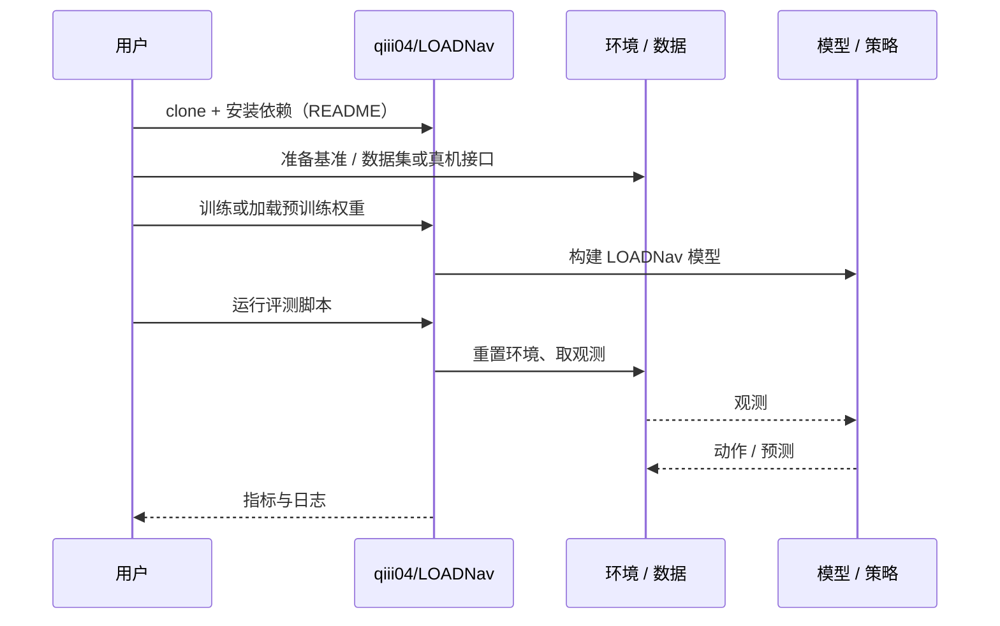

# LOADNav（arXiv:2610.14596）

**LOADNav**（*Load-Aware Quadruped Navigation with Online Contact-based Geometry Estimation*，[arXiv:2610.14596](https://arxiv.org/abs/2610.14596)，[项目页](https://qiii04.github.io/LOADNav/)，[代码](https://github.com/qiii04/LOADNav)）来自 [具身智能小站 2026-10-14 盘点](../../sources/blogs/wechat_embodied_station_41_papers_streamingwam_2026-10-14.md)，属「导航、足式与规划」组。

## 一句话定义

**学习随负载几何调整路径与间距，CoGE 从偶发接触在线推断未知负载形状，避免固定足迹膨胀的过保守。**

## 英文缩写速查

| 缩写 | 英文全称 | 简要说明 |
|------|----------|----------|
| CoGE | Contact-based Geometry Estimation | 接触几何估计 |
| Nav | Navigation | 导航 |
| RL | Reinforcement Learning | 强化学习 |

## 为什么重要

- 四足负载导航若不估计物体外形，要么碰撞要么过保守。
- 开源结论：**已开源**（步骤 2.5，2026-10-14）。项目页链接的 GitHub 仓库可达。
- 同期同组工作见 [流式动作块与世界模型记忆：具身智能小站 10-14 期 41 篇阅读坐标](../overview/embodied-station-2026-10-14-41-papers-technology-map.md)。

## 核心机制

| 项 | 内容 |
|----|------|
| **arXiv** | [2610.14596](https://arxiv.org/abs/2610.14596) |
| **开源** | **已开源** |
| **要点** | 几何估计依赖接触信息逐步更新。 |
| **文内指标** | 以原文为准。 |

## 源码运行时序图

以下为按仓库入口（`qiii04/LOADNav`）推断的通用运行链路；入库日仅核实仓库可达，未逐文件阅读，具体脚本名以 README 为准。

## 实验与评测

- 以原文为准。
- **读法：** 本页为索引级摘要，依据公众号转述的官方摘要与仓库信息整理；逐项数字与 baseline 以原文 PDF 为准。

## 与其他工作对比

- 横向索引见 [流式动作块与世界模型记忆：具身智能小站 10-14 期 41 篇阅读坐标](../overview/embodied-station-2026-10-14-41-papers-technology-map.md)；同 arXiv 不重复造页。

## 结论

**负载导航把几何估计做成在线变量，比固定安全裕度更实用。**

1. 开源边界：**已开源** — 项目页链接的 GitHub 仓库可达。
2. 核心机制：几何估计依赖接触信息逐步更新。
3. 复现与选型前核对任务协议、硬件与基准口径，勿直接横比公众号摘录数字。

## 关联页面

- [locomotion](../tasks/locomotion.md)
- [contact-estimation](../concepts/contact-estimation.md)
- [hierarchical-quadruped-navigation-stack](../concepts/hierarchical-quadruped-navigation-stack.md)
- [embodied-station-2026-10-14-41-papers-technology-map](../overview/embodied-station-2026-10-14-41-papers-technology-map.md)

## 参考来源

- [loadnav_load_aware_quadruped_navigation_arxiv_2610_14596.md](../../sources/papers/loadnav_load_aware_quadruped_navigation_arxiv_2610_14596.md)
- [wechat_embodied_station_41_papers_streamingwam_2026-10-14.md](../../sources/blogs/wechat_embodied_station_41_papers_streamingwam_2026-10-14.md)
- [arXiv:2610.14596](https://arxiv.org/abs/2610.14596)

## 推荐继续阅读

- [arXiv PDF](https://arxiv.org/pdf/2610.14596)
- [项目页](https://qiii04.github.io/LOADNav/)
- [https://github.com/qiii04/LOADNav](https://github.com/qiii04/LOADNav)
