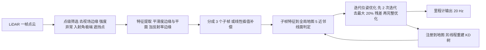

# Loam_livox：面向小视场激光雷达的快速鲁棒高精度里程计与建图（arXiv:1909.06700）

## 一句话定义

**Loam_livox**（Jiarong Lin、Fu Zhang，香港大学机械工程系，[arXiv:1909.06700](https://arxiv.org/abs/1909.06700)）是在 LOAM 框架上针对**小视场、非重复扫描**固态激光雷达（论文以 Livox MID40 为例）重新设计前端点筛选、特征提取、运动补偿与并行实现的开源 LiDAR 里程计与建图包；不使用 IMU、GPS 和相机，里程计与建图均 20 Hz（§I、§IV、Fig. 5）。

## 英文缩写速查

| 缩写 | 英文全称 | 简要说明 |
|------|----------|----------|
| LOAM | LiDAR Odometry and Mapping | 边缘 / 平面特征加扫描到地图匹配的激光里程计与建图框架（论文引用 Zhang & Singh） |
| FoV | Field of View | 视场；MID40 为 38.4 度锥形（§I） |
| MID40 | Livox Mid-40 | 论文用于举例和实验的 Livox 固态激光雷达 |
| FLU | Front-Left-Up | 论文中 LiDAR 坐标轴定义（§III-A） |
| KD-tree | k-dimensional tree | 最近邻搜索结构，由独立线程在上一帧注册后重建（§IV-A） |
| GPS | Global Positioning System | 论文用其（经谷歌地图）核对里程计行程距离（§V-B） |
| mocap | Motion Capture | 动作捕捉系统，用来对比姿态角（§V-B） |
| ICP | Iterative Closest Point | 迭代最近点配准（相关工作 §II） |

## 为什么重要

- **作者自述：** 固态激光雷达成本低、可靠性高，但小视场使单帧特征很少、配准易退化且易受动态物体干扰，非重复扫描让边缘特征无法像旋转雷达那样逐帧稳定跟踪，连续扫描还带来运动模糊（§I）。
- **本库定位：** 它是 Livox 系激光 SLAM 的早期开源基线，同一实验室后来的 [FAST-LIO](fast-lio.md) 等紧耦合工作面对的仍是这类雷达；本页只讲 LiDAR-only 的 Loam_livox 前端。
- **与综述说法的关系（我的核对）：** 综述把它概括为「对有效点筛选和特征提取部分进行优化」，这对应论文 §III，但论文的贡献面更宽，还含迭代位姿优化、离群点剔除、分段运动补偿与并行化（§I 三条贡献、§VI）。

## 核心机制

1. **点级筛选（§III-A）：** 对每个点算深度 D、偏转角 φ、强度 I = R / D²、入射角 θ，剔除四类点。论文给的 MID40 例值：φ ≥ 17 度（视场边缘，扫描轨迹曲率大）；I ≤ 7×10⁻³ 或 I ≥ 1×10⁻¹（信号过弱或饱和）；θ ≤ 5 度或 ≥ 175 度（激光光斑被拉长）；以及 |Pe − Pd| ≥ 0.1|Pe| 且 |Pe| > |Pd| 的遮挡后点（会产生假边缘）。
2. **特征提取（§III-B）：** 沿用 LOAM 的局部平滑度分平面 / 边缘；新增把反射率作为第 4 维，邻域反射率差异大的点记为边缘特征，作者称这在面对关闭门窗的墙面等退化情形有益。
3. **残差（§IV-A、B）：** 每个特征点取 5 个近邻；边缘点要求协方差最大特征值大于次大特征值的 3 倍，面点要求最小特征值比次小特征值小 3 倍，分别算点到线（式 6）、点到面（式 7）距离。
4. **运动补偿（§IV-C）：** 分段处理——把一帧分成 3 个子帧，各自独立与同一地图配准，子帧时间间隔为原帧的 1/3，并可多线程并行；对照方法是线性插值（式 8、9）。
5. **离群点剔除与动态物体过滤（§IV-D、Algorithm 1）：** 每轮先做 2 次迭代优化，计算两类残差并去掉最大的 20%，再做完整优化。
6. **并行（§IV-A、Fig. 7）：** 子帧配准各占一个线程；KD 树由专用线程在上一（子）帧注册后立即重建，下一帧到来时即可用。

## 工程实践

- **仓库：** [hku-mars/loam_livox](https://github.com/hku-mars/loam_livox)，ROS（Kinetic / Melodic，Ubuntu 16.04 / 18.04），依赖 Ceres 与 PCL（README 建议 PCL 1.9，PCL 1.7 在部分例子中失败），GPLv2；README 称其参考了 LOAM、LOAM_NOTED 与 A-LOAM（以上为 README 静态核对，未运行）。
- **存储（Fig. 5 图注）：** 内存只存边缘与平面特征点，全部原始点存硬盘供离线处理（如离线全局优化）。
- **论文报告的结果（§V，均为作者自述）：**
  - 里程计与 GPS：对户外、室内两个数据集，用里程计两位置间距离与谷歌地图 / GPS 量得距离比较，相对差别分别为 0.41% 与 0.65%（§V-B、Fig. 9）。这不是 ATE，且只比较了两个位置之间的距离。
  - 姿态：与动作捕捉对比，三轴欧拉角平均误差 1.1 度（§V-B、Fig. 10）。
  - 耗时（Table I，每帧）：桌面机（i7-9700K）35.68 ms，3 线程并行 17.24 ms；机载机（DJI Manifold 2，i7-8550U）54.60 ms，并行 32.54 ms；对照基线 A-LOAM 为 109.00 ms 与 125.13 ms（表中并行列为 NaN）。论文据此称快 2 到 3 倍（§V-C）；对照双方均用分段处理消除运动模糊。
  - 运动补偿（§V-A、Fig. 8）：不补偿时建图模糊（楼梯、栏杆）且大尺度扭曲；线性插值能消模糊，但手持抖动时有明显长期漂移（图中建筑呈弯曲）；分段处理效果更好。该对比为图示的定性结论。
- **与同仓库回环的关系：** 回环在另一篇 [arXiv:1909.11811](https://arxiv.org/abs/1909.11811)（见下），本篇 §VI 明说回环与滑窗优化是未来工作。

### 关联论文：Lin & Zhang 的点云回环（arXiv:1909.11811，仅作说明，不单独建节点）

按 [来源归档](../../sources/papers/loam-livox_arxiv_1909_06700.md) 的核对：约 100 帧成一个关键帧；把空间划分为固定大小 cell（哈希表加八叉树），按 cell 的协方差判平面 / 线并取特征方向，经旋转归一化后生成两张 60×60（3 度分辨率）的 2D 直方图，用归一化互相关度量相似度（例值阈值：平面 0.90，线 0.65，§VI-B）；检出回环后做边-边 / 面-面地图对齐（平均距离小于 0.1 m 判对齐），再用 Ceres 做位姿图优化。Table I：直方图计算约 1.2 到 1.5 ms，地图对齐 621 到 931 ms，相似度计算约 13 到 16 µs。实验为 4 个 MID40 数据集，结果以回环前后轨迹和点云、与谷歌地图对齐的目视展示，**未给量化误差**。

## 局限与未验证之处

- **作者自述：** 顺序扫描匹配本质上会漂移，回环与滑窗优化留作未来工作（§VI）。
- **我看到的未验证之处：**
  - 精度证据偏弱：与 GPS 只比两点间距离（两个数据集），与动捕只报平均欧拉角误差，没有公开数据集上的 ATE / RPE，也没有与其他小视场方案（含 LOAM 原版）的精度对比；唯一的基线对比（A-LOAM）只在耗时上做。
  - 各项设计（点筛选、反射率边缘、20% 剔除、分段数 3）没有单独消融；仅有"不补偿 / 线性插值 / 分段"三者的定性图（Fig. 8）。
  - 阈值是 MID40 的例值（φ ≥ 17 度等）；换其他型号是否适用论文未验证。
  - 纯 LiDAR，无 IMU；在严重几何退化（长走廊等）下的表现论文未测，只说反射率边缘"对着关闭门窗墙面"有益，没有对比数据。
  - 论文页数短，作者在 §V-D 把更多结果推给代码仓库与外部资源，这些未在本次核对范围内。
- **关于发表信息：** 任务说明称它是 ICRA 2020 论文；arXiv v1 全文与 README 均未标注，本页未在原文核实。

## 关联页面

- [LeGO-LOAM](lego-loam.md)：同属 LOAM 系，前端针对旋转雷达的地面优化；对比 Loam_livox 针对小视场非重复扫描的点筛选。
- [FAST-LIO](fast-lio.md)：同一实验室后续的 LiDAR-惯性紧耦合工作。
- [LIO-SAM](lio-sam.md)、[LVI-SAM](paper-lvi-sam.md)：因子图框架的激光惯性 / 视觉融合对照。
- [Point-LIO（UniLiDAR）](point-lio-unilidar.md)、[Cartographer](cartographer.md)：激光 SLAM 的其他路线。
- [激光雷达感知](../concepts/lidar-sensing.md)、[状态估计](../concepts/state-estimation.md)、[激光 SLAM / LIO / VIO 选型对比](../comparisons/lidar-slam-lio-vio-selection.md)。

## 参考来源

- [loam-livox_arxiv_1909_06700.md](../../sources/papers/loam-livox_arxiv_1909_06700.md)（含对 arXiv:1909.11811 与仓库 README 的核对记录）
- [arXiv:1909.06700](https://arxiv.org/abs/1909.06700) · [arXiv:1909.11811](https://arxiv.org/abs/1909.11811) · [GitHub hku-mars/loam_livox](https://github.com/hku-mars/loam_livox)

## 继续阅读

- [FAST-LIO](fast-lio.md)：想看同实验室如何加入 IMU。
- [激光 SLAM / LIO / VIO 选型对比](../comparisons/lidar-slam-lio-vio-selection.md)。
- [Loam_livox 论文 PDF](https://arxiv.org/pdf/1909.06700) 与 [回环论文 PDF](https://arxiv.org/pdf/1909.11811)。
