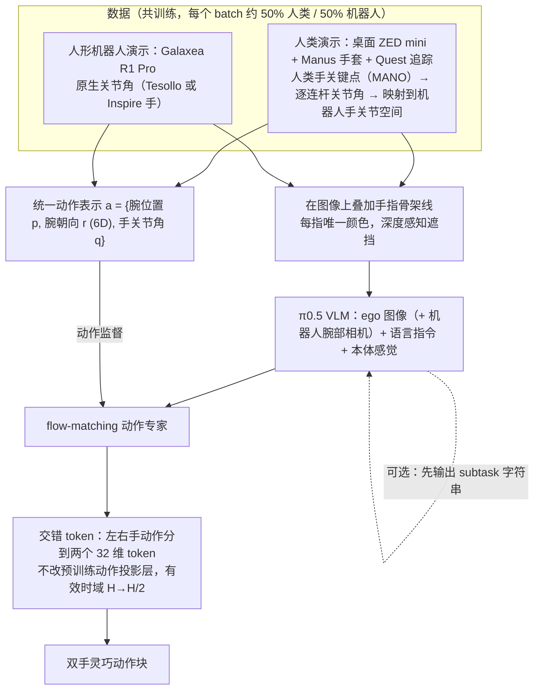

---

type: entity
tags: [paper, loco-manipulation, loco-manip-survey, humanoid, stanford, meta]
status: complete
updated: 2026-10-06
arxiv: "2606.08107"
summary: "人类 ego 与机器人数据共微调 Pi0.5：语义与动作分工，避免硬拷贝人类轨迹。"
related:
  - ../overview/loco-manip-8-papers-technology-map.md
  - ../overview/loco-manip-category-01-egocentric-data.md
sources:
  - ../../sources/papers/loco_manip_survey_01_ego_pi.md
  - ../../sources/blogs/wechat_embodied_ai_lab_loco_manip_8_papers_survey.md
  - ../../sources/papers/loco_manip_8_papers_catalog.md
---

# Ego-Pi

**Ego-Pi** 收录于 [具身智能研究室 · Loco-Manip 8 篇周报](https://mp.weixin.qq.com/s/Ez87ljBYmCyIpLKjMjEyaQ) **第 01/8** 篇，归类为 **01 第一视角数据**。

## 一句话定义

用 π0.5 共微调第一视角人类演示与人形机器人数据（token 交错、机器人关节空间对齐、子任务辅助损失），让机器人学到只出现在人类数据里的任务语义（依据 arXiv:2606.08107v1 摘要、§1）。

## 英文缩写速查

| 缩写 | 英文全称 | 简要说明 |
|------|----------|----------|
| Loco-Manip | Loco-Manipulation | 行走与操作动力学耦合的全身任务 |
| WBC | Whole-Body Control | 协调全身关节满足多任务/约束的控制层 |
| VLA | Vision-Language-Action | 视觉-语言-动作多模态策略 |

## 为什么重要

- 用 π0.5 共微调第一视角人类演示与人形机器人数据（token 交错、机器人关节空间对齐、子任务辅助损失），让机器人学到只出现在人类数据里的任务语义（依据 arXiv:2606.08107v1 摘要、§1）。
- Loco-Manip 8 篇 **#1/8** · Stanford/Meta, CVPR 2026 ext：人类数据让机器人学到新任务语义并组合已有技能，无需对应机器人数据；人类视频供高层语义/任务链，机器人数据负责动作落地（依据 arXiv:2606.08107v1 摘要、§1）。

## 流程总览

图依据：论文 §3 Ego-Pi / Fig.2、Fig.3

## 核心信息

| 字段 | 内容 |
|------|------|
| 编号 | 01/8 |
| 分组 | 01 第一视角数据 |
| 出处 | 2026 · arXiv:2606.08107 |
| 论文/项目 | <https://egopipaper.github.io/> |

## 核心机制（归纳）

### 1）策展导读要点

用 π0.5 共微调第一视角人类演示与人形机器人数据（token 交错、机器人关节空间对齐、子任务辅助损失），让机器人学到只出现在人类数据里的任务语义（依据 arXiv:2606.08107v1 摘要、§1）。

## 结论

**Ego-Pi 的取舍是「人类第一视角只供语义、机器人数据才供动作」：共微调 Pi0.5 而不硬拷贝人类轨迹，把 ego 数据用在它真正可靠的那一层上。**

- 真正起作用的是 **分工而非混合**：人类视频负责高层语义与任务链，机器人数据负责动作落地。
- 作为 Loco-Manip 8 篇的 **01 第一视角数据** 首篇，它解决的是数据来源与接口问题；按本页常见误区，这类工作不自动带来底层 WBC 鲁棒性，须与跟踪/接触控制类工作对照阅读。
- 本页属策展编译层，量化 benchmark、消融与实机指标以原文 PDF / [项目页](https://egopipaper.github.io/) 为准。

## 常见误区

1. Loco-manip 数据/接口论文不自动解决 **底层 WBC 鲁棒性**；须与跟踪/接触控制对照。

## 实验与评测

- 本页在公众号/survey **策展编译**基础上补充机制归纳；**量化 benchmark、消融与实机指标以原文 PDF / 项目页为准**（链接见 [参考来源](#参考来源)）。
- 与同栈姊妹篇对照时，请回到对应 **技术地图 / 42 篇栈 / BFM 地图 / VLN 地图** 总览中的实验段落。

## 与其他页面的关系

- 技术地图：[loco-manip-8-papers-technology-map.md](../overview/loco-manip-8-papers-technology-map.md)
- 分类 hub：[loco-manip-category-01-egocentric-data.md](../overview/loco-manip-category-01-egocentric-data.md)
- 原始 source：[loco_manip_survey_01_ego_pi.md](../../sources/papers/loco_manip_survey_01_ego_pi.md)

## 参考来源

- [loco_manip_survey_01_ego_pi.md](../../sources/papers/loco_manip_survey_01_ego_pi.md) — Loco-Manip 8 篇策展摘录
- [loco_manip_8_papers_catalog.md](../../sources/papers/loco_manip_8_papers_catalog.md)
- [wechat_embodied_ai_lab_loco_manip_8_papers_survey.md](../../sources/blogs/wechat_embodied_ai_lab_loco_manip_8_papers_survey.md)
- 论文/项目：<https://egopipaper.github.io/>
- [arXiv PDF](https://arxiv.org/pdf/2606.08107)：已通读方法部分（实验与附录以略读为准）：摘要、§1 引言、§3 Ego-Pi（3.1-3.4，Fig.2-3）、§4 实现细节；§5 实验略读
- 核对（2026-11-02）：对照 arXiv:2606.08107v1（唯一版本）摘要与 §1，「共享潜在命令空间 + 统一 WBC」与该论文无关（疑为分组描述误贴），已按论文贡献重写「一句话定义」「为什么重要」「核心机制」，并清掉「为什么重要」第二条里误混入的其他篇目列表。

## 推荐继续阅读

- [Loco-Manip 8 篇技术地图](../overview/loco-manip-8-papers-technology-map.md)
- [Loco-Manipulation 任务页](../tasks/loco-manipulation.md)
