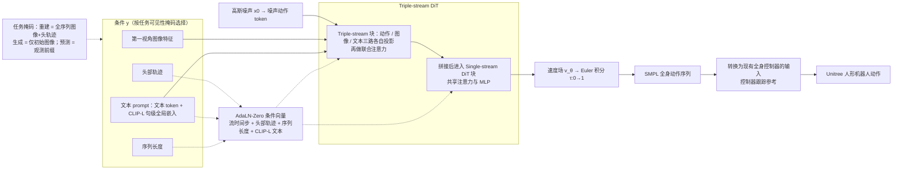

---

type: entity
tags: [paper, loco-manipulation, loco-manip-survey, humanoid, zgca, buaa, deepcybo, tju]
status: complete
updated: 2026-10-06
arxiv: "2606.08495"
summary: "ego 观察 + 文本 → SMPL 全身动作 → 人形控制器。"
related:
  - ../overview/loco-manip-8-papers-technology-map.md
  - ../overview/loco-manip-category-01-egocentric-data.md
sources:
  - ../../sources/papers/loco_manip_survey_02_egoprimo.md
  - ../../sources/blogs/wechat_embodied_ai_lab_loco_manip_8_papers_survey.md
  - ../../sources/papers/loco_manip_8_papers_catalog.md
---

# EgoPriMo

**EgoPriMo** 收录于 [具身智能研究室 · Loco-Manip 8 篇周报](https://mp.weixin.qq.com/s/Ez87ljBYmCyIpLKjMjEyaQ) **第 02/8** 篇，归类为 **01 第一视角数据**。

## 一句话定义

ego 观察 + 文本 → SMPL 全身动作 → 人形控制器。

## 英文缩写速查

| 缩写 | 英文全称 | 简要说明 |
|------|----------|----------|
| Loco-Manip | Loco-Manipulation | 行走与操作动力学耦合的全身任务 |
| WBC | Whole-Body Control | 协调全身关节满足多任务/约束的控制层 |
| VLA | Vision-Language-Action | 视觉-语言-动作多模态策略 |

## 为什么重要

- ego 观察 + 文本 → SMPL 全身动作 → 人形控制器。

## 流程总览

图依据：论文 §III Method / Fig.2

## 核心信息

| 字段 | 内容 |
|------|------|
| 编号 | 02/8 |
| 分组 | 01 第一视角数据 |
| 出处 | 2026 · arXiv:2606.08495 |
| 论文/项目 | <https://arxiv.org/abs/2606.08495> |

## 核心机制（归纳）

### 1）策展导读要点

ego 观察 + 文本 → SMPL 全身动作 → 人形控制器。

## 结论

**EgoPriMo 在 Loco-Manip 8 篇里占的是「第一视角数据」这一格：入口是 ego 观察加文本，出口是 SMPL 全身动作，再交给人形控制器执行。**

- 结构上是两段式：SMPL 作为中间层，让「感知/指令 → 人体动作」与「人体动作 → 机器人执行」解耦，语言在这里是任务条件而非直接的控制信号。
- 本页为 **清单索引** 条目（02/8，2026 · arXiv:2606.08495），只补了机制归纳，未搬运原文消融与实机协议；量化指标须回 PDF。
- 横向定位走 [技术地图](../overview/loco-manip-8-papers-technology-map.md) 与 [01 第一视角数据分类 hub](../overview/loco-manip-category-01-egocentric-data.md)，本页只提供地图坐标。

## 常见误区

1. 策展编译不能替代原文消融与实机协议；量化指标以 PDF 为准。

## 实验与评测

- 本页在公众号/survey **策展编译**基础上补充机制归纳；**量化 benchmark、消融与实机指标以原文 PDF / 项目页为准**（链接见 [参考来源](#参考来源)）。
- 与同栈姊妹篇对照时，请回到对应 **技术地图 / 42 篇栈 / BFM 地图 / VLN 地图** 总览中的实验段落。

## 与其他页面的关系

- 技术地图：[loco-manip-8-papers-technology-map.md](../overview/loco-manip-8-papers-technology-map.md)
- 分类 hub：[loco-manip-category-01-egocentric-data.md](../overview/loco-manip-category-01-egocentric-data.md)
- 原始 source：[loco_manip_survey_02_egoprimo.md](../../sources/papers/loco_manip_survey_02_egoprimo.md)

## 参考来源

- [loco_manip_survey_02_egoprimo.md](../../sources/papers/loco_manip_survey_02_egoprimo.md) — Loco-Manip 8 篇策展摘录
- [loco_manip_8_papers_catalog.md](../../sources/papers/loco_manip_8_papers_catalog.md)
- [wechat_embodied_ai_lab_loco_manip_8_papers_survey.md](../../sources/blogs/wechat_embodied_ai_lab_loco_manip_8_papers_survey.md)
- 论文/项目：<https://arxiv.org/abs/2606.08495>
- [arXiv PDF](https://arxiv.org/pdf/2606.08495)：已通读方法部分（实验与附录以略读为准）：摘要、§I 引言、§III Method（A-E，Fig.2）；§IV 实验略读

## 推荐继续阅读

- [Loco-Manip 8 篇技术地图](../overview/loco-manip-8-papers-technology-map.md)
- [Loco-Manipulation 任务页](../tasks/loco-manipulation.md)
