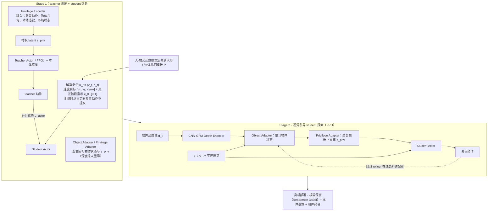

---

type: entity
tags: [paper, loco-manipulation, loco-manip-survey, humanoid, hkust-gz, xiaomi-robotics, hkust, tsinghua]
status: complete
updated: 2026-10-06
arxiv: "2606.09286"
summary: "解耦命令（速度/阶段/物体状态）+ 视觉，敏捷搬推拉滑板交互。"
related:
  - ../overview/humanoid-motion-cerebellum-technology-map.md
  - ../overview/motion-cerebellum-category-07-loco-manip-interface.md
  - ../overview/loco-manip-8-papers-technology-map.md
  - ../overview/loco-manip-category-03-command-controller.md
sources:
  - ../../sources/papers/loco_manip_survey_05_vaic.md
  - ../../sources/blogs/wechat_embodied_ai_lab_loco_manip_8_papers_survey.md
  - ../../sources/papers/loco_manip_8_papers_catalog.md
  - ../../sources/papers/motion_cerebellum_64_catalog.md
  - ../../sources/blogs/wechat_embodied_ai_lab_humanoid_motion_cerebellum_survey.md
---

# VAIC

**VAIC** 收录于 [具身智能研究室 · Loco-Manip 8 篇周报](https://mp.weixin.qq.com/s/Ez87ljBYmCyIpLKjMjEyaQ) **第 05/8** 篇，归类为 **03 命令空间与控制器**。

## 一句话定义

解耦命令（速度/阶段/物体状态）+ 视觉，敏捷搬推拉滑板交互。

## 英文缩写速查

| 缩写 | 英文全称 | 简要说明 |
|------|----------|----------|
| Loco-Manip | Loco-Manipulation | 行走与操作动力学耦合的全身任务 |
| WBC | Whole-Body Control | 协调全身关节满足多任务/约束的控制层 |
| VLA | Vision-Language-Action | 视觉-语言-动作多模态策略 |

## 为什么重要

- 解耦命令（速度/阶段/物体状态）+ 视觉，敏捷搬推拉滑板交互。

## 流程总览

图依据：论文 §3 Methodology / Fig.2

## 核心信息

| 字段 | 内容 |
|------|------|
| 编号 | 05/8 |
| 分组 | 03 命令空间与控制器 |
| 出处 | 2026 · arXiv:2606.09286 |
| 论文/项目 | <https://vaic-humanoid.github.io/> |

## 核心机制（归纳）

### 1）策展导读要点

解耦命令（速度/阶段/物体状态）+ 视觉，敏捷搬推拉滑板交互。

## 结论

**VAIC 的取舍落在命令空间：把速度、阶段、物体状态解耦成显式命令维度并叠加视觉，用接口设计换取搬/推/拉/滑板这类敏捷交互的可控性。**

- 它在 Loco-Manip 8 篇里被归入 **03 命令空间与控制器**（#05/8），说明贡献点是控制器的输入约定，而不是新的运控基座或数据管线。
- 解耦命令的代价是这些维度需要由上层给出；本页停留在清单索引，未交代阶段与物体状态命令的来源与上层规划。
- 本页为策展编译级条目，消融与实机协议以原文 PDF / 项目页 <https://vaic-humanoid.github.io/> 为准。

## 常见误区

1. 策展编译不能替代原文消融与实机协议；量化指标以 PDF 为准。

## 实验与评测

- 本页在公众号/survey **策展编译**基础上补充机制归纳；**量化 benchmark、消融与实机指标以原文 PDF / 项目页为准**（链接见 [参考来源](#参考来源)）。
- 与同栈姊妹篇对照时，请回到对应 **技术地图 / 42 篇栈 / BFM 地图 / VLN 地图** 总览中的实验段落。

## 与其他页面的关系

- 技术地图：[loco-manip-8-papers-technology-map.md](../overview/loco-manip-8-papers-technology-map.md)
- 分类 hub：[loco-manip-category-03-command-controller.md](../overview/loco-manip-category-03-command-controller.md)
- 原始 source：[loco_manip_survey_05_vaic.md](../../sources/papers/loco_manip_survey_05_vaic.md)

## 参考来源

- [loco_manip_survey_05_vaic.md](../../sources/papers/loco_manip_survey_05_vaic.md) — Loco-Manip 8 篇策展摘录
- [loco_manip_8_papers_catalog.md](../../sources/papers/loco_manip_8_papers_catalog.md)
- [wechat_embodied_ai_lab_loco_manip_8_papers_survey.md](../../sources/blogs/wechat_embodied_ai_lab_loco_manip_8_papers_survey.md)
- 论文/项目：<https://vaic-humanoid.github.io/>
- [arXiv PDF](https://arxiv.org/pdf/2606.09286)：已通读方法部分（实验与附录以略读为准）：摘要、§3 Methodology（3.1-3.3，Fig.2）；§4 实验略读

## 推荐继续阅读

- [Loco-Manip 8 篇技术地图](../overview/loco-manip-8-papers-technology-map.md)
- [Loco-Manipulation 任务页](../tasks/loco-manipulation.md)
