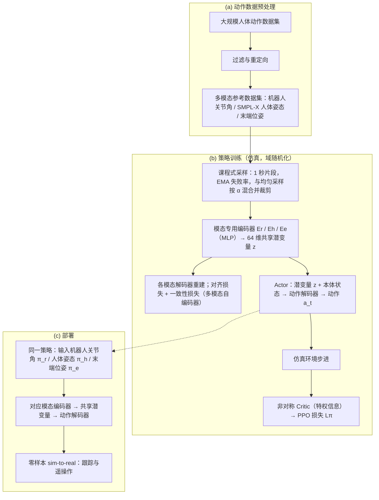

---

type: entity
tags: [paper, loco-manipulation, loco-manip-survey, humanoid, tsinghua]
status: complete
updated: 2026-10-06
arxiv: "2606.04829"
summary: "多模态动作参考 → 共享 latent 命令 → 统一全身控制器。"
related:
  - ../overview/humanoid-motion-cerebellum-technology-map.md
  - ../overview/motion-cerebellum-category-04-wbt-base.md
  - ../overview/loco-manip-8-papers-technology-map.md
  - ../overview/loco-manip-category-03-command-controller.md
sources:
  - ../../sources/papers/loco_manip_survey_06_m3imic.md
  - ../../sources/blogs/wechat_embodied_ai_lab_loco_manip_8_papers_survey.md
  - ../../sources/papers/loco_manip_8_papers_catalog.md
  - ../../sources/papers/motion_cerebellum_64_catalog.md
  - ../../sources/blogs/wechat_embodied_ai_lab_humanoid_motion_cerebellum_survey.md
---

# M3imic

**M3imic** 收录于 [具身智能研究室 · Loco-Manip 8 篇周报](https://mp.weixin.qq.com/s/Ez87ljBYmCyIpLKjMjEyaQ) **第 06/8** 篇，归类为 **03 命令空间与控制器**。

## 一句话定义

多模态动作参考 → 共享 latent 命令 → 统一全身控制器。

## 英文缩写速查

| 缩写 | 英文全称 | 简要说明 |
|------|----------|----------|
| Loco-Manip | Loco-Manipulation | 行走与操作动力学耦合的全身任务 |
| WBC | Whole-Body Control | 协调全身关节满足多任务/约束的控制层 |
| VLA | Vision-Language-Action | 视觉-语言-动作多模态策略 |

## 为什么重要

- 多模态动作参考 → 共享 latent 命令 → 统一全身控制器。

## 流程总览

图依据：论文 §III（A 问题定义与多模态编码、B 课程学习、C Sim-to-Real）/ Fig.2。

## 核心信息

| 字段 | 内容 |
|------|------|
| 编号 | 06/8 |
| 分组 | 03 命令空间与控制器 |
| 出处 | 2026 · arXiv:2606.04829 |
| 论文/项目 | <https://github.com/Renforce-Dynamics/MultiModalWBC> |

## 核心机制（归纳）

### 1）策展导读要点

多模态动作参考 → 共享 latent 命令 → 统一全身控制器。

## 结论

**M3imic 解决的是命令接口问题而不是控制器本身：把多模态动作参考先编码到一个共享 latent 命令空间，再由同一个全身控制器执行，从而让输入模态的扩展不牵动底层控制。**

- 真正起作用的是 **共享 latent 命令空间**：多模态参考在此对齐，统一 WBC 只面对一种命令格式。
- 分类坐标是 Loco-Manip 8 篇的 **03 命令空间与控制器**，因此它适合叠加在运控基座/跟踪类工作之上，而非替代它们。
- 本页为策展编译层：实现开源在 [MultiModalWBC](https://github.com/Renforce-Dynamics/MultiModalWBC)，但量化消融与实机协议以原文 PDF 为准。

## 常见误区

1. 策展编译不能替代原文消融与实机协议；量化指标以 PDF 为准。

## 实验与评测

- 本页在公众号/survey **策展编译**基础上补充机制归纳；**量化 benchmark、消融与实机指标以原文 PDF / 项目页为准**（链接见 [参考来源](#参考来源)）。
- 与同栈姊妹篇对照时，请回到对应 **技术地图 / 42 篇栈 / BFM 地图 / VLN 地图** 总览中的实验段落。

## 与其他页面的关系

- 技术地图：[loco-manip-8-papers-technology-map.md](../overview/loco-manip-8-papers-technology-map.md)
- 分类 hub：[loco-manip-category-03-command-controller.md](../overview/loco-manip-category-03-command-controller.md)
- 原始 source：[loco_manip_survey_06_m3imic.md](../../sources/papers/loco_manip_survey_06_m3imic.md)

## 参考来源

- [loco_manip_survey_06_m3imic.md](../../sources/papers/loco_manip_survey_06_m3imic.md) — Loco-Manip 8 篇策展摘录
- [loco_manip_8_papers_catalog.md](../../sources/papers/loco_manip_8_papers_catalog.md)
- [wechat_embodied_ai_lab_loco_manip_8_papers_survey.md](../../sources/blogs/wechat_embodied_ai_lab_loco_manip_8_papers_survey.md)
- 论文/项目：<https://github.com/Renforce-Dynamics/MultiModalWBC>
- [arXiv PDF](https://arxiv.org/pdf/2606.04829)：已通读方法部分（实验与附录以略读为准）：§I 引言、§III 方法（A–C）、§IV-D 实机部署小节；其余实验仅略读

## 推荐继续阅读

- [Loco-Manip 8 篇技术地图](../overview/loco-manip-8-papers-technology-map.md)
- [Loco-Manipulation 任务页](../tasks/loco-manipulation.md)
