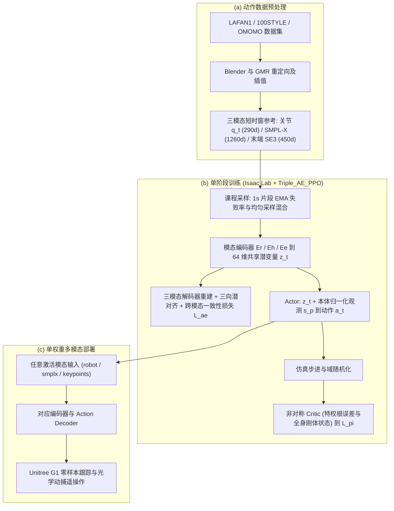
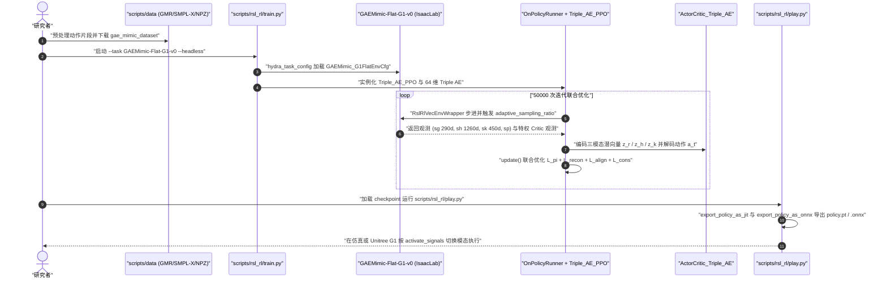

# M3imic

**M3imic**（*Learning a Versatile Whole-Body Controller for Multimodal Motion Mimicking*，IEEE RA-L 2026 / `arXiv:2606.04829v1`）由东南大学、清华大学与 MBZUAI 提出，收敛到统一的通用人形全身控制器（Whole-Body Controller）接口问题：同一底层策略需要在无需在线逆运动学（IK）和多阶段教师-学生蒸馏的前提下，同时消费密集关节轨迹、SMPL-X 人体动作捕捉与稀疏末端位姿三类异构参考信号。

## 一句话定义

M3imic 通过三模态编码器-解码器（重构 + 三向潜在对齐 + 跨模态一致性损失）把机器人关节角、人体 SMPL-X 姿态与末端 SE(3) 位姿对齐到 `64` 维共享隐式命令空间，从而用单一端到端 PPO 策略完成多模态跟踪与真机遥操作。

## 英文缩写速查

| 缩写 | 英文全称 | 简要说明 |
|------|----------|----------|
| M3imic | Multi-Modal Mimic | 本文多模态人形全身模仿控制框架 |
| WBC | Whole-Body Control | 协调全身 29 自由度平衡与动作跟踪的控制层 |
| SMPL-X | Skinned Multi-Person Linear Model (Expressive) | 用于表征人体 21 关节 6D 姿态的参数化人体网格模型 |
| SE(3) | Special Euclidean Group in 3D | 末端关键点（双手、双脚、胸）的 3D 位置与 6D 旋转位姿 |
| EMA | Exponential Moving Average | 1 秒片段终止失败率的滑动平均，用于课程自适应采样 |
| OOD | Out-of-Distribution | 未见动作类别或真机遥操作输入引发的分布偏移 |

## 为什么重要

- **免在线 IK 与免两阶段蒸馏**：现有方案要么依赖实时 IK 将稀疏末端位姿解算回关节角，要么用命令掩码（command masking）+ 两阶段教师-学生蒸馏导致信息损耗与误差累积；M3imic 在单阶段训练内完成模态对齐。
- **把「命令模态差异」量化为 Fidelity–Robustness 权衡**：论文在同一权重下系统比较了关节模态 \(\pi^r\)、人体模态 \(\pi^h\) 与稀疏末端模态 \(\pi^e\)，实证密集指令胜在局部关节精度，而稀疏末端指令凭借运动学冗余在未见测试集取得更高平衡成功率。
- **无外部全局定位的真机友好接口**：部署端 Actor 观测刻意剔除全局根位置与线速度，靠本体角速度、局部旋转误差与历史动作稳定执行，已在 29-DoF Unitree G1 上零样本验证动态舞蹈、跑动与光学动捕遥操作。

## 流程总览

图依据：`arXiv:2606.04829v1` §III（Fig. 2）与官方仓库 `MultiModalWBC` 中 `Actor_Triple_AE` / `Triple_AE_PPO` 实现。

## 核心原理

### 1. 三模态对齐自编码器（`Actor_Triple_AE`）
每个时间步提取步距 \(\Delta=2\)、长度 \(H=10\) 的未来参考片段作为多模态命令：
- **机器人关节角 \(s_t^r\)**：`29` 维关节位置序列（共 `290` 维）；
- **SMPL-X 人体姿态 \(s_t^h\)**：`21` 个人体关节转换为 6D 旋转（`126×10 = 1260` 维）；
- **稀疏末端位姿 \(s_t^e\)**：双手、双脚与胸部共 `5` 个关键点的根相对 3D 位置与 6D 旋转（`5×9×10 = 450` 维）。

三个 MLP 编码器 \(E_r, E_h, E_e\) 将其各自映射至统一的 `64` 维潜空间 \(z_t^m \in \mathbb{R}^{64}\)。总训练损失 \(L = L_\pi + L_{ae}\) 中，自编码分支同时约束三项损失：
- **重构损失 \(L_{recon}\)**：各模态解码器重构原始输入（默认权重 `sg=0.5, sh=0.1, sk=0.1`）；
- **对齐损失 \(L_{align}\)**：最小化两两模态潜向量 \(\|z_t^m - z_t^n\|_2^2\) 距离（默认权重 `1.0`）；
- **一致性损失 \(L_{cons}\)**：约束不同模态潜向量送入机器人解码器 \(D_r\) 后的输出一致（默认权重 `5.0`）。

### 2. 非对称 Actor-Critic 与 1 秒课程采样
- **观测切分**：Actor 仅看潜命令 \(z_t\) 与经过独立 `EmpiricalNormalization` 的本体状态 \(s_t^p = (\Delta\theta_t, \omega_t, q_t, \dot{q}_t, a_{t-1})\)，不输入易漂移的全局位置/线速度；Critic 接收包含根位置误差 \(\Delta p_t\)、全身刚体位置/姿态 \(B_p, B_\theta\) 与根线速度 \(v_t\) 的特权状态。
- **失败率自适应采样**：将长轨迹切分为 `1s` 片段并跟踪其终止失败率的 EMA，通过 \(P_{final} = \alpha P_{uniform} + (1-\alpha)\mathrm{clip}(P_{failure}, 0, P_{max})\)（消融取 \(\alpha_{min}=0.2, P_{max}=0.05\)）逐步把训练预算倾斜到高难度片段并避免不可行片段独占采样。

## 实验与评测

基于 `arXiv:2606.04829v1`（29-DoF Unitree G1，Isaac Sim 4096 并行环境训练与真机评测）：

| 实验基准 | 方法 / 模态 | 成功率 (%) ↑ | \(E_{mpkpe}\) (mm) ↓ | \(E_{mpjae}\) (rad) ↓ | \(E_{vel}\) (m/s) ↓ |
|----------|-------------|--------------|-----------------------|------------------------|---------------------|
| **训练集（LAFAN1+100STYLE）** | HOVER (Teacher) | `87.35±0.26` | `128.20±3.54` | `0.686±0.025` | `0.481±0.044` |
| **训练集（LAFAN1+100STYLE）** | OmniH2O | `97.78±0.10` | `62.75±3.23` | `0.154±0.010` | `0.307±0.025` |
| **训练集（LAFAN1+100STYLE）** | ExBody2 | `98.12±0.09` | `53.25±2.52` | `0.146±0.016` | `0.285±0.023` |
| **训练集（LAFAN1+100STYLE）** | TWIST2 | `98.89±0.08` | `51.65±1.84` | `0.121±0.009` | `0.267±0.015` |
| **训练集（LAFAN1+100STYLE）** | **M3imic (`Ours`)** | **`99.54±0.04`** | **`46.05±2.07`** | **`0.112±0.013`** | **`0.256±0.019`** |
| **未见测试集（OMOMO）** | TWIST2 | `94.59±0.34` | `78.39±2.56` | `0.143±0.009` | **`0.329±0.015`** |
| **未见测试集（OMOMO）** | **M3imic (\(\pi^r\) 关节)** | `95.98±0.33` | **`71.52±3.79`** | **`0.139±0.018`** | `0.341±0.028` |
| **未见测试集（OMOMO）** | **M3imic (\(\pi^h\) 人体)** | `95.23±0.46` | `72.21±4.08` | `0.140±0.016` | `0.339±0.034` |
| **未见测试集（OMOMO）** | **M3imic (\(\pi^e\) 末端)** | **`98.42±0.29`** | `75.52±4.29` | `0.142±0.019` | `0.337±0.032` |
| **真机光学动捕遥操作** | **M3imic (\(\pi^r\) / \(\pi^e\))** | — | **`41.63`** / `43.22` | **`0.095`** / `0.105` | **`0.260`** / `0.268` |

- **关键消融发现（Table V–VI，100STYLE / OMOMO，4×RTX 4090，50,000 iter）：**
  - **课程采样：** 加入 1 秒片段失败率课程采样后，完成率从 `98.17%` 升至 `98.85%`（大网络从 `98.51%` 升至 `99.01%`）。
  - **数据规模 vs 网络规模：** 在关闭课程采样条件下，将训练数据从 10%（`mini`）扩充到 100%（`full`，约 390 万帧），OMOMO 未见成功率由 `85.13%` 提升至 `94.05%`；相比之下，将 MLP 从 `[512, 256, 128]` 扩增至 `[1024, 512, 256]` 仅在低数据下增益较大，在全量数据下只从 `94.05%` 微升至 `94.28%`，同时使相对推理/训练吞吐从 `1.00` 降为 `0.72`。

## 与其他工作对比

| 维度 | M3imic | HOVER（指令掩码+蒸馏） | TWIST2 / 在线 IK 路线 | ExBody2 / OmniH2O |
|------|--------|------------------------|------------------------|---------------------|
| **多模态处理机制** | **三编码器共享 `64` 维隐空间 + 单阶段端到端** | 命令向量拼接掩码 + Teacher-Student 蒸馏 | 依赖在线/离线重定向转换为单一关节空间 | 仅单一或固定参考表示 |
| **训练阶段数** | **单阶段联合训练（PPO + Triple AE）** | 多阶段蒸馏 | 需额外 IK / 重定向前端 | 教师-学生或专家蒸馏 |
| **推理时延/耦合** | 只需切换激活对应编码器分支，无在线 IK | 单网络但受蒸馏信息损失制约 | 引入 IK 奇异与重定向延迟 | 不支持直接稀疏末端输入 |
| **OOD 平衡鲁棒性** | 稀疏末端 \(\pi^e\) OMOMO 达 `98.42%` | OMOMO 成功率 `87.77%` | OMOMO 成功率 `94.59%` | OMOMO `94.68%` / `92.84%` |

## 结论

**M3imic 的核心贡献在于用「共享隐式命令空间 + 单阶段联合自编码 RL」取代传统的「在线 IK 预处理」或「多阶段掩码蒸馏」，使同一副全身控制权重无需微调即可接收关节、人体与末端三类输入并揭示了指令稠密度对稳定性的影响。**

- **三模态对齐损失防止跨模态语义塌缩**：重构、三向潜对齐与 `robot` 解码一致性共同保证不同输入驱动同一运动意图。
- **稀疏末端模态在 OOD 下反而更稳**：密集关节命令 \(\pi^r\) 在局部精度占优，而稀疏末端命令 \(\pi^e\) 为下肢平衡留出冗余，在 OMOMO 上比 \(\pi^r\) 高出 `2.44` 个百分点。
- **动作多样性比盲目加宽网络更划算**：约 390 万帧多源数据带来的泛化增益远超加倍隐藏层宽度，且不牺牲真机部署吞吐率。
- **官方代码与命名对应明确**：开源仓库 `MultiModalWBC` 中以 `GAEMimic-Flat-G1-v0/v1`、`Actor_Triple_AE` 与 `Triple_AE_PPO` 对应论文算法，数据链依赖 Blender + GMR 预处理。

## 源码运行时序图

基于官方仓库 `MultiModalWBC` 中的 `scripts/rsl_rl/train.py`、`scripts/rsl_rl/play.py`、`tasks/tracking/config/g1/` 与 `third_party/rsl_rl` 核对：

## 工程实践

- **代码复现环境**：依赖 Python 3.10、Isaac Sim 4.5.0 与 Isaac Lab 2.1.1；项目核心扩展位于 `source/whole_body_control`，魔改自编码 PPO 算法内置于 `third_party/rsl_rl`。
- **任务与模型选择**：标准训练使用 `--task GAEMimic-Flat-G1-v0`（`[512, 256, 128]`），高容限大模型切换为 `--task GAEMimic-Flat-G1-v1`（`[1024, 512, 256]`，`max_iterations = 50_000`）。注意默认 `GAEMimic_G1FlatPPORunnerCfg` 中关闭了 runner 级 `empirical_normalization=False`，改由 `Actor_Triple_AE` 内部单独归一化本体状态 `x_sp`。
- **部署切换提示**：推理导出时通过配置中的 `activate_signals`（`"robot" | "smplx" | "keypoints"`）决定部署阶段实际使用的前端编码器，其余两个模态解码器仅保留在训练阶段，无需上机运行。
- **数据集准备**：离线动作管线需经 `gmr_pkl_to_csv.py` → `smplx_interpolate.py` → `offline_csv_to_npz_datasets.py` 生成训练所需的多模态同步缓存，或直接拉取作者公开在 ModelScope 的 `seulzx/gae_mimic_dataset`。

## 常见误区与局限

- **误区：把 M3imic 的「Multi-Modal」理解成视觉-语言多模态（VLA）**：本文的多模态严格指**运动参考指令模态**（机器人关节角、人体 SMPL-X、末端 SE(3) 位姿），不包含 RGB 视觉感知或自然语言理解模块。
- **误区：认为 M3imic 已经集成环境感知与高层任务规划**：论文 §V 明确指出 M3imic 当前是**盲控级底层全身模仿控制器（low-level controller）**，尚未与机载相机感知及高层规划器闭合，复杂桌面或跨障碍交互仍需上游遥操作或规划器提供参考轨迹。
- **已知局限**：真机实验（Table VII）的遥操作输入依赖光学动作捕捉系统，且当前仓库主要针对 Unitree G1 29-DoF 平台配置，官方 TODO 列表仍标注 `mjlab` 版本与更多扩展模态待补全；同时大网络在带来微弱长尾提升的同时会把仿真训练吞吐降至标准版的 `0.72` 倍。

## 关联页面

- [Loco-Manip 8 篇技术地图](../overview/loco-manip-8-papers-technology-map.md)
- [Loco-Manip 分类 03：命令空间与控制器](../overview/loco-manip-category-03-command-controller.md)
- [人形运动控制「小脑」技术地图](../overview/humanoid-motion-cerebellum-technology-map.md)
- [Motion Cerebellum 分类 04：全身跟踪基座](../overview/motion-cerebellum-category-04-wbt-base.md)
- [Loco-Manipulation 任务页](../tasks/loco-manipulation.md)

## 参考来源

- [m3imic_arxiv_2606_04829_reading.md](../../sources/papers/m3imic_arxiv_2606_04829_reading.md) — `arXiv:2606.04829v1` 原文全文通读归档
- [multimodal_wbc.md](../../sources/repos/multimodal_wbc.md) — 官方代码 `Renforce-Dynamics/MultiModalWBC` 核查归档
- [loco_manip_survey_06_m3imic.md](../../sources/papers/loco_manip_survey_06_m3imic.md) — Loco-Manip 8 篇策展摘录
- [loco_manip_8_papers_catalog.md](../../sources/papers/loco_manip_8_papers_catalog.md)
- [wechat_embodied_ai_lab_loco_manip_8_papers_survey.md](../../sources/blogs/wechat_embodied_ai_lab_loco_manip_8_papers_survey.md)
- [motion_cerebellum_64_catalog.md](../../sources/papers/motion_cerebellum_64_catalog.md)
- [wechat_embodied_ai_lab_humanoid_motion_cerebellum_survey.md](../../sources/blogs/wechat_embodied_ai_lab_humanoid_motion_cerebellum_survey.md)

## 推荐继续阅读

- [M3imic 论文 arXiv:2606.04829](https://arxiv.org/abs/2606.04829)
- [MultiModalWBC 官方 GitHub 仓库](https://github.com/Renforce-Dynamics/MultiModalWBC)
- [ModelScope 预处理多模态数据集 (`seulzx/gae_mimic_dataset`)](https://www.modelscope.cn/datasets/seulzx/gae_mimic_dataset)
