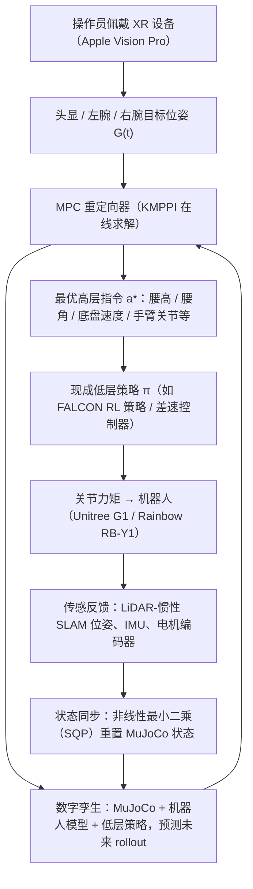

---

type: entity
tags: [paper, loco-manipulation, loco-manip-survey, humanoid, berkeley, amazon]
status: complete
updated: 2026-10-06
arxiv: "2606.07934"
summary: "MPC 重定向跨本体全身遥操作，使 teleop 数据可跨平台复用。"
related:
  - ../overview/humanoid-motion-cerebellum-technology-map.md
  - ../overview/motion-cerebellum-category-06-cross-embodiment-teleop.md
  - ../overview/loco-manip-8-papers-technology-map.md
  - ../overview/loco-manip-category-04-contact-teleop.md
sources:
  - ../../sources/papers/loco_manip_survey_08_x_op.md
  - ../../sources/blogs/wechat_embodied_ai_lab_loco_manip_8_papers_survey.md
  - ../../sources/papers/loco_manip_8_papers_catalog.md
  - ../../sources/papers/motion_cerebellum_64_catalog.md
  - ../../sources/blogs/wechat_embodied_ai_lab_humanoid_motion_cerebellum_survey.md
---

# X-OP

**X-OP** 收录于 [具身智能研究室 · Loco-Manip 8 篇周报](https://mp.weixin.qq.com/s/Ez87ljBYmCyIpLKjMjEyaQ) **第 08/8** 篇，归类为 **04 触觉与跨本体遥操作**。

## 一句话定义

MPC 重定向跨本体全身遥操作，使 teleop 数据可跨平台复用。

## 英文缩写速查

| 缩写 | 英文全称 | 简要说明 |
|------|----------|----------|
| Loco-Manip | Loco-Manipulation | 行走与操作动力学耦合的全身任务 |
| WBC | Whole-Body Control | 协调全身关节满足多任务/约束的控制层 |
| VLA | Vision-Language-Action | 视觉-语言-动作多模态策略 |

## 为什么重要

- MPC 重定向跨本体全身遥操作，使 teleop 数据可跨平台复用。

## 流程总览

图依据：论文 §III（MPC 重定向器、状态同步）/ Fig.3。

## 核心信息

| 字段 | 内容 |
|------|------|
| 编号 | 08/8 |
| 分组 | 04 触觉与跨本体遥操作 |
| 出处 | 2026 · arXiv:2606.07934 |
| 论文/项目 | <https://arxiv.org/abs/2606.07934> |

## 核心机制（归纳）

### 1）策展导读要点

MPC 重定向跨本体全身遥操作，使 teleop 数据可跨平台复用。

## 结论

**X-OP 要解开的是「遥操作数据只能给采集它的那台机器人用」这条约束：用 MPC 重定向做跨本体全身遥操作，让同一批 teleop 数据可跨平台复用。**

- 杠杆点在重定向层：MPC 承担人到不同本体的全身映射，数据价值因此从单一平台摊薄到多平台，而不是靠为每台机器人重采一遍。
- 归类于 **04 触觉与跨本体遥操作**（08/8，2026 · arXiv:2606.07934），本页为清单索引条目，跨本体的实际迁移代价与实机协议以原文 PDF 为准。
- 横向定位回 [技术地图](../overview/loco-manip-8-papers-technology-map.md) 与 [04 触觉与跨本体遥操作 hub](../overview/loco-manip-category-04-contact-teleop.md)；本页只给地图坐标，不替代原文消融。

## 常见误区

1. 策展编译不能替代原文消融与实机协议；量化指标以 PDF 为准。

## 实验与评测

- 本页在公众号/survey **策展编译**基础上补充机制归纳；**量化 benchmark、消融与实机指标以原文 PDF / 项目页为准**（链接见 [参考来源](#参考来源)）。
- 与同栈姊妹篇对照时，请回到对应 **技术地图 / 42 篇栈 / BFM 地图 / VLN 地图** 总览中的实验段落。

## 与其他页面的关系

- 技术地图：[loco-manip-8-papers-technology-map.md](../overview/loco-manip-8-papers-technology-map.md)
- 分类 hub：[loco-manip-category-04-contact-teleop.md](../overview/loco-manip-category-04-contact-teleop.md)
- 原始 source：[loco_manip_survey_08_x_op.md](../../sources/papers/loco_manip_survey_08_x_op.md)

## 参考来源

- [loco_manip_survey_08_x_op.md](../../sources/papers/loco_manip_survey_08_x_op.md) — Loco-Manip 8 篇策展摘录
- [loco_manip_8_papers_catalog.md](../../sources/papers/loco_manip_8_papers_catalog.md)
- [wechat_embodied_ai_lab_loco_manip_8_papers_survey.md](../../sources/blogs/wechat_embodied_ai_lab_loco_manip_8_papers_survey.md)
- 论文/项目：<https://arxiv.org/abs/2606.07934>
- [arXiv PDF](https://arxiv.org/pdf/2606.07934)：已通读方法部分（实验与附录以略读为准）：§I 引言、§III（A 问题形式化、B 状态同步、C 代价设计、D 输入设备）、Table I；§IV 仅略读

## 推荐继续阅读

- [Loco-Manip 8 篇技术地图](../overview/loco-manip-8-papers-technology-map.md)
- [Loco-Manipulation 任务页](../tasks/loco-manipulation.md)
