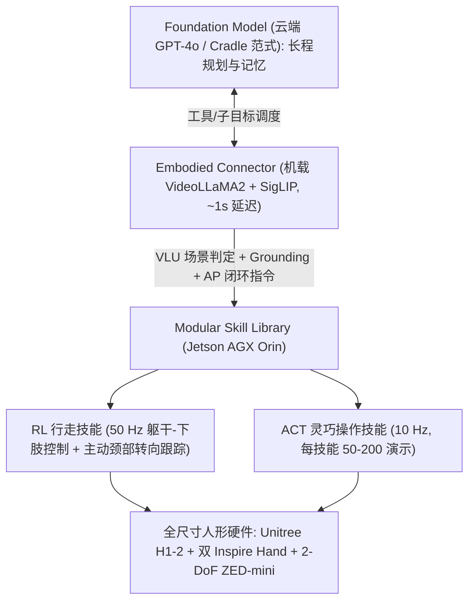

# Being-0：基于视觉语言模型与模块化技能的人形具身智能体

## 一句话定义

**Being-0**（`arXiv:2503.12533`）是智在无界（BeingBeyond）提出的三层分层人形具身智能体框架：通过在云端基础模型（GPT-4o）与底层模块化技能（RL 行走 + ACT 灵巧操作）之间引入机载轻量化 **Embodied Connector**，让 41-DoF 全尺寸人形机器人（Unitree H1-2 + 双 Inspire 手）低延迟、鲁棒地自主完成长程移动操作任务。

## 英文缩写速查

| 缩写 | 英文全称 | 简要说明 |
|------|----------|----------|
| FM | Foundation Model | 云端大规模基础模型（如 GPT-4o），负责高层认知、子任务规划与长期记忆 |
| VLU | Vision-Language Understanding | 第一视角实时视觉-语言场景问答与状态判定子任务 |
| AP | Action Planning | Embodied Connector 面向技能库与导航方向的闭环行动指令规划 |
| ACT | Action Chunking with Transformers | 10 Hz 灵巧操作模仿学习分块策略 |

## 为什么重要

1. **解决云端 VLM 控制人形机器人的延迟与第一视角失配**：每步直接调用云端大模型会产生秒级网络阻塞与目标丢失，纯底层控制又缺乏高层常识与任务编排能力。Embodied Connector 把耗时高频视觉定位与可中断闭环路由留在机载 Jetson AGX Orin（~1 s 响应），兼顾智能性与实时性。
2. **首个面向灵巧手全尺寸人形的长程自主多阶段验证**：在办公室真实环境自主串联导航、找瓶子、拿取咖啡杯与送水等跨房间多阶段任务。

## 核心原理

1. **三层解耦系统架构**：
   - **Foundation Model（FM，云端）**：沿用 Cradle 工具调用思想维护全局任务图、失败重试与子任务分发；
   - **Embodied Connector（机载 ~1s）**：以 VideoLLaMA2 + SigLIP 微调（300K 目标定位 + 3,177 第一视角图像/38,380 VLU 问答 + 771 AP 动作样本），完成三件事——实时 VLU 场景问答、第一视角导航/操作目标检测定位，以及向技能库发出带中断条件（Termination Detection）的闭环动作；
   - **Modular Skill Library（机载实时）**：由 50 Hz RL 行走控制器（支持线速度/角速度与主动颈部相机跟踪）和 10 Hz ACT 灵巧抓握/放置/倾倒等技能组成（每个操作技能由 50–200 条遥操作演示训得）。
2. **主动视觉与全尺寸硬件协同**：Unitree H1-2 共计 41 DoF（配备双侧 Inspire 灵巧手与 2-DoF 主动云台颈部搭载 ZED-mini 双目相机）；机载 Jetson AGX Orin 运行 Connector 与全部底层控制策略，避免网络延迟影响平衡。

## 工程实践

- **长程任务真机实测表现**：在 5 项长程真实场景任务中分别取得 Fetch-bottle **0.90**、Deliver-basket **0.80**、Prepare-coffee **0.75**、Make-coffee **0.90**、Deliver-coffee **0.87**（对比去掉 Embodied Connector 的纯 FM 基线仅 `0 / 0 / 0 / 0.90 / 0.33`）。
- **导航效率收益**：依靠机载 Connector 的快速视觉反馈与可中断导航循环，平均移动效率较基线提升 **4.2×**（**9.6 cm/s** vs `2.3 cm/s`）。
- **开源状态核查**：**源码运行时序图：不适用**（截至 2026-11-21，官方仓库 [BeingBeyond/Being-0](https://github.com/BeingBeyond/Being-0) commit `987b59c` 仅包含占位 `README.md` 与项目主页图片，README 声明 *"We will release our code within this year."*，尚未释出可执行代码）。

## 结论

**Being-0 证明「云端常识规划 + 机载专用第一视角连接器 + 模块化 50Hz/10Hz 技能库」是目前工程上使全尺寸双灵巧手人形机器人完成长程真实办公任务的高效落地范式。**
- Embodied Connector 以约 1 秒的本地化视觉语言决策打通感知与技能间断层，导航速度提升 4.2 倍；
- 5 项跨步骤真机任务全部达到 75%–90% 成功率，验证分级异步频率设计的必要性；
- 技能库可扩展性仍受限于各原子 ACT/RL 技能需单独采集/训练。

## 局限与风险

1. **技能边界偏稳态操作**：当前技能库不包含深蹲地面拾取、坐下、跨越台阶或跳跃等下肢大动态动作。
2. **系统对云端大模型仍有依赖**：完全断网脱离云端 GPT-4o 时无法进行复杂开放式长程规划与异常重规划。
3. **代码尚未开源**：第三方无法直接复用其 Connector 数据微调脚本与 H1-2 部署栈。

## 关联页面

- 所属机构实体：[智在无界（BeingBeyond）](beingbeyond.md)
- 同路线自动数据扩展后续工作：[DemoHLM：单演示可泛化人形移动操作](paper-loco-manip-161-136-demohlm.md)
- 同领域人体/全身控制：[BumbleBee：专家到通才人形全身控制](paper-notebook-from-experts-to-a-generalist.md)

## 参考来源

- 一手论文：`arXiv:2503.12533v2` 全文归档（[being-0_arxiv_2503_12533.md](../../sources/papers/being-0_arxiv_2503_12533.md)）
- 综述补充索引：[loco_manip_161_survey_057_being-0.md](../../sources/papers/loco_manip_161_survey_057_being-0.md)

## 继续阅读

- [arXiv:2503.12533 论文页面](https://arxiv.org/abs/2503.12533)
- [Being-0 官方项目主页](https://beingbeyond.github.io/Being-0)
- [BeingBeyond/Being-0 GitHub 仓库](https://github.com/BeingBeyond/Being-0)
