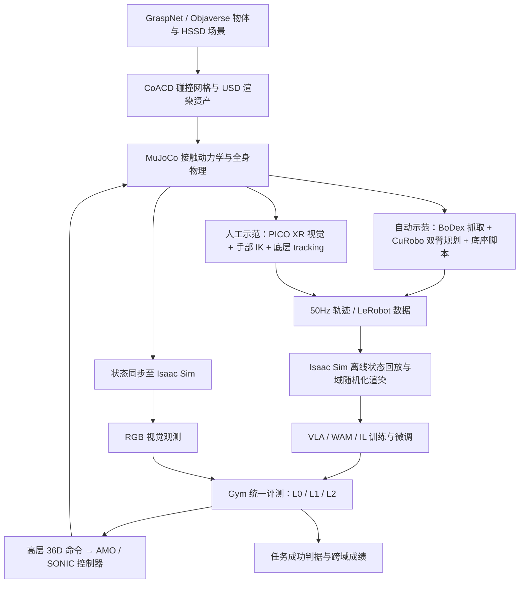
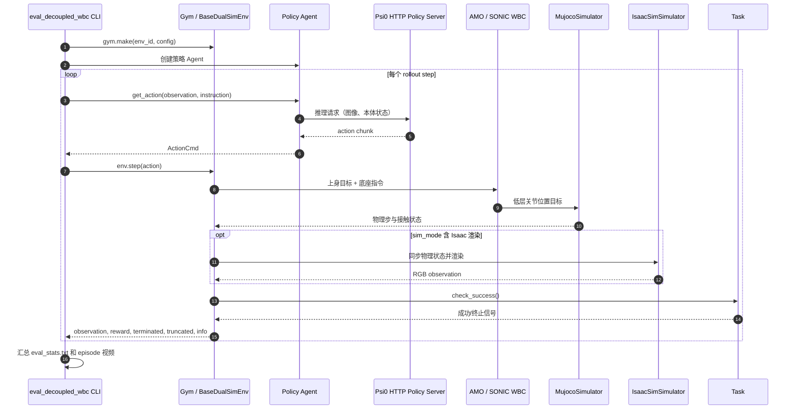

# SIMPLE（Simulation-Based Policy Learning and Evaluation for Humanoid Loco-manipulation）

**SIMPLE** 是 [USC Physical Superintelligence (PSI) Lab](https://psi-lab.ai/) 提出的 **人形全身 loco-manipulation 统一仿真 testbed**（[arXiv:2606.08278v2](https://arxiv.org/html/2606.08278v2)，2026-10-12 修订）。它同时覆盖 **策略评测、演示数据采集与 Gym 式训练接口**，而非单篇 VLA/WAM 算法论文。本页亦收录于 [具身智能研究室 · 人形 Loco-Manip 161 篇长文](https://mp.weixin.qq.com/s/pACh9EhsISiyPGdiiR0C3A) **第 075/161** 篇（03 视觉感知驱动的人形移动操作）；**161 策展初稿将 SIMPLE 误述为「VLA+世界模型预测轨迹」**，以本文与 [arXiv 原文](https://arxiv.org/abs/2606.08278) 为准。

## 一句话定义

SIMPLE 用 **MuJoCo（接触物理）+ Isaac Sim（光追渲染）** 双引擎构建大规模人形 loco-manipulation 仿真环境（v2 基准 16 任务、官网与 v2 §3.2 仍写 60；50 室内场景、1000+ 物体），内置 **运动规划** 与 **VR 遥操作** 两条数据采集管线，并以 **L0/L1/L2 域随机化** benchmark **Ψ₀、GR00T、π₀.₅、DreamZero、Cosmos3** 等策略（v2 主表 7 模型，官网旧版榜单 9 模型）；实验表明 **仿真排序与真机高度一致**，且纯仿真数据可 **零样本迁移真机**。

## 英文缩写速查

| 缩写 | 英文全称 | 简要说明 |
|------|----------|----------|
| SIMPLE | SIMulation-based Policy Learning and Evaluation | 本文 benchmark 与全栈仿真 testbed 名称 |
| Loco-Manip | Loco-Manipulation | 行走与操作动力学耦合的全身任务 |
| VLA | Vision-Language-Action | 视觉-语言-动作多模态策略（SIMPLE 评测对象之一） |
| WAM | World-Action Model | 世界-动作模型（如 DreamZero，SIMPLE 评测对象之一） |
| DR | Domain Randomization | 域随机化；SIMPLE 评测分 L0/L1/L2 三级 |
| WBC | Whole-Body Control | 全身控制；底层 AMO/SONIC tracking 维持平衡与 locomotion |
| IK | Inverse Kinematics | 逆运动学；VR 遥操作手部 retarget 与运动规划双臂轨迹 |

## 论文版本、评测协议与证据边界

| 证据来源 | 任务与策略计数 | 使用建议 |
|---|---|---|
| [arXiv v2](https://arxiv.org/html/2606.08278v2) Abstract、Conclusion、Appendix A.5 | **16 任务**，主文 Table 1 为 **7 模型 × 6 单任务**，附录 Table 8 为 **5 模型 × 16 多任务** | 论文实验的主口径；主表各档 10 次，附录多任务通常 20 次（DreamZero 10 次） |
| 同一篇 v2 §3.2 及[项目主页](https://psi-lab.ai/SIMPLE/) | **60 任务**；官网展示 **9 模型** | 原文内部与官网仍有旧/扩展口径，不能把这 60 项宣称为 v2 Table 8 全量评测 |
| [GitHub README 2026-11-11](https://github.com/physical-superintelligence-lab/SIMPLE#-news--updates) | decoupled-WBC 数据集 **17 任务**（12 Teleop + 5 MP） | 新开放数据与 checkpoints 的集合，不等于论文 16 项 benchmark |

- **控制接口（v2 §3.5）：** 32D 本体状态（双手 14 + 双臂 14 + 腰 3 + 底座高度 1），36D 动作（32D 上身关节目标 + 4D 底座指令 `vx/vy/vyaw/qyaw`）。文中 VR 示范录制 50Hz；附录 MuJoCo 物理子步 500Hz。
- **域随机化：** 以论文表格/代码 README 的 L0/L1/L2 为准：L0 背景材质与干扰物，L1 追加光照/材质，L2 追加目标和机器人初始空间位姿。v2 §3.5 行文使用 Level 1/2/3，存在编号不一致。
- **结果适用域：** 零样本迁移只在少数相似环境的 G1 任务验证；精细接触（如 OpenFaucet）与大规模真机泛化仍是难点，不可把仿真成功率直接当成真机保证。

## 为什么重要

- **填补评测空白：** 桌面/轮式仿真 benchmark（LIBERO、SimplerEnv、RoboCasa 等）难覆盖 **动态行走 + 全身平衡 + 灵巧操作**；SIMPLE 是首批 **full-stack 人形 loco-manipulation testbed** 之一。
- **可预测的 sim↔real 排序：** 在 9 策略 × 6 任务族上，**仿真成功率排序与真机实验强相关**——使「先在 SIMPLE 里筛 checkpoint」对人形 foundation model 具备工程可信度（与 [仿真评测基础设施](../concepts/simulation-evaluation-infrastructure.md) 叙事对齐）。
- **数据采集标准化：** 运动规划（BoDex + CuRobo）与 PICO XR VR 遥操作共用同一 MuJoCo 物理栈；仿真内遥操作 **310 demos/hr**（全身 pick-place），显著高于纯运动规划 **59 demos/hr**，降低 whole-body 演示工程门槛。
- **零样本 sim-to-real 验证：** 仅在 SIMPLE 数据上微调的单一策略，Pick & Place **Sim 0.90 / Real 0.80**、Handover **Sim 1.00 / Real 0.80**，**无真机 fine-tune**——证明 testbed 不仅可评测，也可作为 **训练数据来源**。

## 流程总览

## 源码运行时序图

以下对应官方 README 中 `uv run eval-decoupled-wbc`（`pyproject.toml` → `src/simple/cli/eval_decoupled_wbc.py`）的单次 rollout 主流程，策略服务单独在 Psi0 仓库启动；Isaac Sim 分支视 `sim_mode` 配置可选。

复现入口以 [官方源码归档](../../sources/repos/simple_usc_psi.md) 为准；上述时序依据 CLI、任务环境、Agent 与 `sonic_decoupled_wbc_agent.py`，不代表本次已经执行 GPU 评测。

## 核心机制（归纳）

### 双仿真器解耦架构

- **MuJoCo：** 刚体动力学、接触解析、高频 robot control——保证 humanoid locomotion 与 hand-object 接触的 **物理可信度**（与 AMO/SONIC 等运控栈兼容）。
- **Isaac Sim：** 每步同步物理状态，输出 **光追级** egocentric / 多视角观测——支撑 VLA/WAM 对视觉多样性的需求。
- **控制分层：** 高层策略（Ψ₀、π₀.₅、GR00T 等）输出上身 kinematic trajectory 与 base navigation；**底层 tracking controller** 高频维持平衡与行走。

### 资产与任务规模

| 维度 | 规模 |
|------|------|
| 全身任务 | 论文 v2 **16 项多任务 benchmark**；官网与 v2 §3.2 另称 60，计数冲突待作者统一 |
| 室内场景 | **50** |
| 物体资产 | **1000+** |
| 采集轨迹 | **6000+** |
| Benchmark 策略 | v2 主表 **7**（Ψ₀、GR00T N1.6、π₀.₅、DreamZero、Cosmos3、DP、ACT）；官网另有 9 模型榜单 |

### 数据采集两条管线

1. **运动规划（自动化）：** 物体落稳 → BoDex 合成抓取 → CuRobo 双臂轨迹 + 脚本化底座移动；无需操作员，但 demos/hr 较低。
2. **VR 遥操作（人类）：** PICO XR egocentric 双目流；手部 IK retarget，平衡/locomotion 由 tracking policy 托管；仿真内遥操作最快且可无限离线 replay 渲染。

## 评测：三级协议（L0 / L1 / L2）

- 对训练环境施加 **渐进 OOD 域随机化**（干扰物、材质/光照、物体与机器人初始空间位姿；不要把随机动力学理解为该三级协议的主要变量）。
- 每任务 **10** 次 rollout 报成功次数；项目页以 `L0 / L1 / L2` 三列展示。
- **读点：** Ψ₀、DreamZero 在多数任务 L0/L1 领先；GR00T N1.6、InternVLA 在 **Mobile P&P** 等高动态任务 L2 骤降——暴露 whole-body OOD 鲁棒性差异。

### 消融与 sim-to-real（代表性数字）

| 实验 | 结论 |
|------|------|
| DR 混合（5×L0 + 5×L1 训练） | 相对纯 L0，在更难评测集上泛化更好 |
| 遥操作数据 scaling（10→100 traj） | XmoveBendPick Set 0：**0.50 → 1.00** |
| 数据来源（MP only vs Teleop only） | 平均成功率 **5.00 vs 7.56 / 10**——遥操作演示更利于 VLA 微调 |
| 零样本 sim-to-real | Pick & Place **0.90→0.80**；Handover **1.00→0.80**（sim→real，无真机 FT） |

## 核心信息

| 字段 | 内容 |
|------|------|
| 161 编号 | 075/161 · 03 视觉感知驱动的人形移动操作 |
| 机构 | 南加州大学 Physical Superintelligence (PSI) Lab |
| 作者 | Songlin Wei, Zhenhao Ni, Jie Liu, Zhenyu Zhao, Junjie Ye, Hongyi Jing, Junkai Xia, Xiawei Liu, Michael Leong, Liang Heng, Di Huang, Yue Wang |
| arXiv | <https://arxiv.org/abs/2606.08278> |
| 项目页 | <https://psi-lab.ai/SIMPLE> |
| 代码 | <https://github.com/physical-superintelligence-lab/SIMPLE>（**已开源**） |
| 评测数据 | Hugging Face [`USC-PSI-Lab/psi-data/simple-eval`](https://huggingface.co/datasets/USC-PSI-Lab/psi-data/tree/main/simple-eval) |
| 原文版本 | 2026-06 v1；**2026-10-12 v2**（正文存在 16/60 口径冲突） |

## 工程实践与开源状态

- **已开源：** GitHub 仓库含环境、数据采集与多 VLA/WAM 评测集成；HF 托管 OOD 评测场景。2026-11 新增 decoupled-WBC 17 任务数据与 Psi0 checkpoint，main 仍是 Isaac Sim 4.5 / MuJoCo 3.3，新版 6.2 / 3.12 在单独分支。
- **现实限制：** v2 §5 承认同步光追约 4fps/GPU、只能可靠处理刚体；布料/绳索等形变对象不在本框架可信范围。本次未执行 GPU 评测。
- **复现入口：** 以 `physical-superintelligence-lab/SIMPLE` README 为准；底层依赖 AMO/SONIC 全身 tracking 与 Isaac Sim 渲染栈。
- **与 Ψ₀ 关系：** SIMPLE 由同一 PSI Lab 维护，benchmark 表将 **Ψ₀** 作为强基线；Ψ₀ 模型细节见 [Psi0（161 #156）](./paper-loco-manip-161-156-psi0.md)。

## 局限与风险

- **仿真吞吐瓶颈：** 论文 v2 §4.6/§5 报告 Isaac Sim 同步光追约 **4 fps/GPU**；离线并行渲染能降低数据生成等待，却不能等同于在线策略实时反馈吞吐。
- **物理对象范围：** 当前主要处理刚体，布料、绳索等可形变对象不在已验证能力内；易滑动或细粒度接触任务仍可能出现仿真与真机差异。
- **泛化证据有限：** v2 仅在特定 G1 任务展示有限次零样本 sim-to-real 对照。L0/L1/L2 随机化也不等于覆盖所有真实部署分布；避免将成功率、模型排名直接外推到不同机器人与陌生场景。
- **环境配置依赖：** 官方 `main` 与升级分支的 Isaac Sim/MuJoCo 版本不同；复现实验需固定环境、数据集、策略 checkpoint、WBC 及成功判据，当前未完成独立 GPU 复现。

## 结论

**SIMPLE 卖的不是策略而是地基：MuJoCo 管接触物理、Isaac Sim 管光追渲染，把人形 loco-manipulation 的评测、采集与训练收进同一栈。**

- 决定它有没有工程价值的指标是 **sim↔real 排序相关性**（9 策略 × 6 任务族上仿真成功率排序与真机强相关），而不是某个任务的绝对成功率——「先在 SIMPLE 里筛 checkpoint」正是靠这一条成立。
- 它同时是数据源而非只是尺子：仅用仿真数据微调的单一策略 Pick & Place **0.90→0.80**、Handover **1.00→0.80**、XMoveBendCarryBox **0.70→0.50**，无真机 fine-tune。
- 采集侧结论直接：仿真内 VR 遥操作 **310 demos/hr** 对运动规划 **59 demos/hr**，且 teleop-only 训练平均 **7.56/10** 优于 MP-only **5.00/10**——自动化管线便宜但替代不了人类演示。
- 边界在 L2 与底层运控：GR00T N1.6、InternVLA 在 Mobile P&P 等高动态任务 L2 骤降；所有策略仍依赖 AMO/SONIC tracking，换运控栈或 embodiment 需重新标定。
- 工程状态是它相对多数 161 条目的优势：代码已开源、OOD 评测场景托管在 HF；与同 lab 的 [Psi0](./paper-loco-manip-161-156-psi0.md) 是「基准与被测强基线」的关系，引用时注意 161 策展初稿曾把它误述为 VLA + 世界模型。

## 常见误区

1. **SIMPLE 不是 VLA 论文**——它是 **仿真 benchmark + 数据/评测基础设施**；VLA/WAM 是被评测的对象。
2. **161 策展摘录分类为「视觉感知驱动」合理，但机制描述曾不准确**——核心是 **双仿真器 testbed**，而非「世界模型提供物理先验再出动作头」。
3. **高仿真成功率 ≠ 可忽略底层 WBC**——策略仍依赖 AMO/SONIC 等 tracking；换运控栈或机器人 embodiment 需重新标定。
4. **运动规划数据不能替代一切**——论文与项目页均显示 **遥操作数据** 对 VLA 微调显著更优。

## 关联页面

- 技术地图：[humanoid-loco-manip-161-papers-technology-map.md](../overview/humanoid-loco-manip-161-papers-technology-map.md)
- 分类 hub：[loco-manip-161-category-03-visuomotor.md](../overview/loco-manip-161-category-03-visuomotor.md)
- 概念：[仿真评测基础设施](../concepts/simulation-evaluation-infrastructure.md)、[Sim2Real](../concepts/sim2real.md)
- 任务：[Loco-Manipulation](../tasks/loco-manipulation.md)
- 同 lab 模型：[Psi0](./paper-loco-manip-161-156-psi0.md)
- 对照 benchmark：[SimFoundry](./paper-simfoundry-real2sim-scene-generation.md)（操作侧重 real-to-sim）、[TeleOpBench](./paper-notebook-teleopbench-a-simulator-centric-benchmark-for-du.md)（双臂遥操作基准）
- [具身评测纵深 · Stage 5](../../roadmap/depth-embodied-eval.md) — 以 SIMPLE 校准策略仿真分数和真机迁移的适用边界
- [具身大模型评测基准选型闭环](../queries/embodied-eval-benchmark-selection-loop.md) — 本页兼跨其 ③ 策略成功率与 ④ sim↔real 校准层：仿真排序与真机强相关、支持纯仿真数据零样本 sim-to-real

## 参考来源

- [simple_arxiv_2606_08278.md](../../sources/papers/simple_arxiv_2606_08278.md) — arXiv 正文编译
- [psi-lab-simple.md](../../sources/sites/psi-lab-simple.md) — 官方项目页
- [simple_usc_psi.md](../../sources/repos/simple_usc_psi.md) — GitHub 开源仓库
- [loco_manip_161_survey_075_simple.md](../../sources/papers/loco_manip_161_survey_075_simple.md) — 161 篇策展初稿（机制描述以 arXiv 为准）

## 推荐继续阅读

- [机器人论文阅读笔记：SIMPLE](https://imchong.github.io/Robot_Learning_Paper_Notebooks/papers/11_Simulation_Benchmark/SIMPLE__Simulation-Based_Policy_Learning_and_Evaluation_for_Humanoid_Loco-manipulation/SIMPLE__Simulation-Based_Policy_Learning_and_Evaluation_for_Humanoid_Loco-manipulation.html)
- 论文 PDF：<https://arxiv.org/pdf/2606.08278>
- [Loco-Manipulation 任务页](../tasks/loco-manipulation.md)
- [Psi0 项目页](https://psi-lab.ai/Psi0) — 同 lab 人形 loco-manipulation foundation model
