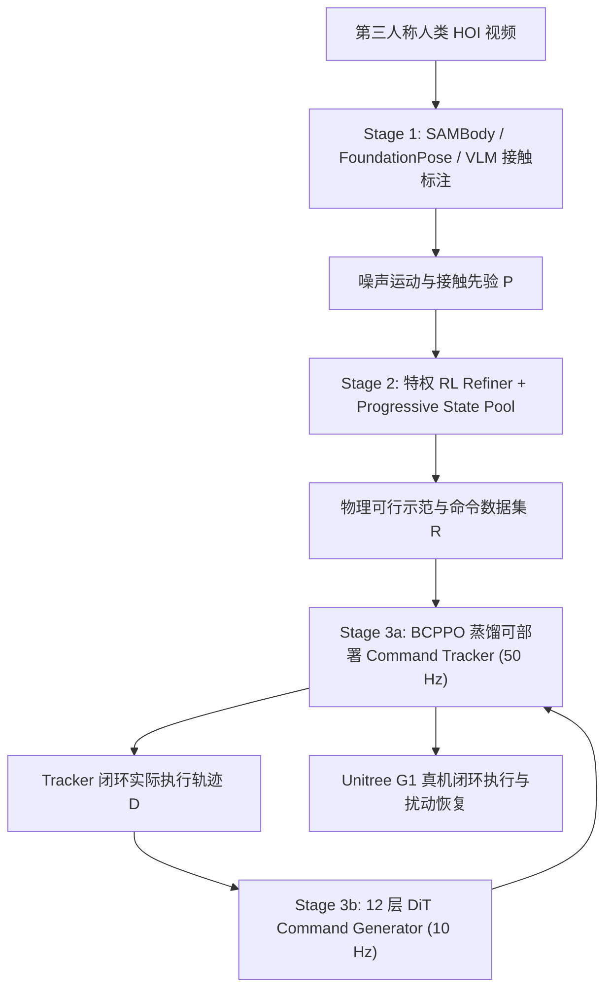
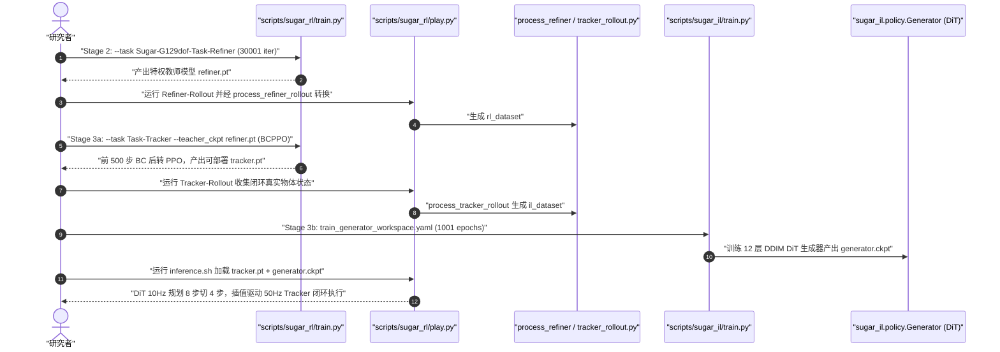

# SUGAR

**SUGAR**（*A Scalable Human-Video-Driven Generalizable Humanoid Loco-Manipulation Learning Framework*，`arXiv:2605.20373v1`）由北京大学 CFCS 与北京航空航天大学提出，解决「人类交互视频丰富但物理不可行，遥操作精确却昂贵难扩展」的核心矛盾：先把无标注人类 HOI 视频抽取为粗略运动与接触先验，再通过特权强化学习将噪声轨迹清洗成物理可行的示范，最终蒸馏出无需在线参考轨迹的「Diffusion 命令生成器 + 底层全身跟踪器」分层闭环策略。

## 一句话定义

SUGAR 用「自动化视频先验抽取 → 特权 RL Refiner 物理清洗（PSPI 状态池）→ BC+RL Command Tracker 与 DiT Command Generator 分层蒸馏」三阶段管线，把充满遮挡与穿模的第三人称人类视频转化为可零样本部署到 Unitree G1 的参考无关自主移动操作策略。

## 英文缩写速查

| 缩写 | 英文全称 | 简要说明 |
|------|----------|----------|
| SUGAR | Scalable human-video-driven Generalizable humanoid loco-manipulation framework | 本文面向视频驱动人形移动操作的三阶段学习框架 |
| HOI | Human-Object Interaction | 人-物接触交互视频与演示数据 |
| PSPI | Progressive State Pool for Initialization | 用已物理验证的中间成功状态动态扩充 RL 初始化池 |
| DiT | Diffusion Transformer | 12 层扩散模型充当高层 Command Generator（10 Hz） |
| BCPPO | Behavior Cloning + Proximal Policy Optimization | `sugar_rl` 中结合教师 BC 蒸馏与 RL 微调的策略优化器 |
| VLM | Vision-Language Model | 辅助从视频帧自动判别直接物理接触标签 \(\hat{l}_t\) |

## 为什么重要

- **承认人类视频不能直接当真值**：第三人称单目/RGB-D 视频重建伴随严重遮挡、手物穿模与重定向比例失配；SUGAR 把视频定位为「包含粗略任务逻辑的先验」并用物理仿真 Refiner 清洗，避免把伪影直接喂给部署策略。
- **以分层闭环取代刚性轨迹回放**：推理时完全不依赖离线参考运动序列或每步手写任务奖励，高层 `10 Hz` DiT 生成运动意图命令、底层 `50 Hz` Tracker 稳健执行，在物体移位或被推挤后能自主纠偏重续。
- **验证人类视频数据规模的 Scaling 规律**：每任务视频从 `20 → 50 → 100` 条时，未见测试集成功率持续单调攀升，且只需一套统一模仿+交互奖励即可跨搬箱、踢箱、推箱、取瓶、扶正水瓶、坐椅子 6 类任务复用。

## 流程总览

## 核心原理

### 1. Stage 1：自动化运动与接触先验提取（§3.2）
管线首先从人类视频无人工标注地提取结构化先验 \(\mathcal{P} = \{\hat{\tau}_i\}\)（每帧含人体/机器人先验位姿 \(\hat{p}_t^R\)、物体 6D 位姿 \(\hat{p}_t^O\) 与接触标签 \(\hat{l}_t\)）：
- 利用 `SAMBody` 结合深度点云 ICP 对齐重建人体运动，用 `SAMObj` 与点云对齐物理尺度后由 `FoundationPose` 跟踪物体 6D 姿态；
- 利用 VLM（Qwen3-VL）按预设部位与物体模板逐帧判别直接物理接触，并在强遮挡快速交互（如踢箱子）时结合物体速度阈值补足标签，最后经时序滤波得初始数据集 \(\mathcal{P}\)。

### 2. Stage 2：特权 RL Refiner 与 Progressive State Pool（§3.3）
直接对噪声先验做标准 RSI 往往在起始帧就出现穿模或悬空失败。Refiner \(\pi_r\) 在特权观测下以统一奖励 \(r = r_{track} + r_{int} + r_{reg}\) 优化：
- **根相对跟踪 + 接触一致性**：人体关节追踪采用根坐标系相对位姿防止全局重建漂移污染动作，并加入物体-部位相对位置/朝向惩罚与接触开关一致性奖励 \(r_{int}\)（强制区分「仅弯腰」与「真正抓起」）；
- **Progressive State Pool (PSPI)**：训练中持续将 \(\pi_r\) 实际跑出的物理合法中间状态注入状态池 \(\mathcal{B}\) 作为后续环境复位起点；
- **交互鲁棒性增强（IRE）**：在物体质量 `[0.5, 2.0]×`、摩擦随机化与机器人/物体外力脉冲（仅在有效接触时施加物体脉冲）下收集精修数据集 \(\mathcal{R}\)，同步记录实际高层命令 \(c_t = [q_t^{cmd}, v_t^{cmd}, \omega_t^{cmd}, l_t]\)。

### 3. Stage 3：Command Tracker 与 DiT Command Generator 闭环学习（§3.4 & §A）
- **底层 Command Tracker（\(\pi_t\)，`50 Hz`）**：使用 `BCPPO` 从 \(\pi_r\) 蒸馏（前 `500` 步纯 BC 模仿，至 `1000` 步预热 Critic，至 `2000` 步过渡到完整强化学习微调），部署端仅接收 5 帧本体历史、相对物体 6D 位姿与命令 \(c_t\)。
- **高层 Command Generator（\(\pi_g\)，`10 Hz`）**：用冻结的 \(\pi_t\) 在仿真中按真实命令流做闭环 rollout，记录**实际被执行出来的物体状态** \(\tilde{o}_t^O\) 构成数据集 \(\mathcal{D}\)，训练 `12` 层 DiT 扩散策略预测未来 `H=8` 步命令块（执行前 `A_a=4` 步并线性插值到 `50 Hz`）。训练于真实执行分布使高层生成器具备主动纠偏与失败重拾能力。

## 实验与评测

基于 `arXiv:2605.20373v1` 报告的 Unitree G1 仿真与真机实验（每任务 `100` 条训练人类视频 / `30` 条测试视频）：

| 实验阶段 / 方法 | Kick Box SR / Err | Push Box SR / Err | Carry Box SR / Err | Sit Chair SR | Pick Bottle SR | Stand Bottle SR |
|----------------|-------------------|-------------------|--------------------|--------------|----------------|-----------------|
| **Sim Test · Resmimic** | `18.5%` / `0.963 m` | `10.6%` / `1.160 m` | `0.0%` / `—` | `20.6%` | `0.0%` | `0.0%` |
| **Sim Test · HDMI** | `17.3%` / `0.938 m` | `54.6%` / `0.377 m` | `0.0%` / `—` | `8.2%` | `0.0%` | `0.0%` |
| **Sim Test · w/o Refiner** | `46.3%` / `0.414 m` | `41.7%` / `0.554 m` | `62.0%` / `0.424 m` | `98.0%` | `94.9%` | `84.3%` |
| **Sim Test · w/o IR (缺交互奖励)** | `72.0%` / `0.298 m` | `47.2%` / `0.421 m` | `57.5%` / `0.436 m` | `98.9%` | `0.0%` | `63.4%` |
| **Sim Test · SUGAR (Ours)** | **`76.0%`** / **`0.265 m`** | **`70.0%`** / **`0.325 m`** | **`69.6%`** / **`0.326 m`** | **`99.6%`** | **`99.2%`** | **`86.3%`** |
| **Real World (10 trials/task)** | **`7/10`** | **`6/10`** | **`7/10`** | **`9/10`** | **`9/10`** | **`8/10`** |

- **数据规模缩放（Table 2）：** 将每任务人类视频从 `20 → 50 → 100` 条时，Test 集成功率持续提升（`Kick Box: 32.7% → 63.1% → 76.0%`，`Push Box: 35.0% → 52.3% → 70.0%`，`Carry Box: 33.5% → 61.0% → 69.6%`），证明方法能直接吸收更多低成本视频。
- **消融验证（Table 1 & §4.4）：** 去掉 `Refiner` 使全任务大幅塌陷；去掉交互奖励 `IR` 会导致接触密集任务 `Pick Bottle` 降为 `0.0%`；以固定起点（SSI）或纯原始轨迹（RSI）替代 `PSPI` 均导致成功率与定位误差退化；去掉 `IRE` 扰动增强则会过拟合理想物理。
- **真机鲁棒性（§4.5）：** 通过 MoCap 获取真机物体位姿，六类任务取得 `60%–90%`（`6/10` 到 `9/10`）成功表现，并在物体被人为踢开/拖离与外部推挤下自主恢复任务执行，同时展现跨外形尺寸物体的零样本迁移能力。

## 与其他工作对比

| 维度 | SUGAR | 参考轨迹回放（Resmimic / HDMI） | HumanX | HumanoidMimicGen |
|------|-------|----------------------------------|--------|------------------|
| **数据来源与清洗** | **人类视频 + 特权 RL Refiner 清洗（PSPI）** | 人类视频/动捕直接重定向回放 | XGen 物理交互合成（锚点驱动） | 少量 VR 遥操作示范 |
| **推理时对参考依赖** | **无参考动作输入（仅需当前状态与可选目标）** | 必须持续输入演示参考序列 | 联合模仿策略条件控制 | VLA / Diffusion 策略输入视觉 |
| **接触一致机制** | VLM 接触标签 + `r_int` 接触一致性奖励 | 主要依赖部位位置跟踪 | 接触锚点与力约束 | 规划保证 IK 接触可行 |
| **代码开源覆盖** | 训练（Refiner/Tracker/Generator）、权重与 6 任务处理数据全开放；视频提取待发 | 部分脚本或无统一闭环 | 项目页代码链接尚不稳定 | 基准与数据管线 |

## 结论

**SUGAR 验证了「先用特权 RL 在仿真里清洗人类视频伪影，再在真实底层执行分布上训练扩散命令生成器」的三段解耦路线，能够不靠遥操作写出可泛化、能抗扰恢复的人形 loco-manipulation 策略。**

- **物理 Refiner 是视频可用化的前提**：Table 1 显示直接模仿视频先验（`w/o Refiner`）在新配置上成功率掉到 `41.7%–46.3%`，必须经过物理交互奖励与 PSPI 状态池重构才能产出高质量示范。
- **在执行分布上训练 Generator 至关重要**：用冻结 Tracker 实际跑出的物体轨迹 \(\tilde{o}_t^O\) 而不是理想精修轨迹去训练 DiT，才让高层学会在跟踪滞后与外扰后主动纠偏。
- **缩放潜力与单卡算力边界清楚**：数据从 20 增至 100 条带来显著跃升，但单任务训练完整三阶段在单卡 RTX 5090 仍需约 `45 GPU hours`（Refiner `20h` + Tracker `20h` + Generator `5h`）。
- **开源实现可直接复现训练推理，但上游未完全闭合**：`tianshuwu/SUGAR`（MIT）完整开源了 `train.sh`、`inference.sh` 与六任务处理数据，但 RGB-D 视频提取与 Sim2Sim 验证管线尚未释出。

## 源码运行时序图

基于官方仓库 `tianshuwu/SUGAR` 中的 `train.sh`、`inference.sh`、`scripts/sugar_rl/train.py`、`scripts/sugar_rl/play.py`、`rsl_rl_bcppo.py` 与 `scripts/sugar_il/train.py` 核对：

## 工程实践

- **依赖栈与安装入口**：要求 Python 3.11、IsaacSim 5.1.0、IsaacLab `v2.3.0`，需依次可编辑安装 `source/sugar_rl` 与 `source/sugar_il`，并按 README 指引通过 `gdown` 拉取六任务预处理数据（`400 MB`）、描述文件（`50 MB`）与演示权重（`250 MB`）。
- **任务名与条件配置区分**：`train.sh` 根据任务自动切换高层目标条件 `use_target`——`CarryBox`、`PickBox`、`PushBox` 设 `use_target=True`（需要目标位置 `g`），而 `PickBottle`、`StandBottle`、`SitChair` 设 `use_target=False`。
- **BCPPO 混合蒸馏节拍**：`source/sugar_rl/sugar_rl/utils/rsl_rl_bcppo.py` 中硬编码了 `bc_only_steps=500`、`critic_warmup_steps=1000` 与 `full_ppo_warmup_steps=2000`，确保学生先对齐教师可行域再释放 Critic 与 RL 探索。
- **高层 DiT 生成器频率与块步**：`train_generator_workspace.yaml` 配置 `n_layer=12`、`n_head=8`、`DDIMScheduler`（训练 `50` 步、采样 `16` 步）、预测窗 `H=8`、每次执行 `4` 步，经线性插值从 `10 Hz` 同步到底层 Tracker 的 `50 Hz`。

## 常见误区与局限

- **误区：把 SUGAR 当成直接输入原始 RGB 图像的端到端视觉策略**：最终部署的高层 `Generator` 与底层 `Tracker` 都是基于状态与物体 6D 位姿的策略（真机实验使用 MoCap 获取物体 6D 状态），视觉大模型（SAMBody/FoundationPose/VLM）只运行在离线 Stage 1 数据生产期。
- **误区：认为开源仓库已经能一键跑通自带人类视频**：截至本地仓库版本，`README.md` TODO 明确标注「RGB-D 人类视频到训练数据的处理管线」与「Sim2Sim 管线」仍未开源，当前开箱可复现的是基于已处理 6 任务数据的 Stage 2 + Stage 3 训练与推理。
- **论文自述局限（Appendix C）**：上游提取的运动先验仍偏粗粒度，难以覆盖双手精细操作；训练对单任务视频规模与 GPU 小时要求较高，且尚未整合直接从机载视觉/语言指令端到端运行的 VLA 感知前端。

## 关联页面

- [Loco-Manipulation](../tasks/loco-manipulation.md)
- [Loco-Manip 接触分类 01：接触数据](../overview/loco-manip-contact-category-01-contact-data.md)
- [161 篇 · 03 视觉感知驱动](../overview/loco-manip-161-category-03-visuomotor.md)
- [Imitation Learning](../methods/imitation-learning.md)
- [Privileged Training（特权信息训练）](../concepts/privileged-training.md)
- [AMP Reward](../methods/amp-reward.md)
- [HumanX](./paper-hrl-stack-05-humanx.md)
- [HumanoidMimicGen](./paper-humanoidmimicgen.md)

## 参考来源

- [loco_manip_161_survey_076_sugar.md](../../sources/papers/loco_manip_161_survey_076_sugar.md) — `arXiv:2605.20373v1` 全文通读与 161 篇映射归档
- [tianshuwu_sugar.md](../../sources/repos/tianshuwu_sugar.md) — 官方代码 `tianshuwu/SUGAR` 源码与脚本核查归档
- [wechat_embodied_ai_lab_humanoid_loco_manip_161_survey.md](../../sources/blogs/wechat_embodied_ai_lab_humanoid_loco_manip_161_survey.md)
- [wechat_embodied_ai_lab_loco_manip_contact_survey.md](../../sources/blogs/wechat_embodied_ai_lab_loco_manip_contact_survey.md)

## 推荐继续阅读

- [SUGAR 论文 arXiv:2605.20373](https://arxiv.org/abs/2605.20373)
- [SUGAR 官方项目页](https://tianshuwu.github.io/sugar-humanoid/)
- [SUGAR GitHub 仓库 (`tianshuwu/SUGAR`)](https://github.com/tianshuwu/SUGAR)
- [机器人论文阅读笔记：SUGAR](https://imchong.github.io/Robot_Learning_Paper_Notebooks/papers/04_Loco-Manipulation_and_WBC/SUGAR__A_Scalable_Human-Video-Driven_Generalizable_Humanoid_Loco-Manipulation_Learning_Framework/SUGAR__A_Scalable_Human-Video-Driven_Generalizable_Humanoid_Loco-Manipulation_Learning_Framework.html)
