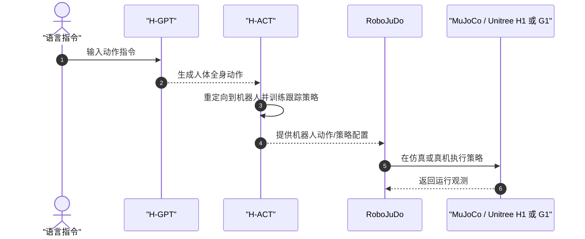

# FRoM-W1

**FRoM-W1: Towards General Humanoid Whole-Body Control with Language Instructions**（arXiv:2601.12799）提出语言条件的人形全身动作控制框架：H-GPT 根据文本指令生成动作，H-ACT 将人体动作重定向到机器人并训练跟踪策略，再通过 RoboJuDo 部署到仿真和真机。官方评估覆盖 Unitree H1 与 G1。

## 一句话定义

FRoM-W1 把「语言指令 → 人体全身动作 → 机器人关节动作 → 强化学习跟踪 → 仿真/真机执行」串成一条可复用的人形控制管线。

## 英文缩写速查

| 缩写 | 英文全称 | 简要说明 |
|------|----------|----------|
| WBC | Whole-Body Control | 协调机器人全身关节实现动作目标 |
| RL | Reinforcement Learning | H-ACT 用于仿真中的运动跟踪策略训练与微调 |
| SMPL-X | Skinned Multi-Person Linear Model eXtended | 人体姿态与手部动作表征，重定向流程使用的表示之一 |
| Sim2Real | Simulation to Real | 将仿真中训练/验证的控制策略部署到实体机器人 |

## 为什么重要

- **语言与物理执行相接**：项目把高层文本到动作生成、人体到机器人重定向、低层物理运动跟踪连起来，便于检查语义生成质量与机器人可执行性之间的断点。
- **不是单个端到端策略**：H-GPT 负责生成人体动作；H-ACT 负责重定向与机器人跟踪策略；RoboJuDo 负责策略运行时的仿真/真机环境和控制接口。
- **提供部署代码入口**：FRoM-W1 官方项目页链接了代码；RoboJuDo 仓库作为独立模块公开，支持多策略和多环境部署。

## 核心流程

| 阶段 | 模块 | 输入 → 输出 |
|------|------|-------------|
| 语言动作生成 | H-GPT | 文本指令 → 人体全身动作 |
| 重定向 | H-ACT / retarget | 人体动作 → 目标机器人关节轨迹 |
| 策略训练 | H-ACT / human2humanoid | 机器人动作参考 + 仿真 → 运动跟踪策略 |
| 执行与迁移 | RoboJuDo | 策略、环境与控制器配置 → 仿真或真机动作执行 |

FRoM-W1 官方快速开始说明，可用 H1、G1 等目标机器人进行重定向；再将轨迹用于跟踪策略，并通过 RoboJuDo 在仿真或实体机器人上执行。具体配置、策略权重和兼容矩阵以两个代码仓库当前 README 为准。

## RoboJuDo 部署框架

RoboJuDo 将 **Controller、Environment、Policy** 解耦并通过配置组成运行 pipeline：控制器提供手柄、键盘或动作序列输入；环境连接 MuJoCo 或真机并传回观测；策略根据环境与控制输入产生动作。仓库提供 Sim2Sim、Sim2Real、多策略切换及插值过渡示例。

- 官方 README 标明 RoboJuDo 属于 FRoM-W1，并作为独立仓库发布。
- README 列出的已接入策略包括 Human2Humanoid、BeyondMimic、ASAP、TWIST、KungfuBot / KungfuBot2，并在 2026-03 增加 ProtoMotions G1 tracker 集成。
- 支持情况依机器人、环境和策略组合而异；README roadmap 将 HugWBC、GMT 代码标作待发布，不应把计划支持等同于已有可运行实现。
- 真机运行需配置对应 SDK 与网络接口。RoboJuDo README 明确提示验证急停并采取严格安全措施。

## 评测与开源状态

- 论文报告在 **Unitree H1、G1** 上评估；H-GPT 在 **HumanML3D-X** 基准上评估人体全身动作生成，H-ACT 的 RL 微调提升运动跟踪精度和任务成功率。具体数值与比较条件以论文为准。
- **源码：已公开。** FRoM-W1 仓库提供初始代码、模型检查点及数据处理/部署入口；RoboJuDo 单独提供部署实现。
- **数据：部分开放。** FRoM-W1 README 说明部分数据受许可限制而不能公开提供；不要将代码开源等同于训练数据全集可下载。
- **许可核查：** RoboJuDo 的 LICENSE 正文标注 CC BY 4.0，但 README 徽章链接与标签不一致；使用者应在复用前核对仓库当前许可文件及作者说明。

## 源码运行时序图

图示概括官方仓库的模块顺序；H-GPT 推理、H-ACT 重定向/训练和 RoboJuDo 部署分别按 [FRoM-W1 快速开始](https://github.com/OpenMOSS/FRoM-W1/blob/main/QUICKSTART.md) 与 [RoboJuDo README](https://github.com/HansZ8/RoboJuDo) 复现。

## 结论

**FRoM-W1 的工程贡献在于把语言生成动作、机器人重定向、物理跟踪和部署串成可复用框架；RoboJuDo 补齐了策略到仿真/真机的运行入口。**

- 阅读或复现时先区分 H-GPT（生成）与 H-ACT（机器人跟踪），避免把整条管线误解成一个端到端 VLA 控制器。
- 真机效果取决于重定向质量、跟踪策略与部署配置；仅有生成质量不能代表机器人动作稳定。
- RoboJuDo 的策略支持矩阵需按具体机器人和环境逐项核查；Roadmap 上的待发布策略不能当成已开放。
- 数据访问受第三方数据许可限制；代码、模型与数据的开放范围并不相同。
- 真机部署前应先在仿真验证动作、接口和急停，遵循 RoboJuDo 仓库的安全提示。

## 与其他页面的关系

- [Loco-Manipulation](../tasks/loco-manipulation.md) — 行走与全身动作控制的任务背景
- [Unitree G1](./unitree-g1.md) — FRoM-W1 的实体机器人评估平台
- [人形运动跟踪与全身控制](../overview/humanoid-motion-intelligence-day3-motion-tracking-wbc.md) — 低层策略跟踪问题
- [ProtoMotions](./protomotions.md) — RoboJuDo 集成的另一套人形跟踪器

## 参考来源

- [FRoM-W1 arXiv 摘录](../../sources/papers/loco_manip_161_survey_096_from-w1.md)
- [FRoM-W1 官方项目页](../../sources/sites/from-w1.md)
- [RoboJuDo 官方仓库摘录](../../sources/repos/robojudo.md)

## 推荐继续阅读

- [FRoM-W1 论文](https://arxiv.org/abs/2601.12799)
- [FRoM-W1 官方项目页](https://openmoss.github.io/FRoM-W1/)
- [FRoM-W1 官方快速开始](https://github.com/OpenMOSS/FRoM-W1/blob/main/QUICKSTART.md)
- [RoboJuDo 官方仓库](https://github.com/HansZ8/RoboJuDo)
