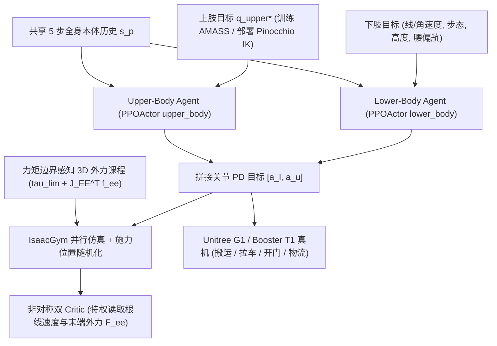
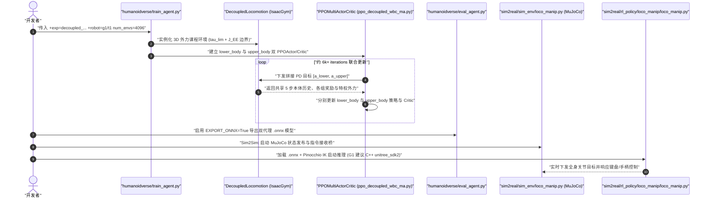

# FALCON

**FALCON**（*Learning Force-Adaptive Humanoid Loco-Manipulation*，L4DC 2026 Oral / `arXiv:2505.06776v2`）由 CMU LeCAR-Lab、Field AI 与 Nissan USA 提出，解决「持续未知 3D 末端外力」下的人形移动操作问题（搬运重物、拉重车、推开阻尼门）：既克服「下肢 RL + 上肢 IK」缺少动力学力补偿的迟滞与漂移，又避免「单一全身 RL」在强弱相关上下肢目标间探索低效的问题。

## 一句话定义

FALCON 采用共享全身本体观测的双代理（下肢抗扰步态 Agent + 上肢跟踪与隐式力补偿 Agent）联合训练架构与尊重关节力矩边界的 3D 外力课程，使人形机器人无需外置力传感器即可适应达 `100 N` 级的持续交互外力并跨 Unitree G1 / Booster T1 迁移。

## 英文缩写速查

| 缩写 | 英文全称 | 简要说明 |
|------|----------|----------|
| FALCON | Force-Adaptive Loco-manipulation Control | 本文双代理力自适应全身控制框架 |
| EE | End-Effector | 施加 3D 交互外力与接触随机化的手腕/末端执行器 |
| IK | Inverse Kinematics | 部署期将末端抓取位姿转为上肢期望关节角 \(q_t^{upper*}\) |
| WBC | Whole-Body Control | 协调下肢平衡与上肢操作的全身控制范式 |
| MoCap | Motion Capture | 自主料箱物流测试中用于全局定位的光学动捕系统 |
| Sim2Sim | Simulation to Simulation | IsaacGym 策略导出 ONNX 至 MuJoCo 通信闭环验证 |

## 为什么重要

- **把「持续外力」当一等公民建模**：在开门、拉车、重物搬运中，外力不是瞬时踢击而是长时强耦合负载；FALCON 证明只需依靠本体历史观测 + 力课程训练，就能隐式学会躯干后仰/前倾与手臂加力补偿。
- **双代理分解兼顾样本效率与全身协同**：相比纯解耦的「下肢 RL + 上肢 IK」多出上肢闭环力学适应，相比「单体全身 RL」大幅降低动作空间探索干扰（~`6k` iter 即见显著效果），上肢追踪误差降至近一半。
- **物理可行的力课程防止学坏**：对于 Unitree G1 手腕等小力矩关节，不加力矩边界直接随机施大力会导致频繁触顶饱和、迫使策略学会放弃上肢追踪；引入雅可比力矩可行域估计后课程能推满至 \(\alpha_g=1.0\)。
- **工程化真机闭环完整**：MIT 开源仓库不仅给出 `HumanoidVerse` 训练脚本，还在 `sim2real/` 内将 MuJoCo 伪装为机器人 SDK 状态机，实现 Unitree G1 与 Booster T1 的一键 Sim2Sim/Sim2Real 切换。

## 流程总览

## 核心原理

### 1. 共享观测的双代理学习框架（`PPOMultiActorCritic`）
两个策略接收完全相同的 5 步全身本体历史 \(s_t^p = [q_{t-4:t}, \dot{q}_{t-4:t}, \omega_{t-4:t}^{root}, g_{t-4:t}, a_{t-5:t-1}]\)，从而彼此感知对方姿态调整引发的质心变化，但各自消费独立指令并由专属奖励与独立非对称 Critic 优化：
- **Lower-Body Agent (\(\pi^l\))**：条件输入根速度、步态相位、机身高度与腰部偏航指令 \(G_t^l\)，输出下肢目标，重点奖励速度/高度追踪、站立稳态（`stance_tap_feet`, `stance_root`）与低晃动惩罚；
- **Upper-Body Agent (\(\pi^u\))**：条件输入上肢目标关节角 \(G_t^u = [q_t^{upper*}]\)（训练从 AMASS 动作库采样，真机由 Pinocchio IK 实时解算），负责精确追角的同时隐式产生抵消外力的前馈位移；
- **非对称训练**：双 Critic 特权读取仿真真值根线速度与施加的 3D 外力 \(F_t^{ee}\)，部署端完全移除外部力估计器或腕部力传感器。

### 2. 力矩可行域感知 3D 外力课程（§3.2）
直接对人手腕等弱力矩关节随机施加过大外力会立刻触发电机饱和，导致策略只学会保下肢而牺牲手部精度。FALCON 每步在线计算左/右末端可承受的安全三维力盒：
1. **瞬时雅可比力界估计**：利用当前重力补偿力矩 \(\tau_g\)、末端质心雅可比 \(J_{EE}\) 与关节力矩上限 \(\tau^{lim}\)，求解满足 \(-\tau^{lim} \le \tau_g + J_{EE}^T f^{ee} \le \tau^{lim}\) 的各坐标轴最大/最小合法外力 \([f_i^{min}, f_i^{max}]\)；
2. **Dirichlet 分轴采样 + 渐进尺度**：按 Dirichlet 分布分配 \(x, y, z\) 三轴权重并采样有效力，乘以随训练收敛递增的课程系数 \(\alpha_g \in (0, 1)\)（行走期将平面力按逆行方向投影），并做低通滤波避免抖动；
3. **施力位置随机化**：将外力作用点沿腕部到远端手指网格连杆之间随机移动，模拟真实抓持点偏移导致的等效雅可比臂长变化。

## 实验与评测

基于 `arXiv:2505.06776v2` 报告的 IsaacGym（252 个 ACCAD 动作目标，Unitree G1）与 Unitree G1 / Booster T1 真机评测：

| 实验场景 / 方法 | `Upper` 追踪误差 `N-Force` ↓ | `Upper` 追踪误差 `L-Force` ↓ | `Root` 追踪误差 `N-Force` ↓ | `Root` 追踪误差 `L-Force` ↓ | 核心发现（Table 1–2 & Table 4） |
|----------------|------------------------------|------------------------------|-----------------------------|-----------------------------|---------------------------------|
| **Sim · Upper-PD-Force-Curr.** | `0.44±0.03` | `1.42±0.04` | `0.33±0.03` | `0.46±0.03` | 仅下肢抗扰，上肢无力适应在大力下崩坏 |
| **Sim · Upper-PID-Force-Curr.** | `0.24±0.03` | `0.60±0.04` | `0.32±0.03` | `0.46±0.04` | 积分项部分弥补稳态力误差但仍受滞后制约 |
| **Sim · Upper-PD-ID-Force-Curr.** | `0.29±0.03` | `0.53±0.04` | `0.40±0.03` | `0.47±0.04` | 显式力估计+准静态逆动力学在运动态与接触点变化时受损 |
| **Sim · Monolithic-WB-RL (with Force)** | `0.43±0.04` | `0.73±0.05` | `0.28±0.03` | `0.44±0.04` | 单体网络探索冲突，上肢误差约为 FALCON 两倍 |
| **Sim · FALCON (w/o Force-Curr.)** | **`0.14±0.03`** | `1.06±0.06` | `0.32±0.03` | `1.24±0.06` | 无力课程时在有外力测试集快速失稳 |
| **Sim · FALCON (with Force-Curr.)** | `0.21±0.03` | **`0.37±0.04`** | **`0.27±0.03`** | `0.45±0.04` | 全力级综合最优，L-Force 上肢精度约 M-WB-RL 2× |
| **Real · 双臂各持 1.2 kg 行走 0.5 m/s** | — | **FALCON `0.39±0.08`** | — | **FALCON `0.42±0.03`** | 对比 `Upper-PD (1.81)` 与 `M-WB-RL (0.81)` 大幅领先 |

- **力矩可行域课程消融（Table 2 & Table 3）：** 若去掉力矩上限约束直接从 `[-100, 100] N` 随机采力，课程尺度因频繁触及电机力矩极限而被迫停滞在 \(\alpha_g = 0.6\)，`L-Force` 下上肢误差恶化至 `0.61±0.10`（加入约束后为 `0.36±0.04`）。
- **真机强力交互与力表实测峰值（§4.5 & Appendix A.4, Fig. 8）：** 同一套奖励与课程无需针对本体改参直接部署至 Unitree G1 与 Booster T1，实现载荷运输（`0–20 N`）、拉载人推车（`0–100 N`，手持拉力计实测峰值 `107.9 N`）与推开弹簧门（`0–40 N`，峰值 `47.3 N`）；静态对抗测试中 G1 最大抗拉力 `57.4 N`、质心更低的 Booster T1 达 `66.3 N`。
- **自主物流系统集成（§4.6 & Appendix A.5）：** 结合 `FoundationPose` 6D 物体位姿、MoCap 全局定位、四状态机与 Pinocchio IK，在 Unitree G1 上完成无人工干预的料箱抓取搬运与放置闭环。

## 与其他工作对比

| 维度 | FALCON | Thor | HMC | WoCoCo |
|------|--------|------|-----|--------|
| **控制结构** | **双代理联合训练（下肢+上肢共享 5 步历史）** | 分体共享观测（FAT2 躯干力适应） | 力矩空间混合 + MoE 专家路由 | 接触相位序列分解 + 单一 RL |
| **力适应机制** | **雅可比力矩边界感知 3D 外力课程 + 隐式适应** | 大力矩后拉/全身倾角适应 | 位置/阻抗/力位多模式切换 | 多端接触建立与转移奖励整形 |
| **真机交互重点** | 持续外力（拉车 `107.9 N` / 开门 `47.3 N` / 搬箱） | 峰值极限大拉力 | 接触模式顺滑切换 | 顺序多端支撑与抓握 |
| **跨平台表现** | **同超参零改写跨 Unitree G1 与 Booster T1** | Unitree G1 | 依赖底层力矩/阻抗接口 | Unitree H1 等平台 |
| **开源成熟度** | **MIT 全套训练 (`HumanoidVerse`) + MuJoCo/真机部署** | 代码待发布 | 未开放可运行实现 | CC BY-NC 教学框架示例 |

## 结论

**FALCON 确立了「共享本体历史的双代理分解 + 力矩可行域边界内 3D 外力课程」这一工程简洁路线：不靠腕部六维力传感器、不把上下肢塞进同一奖励大锅，也能让双足人形稳稳扛住百牛级持续外力。**

- **安全边界内的外力课程才是有效课程**：不考虑手腕等弱关节力矩上限盲目加大外力只会让训练卡在 \(\alpha_g=0.6\)；用逆动力学雅可比划定可解外力盒后，策略才能学会全身协调让步而不是瘫软饱和。
- **双代理分解同时赢过纯 IK 与单体 RL**：上肢学到隐式力前馈补偿（误差 `0.37` vs PID `0.60`），下肢专注抗扰步态保持（免于单体 RL `0.73` 的动作耦合抖动）。
- **开源工程链路已打通 Sim2Sim 与双机真机**：`LeCAR-Lab/FALCON` 通过 MuJoCo 状态桥复用 `unitree_sdk2` / `booster_robotics_sdk` 接口，但实操需关注 Python 3.8 旧训练栈与 C++ SDK 实时性要求。
- **物理与建模边界十分清晰**：课程仅施于双侧末端且只包含平动 3D 力（不含力矩偏心扭转与躯干多点倚靠），同时真机手腕持续大负载仍受电机热过载限制（`>2 kg`/臂难长时保持）。

## 源码运行时序图

基于官方仓库 `LeCAR-Lab/FALCON` 中的 `humanoidverse/train_agent.py`、`humanoidverse/eval_agent.py`、`ppo_decoupled_wbc_ma.py` 与 `sim2real/README.md` 核对：

## 工程实践

- **环境版本双栈拆分**：训练侧基于 `HumanoidVerse` + `IsaacGym Preview4`（推荐 Python 3.8），部署侧 `sim2real/` 独立使用 Python 3.10 与 `pinocchio=3.2.0`（用于部署期把末端目标转为上肢关节参考 \(q_t^{upper*}\)）。
- **导出开关陷阱**：`humanoidverse/eval_agent.py` 中 `EXPORT_ONNX` 与 `EXPORT_POLICY` 默认均为 `False`，导出 `export_multi_agent_decouple_policy_as_onnx` 前需先在脚本内改为 `True`。
- **机载实时通讯选型**：`sim2real/README.md` 实测指出纯 Python 的 `unitree_sdk2_python` 在 Unitree G1 机载 Jetson Orin 上难以稳定满足实时频率要求，部署建议改用带 C++ 后端的 pybinding 封装 `unitree_sdk2`；Booster T1 则使用补充了发布器接口的 `hang0610/booster_robotics_sdk`。
- **真机热保护管理（Appendix A.6）**：虽然仿真 MuJoCo 中每臂挂重超 `3 kg` 仍可行走，但真机 Unitree G1 手腕电机在持续悬停高力矩下极易过热（实测稳定持重极限约 `2 kg`/臂）；长时任务需通过姿态退让或间歇卸载（如拉车脉冲施力）缓解温升。

## 常见误区与局限

- **误区：把 FALCON 当作多触点全身力控框架**：论文 §6 明确局限：3D 外力课程**仅施加于左右末端执行器（wrist/hand）**，未对胸腹、大腿或背部支撑触点建模，不适用于倚靠支撑或抱举重箱贴胸协同受力场景。
- **误区：认为课程已经涵盖末端力矩（Torque / Wrench）干扰**：训练期只采样三维平动外力 \(F^{ee} \in \mathbb{R}^3\) 而忽略外部旋转力矩，因此面对长柄偏心工具操作或强抗扭门把手转动时适应有限。
- **架构与旧栈制约**：`eval_agent.py` 的 IsaacGym 依赖较老，且自主物流演示（§A.5）中的全局定位仍需外接 MoCap 配合 `FoundationPose` 使用，距离完全无标记野外部署仍有距离。

## 关联页面

- [Loco-Manip 接触分类 04：接触后如何稳住](../overview/loco-manip-contact-category-04-post-contact-stability.md)
- [161 篇 · 05 动捕/交互动作规划](../overview/loco-manip-161-category-05-mocap-human-video.md)
- [Whole-Body Control](../concepts/whole-body-control.md)
- [Privileged Training（特权信息训练）](../concepts/privileged-training.md)
- [HMC](./paper-loco-manip-161-039-hmc.md)
- [WoCoCo](./paper-loco-manip-161-116-wococo.md)
- [Thor](./paper-hrl-stack-42-thor.md)
- [HTD 解耦 WBC](./paper-humanoid-touch-dream.md)

## 参考来源

- [loco_manip_161_survey_109_falcon.md](../../sources/papers/loco_manip_161_survey_109_falcon.md) — `arXiv:2505.06776v2` 全文通读与 161 篇映射归档
- [lecar_falcon.md](../../sources/repos/lecar_falcon.md) — 官方代码 `LeCAR-Lab/FALCON` 源码与部署核查归档
- [wechat_embodied_ai_lab_humanoid_loco_manip_161_survey.md](../../sources/blogs/wechat_embodied_ai_lab_humanoid_loco_manip_161_survey.md)
- [wechat_embodied_ai_lab_loco_manip_contact_survey.md](../../sources/blogs/wechat_embodied_ai_lab_loco_manip_contact_survey.md)

## 推荐继续阅读

- [FALCON 论文 arXiv:2505.06776](https://arxiv.org/abs/2505.06776)
- [FALCON 官方项目页](https://lecar-lab.github.io/falcon-humanoid)
- [FALCON GitHub 仓库 (`LeCAR-Lab/FALCON`)](https://github.com/LeCAR-Lab/FALCON)
- [机器人论文阅读笔记：FALCON](https://imchong.github.io/Robot_Learning_Paper_Notebooks/papers/04_Loco-Manipulation_and_WBC/FALCON__Learning_Force-Adaptive_Humanoid_Loco-Manipulation/FALCON__Learning_Force-Adaptive_Humanoid_Loco-Manipulation.html)
