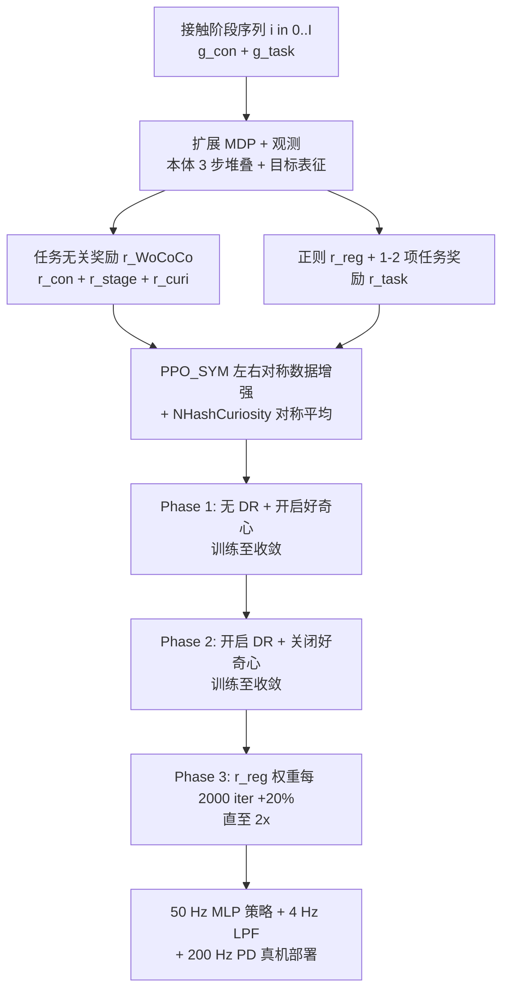
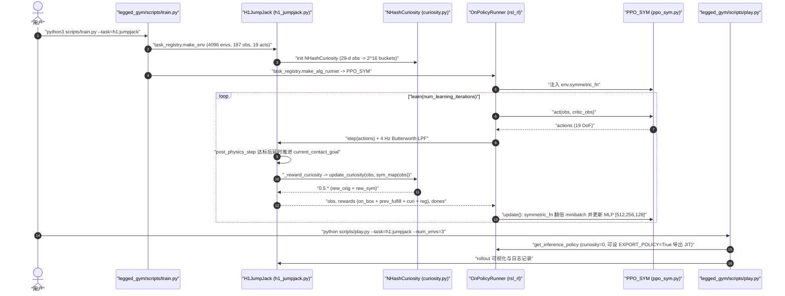

# WoCoCo

**WoCoCo**（*Learning Whole-Body Humanoid Control with Sequential Contacts*，CMU & ETH Zurich，CoRL 2024 Oral）将涉及多部位、长时程物理接触的全身运动与移动操作问题重新建模为按序完成的离散「接触阶段（contact stages）」，在不引入任何运动先验或离线参考轨迹的前提下，用一套跨任务复用的任务无关奖励与三阶段 Sim2Real 课程驱动端到端 MLP 策略完成多种真实人形与多体机器人控制任务。

## 一句话定义

WoCoCo 是一个面向顺序接触全身控制的端到端强化学习框架，通过「接触阶段分解 + 稠密接触/阶段计数/Hash 好奇心通用奖励 + 三阶段 Sim2Real 课程」，仅需每任务 1–2 个直观任务奖励项即可在真实人形机器人上学习跑酷跳跃、搬箱、拍手舞与悬崖攀爬等多阶段接触技能。

## 英文缩写速查

| 缩写 | 英文全称 | 简要说明 |
|------|----------|----------|
| WoCoCo | Whole-Body Control with Sequential Contacts | 本文提出的顺序接触全身 RL 控制框架 |
| MDP | Markov Decision Process | 扩展至多阶段接触目标与任务目标的强化学习决策过程 |
| PPO | Proximal Policy Optimization | 主策略优化算法，源码以 `PPO_SYM` 加入左右对称增强 |
| RND | Random Network Distillation | 随机网络蒸馏好奇心基线；论文指出其易过探索高风险稀有姿态 |
| BIN2DEC | Binary to Decimal | 将随机 Hash 网络输出符号位向量转为离散桶编号的映射函数 |
| RSL-RL / Isaac Gym | Robotic Systems Lab RL / NVIDIA Isaac Gym | 官方仓库 `LeCAR-Lab/wococo` 所用的 GPU 并行仿真与训练栈 |

## 为什么重要

- **打破「每换一个长时程接触任务就要重写有限状态机与多策略切换」的僵局：** 传统多接触依赖简化动力学模型优化（如 Crocoddyl）或分层 FSM，而现有 RL 又常因接触稀疏、长时程复合跌倒风险与正则化阻碍探索而陷入原地不动；WoCoCo 证明单条端到端无先验 RL 策略即可统一解决四类跨度极广的接触任务。
- **揭示长时程接触 RL 的三个核心失效模式并给出通用解：** 论文明确拆解并逐一修复了「0-1 接触奖励太稀疏」「停留在当前安全阶段吃奖励而拒绝向后探索（shortsightedness）」「RND 在安全状态之外过探索危险动作」三大坑。
- **纠正早期综述对技术栈的误读：** 早期二创综述常把 WoCoCo 误归为依赖 AMP 运动先验或扩散策略/流匹配生成轨迹；原文明确声明 **without any motion priors**，策略为标准 `[512, 256, 128]` MLP，在无动作参考条件下自主涌现转身、弯腰搬箱等协调行为。

## 核心原理

### 1. 顺序接触分解与扩展 MDP（Section 2, Eq. 1）

给定启发式预定义或由高层规划器输出的接触阶段序列 \(i \in \{0, 1, \dots, I\}\)，每个阶段由 **接触目标** \(g_i^{\mathrm{con}}\)（规定指定末端何时处于接触/悬空/区间位置，状态布尔记为 \(F_{\mathrm{con}}\)）与 **任务目标** \(g_i^{\mathrm{task}}\)（规定上身姿态、目标地点等附加约束，状态布尔记为 \(F_{\mathrm{task}}\)）共同定义。一旦两者同时满足并经过预设保持时间，阶段推进至下一级。总体奖励拆分为三部分（Eq. 1）：

$$r = \underbrace{r_{\mathrm{WoCoCo}} + r_{\mathrm{reg}}}_{\text{task-agnostic}} + r_{\mathrm{task}}$$

### 2. 任务无关 WoCoCo 奖励设计（Section 3.1, Eqs. 2–6 & Appendix I）

$$r_{\mathrm{WoCoCo}} = w_{\mathrm{con}} r_{\mathrm{con}} + w_{\mathrm{stage}} r_{\mathrm{stage}} + w_{\mathrm{curi}} r_{\mathrm{curi}}$$

- **稠密接触奖励 \(r_{\mathrm{con}}\)（Eq. 3）：** \(r_{\mathrm{con}} = n_{\mathrm{corr}} - n_{\mathrm{con}} n_{\mathrm{wrong}} \cdot \mathbf{1}(n_{\mathrm{stage}} > 0) + 2 n_{\mathrm{con}}^2 F_{\mathrm{con}} F_{\mathrm{task}}\)。逐一累加正确末端接触 \(n_{\mathrm{corr}}\) 并按系数 \(n_{\mathrm{con}}\) 重罚错误接触 \(n_{\mathrm{wrong}}\)，相比 \(0\text{-}1\) 奖励提供细粒度梯度；同时在第一阶段（\(n_{\mathrm{stage}} = 0\)）屏蔽错误接触惩罚，避免复位落地瞬间即被扣分而放弃探索。
- **阶段计数奖励 \(r_{\mathrm{stage}}\)（Eq. 4）：** \(r_{\mathrm{stage}} = n_{\mathrm{stage}} F_{\mathrm{task}}\)。奖励随已完成阶段数 \(n_{\mathrm{stage}}\) 线性增长，迫使策略承担跨阶段切换风险以换取更高累积回报；乘子 \(F_{\mathrm{task}}\) 防止策略在已推进阶段后故意违背当前任务目标来「刷分」。
- **随机网络 Hash 好奇心 \(r_{\mathrm{curi}}\)（Eqs. 5–6, Appendix I）：** 将世界系基座位置/姿态四元数/线角速度与全部末端位置及接触状态构成任务无关好奇心观测 \(o_{\mathrm{curi}}\)（源码 `H1JumpJack` 为 29 维），先按上限下限归一化至 \([0, \pi]\) 并取 \(\cos/\sin\) 编码，再输入随机初始化并冻结参数的单隐层网络 \(f_{\mathrm{curi}}\)（隐层 32 单元，输出 16 维二进制符号映射到 \(2^{16}\) 个桶）：

$$\mathrm{bucket}(o_{\mathrm{curi}}) = \mathrm{BIN2DEC}\big[f_{\mathrm{curi}}(o_{\mathrm{curi}}) > 0\big], \qquad r_{\mathrm{curi}} = \frac{1}{\sqrt{\#\mathrm{visits}(\mathrm{bucket}(o_{\mathrm{curi}}))}}$$

  与对称增广样本各自算得好奇心后取均值（Appendix D）。相比可训练预测器的 RND，计数衰减约束了随机网络对特定稀有危险姿态的过拟合探索。

### 3. 三阶段 Sim2Real 课程与对称增强（Section 3.2, Appendices D, F, J, L）

- **Phase 1（探索阶段）：** 关闭域随机化，仅开启 \(r_{\mathrm{curi}}\) 与基本奖励直至阶段进度收敛，解决「重度随机化扼杀长时程接触探索」的矛盾。
- **Phase 2（鲁棒化阶段）：** 关闭 \(r_{\mathrm{curi}}\)，引入跨 4 项人形任务共用的 9 项域随机化（摩擦 \(U(0.2, 1.1)\)、质心偏移 \(U(-0.1, 0.1)\,\mathrm{m}\)、连杆质量 \(U(0.7, 1.3)\times\)、Kp/Kd \(U(0.75, 1.25)\times\)、力矩 RFI \(0.1\times\tau_{\lim}\)、控制延迟 \(U(0, 20)\,\mathrm{ms}\)、每 5 s 随机速度推扰 \(0.25\,\mathrm{m/s}\) 及碎石地形）训练至收敛。
- **Phase 3（动作平滑阶段）：** 每 2000 次迭代将正则化奖励 \(r_{\mathrm{reg}}\) 权重提高 20% 直至翻倍（Appendix F 共 11 项常规正则，非跳跃任务附加 `Feet air time` 与 `No fly`），消除真机高频抖动。
- **对称增强与时序观测：** 策略与 Critic 均为 `[512, 256, 128]` MLP，本体输入堆叠最近 3 个控制步关节位置、速度与历史动作；PPO 按 Unitree H1 左右对称映射将每个 minibatch 扩增 2 倍（Appendix D / `PPO_SYM`）。

## 实验与对比评测

论文在 **Unitree H1（19-DoF）** 上完成 4 项高难度顺序接触任务的仿真与真机实验，并在 22-DoF 仿真恐龙机器人上验证跨形态通用性；全任务共享同一套 \(r_{\mathrm{WoCoCo}}\) 与 \(r_{\mathrm{reg}}\)，仅按任务调整 \(w_{\mathrm{con}}, w_{\mathrm{stage}}, w_{\mathrm{curi}}\)（Supplementary Table 1）与 1–2 个任务奖励项（Appendix G）：

| 任务 | 核心接触阶段定义 | 任务专属奖励项数 | 通用权重 `(w_con, w_stage, w_curi)` | 关键实测现象（论文 Sections 4–5） |
|------|------------------|------------------|-------------------------------------|----------------------------------|
| Versatile Parkour Jumping | 连续踏石序列（左脚/右脚/双脚切换）+ 上身 `hug`/`relax` 姿态 | 1 项（肘部相对机体系位姿误差） | `(120, 160, 20000)` | 仿真适应未见碎石；真机完成 45 cm 单步跳与连续双脚跳（前瞻未来 2 阶段目标） |
| Anywhere-to-Anywhere Box Loco-Manipulation | 2 阶段手部接触（触碰箱体两侧 -> 保持触碰并运至终点） | 2 项（手-箱距离、箱-终点距离） | `(40, 160, 40000)` | 零先验下涌现 0.5 s 高效转身、行走-抓取无缝过渡、踩中自身绑带后自恢复 |
| Dynamic Clap-and-Tap Dancing | `Left`/`Middle`/`Right` 组合序列（足端世界系落框 + 拍手自碰） | 2 项（手臂展开、足端到框中心距离） | `(10, 5, 5000)` | 真机精准踏点与拍手同步（开源代码 `h1:jumpjack` 示例即为此任务） |
| Bidirectional Cliffside Climbing | 四肢依次触达地面/墙面 2D 目标方框（`F_task=1` 常亮） | 2 项（面向墙面偏航、四末端到框心距离） | `(20, 40, 10000)` | 仿真抗推扰与碎石；真机以人工手持木板模拟墙体，适应手部变化接触力 |
| Dinosaur Ball Loco-Manipulation（仿真） | 22-DoF 恐龙用头、尾、四足共 6 个末端轮流踢/推球至目标 | 2 项（去掉朝向角限制的 Loco-Manip 奖励） | — | 可按目标序列控制球体沿 `"WoCoCo"` 轨迹移动，证明跨形态可迁移性 |

### 消融实验与训练稳定性（Section 5, Appendix B, C, K）

作者以最难的 Parkour Jumping（4 种基线，Figs. 8–9）和 Cliffside Climbing（Sim2Real 课程消融，Fig. 11）验证各组件不可或缺：

- **奖励组件消融：**
  - 用简单 \(0\text{-}1\) 接触奖励替代 \(r_{\mathrm{con}}\)：策略无法跳上石块，仅原地保持上身姿势；
  - 去掉 \(r_{\mathrm{stage}}\)：策略故意不满足接触条件，停留在当前阶段持续刷其他奖励；
  - 去掉 \(r_{\mathrm{curi}}\)：探索不足导致无法跨石跳跃；
  - 用 **RND 好奇心**替代 Hash 计数好奇心：出现向后危险仰倒的刷分行为（印证 Burda et al. 中 RND 对稀疏险态过拟合的问题）。
- **多种子收敛稳定性（Appendix C, Fig. 10）：** Parkour Jumping 在 5 个不同随机种子下均在 20,000 次迭代内稳定收敛至任务进度 \(> 0.75\)，未出现文献 [24] 常见的好奇心探索高方差崩溃。
- **三阶段课程必要性（Appendix K）：** 将 DR 提前至 Phase 1（合并 Phase 1 与 Phase 2）会使 Parkour 平均进度上限卡在 \(< 0.6\)；取消 Phase 3 正则加权则在真机 Cliffside 上出现高频抖动，导致脚部屡次踩出悬崖边缘白线（Fig. 11）。

## 结论

**WoCoCo 证明「用足够好用的顺序接触奖励分解 + 三阶段 Sim2Real 课程，完全可以不靠参考轨迹或扩散模型，只用普通 MLP 和 PPO 训出多技能真机全身控制器」。**

- 真正支撑通用性的是 **4 个最小任务无关机制的耦合**：每阶段双布尔满足条件 \((F_{\mathrm{con}}, F_{\mathrm{task}})\)、防初期死锁的稠密接触奖励 \(r_{\mathrm{con}}\)、防躺平的阶段计数 \(r_{\mathrm{stage}}\)，以及比 RND 更可控的对称 Hash 计数好奇心 \(r_{\mathrm{curi}}\)。
- 其工程代价在于将复杂性部分转移给了 **阶段序列预定义与动捕/接触反馈接口**：当前框架只负责执行既定接触序列，并不自己从视觉场景中规划下一落脚点或抓握面。
- 面向落地选型：若希望无动作先验自由涌现新接触协调、且有可控接触反馈与简单几何阶段定义，WoCoCo 的设计范式极具复用价值；若追求强抗外力推拉与纯本体感知下的高负载作业，应结合 [FALCON](./paper-loco-manip-161-109-falcon.md) 的力课程与解耦架构；若追求多模态参考复用，可对照 [OmniContact](./paper-omnicontact-humanoid-loco-manipulation.md) 的接触流抽象。

## 源码运行时序图

以下时序图严格对齐开源仓库 `LeCAR-Lab/wococo` 中的实际文件与入口（以公开示例任务 `h1:jumpjack` 为例）：

## 工程实践

### 开源核查结果

- **状态：** **核心框架与 1 个完整任务已开源**（仓库归档：[lecar_wococo.md](../../sources/repos/lecar_wococo.md)）。
- **代码仓库：** <https://github.com/LeCAR-Lab/wococo>（**CC BY-NC 4.0** 非商业许可 + 继承 `legged_gym`/`rsl_rl`/Isaac Gym 许可证）。
- **实际包含资产：**
  - 完整实现：`NHashCuriosity`（`curiosity.py`）、`PPO_SYM` 左右对称数据增强（`ppo_sym.py`）、4 Hz Butterworth 低通动作滤波器 `ActionFilterButter`（`lpf.py`），以及 `h1:jumpjack` 拍手舞完整训练与回放代码。
  - **公开边界：** 官方 README 明言对公开仓库做了「去工程化（de-engineered）」精简，未包含 Parkour、Box Loco-Manipulation、Cliffside Climbing 与 22-DoF Dinosaur 的任务环境类、真机 C++ 部署代码或论文修正后的 H1 URDF 参数说明（注：`scripts/train.py` 第 12 行遗留作者本地硬编码路径 `/home/wenli-run/unitree_rl_gym`，不影响正常导入）。
- **真机工程细节（来自论文 Appendix L）：**
  - 控制频率：策略 **50 Hz**、低层 PD **200 Hz**（`decimation = 4`），动作输出经 **4 Hz 截止频率 Butterworth 低通滤波**抑制真机抖动（已在公开 `h1_jumpjack_config.py` 中启用 `action_filt = True, action_cutfreq = 4.0`）。
  - Real-to-Sim 校准：作者实测发现 Unitree 官方 H1 URDF 存在明显的**躯干质量偏差与足部几何错误**，自行称重躯干并重新测量足部几何后才实现高动态任务迁移。

## 常见误区与局限

- **误区：以为 WoCoCo 用了运动先验、AMP 或扩散/流匹配模型：** 早期 161 篇综述归档曾将通用扩散模板套用到本页；原文明确强调零运动先验，核心是 `[512, 256, 128]` MLP + `PPO_SYM` + 阶段奖励。
- **误区：以为直接 clone 仓库就能跑全部 4 个人形真机任务：** 公开代码仅含 `h1:jumpjack` 与核心算法库，且采用非商业的 CC BY-NC 4.0 许可，其余任务的观测目标、碰撞框、URDF 修正及三阶段手动/脚本切换课程需开发者参照 Appendix G–L 自行实现。
- **论文自述四大技术局限（Section 6）：**
  1. **缺乏可行性/失败预判：** 不同于 Crocoddyl 等模型优化求解器能显式返回「无解」，RL 策略缺少安全边界或失败预测器。
  2. **依赖定长先验与显式阶段切换：** 若部署时接触序列长度未知，\(r_{\mathrm{stage}}\) 可能需要启发式裁剪以防刷分；当前阶段切换仍依赖动捕或传感器显式检测接触完成，尚未实现完全纯本体端到端隐式切换。
  3. **依赖外部动捕原型与人工接触序列：** 目前不含相机或 LiDAR 机载感知，目标框与箱体位姿来自外部 MoCap，且接触序列由人工启发式预设。

### 与相邻顺序接触 / 抗扰控工作对比

| 维度 | WoCoCo (CoRL 2024 Oral) | [OmniContact](./paper-omnicontact-humanoid-loco-manipulation.md) | [FALCON](./paper-loco-manip-161-109-falcon.md) (arXiv:2505.06776) |
|------|-------------------------|----------------------------------------------------------------|---------------------------------------------------------------|
| 核心问题 | 无先验顺序接触全身 RL 控制 | 可组合 meta-skill 的接触流接口 | 上下肢解耦与 3D 力课程全身抗扰控制 |
| 接触/任务抽象 | 阶段化 \((g_i^{\mathrm{con}}, g_i^{\mathrm{task}})\) + 3 项通用奖励 | Contact Flow（稀疏体目标 + 四端接触时序） | 解耦上肢参考追踪 + 下肢 3D 力课程对抗训练 |
| 运动先验 | **无**（纯奖励引导 + 对称增强） | 动捕/技能生成轨迹 | 遥操作/动作跟踪上肢参考 + PPO 下肢策略 |
| 验证规模 | Unitree H1 四大真机任务 + 22-DoF 恐龙仿真 | Unitree G1 仿真定量基准与自采数据集 | G1/T1 定量力边界实验（推拉 0–20 kg 负载与外力） |
| 开源与许可 | CC BY-NC 4.0（开源核心模块 + `h1:jumpjack`） | 开源 sim2sim 与数据集 | MIT 开源训练至真机全链路 |

## 关联页面

- [Loco-Manip 接触分类 04：接触后如何稳住](../overview/loco-manip-contact-category-04-post-contact-stability.md)
- [161 篇 · 05 动捕、人类视频与交互动作规划](../overview/loco-manip-161-category-05-mocap-human-video.md)
- [OmniContact](./paper-omnicontact-humanoid-loco-manipulation.md)
- [FALCON](./paper-loco-manip-161-109-falcon.md)
- [Whole-Body Control](../concepts/whole-body-control.md)
- [Sim2Real 迁移与域随机化](../concepts/sim2real.md)

## 参考来源

- [wococo_arxiv_2406_06005_reading.md](../../sources/papers/wococo_arxiv_2406_06005_reading.md)（`arXiv:2406.06005v2` 原文通读与官方仓库源码核对归档）
- [loco_manip_161_survey_116_wococo.md](../../sources/papers/loco_manip_161_survey_116_wococo.md)
- [lecar_wococo.md](../../sources/repos/lecar_wococo.md)
- [wechat_embodied_ai_lab_humanoid_loco_manip_161_survey.md](../../sources/blogs/wechat_embodied_ai_lab_humanoid_loco_manip_161_survey.md)
- [wechat_embodied_ai_lab_loco_manip_contact_survey.md](../../sources/blogs/wechat_embodied_ai_lab_loco_manip_contact_survey.md)
- Zhang et al., *WoCoCo: Learning Whole-Body Humanoid Control with Sequential Contacts*, arXiv:2406.06005v2 / CoRL 2024 Oral. <https://arxiv.org/abs/2406.06005>
- 项目页：<https://lecar-lab.github.io/wococo/>
- 官方代码：<https://github.com/LeCAR-Lab/wococo>

## 推荐继续阅读

- [WoCoCo 项目页](https://lecar-lab.github.io/wococo/)
- [WoCoCo GitHub 仓库](https://github.com/LeCAR-Lab/wococo)
- [OmniContact（接触流接口对比）](./paper-omnicontact-humanoid-loco-manipulation.md)
- [FALCON（解耦全身控制与 3D 力课程）](./paper-loco-manip-161-109-falcon.md)
